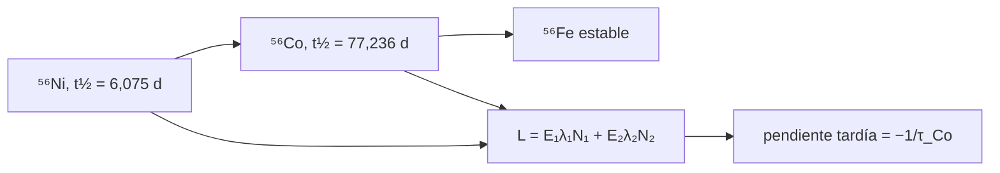

# B27-C14 — Supernovas termonucleares

<!-- nav:top -->
[🏠 Programa](../../../../README.md) · [📚 Bloque B27](../../../tronco-comun/B27-objetos-compactos-y-altas-energias.md) · [← Anterior: B27-C13 — Binarias compactas](../B27-C13-binarias-compactas/CLASE.md) · [Siguiente: B27-C15 — Supernovas de colapso →](../B27-C15-supernovas-de-colapso/CLASE.md)
<!-- /nav -->

## 1. Ubicación, nivel y alcance

Clase 14 del bloque B27. Nivel N3. Una enana blanca de [C02](../B27-C02-enanas-blancas-y-limite-de-chandrasekhar/CLASE.md) que se acerca al límite de Chandrasekhar puede explotar por completo; su brillo posterior lo alimenta la desintegración de níquel-56. Aquí resuelves la cadena radiactiva **⁵⁶Ni → ⁵⁶Co → ⁵⁶Fe** con las ecuaciones de Bateman y obtienes la luminosidad y su caída tardía. Usas exponenciales ([B09-C11](../../B09/B09-C11-integrales-definidas/CLASE.md)) y ecuaciones diferenciales. Se asume deposición completa de la energía.

## 2. Por qué esta clase existe

La luminosidad tardía de estas supernovas sigue la semivida del cobalto-56, y por eso se usan para medir distancias. La decisión central: **¿cuántos núcleos de cada especie quedan en cada instante y qué luminosidad producen?**

## 3. Lo que podrás hacer al terminar

1. Escribir y resolver la cadena de Bateman.
2. Verificarla con RK4.
3. Calcular la luminosidad a partir de las energías medias.
4. Localizar el máximo de ⁵⁶Co.
5. Medir la pendiente tardía y relacionarla con la vida media del cobalto.
6. Reconocer cuándo falla la deposición completa.

La evidencia es la **curva de luz radiactiva de una SN Ia** del ejercicio 12 (sección 20).

## 4. Con qué llegas y cómo comprobarlo

1. ¿Qué es una semivida?
2. ¿Qué es la vida media?
3. ¿Qué es la ley exponencial de desintegración?
4. ¿Qué es una cadena radiactiva?
5. ¿Qué es el límite de Chandrasekhar?

<details>
<summary>Ver respuestas</summary>

1. El tiempo para que decaiga la mitad. 2. `τ = t_{1/2}/ln 2`. 3. `N = N₀e^{−t/τ}`. 4. Una secuencia de desintegraciones. 5. La masa máxima de una enana blanca, ≈1,4 `M☉`.
</details>

Con cuatro o cinco aciertos, sigue; si no, repasa B09-C11 y B27-C02.

## 5. Un caso ilustrativo: 0,6 masas solares de níquel

No se cita aquí ninguna medición de una supernova. Con las semividas `6,075 d` (⁵⁶Ni) y `77,236 d` (⁵⁶Co) (S3), vidas medias `8,764 d` y `111,428 d`. Con `0,6 M☉` de ⁵⁶Ni (ilustrativo) y energías medias de `1,7` y `3,6 MeV` por desintegración (ilustrativas), la luminosidad inicial es `4,615 × 10³⁶ W` y a 100 días `3,401 × 10³⁵ W`. Es el **ejemplo conductor**.

## 6. Vocabulario

La **cadena de Bateman** da las poblaciones sucesivas. La **semivida** es el tiempo para decaer a la mitad. La **vida media** `τ = t_{1/2}/ln 2`. La **constante de desintegración** `λ = 1/τ`. La **deposición completa** supone que toda la energía se convierte en luz. La **cola radiactiva** es la caída tardía al ritmo del cobalto.

## 7. Modelo mental: dos relojes en serie

El níquel se agota rápido y alimenta al cobalto, que se agota despacio. La luz al principio la domina el níquel y después el cobalto, que fija la pendiente final.



*Descripción textual:* el níquel decae al cobalto, que decae al hierro; la luminosidad suma ambas desintegraciones y tarde sigue la vida media del cobalto.

Analogía: un reloj de arena que llena otro. Límite: no se modela la transparencia de los eyectados.

## 8. La explicación, paso a paso

### 8.1 La cadena de Bateman

`N₁ = N₀e^{−λ₁t}`; `N₂ = N₀ λ₁/(λ₂ − λ₁) (e^{−λ₁t} − e^{−λ₂t})`.

### 8.2 Verificación con RK4

El laboratorio integra con RK4 el sistema `N₁′ = −λ₁N₁`, `N₂′ = λ₁N₁ − λ₂N₂` y obtiene lo mismo que Bateman a `10⁻⁸` en 10, 20, 50, 100, 200 y 300 días.

### 8.3 Las poblaciones

| `t` (d) | `N_Ni/N₀` | `N_Co/N₀` | `L` (W) |
|---|---|---|---|
| 0 | 1,00000 | 0,00000 | `4,615 × 10³⁶` |
| 10 | 0,31950 | 0,64543 | `1,971 × 10³⁶` |
| 20 | 0,10208 | 0,79624 | `1,083 × 10³⁶` |
| 50 | 0,00333 | 0,68933 | `5,452 × 10³⁵` |
| 100 | 0,00001 | 0,44240 | `3,401 × 10³⁵` |
| 200 | 0,00000 | 0,18033 | `1,386 × 10³⁵` |
| 300 | 0,00000 | 0,07351 | `5,650 × 10³⁴` |

El máximo de ⁵⁶Co se alcanza a los `24,19 d` con `N_Co/N₀ = 0,80487`.

### 8.4 La pendiente tardía

A `300 d`, `d ln L/dt = −0,008 974 d⁻¹`, igual a `−1/τ_Co` a `10⁻⁴`. Equivale a una caída de una magnitud cada `102,6 d`.

### 8.5 Quién aporta cuándo

A `20 d` el níquel aporta el `43,5 %` de la luminosidad; después domina el cobalto.

## 9. Magnitudes, símbolos y unidades

| Símbolo | Qué es | Unidad | Valor / nota |
|---|---|---|---|
| `t_{1/2}` | semivida | d | `6,075` y `77,236` (S3) |
| `τ` | vida media | d | `8,764` y `111,428` |
| `λ` | constante de desintegración | s⁻¹ | `ln 2/t_{1/2}` |
| `N₀` | núcleos iniciales | — | `1,283 × 10⁵⁵` |
| `E₁`, `E₂` | energía media por desintegración | MeV | `1,7`; `3,6` (ilustrativas) |
| `L` | luminosidad | W | ver tabla |

## 10. Convenciones y referencias

Masa atómica 56 u (S1); `N₀ = 0,6 M☉/(56 u)` (ilustrativo); deposición completa; las energías y la masa de níquel son **ilustrativas**.

## 11. De dónde sale lo que afirmamos

| ID | Fuente | Localizador | Respalda | Estado |
|---|---|---|---|---|
| S1 | NIST, *Fundamental Physical Constants — Complete Listing* (CODATA 2022) | https://physics.nist.gov/cuu/Constants/Table/allascii.txt | constante de masa atómica; MeV en julios; `G` | Consultada el 2026-11-09 |
| S2 | UAI, Resolución B3 de 2015 | https://arxiv.org/abs/1510.07674 | `GM_☉` nominal | Consultada el 2026-11-09 |
| S3 | Wikipedia, *Isotopes of nickel* e *Isotopes of cobalt* | https://en.wikipedia.org/wiki/Isotopes_of_nickel ; https://en.wikipedia.org/wiki/Isotopes_of_cobalt | semividas `6,075(10) d` y `77,236(26) d` | Consultada el 2026-11-09; fuente secundaria, no se consultó la base de datos nuclear original |

Límites: las semividas provienen de una fuente secundaria; las energías por desintegración y la masa de níquel son ilustrativas; no se cita ninguna supernova real (Maoz, arXiv:1312.0628, no se consultó para esta clase).

## 12. Cómo ver la curva

| `t` (d) | `L` (erg/s) |
|---|---|
| 0 | `4,615 × 10⁴³` |
| 20 | `1,083 × 10⁴³` |
| 100 | `3,401 × 10⁴²` |
| 300 | `5,650 × 10⁴¹` |

Descripción larga: la luminosidad cae rápido al principio (níquel) y luego exponencialmente despacio (cobalto).

## 13. Ejemplo trabajado: ¿cuántos núcleos de cobalto a 100 días?

**Paso 1 · Datos.** `λ₁ = 0,1141 d⁻¹`, `λ₂ = 0,008 974 d⁻¹`.

**Paso 2 · Fórmula.** `N₂/N₀ = λ₁/(λ₂ − λ₁)(e^{−λ₁t} − e^{−λ₂t})`.

**Paso 3 · Resultado.** `0,44240`.

**Paso 4 · Sentido.** Casi la mitad del níquel inicial sigue como cobalto.

## 14. Distintas formas de describir la curva

**Por poblaciones:** Bateman. **Por luminosidad:** suma de dos términos. **Por magnitud:** `−2,5 log L`. **Por pendiente tardía:** `1/τ_Co`.

## 15. Práctica guiada

**Ejercicio 1 · con los pasos indicados.** Vida media del níquel. *Pasos:* `6,075/ln 2`.

<details><summary>Solución comentada</summary>

`8,764 d`.
</details>

**Ejercicio 2 · con una pista.** `λ₂` en d⁻¹. *Pista:* `1/111,428`.

<details><summary>Solución comentada</summary>

`0,008 974 d⁻¹`.
</details>

**Ejercicio 3 · casi autónomo.** `N_Ni/N₀` a 10 días.

<details><summary>Solución comentada</summary>

`e^{−10/8,764} = 0,3195`.
</details>

## 16. Práctica autónoma, transferencia e integrador

**Ejercicio 4.** Instante del máximo de ⁵⁶Co.

<details><summary>Solución comentada</summary>

`ln(λ₁/λ₂)/(λ₁ − λ₂) = 24,19 d`.
</details>

**Ejercicio 5.** Cociente `L(100 d)/L(200 d)`.

<details><summary>Solución comentada</summary>

`3,401/1,386 = 2,45`.
</details>

**Ejercicio 6.** Días para que la luminosidad tardía caiga un factor 10.

<details><summary>Solución comentada</summary>

`ln 10/0,008 974 = 256,6 d`.
</details>

**Ejercicio 7.** Magnitudes perdidas entre 100 y 300 días.

<details><summary>Solución comentada</summary>

`2,5 log(3,401 × 10³⁵/5,650 × 10³⁴) = 1,95 mag`.
</details>

**Ejercicio 8.** Aporte del níquel a 20 días.

<details><summary>Solución comentada</summary>

`43,5 %`.
</details>

**Ejercicio 9 · transferencia.** Un compañero dice que la luz de una supernova real sigue siempre la curva calculada. Responde con 8.4 y la sección 10.

<details><summary>Solución comentada</summary>

El modelo supone deposición completa; en la fase tardía real parte de la radiación escapa y la curva cae más rápido.
</details>

**Ejercicio 10 · transferencia.** ¿Por qué la pendiente tardía mide la vida media del cobalto?

<details><summary>Solución comentada</summary>

Porque el níquel ya se agotó y solo queda el decaimiento exponencial del cobalto.
</details>

**Ejercicio 11 · transferencia.** ¿Qué valida RK4 frente a Bateman?

<details><summary>Solución comentada</summary>

La solución analítica y el integrador; no la física de la supernova.
</details>

**Ejercicio 12 · integrador.** Elabora tu *curva de luz radiactiva de una SN Ia*: constantes, poblaciones y luminosidad en siete instantes, máximo de cobalto y pendiente tardía.

<details><summary>Solución modelo</summary>

Tabla de 8.3 y ejercicios 4–6.
</details>

## 17. Laboratorio: cadena radiactiva

El script [radiactiva.py](radiactiva.py) evalúa Bateman, lo compara con RK4 (**comprueba** `10⁻⁸`) y mide la pendiente tardía (**comprueba** `10⁻⁴`).

**Datos:** semividas de S3; constantes de NIST/UAI; masa de níquel y energías **ilustrativas**. **Predice antes de ejecutar:** ¿qué pendiente da la cola? (`−1/τ_Co`.) **Ejecución del 2026-11-09 (Python 3.12.9):**

```text
Python 3.12.9 (biblioteca estandar)
tau(Ni) = 8.764 d ; tau(Co) = 111.428 d ; N0 = 1.2830e+55 nucleos (0.6 Msol de 56Ni)
 t [d]    N_Ni/N0    N_Co/N0        L [W]   L [erg/s]
     0    1.00000    0.00000   4.6147e+36   4.615e+43
    10    0.31950    0.64543   1.9705e+36   1.971e+43
    20    0.10208    0.79624   1.0831e+36   1.083e+43
    50    0.00333    0.68933   5.4522e+35   5.452e+42
   100    0.00001    0.44240   3.4010e+35   3.401e+42
   200    0.00000    0.18033   1.3861e+35   1.386e+42
   300    0.00000    0.07351   5.6499e+34   5.650e+41
maximo de 56Co en t = 24.19 d con N_Co/N0 = 0.80487
pendiente tardia d ln L/dt = -0.008974 /d ; -1/tau_Co = -0.008974 /d ; caida de 1 magnitud cada 102.6 d
a 20 d: aporte del Ni = 43.5 % de L
Pruebas superadas.
```

```bash
python programa/clases/B27/B27-C14-supernovas-termonucleares/radiactiva.py
```

**Límites:** deposición completa, sin opacidad, sin otras cadenas.

## 18. Errores frecuentes y cómo corregirlos

**Confundir semivida y vida media.** Se corrige con el ejercicio 1.

**Olvidar el término de aporte del níquel.** Se corrige con 8.5.

**Creer que la cola es siempre exponencial.** Se corrige con el ejercicio 9.

**Mezclar d y s.** Se corrige con la sección 9.

**Tomar la masa de níquel por medida.** Se corrige con la sección 10.

## 19. Cómo sabrás que vas bien

Tras 8.1: ¿cuál es la forma de `N₂`? Si dudas, ejercicio 3. Tras 8.4: ¿qué fija la cola? Ejercicio 10. Tras el laboratorio: ¿qué verifica RK4? (la solución analítica).

## 20. Qué entregas y cómo se evalúa

El producto es tu **curva de luz radiactiva de una SN Ia** (ejercicio 12).

| Criterio | Inicial | En desarrollo | Logrado | Destacado |
|---|---|---|---|---|
| Conceptos | Los confunde | Parciales | Cadena y vidas medias | Explica la cola |
| Cálculo | Sin unidades | Con errores | Poblaciones y `L` | Interpreta magnitudes |
| Numérico | Sin comprobar | Un caso | RK4 y pendiente | Interpreta tolerancias |
| Fuentes | Sin fuente | Sin fecha | S1–S3 con fecha | Declara S3 como secundaria |
| Límites | No los nombra | Uno | Tres | Discute la transparencia |

**Condiciones críticas (no se compensan con promedio):** rotular masa y energías como ilustrativas; no citar una supernova real; citar solo lo consultado.

## 21. Ética, seguridad y límites

Clase educativa: no sirve para medir distancias reales. Accesibilidad: tablas equivalentes a las gráficas, fórmulas en texto, ejercicios sin conexión.

## 22. Para cerrar y seguir

La cadena ⁵⁶Ni → ⁵⁶Co → ⁵⁶Fe da una luminosidad que cae primero al ritmo del níquel y luego al del cobalto. Queda una pregunta: ¿qué pasa cuando el que explota es el núcleo de una estrella masiva?

**Glosario español–inglés.** supernova termonuclear · *thermonuclear supernova*; cadena de Bateman · *Bateman chain*; semivida · *half-life*; vida media · *mean lifetime*; deposición · *deposition*; cola radiactiva · *radioactive tail*.

**Continuidad.** [B27-C15](../B27-C15-supernovas-de-colapso/CLASE.md) estudia las supernovas de colapso.

**Referencias:** ver sección 11.

<!-- nav:bottom -->
---

[← Anterior: B27-C13 — Binarias compactas](../B27-C13-binarias-compactas/CLASE.md) · [📚 Bloque B27](../../../tronco-comun/B27-objetos-compactos-y-altas-energias.md) · [Siguiente: B27-C15 — Supernovas de colapso →](../B27-C15-supernovas-de-colapso/CLASE.md)
<!-- /nav -->
