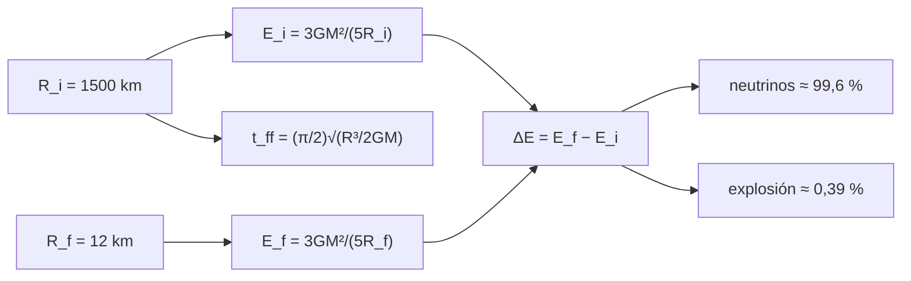

# B27-C15 — Supernovas de colapso

<!-- nav:top -->
[🏠 Programa](../../../../README.md) · [📚 Bloque B27](../../../tronco-comun/B27-objetos-compactos-y-altas-energias.md) · [← Anterior: B27-C14 — Supernovas termonucleares](../B27-C14-supernovas-termonucleares/CLASE.md) · [Siguiente: B27-C16 — Eventos de disrupción por marea →](../B27-C16-eventos-de-disrupcion-por-marea/CLASE.md)
<!-- /nav -->

## 1. Ubicación, nivel y alcance

Clase 15 del bloque B27. Nivel N3. Cuando el núcleo de hierro de una estrella masiva supera su límite, colapsa hasta formar una estrella de neutrones ([C03](../B27-C03-estrellas-de-neutrones/CLASE.md)) y libera una cantidad enorme de energía gravitatoria. Aquí calculas el **balance de energía** del colapso y su **escala de tiempo** de caída libre, con RK4 contra la solución analítica. Usas energía gravitatoria ([B05-C20](../../B05/B05-C20-problema-fisico-integrado-de-satelite-ideal/CLASE.md)) y la física de [C02](../B27-C02-enanas-blancas-y-limite-de-chandrasekhar/CLASE.md). Se trata un modelo uniforme.

## 2. Por qué esta clase existe

El colapso libera cerca de un décimo de `Mc²`; casi todo sale en neutrinos y solo una milésima en la explosión visible. La decisión central: **¿cuánta energía libera el colapso, a qué fracción corresponde la explosión y cuánto tarda?**

## 3. Lo que podrás hacer al terminar

1. Calcular la energía de ligadura de una esfera uniforme.
2. Calcular la energía liberada al pasar de `R_i` a `R_f`.
3. Compararla con `Mc²` y con la energía de la explosión.
4. Calcular el tiempo de caída libre de dos maneras.
5. Verificar con RK4 el tiempo analítico `t(x)`.
6. Reconocer los límites del modelo newtoniano.

La evidencia es el **balance energético de un colapso** del ejercicio 12 (sección 20).

## 4. Con qué llegas y cómo comprobarlo

1. ¿Qué es la energía gravitatoria de una esfera uniforme?
2. ¿Qué es el tiempo de caída libre?
3. ¿Qué es un neutrino?
4. ¿Qué es la conservación de la energía?
5. ¿Qué es la densidad media?

<details>
<summary>Ver respuestas</summary>

1. `−(3/5)GM²/R`. 2. El tiempo para colapsar bajo la gravedad propia. 3. Una partícula neutra que casi no interactúa. 4. La energía total se conserva. 5. Masa dividida por volumen.
</details>

Con cuatro o cinco aciertos, sigue; si no, repasa B05-C20.

## 5. Un caso de referencia y un caso ilustrativo

Riley y colaboradores midieron una estrella de neutrones de `1,34 M☉` con radio `12,71 km` (S3, resumen). El colapso del núcleo que la formó se modela aquí con un núcleo de `1,4 M☉` que pasa de `1500 km` a `12 km` (valores ilustrativos): libera `2,565 × 10⁴⁶ J`, el `10,25 %` de `Mc²`, y tarda `149,70 ms` en caída libre. Es el **ejemplo conductor**.

## 6. Vocabulario

El **colapso del núcleo** es la caída del núcleo de hierro. La **energía de ligadura gravitatoria** `E = (3/5)GM²/R`. El **tiempo de caída libre** `t_ff = √(3π/(32Gρ))`. La **energía cinética de la explosión** es la que mueve las capas externas. Los **neutrinos** se llevan la mayor parte. La **estrella de neutrones** es el remanente.

## 7. Modelo mental: una bola que cae en un pozo

El núcleo cae en su propio pozo gravitatorio; la energía liberada es la diferencia de energía de ligadura. Casi toda se escapa como neutrinos; una fracción pequeña impulsa la explosión.



*Descripción textual:* las energías de ligadura inicial y final dan la energía liberada, de la que la explosión es una fracción pequeña; el radio inicial fija el tiempo de caída libre.

Analogía: una piedra que cae a un pozo profundo. Límite: la esfera uniforme sobreestima la energía real.

## 8. La explicación, paso a paso

### 8.1 Balance de energía

`E(R_i) = 2,069 × 10⁴⁴ J` y `E(R_f) = 2,586 × 10⁴⁶ J`; la diferencia es `ΔE = 2,565 × 10⁴⁶ J` (`2,565 × 10⁵³ erg`), el `10,25 %` de `Mc²`.

### 8.2 La explosión es una fracción pequeña

Si la energía cinética de la explosión es `10⁴⁴ J` (ilustrativa), corresponde al `0,390 %` de `ΔE` y el resto, `99,61 %`, se va en neutrinos y otras formas.

### 8.3 El tiempo de caída libre

La densidad media inicial es `1,969 × 10¹¹ kg/m³`; el tiempo `√(3π/(32Gρ)) = 149,70 ms` coincide con `(π/2)√(R³/(2GM))` a `10⁻¹²`.

### 8.4 La caída hasta un radio dado

`t(x) = √(R₀³/(2GM))[√(x(1 − x)) + arccos √x]`, con `x = r/R₀`. RK4 y analítico coinciden a `10⁻⁵`:

| `x` | analítico (ms) | RK4 (ms) |
|---|---|---|
| 0,500 | 122,5010 | 122,5010 |
| 0,100 | 147,6272 | 147,6272 |
| 0,010 | 149,6363 | 149,6363 |

### 8.5 La velocidad final

En `r = 12 km` la velocidad newtoniana sería `0,585 c`: el valor no es físico (la relatividad cambia el resultado) y marca el límite del modelo.

## 9. Magnitudes, símbolos y unidades

| Símbolo | Qué es | Unidad | Valor / nota |
|---|---|---|---|
| `M` | masa del núcleo | `M☉` | `1,4` (ilustrativa) |
| `R_i`, `R_f` | radios inicial y final | km | 1500; 12 |
| `ΔE` | energía liberada | J | `2,565 × 10⁴⁶` |
| `ρ₀` | densidad inicial | kg/m³ | `1,969 × 10¹¹` |
| `t_ff` | tiempo de caída libre | ms | `149,70` |

## 10. Convenciones y referencias

Esfera uniforme, sin rotación ni presión; `M`, `R_i`, `R_f` y `10⁴⁴ J` son **ilustrativos**.

## 11. De dónde sale lo que afirmamos

| ID | Fuente | Localizador | Respalda | Estado |
|---|---|---|---|---|
| S1 | NIST, *Fundamental Physical Constants — Complete Listing* (CODATA 2022) | https://physics.nist.gov/cuu/Constants/Table/allascii.txt | `G`, `c` | Consultada el 2026-11-09 |
| S2 | UAI, Resolución B3 de 2015 | https://arxiv.org/abs/1510.07674 | `GM_☉` nominal | Consultada el 2026-11-09 |
| S3 | Riley et al., arXiv:1912.05702 | https://arxiv.org/abs/1912.05702 | `1,34 M☉`; `12,71 km` | Solo resumen, consultado el 2026-11-09 |

Límites: S3 solo resumen; las fórmulas son estándar y se verifican en el laboratorio; no se cita ninguna supernova observada ni ninguna energía de explosión medida.

## 12. Cómo ver el balance

| Magnitud | Valor |
|---|---|
| `E(1500 km)` | `2,069 × 10⁴⁴ J` |
| `E(12 km)` | `2,586 × 10⁴⁶ J` |
| `ΔE` | `2,565 × 10⁴⁶ J` (10,25 % de `Mc²`) |
| Explosión | `10⁴⁴ J` (0,39 %) |

Descripción larga: el colapso libera cuatro órdenes de magnitud más energía que la explosión.

## 13. Ejemplo trabajado: ¿cuánto se va en neutrinos?

**Paso 1 · Datos.** `ΔE = 2,565 × 10⁴⁶ J`, explosión `10⁴⁴ J`.

**Paso 2 · Cociente.** `10⁴⁴/2,565 × 10⁴⁶ = 0,390 %`.

**Paso 3 · Resto.** `99,61 %`.

**Paso 4 · Sentido.** La explosión visible es una fracción pequeña de la energía total.

## 14. Distintas formas de describir la energía

**Por ligadura:** diferencia entre dos radios. **Por fracción de `Mc²`:** 10 %. **Por erg:** `2,565 × 10⁵³`. **Por canal:** neutrinos y explosión.

## 15. Práctica guiada

**Ejercicio 1 · con los pasos indicados.** `E(R_f)` desde `GM²/R`. *Pasos:* `0,6 G M²/R`.

<details><summary>Solución comentada</summary>

`2,586 × 10⁴⁶ J`.
</details>

**Ejercicio 2 · con una pista.** Fracción de `Mc²`. *Pista:* `ΔE/(Mc²)`.

<details><summary>Solución comentada</summary>

`10,25 %`.
</details>

**Ejercicio 3 · casi autónomo.** Tiempo de caída libre con `ρ₀ = 1,969 × 10¹¹`.

<details><summary>Solución comentada</summary>

`149,70 ms`.
</details>

## 16. Práctica autónoma, transferencia e integrador

**Ejercicio 4.** `t` para `x = 0,5`.

<details><summary>Solución comentada</summary>

`122,5010 ms`.
</details>

**Ejercicio 5.** Fracción del tiempo total que ocupa llegar a `x = 0,1`.

<details><summary>Solución comentada</summary>

`147,63/149,70 = 98,6 %`.
</details>

**Ejercicio 6.** Conversión de `2,565 × 10⁴⁶ J` a erg.

<details><summary>Solución comentada</summary>

`2,565 × 10⁵³ erg`.
</details>

**Ejercicio 7.** Energía liberada si el radio final fuera `24 km`.

<details><summary>Solución comentada</summary>

Aproximadamente la mitad: `1,28 × 10⁴⁶ J`.
</details>

**Ejercicio 8.** ¿Cómo escala `t_ff` con `ρ`?

<details><summary>Solución comentada</summary>

Como `ρ^{−1/2}`.
</details>

**Ejercicio 9 · transferencia.** Un compañero dice que la explosión recibe el 10 % de `Mc²`. Responde con 8.2.

<details><summary>Solución comentada</summary>

El 10 % es la energía liberada por el colapso; la explosión recibe una fracción de décimas de punto porcentual.
</details>

**Ejercicio 10 · transferencia.** ¿Por qué el `0,585 c` no es un resultado fiable?

<details><summary>Solución comentada</summary>

Porque el modelo es newtoniano y se acerca a la velocidad de la luz (8.5).
</details>

**Ejercicio 11 · transferencia.** ¿Qué valida RK4 frente al analítico?

<details><summary>Solución comentada</summary>

La integración numérica; no que la caída sea libre en una estrella real.
</details>

**Ejercicio 12 · integrador.** Elabora tu *balance energético de un colapso*: energías de ligadura, `ΔE`, fracción de `Mc²`, reparto explosión/neutrinos, `t_ff` y `t(x)`.

<details><summary>Solución modelo</summary>

Secciones 8.1–8.4.
</details>

## 17. Laboratorio: balance y caída libre

El script [colapso.py](colapso.py) calcula las energías, el tiempo de caída libre por dos vías (**comprueba** `10⁻¹²`) y el tiempo hasta tres radios por RK4 (**comprueba** `10⁻⁵`).

**Datos:** constantes de NIST/UAI; masa, radios y energía de explosión **ilustrativos**. **Predice antes de ejecutar:** ¿qué fracción de `Mc²` libera? (≈10 %.) **Ejecución del 2026-11-09 (Python 3.12.9):**

```text
Python 3.12.9 (biblioteca estandar)
M = 1.40 Msol ; E_grav(R=1500 km) = 2.0689e+44 J ; E_grav(R=12 km) = 2.5861e+46 J ; energia liberada = 2.5654e+46 J
energia liberada = 10.25 % de M c^2 ; en erg: 2.565e+53
si la energia cinetica de la explosion es 1e44 J, fraccion = 0.390 % ; resto (neutrinos y otros) = 99.61 %
rho_0 = 1.9691e+11 kg/m3 ; t_ff = 149.70 ms
 x = r/R0  t analitico [ms]   t RK4 [ms]
    0.500          122.5010     122.5010
    0.100          147.6272     147.6272
    0.010          149.6363     149.6363
velocidad de caida libre en r = 12 km: 0.585 c (newtoniano, no valido cerca de c)
Pruebas superadas.
```

```bash
python programa/clases/B27/B27-C15-supernovas-de-colapso/colapso.py
```

**Límites:** esfera uniforme, newtoniano, sin presión ni rotación ni neutrinos atrapados.

## 18. Errores frecuentes y cómo corregirlos

**Confundir energía liberada y energía de la explosión.** Se corrige con el ejercicio 9.

**Usar el signo equivocado de la energía.** Se corrige con la sección 4.

**Tomar `0,585 c` por un resultado.** Se corrige con el ejercicio 10.

**Mezclar J y erg.** Se corrige con el ejercicio 6.

**Tomar los radios ilustrativos por medidas.** Se corrige con la sección 10.

## 19. Cómo sabrás que vas bien

Tras 8.1: ¿qué fracción de `Mc²` es `ΔE`? Si dudas, ejercicio 2. Tras 8.2: ¿cuánto va a la explosión? Ejercicio 9. Tras el laboratorio: ¿qué verifica RK4? (la fórmula analítica).

## 20. Qué entregas y cómo se evalúa

El producto es tu **balance energético de un colapso** (ejercicio 12).

| Criterio | Inicial | En desarrollo | Logrado | Destacado |
|---|---|---|---|---|
| Conceptos | Los confunde | Parciales | Ligadura y reparto | Explica el papel de los neutrinos |
| Cálculo | Sin unidades | Con errores | J y erg | Compara escalas |
| Numérico | Sin comprobar | Un caso | Dos comprobaciones | Interpreta tolerancias |
| Fuentes | Sin fuente | Sin fecha | S1–S3 con fecha | Declara S3 como resumen |
| Límites | No los nombra | Uno | Tres | Discute la relatividad |

**Condiciones críticas (no se compensan con promedio):** rotular los valores como ilustrativos; no atribuir una energía a una supernova real; citar solo lo consultado.

## 21. Ética, seguridad y límites

Clase educativa: no es un modelo de explosión. Accesibilidad: tablas equivalentes a las gráficas, fórmulas en texto, ejercicios sin conexión.

## 22. Para cerrar y seguir

El colapso libera cerca de un décimo de `Mc²` en unos cientos de milisegundos y la explosión recibe una fracción mínima. Queda una pregunta: ¿qué pasa cuando una estrella se acerca a un agujero negro y no explota, sino que se desgarra?

**Glosario español–inglés.** supernova de colapso · *core-collapse supernova*; energía de ligadura · *binding energy*; caída libre · *free fall*; neutrino · *neutrino*; remanente · *remnant*; núcleo de hierro · *iron core*.

**Continuidad.** [B27-C16](../B27-C16-eventos-de-disrupcion-por-marea/CLASE.md) estudia los eventos de disrupción por marea.

**Referencias:** ver sección 11.

<!-- nav:bottom -->
---

[← Anterior: B27-C14 — Supernovas termonucleares](../B27-C14-supernovas-termonucleares/CLASE.md) · [📚 Bloque B27](../../../tronco-comun/B27-objetos-compactos-y-altas-energias.md) · [Siguiente: B27-C16 — Eventos de disrupción por marea →](../B27-C16-eventos-de-disrupcion-por-marea/CLASE.md)
<!-- /nav -->
