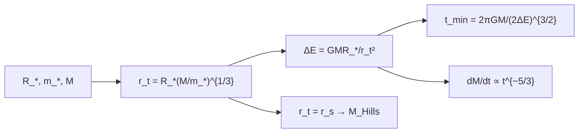

# B27-C16 — Eventos de disrupción por marea

<!-- nav:top -->
[🏠 Programa](../../../../README.md) · [📚 Bloque B27](../../../tronco-comun/B27-objetos-compactos-y-altas-energias.md) · [← Anterior: B27-C15 — Supernovas de colapso](../B27-C15-supernovas-de-colapso/CLASE.md) · [Siguiente: B27-C17 — Explosiones de rayos gamma →](../../../tronco-comun/B27-objetos-compactos-y-altas-energias.md#b27-c17)
<!-- /nav -->

## 1. Ubicación, nivel y alcance

Clase 16 del bloque B27. Nivel N3. Cuando una estrella se acerca a un agujero negro supermasivo ([C07](../B27-C07-metricas-de-agujeros-negros/CLASE.md)), la marea la desgarra y parte de su masa cae hacia el agujero. Aquí calculas el **radio de marea**, la **masa de Hills** (el agujero más masivo capaz de desgarrar una estrella antes de tragarla) y la **tasa de retorno** de masa, que cae como `t^{−5/3}`. Usas órbitas ([B02-C14](../../B02/B02-C14-kepler-y-reconstruccion-de-orbitas/CLASE.md)) y la caída al horizonte de [C08](../B27-C08-horizonte-de-sucesos/CLASE.md). Se trata un modelo de distribución plana de energía.

## 2. Por qué esta clase existe

Estos eventos iluminan agujeros negros inactivos y permiten estimar su masa. Gezari revisa 56 de ellos (S3, resumen). La decisión central: **¿hasta qué masa el agujero desgarra una estrella, cuándo vuelve el primer residuo y cómo decae la tasa?**

## 3. Lo que podrás hacer al terminar

1. Calcular el radio de marea `r_t = R_*(M/m_*)^{1/3}`.
2. Obtener la masa de Hills por fórmula y por bisección.
3. Calcular la dispersión de energía y el tiempo mínimo de retorno.
4. Verificar numéricamente la pendiente `−5/3`.
5. Comprobar que la mitad de la masa queda ligada.
6. Reconocer los supuestos del modelo.

La evidencia es la **ficha de un evento de disrupción** del ejercicio 12 (sección 20).

## 4. Con qué llegas y cómo comprobarlo

1. ¿Qué es una fuerza de marea?
2. ¿Qué es la energía de una órbita ligada?
3. ¿Qué dice la tercera ley de Kepler?
4. ¿Qué es una bisección?
5. ¿Qué es una pendiente en escala logarítmica?

<details>
<summary>Ver respuestas</summary>

1. La diferencia de gravedad entre dos puntos. 2. Negativa: `E = −GMm/(2a)`. 3. `P² ∝ a³`. 4. Un método para hallar la raíz de una función. 5. El exponente de una ley de potencias.
</details>

Con cuatro o cinco aciertos, sigue; si no, repasa B02-C14.

## 5. Un caso real y un caso ilustrativo

La revisión de Gezari recoge `56` eventos de disrupción por marea con firma térmica y de rayos X (S3, resumen). Para ilustrar la mecánica se usa una estrella solar y un agujero de `10⁶ M☉` (valores sintéticos): el radio de marea es `0,4650 au = 23,56 r_s` y el residuo más ligado vuelve a los `40,95 d`. Es el **ejemplo conductor**.

## 6. Vocabulario

El **radio de marea** `r_t` es donde la marea iguala la autogravedad. La **masa de Hills** es el valor para el que `r_t = r_s`. La **dispersión de energía** `ΔE = GMR_*/r_t²`. El **tiempo mínimo de retorno** `t_min` es el del residuo más ligado. La **tasa de retorno** `dM/dt ∝ t^{−5/3}`.

## 7. Modelo mental: una cinta de órbitas

La estrella se estira en una cinta donde cada trozo tiene su energía; los más ligados vuelven antes. Una distribución plana de energía produce una tasa que baja como `t^{−5/3}`.



*Descripción textual:* de la estrella y la masa del agujero se obtienen el radio de marea y la dispersión de energía; de ahí salen el tiempo mínimo y la ley de caída; igualar `r_t` con el radio de Schwarzschild da la masa de Hills.

Analogía: una cinta que se desenrolla. Límite: la distribución de energía real no es plana.

## 8. La explicación, paso a paso

### 8.1 El radio de marea

`r_t = R_*(M/m_*)^{1/3}`:

| `M` (`M☉`) | `r_t` (au) | `r_t/r_s` | `t_min` (d) |
|---|---|---|---|
| `10⁵` | 0,2159 | 109,34 | 12,95 |
| `10⁶` | 0,4650 | 23,56 | 40,95 |
| `10⁷` | 1,0019 | 5,08 | 129,51 |
| `10⁸` | 2,1586 | 1,09 | 409,54 |

### 8.2 La masa de Hills

`r_t = r_s` da `M_H = (R_*c²/(2G))^{3/2} m_*^{−1/2}`. Para una estrella solar, `1,1434 × 10⁸ M☉`; la bisección reproduce el valor a `10⁻⁹`. Por encima de esa masa, el agujero se traga la estrella entera.

### 8.3 Dispersión y retorno

Para `10⁶ M☉`, `ΔE = 1,9076 × 10¹³ J/kg` y `t_min = 40,95 d`.

### 8.4 La pendiente `−5/3`

Con `dM/dE` uniforme y `E(t) = −½(2πGM/t)^{2/3}`, la tasa es proporcional a `t^{−5/3}`. El laboratorio la verifica por diferencias finitas: pendiente `−1,666 667` a `10 t_min` y `100 t_min`; las tasas son `1,7535 × 10⁻⁴` y `3,7779 × 10⁻⁶ M_*/día`.

### 8.5 La mitad queda ligada

Cuando el residuo menos ligado entre en la cuenta, la masa devuelta tiende a `0,5000 m_*`: la mitad de la estrella queda ligada (con distribución plana y simétrica).

## 9. Magnitudes, símbolos y unidades

| Símbolo | Qué es | Unidad | Valor / nota |
|---|---|---|---|
| `r_t` | radio de marea | au | `0,4650` (`10⁶ M☉`) |
| `r_s` | radio de Schwarzschild | m | `2GM/c²` |
| `M_H` | masa de Hills | `M☉` | `1,1434 × 10⁸` |
| `ΔE` | dispersión de energía | J/kg | `1,9076 × 10¹³` |
| `t_min` | tiempo mínimo de retorno | d | `40,95` |
| `R_☉` | radio solar nominal | m | `6,957 × 10⁸` (S2) |

## 10. Convenciones y referencias

Estrella de `1 M☉` y `1 R☉`, intacta hasta `r_t`; distribución plana de energía; los agujeros de `10⁵`–`10⁸ M☉` son **ilustrativos**. `1 au = 1,495 978 707 × 10¹¹ m` (S4).

## 11. De dónde sale lo que afirmamos

| ID | Fuente | Localizador | Respalda | Estado |
|---|---|---|---|---|
| S1 | NIST, *Fundamental Physical Constants — Complete Listing* (CODATA 2022) | https://physics.nist.gov/cuu/Constants/Table/allascii.txt | `G`, `c` | Consultada el 2026-11-09 |
| S2 | UAI, Resolución B3 de 2015 | https://arxiv.org/abs/1510.07674 | `GM_☉`, `R_☉` nominal | Consultada el 2026-11-09 |
| S3 | Gezari, arXiv:2104.14580 | https://arxiv.org/abs/2104.14580 | `56` eventos | Solo resumen, consultado el 2026-11-09 |
| S4 | IERS Technical Note 36, Tabla 1.1 | https://iers-conventions.obspm.fr/ | `au` | Consultada el 2026-11-09 |

Límites: S3 solo resumen; las fórmulas son estándar y se verifican en el laboratorio; la ley `t^{−5/3}` depende de la distribución plana, que es una aproximación.

## 12. Cómo ver la tasa

| `t/t_min` | tasa (`M_*`/día) |
|---|---|
| 10 | `1,7535 × 10⁻⁴` |
| 100 | `3,7779 × 10⁻⁶` |

Descripción larga: al multiplicar el tiempo por 10, la tasa cae un factor `10^{5/3} = 46,4`.

## 13. Ejemplo trabajado: ¿hay disrupción?

**Paso 1 · Datos.** `M = 10⁸ M☉`, estrella solar.

**Paso 2 · Cociente.** `r_t/r_s = 1,09`.

**Paso 3 · Comparación con Hills.** `10⁸ < 1,1434 × 10⁸`, pero muy cerca.

**Paso 4 · Sentido.** Casi en el límite: la disrupción ocurre fuera del horizonte por un margen estrecho.

## 14. Distintas formas de describir el evento

**Por escalas:** `r_t`, `t_min`. **Por tasa:** `t^{−5/3}`. **Por masa de Hills:** umbral. **Por observación:** curva de luz térmica (otra clase).

## 15. Práctica guiada

**Ejercicio 1 · con los pasos indicados.** `r_t` en unidades de `R_*` para `10⁶ M☉`. *Pasos:* `(10⁶)^{1/3}`.

<details><summary>Solución comentada</summary>

`100 R_*`.
</details>

**Ejercicio 2 · con una pista.** `r_t` en au. *Pista:* `100 × 6,957 × 10⁸/1,496 × 10¹¹`.

<details><summary>Solución comentada</summary>

`0,4650 au`.
</details>

**Ejercicio 3 · casi autónomo.** Cociente entre las tasas a `10` y `100 t_min`.

<details><summary>Solución comentada</summary>

`1,7535 × 10⁻⁴/3,7779 × 10⁻⁶ = 46,4`.
</details>

## 16. Práctica autónoma, transferencia e integrador

**Ejercicio 4.** Cociente `t_min(10⁷)/t_min(10⁶)`.

<details><summary>Solución comentada</summary>

`129,51/40,95 = 3,16 = 10^{1/2}`.
</details>

**Ejercicio 5.** Cociente `r_t(10⁸)/r_t(10⁵)`.

<details><summary>Solución comentada</summary>

`2,1586/0,2159 = 10 = 1000^{1/3}`.
</details>

**Ejercicio 6.** Masa de Hills para una estrella de `0,5 M☉` y `0,5 R☉`.

<details><summary>Solución comentada</summary>

`M_H ∝ R_*m_*^{−1/2}`: `(0,5 × 1,414) × 1,1434 × 10⁸ = 8,1 × 10⁷ M☉`.
</details>

**Ejercicio 7.** Pendiente de la tasa.

<details><summary>Solución comentada</summary>

`−5/3`.
</details>

**Ejercicio 8.** Fracción de masa devuelta cuando todo lo ligado ha vuelto.

<details><summary>Solución comentada</summary>

`0,5`.
</details>

**Ejercicio 9 · transferencia.** Un compañero dice que un agujero de `10⁹ M☉` desgarra estrellas solares. Responde con 8.2.

<details><summary>Solución comentada</summary>

No: supera la masa de Hills; la estrella cae entera bajo el horizonte.
</details>

**Ejercicio 10 · transferencia.** ¿Qué supuesto produce `−5/3`?

<details><summary>Solución comentada</summary>

Una distribución de energía plana (8.4).
</details>

**Ejercicio 11 · transferencia.** ¿Qué valida la bisección frente a la fórmula?

<details><summary>Solución comentada</summary>

La resolución numérica de `r_t = r_s`; no la física de la disrupción.
</details>

**Ejercicio 12 · integrador.** Elabora tu *ficha de un evento de disrupción*: `r_t`, `r_t/r_s`, `t_min` para cuatro masas, masa de Hills, pendiente y reparto de masa.

<details><summary>Solución modelo</summary>

Secciones 8.1–8.5.
</details>

## 17. Laboratorio: marea y retorno

El script [disrupcion.py](disrupcion.py) calcula la masa de Hills por fórmula y por bisección (**comprueba** `10⁻⁹`) y la pendiente de la tasa (**comprueba** `10⁻⁴`).

**Datos:** constantes de NIST/UAI/IERS; estrella y masas **ilustrativas**. **Predice antes de ejecutar:** ¿qué pendiente da la tasa? (`−5/3`.) **Ejecución del 2026-11-09 (Python 3.12.9):**

```text
Python 3.12.9 (biblioteca estandar)
masa de Hills (estrella de 1 Msol, 1 Rsol) = 1.1434e+08 Msol (biseccion 1.1434e+08)
 M_BH [Msol]   r_t [au]   r_t/r_s  t_min [d]
       1e+05     0.2159    109.34      12.95
       1e+06     0.4650     23.56      40.95
       1e+07     1.0019      5.08     129.51
       1e+08     2.1586      1.09     409.54
M = 1e6 Msol: DeltaE = 1.9076e+13 J/kg ; t_min = 40.95 d
t =    10 t_min: tasa = 1.7535e-04 Msol_estrella/dia ; pendiente = -1.666667 (-5/3 = -1.666667)
t =   100 t_min: tasa = 3.7779e-06 Msol_estrella/dia ; pendiente = -1.666667 (-5/3 = -1.666667)
fraccion de la masa estelar devuelta cuando e_t -> 0: 0.5000 (esperada 0.5 de la estrella: la mitad ligada)
Pruebas superadas.
```

```bash
python programa/clases/B27/B27-C16-eventos-de-disrupcion-por-marea/disrupcion.py
```

**Límites:** newtoniano, distribución plana de energía, sin corrección relativista ni de la estructura estelar.

## 18. Errores frecuentes y cómo corregirlos

**Olvidar la raíz cúbica.** Se corrige con el ejercicio 1.

**Confundir `r_t` con `r_s`.** Se corrige con la tabla de 8.1.

**Aplicar `−5/3` a todos los tiempos.** Se corrige con el ejercicio 10.

**Ignorar la masa de Hills.** Se corrige con el ejercicio 9.

**Tomar las masas ilustrativas por medidas.** Se corrige con la sección 10.

## 19. Cómo sabrás que vas bien

Tras 8.1: ¿cómo escala `r_t` con `M`? Si dudas, ejercicio 5. Tras 8.2: ¿qué es la masa de Hills? Ejercicio 9. Tras el laboratorio: ¿qué verifica la pendiente? (la ley de potencias del modelo).

## 20. Qué entregas y cómo se evalúa

El producto es tu **ficha de un evento de disrupción** (ejercicio 12).

| Criterio | Inicial | En desarrollo | Logrado | Destacado |
|---|---|---|---|---|
| Conceptos | Los confunde | Parciales | `r_t`, Hills, retorno | Explica `−5/3` |
| Cálculo | Sin unidades | Con errores | Tabla completa | Compara masas |
| Numérico | Sin comprobar | Un caso | Hills y pendiente | Interpreta tolerancias |
| Fuentes | Sin fuente | Sin fecha | S1–S4 con fecha | Declara S3 como resumen |
| Límites | No los nombra | Uno | Tres | Discute la energía no plana |

**Condiciones críticas (no se compensan con promedio):** rotular las masas como ilustrativas; no atribuir parámetros a un evento real; citar solo lo consultado.

## 21. Ética, seguridad y límites

Clase educativa: no sirve para ajustar curvas de luz observadas. Accesibilidad: tablas equivalentes a las gráficas, fórmulas en texto, ejercicios sin conexión.

## 22. Para cerrar y seguir

El radio de marea crece como `M^{1/3}`, la masa de Hills fija el umbral (`1,14 × 10⁸ M☉` para una estrella solar) y la tasa de retorno cae como `t^{−5/3}`. Queda una pregunta: ¿qué ocurre en las explosiones más brillantes del universo, las de rayos gamma?

**Glosario español–inglés.** evento de disrupción por marea · *tidal disruption event*; radio de marea · *tidal radius*; masa de Hills · *Hills mass*; tasa de retorno · *fallback rate*; residuo · *debris*; dispersión de energía · *energy spread*.

**Continuidad.** [B27-C17](../B27-C17-explosiones-de-rayos-gamma/CLASE.md) estudia las explosiones de rayos gamma.

**Referencias:** ver sección 11.

<!-- nav:bottom -->
---

[← Anterior: B27-C15 — Supernovas de colapso](../B27-C15-supernovas-de-colapso/CLASE.md) · [📚 Bloque B27](../../../tronco-comun/B27-objetos-compactos-y-altas-energias.md) · [Siguiente: B27-C17 — Explosiones de rayos gamma →](../../../tronco-comun/B27-objetos-compactos-y-altas-energias.md#b27-c17)
<!-- /nav -->
