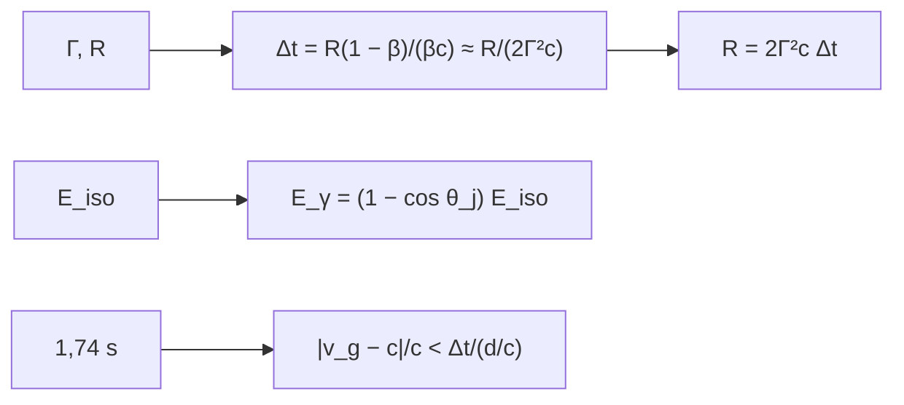

# B27-C17 — Explosiones de rayos gamma

<!-- nav:top -->
[🏠 Programa](../../../../README.md) · [📚 Bloque B27](../../../tronco-comun/B27-objetos-compactos-y-altas-energias.md) · [← Anterior: B27-C16 — Eventos de disrupción por marea](../B27-C16-eventos-de-disrupcion-por-marea/CLASE.md) · [Siguiente: B27-C18 — Neutrinos de supernova →](../B27-C18-neutrinos-de-supernova/CLASE.md)
<!-- /nav -->

## 1. Ubicación, nivel y alcance

Clase 17 del bloque B27. Nivel N3. Los destellos de rayos gamma son las explosiones más luminosas conocidas; surgen de chorros que se mueven con factores de Lorentz de cientos ([C11](../B27-C11-chorros-relativistas/CLASE.md)). Aquí calculas el **retardo de llegada** de la emisión de una capa relativista, la **colimación** que reduce la energía real y una **cota sobre la velocidad de las ondas gravitacionales** a partir de GW170817 y GRB 170817A. Usas relatividad especial ([B26-C03](../../B26/B26-C03-dilatacion-temporal-y-contraccion/CLASE.md)) y la fusión de [C13](../B27-C13-binarias-compactas/CLASE.md). Se trata una capa esférica fina y emisión instantánea.

## 2. Por qué esta clase existe

Una explosión que parece de energía enorme puede ser de energía moderada vista de frente, y un retardo de segundos entre dos mensajeros, tras viajar 130 millones de años, es una medición extraordinariamente precisa. La decisión central: **¿qué retardo y qué energía real implican un factor de Lorentz y un ángulo dados?**

## 3. Lo que podrás hacer al terminar

1. Calcular el retardo exacto `R(1 − β)/(βc)` y su aproximación `R/(2Γ²c)`.
2. Despejar el radio de emisión a partir del retardo.
3. Corregir `E_iso` por colimación.
4. Calcular el tiempo de viaje de la luz desde 40 Mpc.
5. Interpretar la cota `|v_g − c|/c`.
6. Distinguir lo que es medición de lo que es cota.

La evidencia es la **ficha energética de una explosión de rayos gamma** del ejercicio 12 (sección 20).

## 4. Con qué llegas y cómo comprobarlo

1. ¿Qué es el factor de Lorentz?
2. ¿Qué es la energía isótropa equivalente?
3. ¿Qué es un parsec?
4. ¿Qué es un ángulo sólido?
5. ¿Qué es un cociente de errores relativos?

<details>
<summary>Ver respuestas</summary>

1. `Γ = 1/√(1 − β²)`. 2. La energía que se emitiría si la fuente radiara por igual en todas direcciones. 3. `648 000/π` unidades astronómicas. 4. La fracción de esfera cubierta. 5. Un error dividido por el valor.
</details>

Con cuatro o cinco aciertos, sigue; si no, repasa B26-C03.

## 5. Un caso real: GW170817 y GRB 170817A

La colaboración midió un retardo de `1,74 ± 0,05 s` entre la onda gravitacional de GW170817 y el destello gamma GRB 170817A (S3, resumen), a unos `40 Mpc` (S4, resumen). La luz tarda `4,117 × 10¹⁵ s` (`130,5 Ma`) en cruzar esa distancia; el cociente da `4,23 × 10⁻¹⁶`. Es el **ejemplo conductor**.

## 6. Vocabulario

El **destello de rayos gamma** es una emisión breve e intensa. El **factor de Lorentz** `Γ` de la capa. El **retardo de llegada** es la diferencia de tiempo entre fotones emitidos a distinto radio. La **energía isótropa** `E_iso`. La **fracción de colimación** `f_b = 1 − cos θ_j`. La **cota** es un límite superior, no una medición del valor.

## 7. Modelo mental: dos relojes que casi coinciden

La capa casi alcanza a su propia luz: un foton emitido en `R` llega unos `R/(2Γ²c)` después que uno emitido en el centro. Para `Γ` grande, un radio enorme produce un retardo de segundos.



*Descripción textual:* con `Γ` y `R` se obtiene el retardo, y al revés; la energía real se obtiene de la isótropa con la colimación; el retardo observado frente al tiempo de viaje da una cota.

Analogía: dos corredores que salen con unos metros de diferencia en una maratón. Límite: la cota supone que la emisión no se retrasó.

## 8. La explicación, paso a paso

### 8.1 Retardo exacto y aproximado

Con `R = 10¹⁵ m`: `Γ = 100` da `166,794 557 s` exacto y `166,782 048 s` aproximado; `Γ = 300`, `18,531 493` frente a `18,531 339`; `Γ = 1000`, `1,667 822` frente a `1,667 820`. El cociente exacto/aproximado vale `1 + 3/(4Γ²)` (`1,000 075` para `Γ = 100`).

### 8.2 El radio de emisión

Si el retardo es `1 s` y `Γ = 300`, `R = 2Γ²cΔt = 5,396 × 10¹³ m = 360,7 au`.

### 8.3 La colimación

Con `E_iso = 10⁴⁷ J`:

| `θ_j` (rad) | `f_b` | `E_γ` (J) |
|---|---|---|
| 0,02 | `2,000 × 10⁻⁴` | `2,000 × 10⁴³` |
| 0,05 | `1,250 × 10⁻³` | `1,250 × 10⁴⁴` |
| 0,10 | `4,996 × 10⁻³` | `4,996 × 10⁴⁴` |
| 0,30 | `4,466 × 10⁻²` | `4,466 × 10⁴⁵` |

### 8.4 Tiempo de viaje

`1 pc = 3,085 678 × 10¹⁶ m` (a partir de `648 000/π au`) y `40 Mpc = 1,2343 × 10²⁴ m`; la luz tarda `4,1171 × 10¹⁵ s`.

### 8.5 La cota

`1,74 s / 4,117 × 10¹⁵ s = 4,23 × 10⁻¹⁶`; con `±0,05 s`, entre `4,10 × 10⁻¹⁶` y `4,35 × 10⁻¹⁶`. Si no hubo retraso intrínseco, la velocidad de las ondas gravitacionales difiere de `c` en menos de esa fracción. Es una cota superior, no una medición.

## 9. Magnitudes, símbolos y unidades

| Símbolo | Qué es | Unidad | Valor / nota |
|---|---|---|---|
| `Γ` | factor de Lorentz | — | 100–1000 (ilustrativo) |
| `R` | radio de emisión | m | `10¹⁵` (ilustrativo) |
| `Δt` | retardo | s | `166,79`; `1,74` (medido) |
| `θ_j` | semiángulo del chorro | rad | 0,02–0,3 (ilustrativo) |
| `d` | distancia | Mpc | 40 (S4) |
| `c` | velocidad de la luz | m/s | `299 792 458` (S1) |

## 10. Convenciones y referencias

Capa esférica fina; emisión instantánea; sin cosmología; `Γ`, `R`, `E_iso` y `θ_j` son **ilustrativos**; `Δt = 1,74 s` y `d = 40 Mpc` son los de S3 y S4.

## 11. De dónde sale lo que afirmamos

| ID | Fuente | Localizador | Respalda | Estado |
|---|---|---|---|---|
| S1 | NIST, *Fundamental Physical Constants — Complete Listing* (CODATA 2022) | https://physics.nist.gov/cuu/Constants/Table/allascii.txt | `c` | Consultada el 2026-11-09 |
| S2 | IERS Technical Note 36, Tabla 1.1 | https://iers-conventions.obspm.fr/ | `au` | Consultada el 2026-11-09 |
| S3 | LIGO, Virgo, Fermi y INTEGRAL, arXiv:1710.05834 | https://arxiv.org/abs/1710.05834 | retardo `1,74 ± 0,05 s`; probabilidad de coincidencia fortuita `5 × 10⁻⁸` | Solo resumen, consultado el 2026-11-09 |
| S4 | LIGO Scientific y Virgo, GW170817, arXiv:1710.05832 | https://arxiv.org/abs/1710.05832 | `40 Mpc` | Solo resumen, consultado el 2026-11-09 |

Límites: S3 y S4 solo resumen; el artículo no se leyó, por lo que la cota calculada aquí es un cálculo propio y no es la que ese artículo da.

## 12. Cómo ver el retardo

| `Γ` | exacto (s) | aproximado (s) |
|---|---|---|
| 100 | 166,794 557 | 166,782 048 |
| 300 | 18,531 493 | 18,531 339 |
| 1000 | 1,667 822 | 1,667 820 |

Descripción larga: el retardo cae como `1/Γ²`; la aproximación mejora al crecer `Γ`.

## 13. Ejemplo trabajado: ¿a qué radio emite?

**Paso 1 · Datos.** `Γ = 300`, `Δt = 1 s`.

**Paso 2 · Fórmula.** `R = 2Γ²cΔt = 2 × 90 000 × 299 792 458`.

**Paso 3 · Resultado.** `5,396 × 10¹³ m`.

**Paso 4 · Sentido.** `360,7 au`: mucho más lejos que cualquier objeto compacto.

## 14. Distintas formas de describir la energía

**Isótropa:** `E_iso`. **Colimada:** `f_b E_iso`. **Por ángulo:** `θ_j`. **Por fluencia:** otra clase.

## 15. Práctica guiada

**Ejercicio 1 · con los pasos indicados.** `f_b` para `θ_j = 0,1`. *Pasos:* `1 − cos 0,1`.

<details><summary>Solución comentada</summary>

`4,996 × 10⁻³`.
</details>

**Ejercicio 2 · con una pista.** `E_γ` si `E_iso = 10⁴⁷ J`. *Pista:* producto.

<details><summary>Solución comentada</summary>

`4,996 × 10⁴⁴ J`.
</details>

**Ejercicio 3 · casi autónomo.** Retardo aproximado para `Γ = 300`, `R = 10¹⁵ m`.

<details><summary>Solución comentada</summary>

`10¹⁵/(2 × 90 000 × 299 792 458) = 18,53 s`.
</details>

## 16. Práctica autónoma, transferencia e integrador

**Ejercicio 4.** Cociente de retardos entre `Γ = 100` y `Γ = 1000`.

<details><summary>Solución comentada</summary>

`166,79/1,668 = 100`.
</details>

**Ejercicio 5.** `R` para `Γ = 100` y `Δt = 1 s`.

<details><summary>Solución comentada</summary>

`2 × 10⁴ × 299 792 458 = 5,996 × 10¹² m = 40,1 au`.
</details>

**Ejercicio 6.** Tiempo de viaje en millones de años.

<details><summary>Solución comentada</summary>

`130,5 Ma`.
</details>

**Ejercicio 7.** Cota para un retardo de `1,74 s`.

<details><summary>Solución comentada</summary>

`4,23 × 10⁻¹⁶`.
</details>

**Ejercicio 8.** Cota con `1,69 s`.

<details><summary>Solución comentada</summary>

`4,10 × 10⁻¹⁶`.
</details>

**Ejercicio 9 · transferencia.** Un compañero dice que la cota mide la velocidad de las ondas gravitacionales. Responde con 8.5.

<details><summary>Solución comentada</summary>

Es un límite superior sobre la diferencia de velocidades, bajo el supuesto de que no hubo retraso intrínseco.
</details>

**Ejercicio 10 · transferencia.** ¿Por qué `E_iso` sobreestima la energía?

<details><summary>Solución comentada</summary>

Porque supone emisión isótropa; con chorro estrecho la energía real es `f_b` veces menor.
</details>

**Ejercicio 11 · transferencia.** ¿Qué verifica comparar el retardo exacto y el aproximado?

<details><summary>Solución comentada</summary>

La validez de la aproximación para `Γ ≥ 100`; no el modelo físico.
</details>

**Ejercicio 12 · integrador.** Elabora tu *ficha energética de una explosión de rayos gamma*: retardos para tres `Γ`, radio de emisión, `E_γ` para cuatro `θ_j`, tiempo de viaje y cota.

<details><summary>Solución modelo</summary>

Secciones 8.1–8.5.
</details>

## 17. Laboratorio: retardo y cota

El script [grb.py](grb.py) calcula el retardo exacto y aproximado (**comprueba** `10⁻³`), la colimación y la cota.

**Datos:** `c` de NIST; `au` de IERS; retardo y distancia de S3 y S4; el resto **ilustrativo**. **Predice antes de ejecutar:** ¿qué cota sale? (≈`4 × 10⁻¹⁶`.) **Ejecución del 2026-11-09 (Python 3.12.9):**

```text
Python 3.12.9 (biblioteca estandar)
1 pc = 3.085678e+16 m ; 1 Mpc = 3.085678e+22 m
  Gamma   retardo exacto [s]   aproximacion [s]   cociente
    100           166.794557         166.782048   1.000075
    300            18.531493          18.531339   1.000008
   1000             1.667822           1.667820   1.000001
retardo de 1.0 s con Gamma = 300: R = 5.3963e+13 m = 360.7 au
 theta_j [rad]        f_b   E_gamma [J]
          0.02  2.000e-04     2.000e+43
          0.05  1.250e-03     1.250e+44
          0.10  4.996e-03     4.996e+44
          0.30  4.466e-02     4.466e+45
40 Mpc = 1.2343e+24 m ; tiempo de viaje de la luz = 4.1171e+15 s = 130.5 Ma
cota |v_g - c|/c < 4.23e-16 (retardo 1.74 s entre 4.117e+15 s)
con la incertidumbre de 0.05 s: 4.10e-16 .. 4.35e-16
Pruebas superadas.
```

```bash
python programa/clases/B27/B27-C17-explosiones-de-rayos-gamma/grb.py
```

**Límites:** capa fina, sin cosmología, sin retraso intrínseco de la emisión.

## 18. Errores frecuentes y cómo corregirlos

**Confundir retardo y tiempo de viaje.** Se corrige con 8.4–8.5.

**Tomar la cota por una medida.** Se corrige con el ejercicio 9.

**Olvidar la colimación.** Se corrige con el ejercicio 10.

**Usar la aproximación con `Γ` pequeño.** Se corrige con 8.1.

**Tomar `Γ` ilustrativo por medida.** Se corrige con la sección 10.

## 19. Cómo sabrás que vas bien

Tras 8.1: ¿cómo escala el retardo con `Γ`? Si dudas, ejercicio 4. Tras 8.5: ¿qué es la cota? Ejercicio 9. Tras el laboratorio: ¿qué valida el cociente? (la aproximación).

## 20. Qué entregas y cómo se evalúa

El producto es tu **ficha energética de una explosión de rayos gamma** (ejercicio 12).

| Criterio | Inicial | En desarrollo | Logrado | Destacado |
|---|---|---|---|---|
| Conceptos | Los confunde | Parciales | Retardo, colimación, cota | Explica el supuesto de la cota |
| Cálculo | Sin unidades | Con errores | Todas las magnitudes | Compara `Γ` |
| Numérico | Sin comprobar | Un caso | Tabla y cota | Interpreta tolerancias |
| Fuentes | Sin fuente | Sin fecha | S1–S4 con fecha | Declara S3 y S4 como resumen |
| Límites | No los nombra | Uno | Tres | Discute el retraso intrínseco |

**Condiciones críticas (no se compensan con promedio):** rotular `Γ`, `R` y `θ_j` como ilustrativos; no confundir cota con medición; citar solo lo consultado.

## 21. Ética, seguridad y límites

Clase educativa: no reproduce el análisis de la colaboración. Accesibilidad: tablas equivalentes a las gráficas, fórmulas en texto, ejercicios sin conexión.

## 22. Para cerrar y seguir

El retardo de una capa relativista cae como `1/Γ²`, la colimación reduce la energía real y 1,74 s tras `130,5 Ma` acotan la velocidad gravitacional a la parte `10⁻¹⁶`. Queda una pregunta: ¿qué otras partículas llegan de una explosión?

**Glosario español–inglés.** destello de rayos gamma · *gamma-ray burst*; retardo de llegada · *arrival delay*; colimación · *beaming*; energía isótropa · *isotropic-equivalent energy*; cota · *bound*; capa · *shell*.

**Continuidad.** [B27-C18](../B27-C18-neutrinos-de-supernova/CLASE.md) estudia los neutrinos de supernova.

**Referencias:** ver sección 11.

<!-- nav:bottom -->
---

[← Anterior: B27-C16 — Eventos de disrupción por marea](../B27-C16-eventos-de-disrupcion-por-marea/CLASE.md) · [📚 Bloque B27](../../../tronco-comun/B27-objetos-compactos-y-altas-energias.md) · [Siguiente: B27-C18 — Neutrinos de supernova →](../B27-C18-neutrinos-de-supernova/CLASE.md)
<!-- /nav -->
