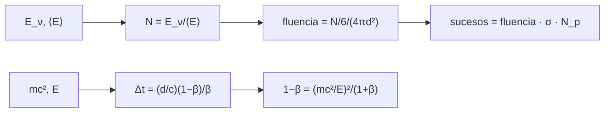

# B27-C18 — Neutrinos de supernova

<!-- nav:top -->
[🏠 Programa](../../../../README.md) · [📚 Bloque B27](../../../tronco-comun/B27-objetos-compactos-y-altas-energias.md) · [← Anterior: B27-C17 — Explosiones de rayos gamma](../B27-C17-explosiones-de-rayos-gamma/CLASE.md) · [Siguiente: B27-C19 — Observatorios de rayos X y gamma →](../B27-C19-observatorios-de-rayos-x-y-gamma/CLASE.md)
<!-- /nav -->

## 1. Ubicación, nivel y alcance

Clase 18 del bloque B27. Nivel N3. En el colapso de [C15](../B27-C15-supernovas-de-colapso/CLASE.md) casi toda la energía sale como neutrinos. Aquí calculas cuántos se emiten, cuántos llegan a un detector y cuánto se retrasaría un neutrino con masa respecto de la luz, y descubres un problema numérico: la fórmula ingenua pierde cifras. Usas la ley del inverso del cuadrado ([B05-C20](../../B05/B05-C20-problema-fisico-integrado-de-satelite-ideal/CLASE.md)) y aritmética de punto flotante. Se trata un espectro monoenergético.

## 2. Por qué esta clase existe

Los neutrinos de una supernova galáctica serían una señal de cientos de sucesos en unos segundos, mensajera del interior de la estrella. La decisión central: **¿cuántos neutrinos llegan, qué retraso produce su masa y cómo se calcula sin perder precisión?**

## 3. Lo que podrás hacer al terminar

1. Calcular el número de neutrinos a partir de la energía y la energía media.
2. Calcular la fluencia a una distancia dada.
3. Estimar los sucesos en un detector.
4. Calcular el retraso por masa de forma estable.
5. Reconocer la cancelación catastrófica de la forma ingenua.
6. Distinguir lo medido de lo ilustrativo.

La evidencia es la **ficha de neutrinos de supernova** del ejercicio 12 (sección 20).

## 4. Con qué llegas y cómo comprobarlo

1. ¿Qué es una fluencia?
2. ¿Qué es una sección eficaz?
3. ¿Qué es la constante de Avogadro?
4. ¿Qué es la cancelación catastrófica?
5. ¿Qué es un electronvoltio?

<details>
<summary>Ver respuestas</summary>

1. Número de partículas por unidad de área. 2. El área efectiva de interacción. 3. `6,022 140 76 × 10²³ mol⁻¹`. 4. La pérdida de cifras al restar números casi iguales. 5. `1,602 176 634 × 10⁻¹⁹ J`.
</details>

Con cuatro o cinco aciertos, sigue; si no, repasa B05-C20.

## 5. Un caso ilustrativo: una supernova a 10 kpc

La revisión de Mirizzi y colaboradores trata la producción, oscilaciones y detección de estos neutrinos (S3, resumen). Aquí no se cita ninguna cifra de esa revisión: todos los números son sintéticos. Con `2,5 × 10⁴⁶ J` en neutrinos de `10 MeV` en promedio (ilustrativos) a `10 kpc`, la fluencia por sabor es `2,17 × 10¹¹ cm⁻²` y un kilotón de agua daría `145,4` sucesos con una sección eficaz de `10⁻⁴¹ cm²` (ilustrativa). Es el **ejemplo conductor**.

## 6. Vocabulario

El **neutrino** es una partícula neutra y muy ligera. La **fluencia** es el número de neutrinos por unidad de área. La **sección eficaz** mide la probabilidad de interacción. Los **protones libres** son el blanco principal en agua. El **retraso por masa** `Δt = (d/c)(1 − β)/β`. La **cancelación catastrófica** es la pérdida de cifras al restar números casi iguales.

## 7. Modelo mental: una lluvia fina

La energía total en neutrinos se reparte entre todos ellos; a 10 kpc, la lluvia es de `10¹¹` por centímetro cuadrado, pero casi ninguno interactúa. Y si tienen masa, los más lentos llegan un poco después.



*Descripción textual:* de la energía y la energía media se obtiene el número de neutrinos y su fluencia; con la sección eficaz y los protones del detector, los sucesos; el retraso por masa se calcula con una forma algebraica estable.

Analogía: una lluvia fina sobre un techo grande. Límite: el espectro real no es monoenergético.

## 8. La explicación, paso a paso

### 8.1 Número de neutrinos

`N = 2,5 × 10⁴⁶ J / (10 MeV) = 1,5604 × 10⁵⁸`. Por sabor (un sexto), `2,6006 × 10⁵⁷`.

### 8.2 Fluencia

A `d = 10 kpc = 3,0857 × 10²⁰ m`, la fluencia es `2,1735 × 10¹⁵ m⁻² = 2,1735 × 10¹¹ cm⁻²`.

### 8.3 Sucesos

Un kilotón de agua tiene `6,6913 × 10³¹` protones libres. Con `σ = 10⁻⁴¹ cm²` a 10 MeV (crece como `E²`), los sucesos esperados son:

| `E` (MeV) | `σ(E)` (cm²) | sucesos |
|---|---|---|
| 5 | `2,500 × 10⁻⁴²` | 72,7 |
| 10 | `1,000 × 10⁻⁴¹` | 145,4 |
| 20 | `4,000 × 10⁻⁴¹` | 290,9 |
| 40 | `1,600 × 10⁻⁴⁰` | 581,7 |

### 8.4 Retraso por masa

Con `mc² = 1 eV` (ilustrativo) y `d = 10 kpc`, la forma estable `1 − β = (mc²/E)²/(1 + β)` da `5,146 356 × 10⁻³ s` a `10 MeV`, `1,286 589 × 10⁻³ s` a `20 MeV` y `3,216 473 × 10⁻⁴ s` a `40 MeV`; coincide con la aproximación `(d/2c)(mc²/E)²` a `10⁻⁶`.

### 8.5 La forma ingenua falla

Calcular `1 − β` restando directamente da `5,142 243 × 10⁻³ s` (10 MeV), `1,371 265 × 10⁻³ s` (20 MeV, error del 6,6 %) y `3,428 162 × 10⁻⁴ s` (40 MeV, 6,6 %): `β` está tan cerca de 1 que los dígitos se cancelan. La diferencia de llegada entre 10 y 20 MeV por masa es `3,8598 × 10⁻³ s`.

## 9. Magnitudes, símbolos y unidades

| Símbolo | Qué es | Unidad | Valor / nota |
|---|---|---|---|
| `E_ν` | energía en neutrinos | J | `2,5 × 10⁴⁶` (ilustrativa) |
| `⟨E⟩` | energía media | MeV | 10 (ilustrativa) |
| `d` | distancia | kpc | 10 (ilustrativa) |
| `σ` | sección eficaz | cm² | `10⁻⁴¹` a 10 MeV (ilustrativa) |
| `N_p` | protones libres | — | `6,6913 × 10³¹` |
| `mc²` | masa del neutrino | eV | 1 (ilustrativa) |

## 10. Convenciones y referencias

Espectro monoenergético; un sexto de la energía por sabor; 18 g/mol para el agua; `1 kpc = 3,085 678 × 10¹⁹ m` (de `648 000/π au`); todos los valores físicos son **ilustrativos**.

## 11. De dónde sale lo que afirmamos

| ID | Fuente | Localizador | Respalda | Estado |
|---|---|---|---|---|
| S1 | NIST, *Fundamental Physical Constants — Complete Listing* (CODATA 2022) | https://physics.nist.gov/cuu/Constants/Table/allascii.txt | `c`, eV, constante de Avogadro | Consultada el 2026-11-09 |
| S2 | IERS Technical Note 36, Tabla 1.1 | https://iers-conventions.obspm.fr/ | `au` | Consultada el 2026-11-09 |
| S3 | Mirizzi et al., arXiv:1508.00785 | https://arxiv.org/abs/1508.00785 | contexto: producción, oscilaciones y detección | Solo resumen, consultado el 2026-11-09 |

Límites: S3 solo resumen y no respalda ninguna cifra de esta clase; la sección eficaz, la energía, la masa del detector y la masa del neutrino son ilustrativas.

## 12. Cómo ver la tabla de retrasos

| `E` (MeV) | estable (s) | ingenuo (s) |
|---|---|---|
| 10 | `5,146 356 × 10⁻³` | `5,142 243 × 10⁻³` |
| 20 | `1,286 589 × 10⁻³` | `1,371 265 × 10⁻³` |
| 40 | `3,216 473 × 10⁻⁴` | `3,428 162 × 10⁻⁴` |

Descripción larga: el retraso cae como `1/E²`; el cálculo ingenuo se aparta del correcto más cuanto mayor es `E`.

## 13. Ejemplo trabajado: sucesos a 20 MeV

**Paso 1 · Número.** `N = 2,5 × 10⁴⁶ J/(20 MeV) = 7,80 × 10⁵⁷`; por sabor `1,30 × 10⁵⁷`.

**Paso 2 · Fluencia.** `1,087 × 10¹⁵ m⁻²`.

**Paso 3 · Sección.** `4 × 10⁻⁴¹ cm² = 4 × 10⁻⁴⁵ m²`.

**Paso 4 · Sucesos.** `1,087 × 10¹⁵ × 4 × 10⁻⁴⁵ × 6,6913 × 10³¹ = 290,9`.

## 14. Distintas formas de describir la señal

**Por número:** `N`. **Por fluencia:** por área. **Por sucesos:** esperados en un detector. **Por retraso:** una cota sobre la masa.

## 15. Práctica guiada

**Ejercicio 1 · con los pasos indicados.** `N` a 10 MeV. *Pasos:* `E_ν/⟨E⟩`.

<details><summary>Solución comentada</summary>

`2,5 × 10⁴⁶/1,602 × 10⁻¹² = 1,56 × 10⁵⁸`.
</details>

**Ejercicio 2 · con una pista.** Distancia en metros. *Pista:* `10 × 3,0857 × 10¹⁹`.

<details><summary>Solución comentada</summary>

`3,0857 × 10²⁰ m`.
</details>

**Ejercicio 3 · casi autónomo.** Fluencia en cm⁻².

<details><summary>Solución comentada</summary>

`2,17 × 10¹¹ cm⁻²`.
</details>

## 16. Práctica autónoma, transferencia e integrador

**Ejercicio 4.** Sucesos a 5 MeV.

<details><summary>Solución comentada</summary>

`72,7`.
</details>

**Ejercicio 5.** Cociente de sucesos entre 40 y 5 MeV.

<details><summary>Solución comentada</summary>

`581,7/72,7 = 8 = 40/5`.
</details>

**Ejercicio 6.** Retraso a 20 MeV si `mc² = 1 eV`.

<details><summary>Solución comentada</summary>

`1,2866 × 10⁻³ s`.
</details>

**Ejercicio 7.** Cociente entre retrasos a 10 y 20 MeV.

<details><summary>Solución comentada</summary>

`4,0 = (20/10)²`.
</details>

**Ejercicio 8.** Error relativo del cálculo ingenuo a 20 MeV.

<details><summary>Solución comentada</summary>

`(1,371 265 − 1,286 589)/1,286 589 = 6,6 %`.
</details>

**Ejercicio 9 · transferencia.** Un compañero dice que 145 sucesos es la predicción para una supernova real. Responde con la sección 10.

<details><summary>Solución comentada</summary>

Es un cálculo con números ilustrativos; no representa ningún detector ni evento.
</details>

**Ejercicio 10 · transferencia.** ¿Por qué la forma ingenua falla?

<details><summary>Solución comentada</summary>

Porque resta números casi iguales en doble precisión (8.5).
</details>

**Ejercicio 11 · transferencia.** ¿Qué valida la comparación con la aproximación?

<details><summary>Solución comentada</summary>

Que la forma estable es correcta; no la masa del neutrino.
</details>

**Ejercicio 12 · integrador.** Elabora tu *ficha de neutrinos de supernova*: `N`, fluencia, sucesos para cuatro energías y retrasos estable e ingenuo para tres energías.

<details><summary>Solución modelo</summary>

Tablas de 8.3 y 12.
</details>

## 17. Laboratorio: sucesos y retraso

El script [neutrinos.py](neutrinos.py) calcula `N`, fluencia y sucesos, y compara el retraso estable con la aproximación (**comprueba** `10⁻⁶`) y con la forma ingenua.

**Datos:** constantes de NIST/IERS; todo lo demás **ilustrativo**. **Predice antes de ejecutar:** ¿qué orden de magnitud de sucesos sale? (cientos.) **Ejecución del 2026-11-09 (Python 3.12.9):**

```text
Python 3.12.9 (biblioteca estandar)
1 kpc = 3.085678e+19 m ; d = 10 kpc = 3.0857e+20 m
N_total = 1.5604e+58 neutrinos ; por sabor (1/6) = 2.6006e+57 ; fluencia a 10 kpc = 2.1735e+15 /m2 = 2.1735e+11 /cm2
protones libres en 1 kt de agua = 6.6913e+31 ; sucesos esperados = 145.4 (sigma = 1e-41 cm2 ilustrativa)
 E [MeV]   sigma(E) [cm2]   sucesos
     5.0        2.500e-42      72.7
    10.0        1.000e-41     145.4
    20.0        4.000e-41     290.9
    40.0        1.600e-40     581.7
 E [MeV]  retraso estable [s]    aprox [s]    ingenuo [s]
    10.0         5.146356e-03   5.1464e-03   5.142243e-03
    20.0         1.286589e-03   1.2866e-03   1.371265e-03
    40.0         3.216473e-04   3.2165e-04   3.428162e-04
diferencia de llegada entre 10 y 20 MeV por masa: 3.8598e-03 s
Pruebas superadas.
```

```bash
python programa/clases/B27/B27-C18-neutrinos-de-supernova/neutrinos.py
```

**Límites:** espectro monoenergético, sin oscilaciones, sin eficiencia de detección.

## 18. Errores frecuentes y cómo corregirlos

**Confundir J y MeV.** Se corrige con la sección 4.

**Olvidar el sexto por sabor.** Se corrige con 8.1.

**Mezclar m² y cm².** Se corrige con el ejemplo 13.

**Restar números casi iguales.** Se corrige con el ejercicio 10.

**Tomar los sucesos por una predicción.** Se corrige con el ejercicio 9.

## 19. Cómo sabrás que vas bien

Tras 8.2: ¿en qué unidades está la fluencia? Si dudas, ejercicio 3. Tras 8.4: ¿cómo escala el retraso con `E`? Ejercicio 7. Tras el laboratorio: ¿qué diferencia hay entre estable e ingenuo? (la pérdida de cifras).

## 20. Qué entregas y cómo se evalúa

El producto es tu **ficha de neutrinos de supernova** (ejercicio 12).

| Criterio | Inicial | En desarrollo | Logrado | Destacado |
|---|---|---|---|---|
| Conceptos | Los confunde | Parciales | `N`, fluencia, sucesos | Explica el retraso |
| Cálculo | Sin unidades | Con errores | Todas las magnitudes | Compara energías |
| Numérico | Sin comprobar | Un caso | Estable y aproximado | Explica la cancelación |
| Fuentes | Sin fuente | Sin fecha | S1–S3 con fecha | Declara que S3 no respalda cifras |
| Límites | No los nombra | Uno | Tres | Discute oscilaciones |

**Condiciones críticas (no se compensan con promedio):** rotular los valores como ilustrativos; no presentar los sucesos como predicción; citar solo lo consultado.

## 21. Ética, seguridad y límites

Clase educativa: no es un análisis de un detector. Accesibilidad: tablas equivalentes a las gráficas, fórmulas en texto, ejercicios sin conexión.

## 22. Para cerrar y seguir

La energía en neutrinos da `10⁵⁸` partículas, cientos de sucesos en un detector de un kilotón a 10 kpc (con valores ilustrativos) y un retraso por masa que exige un cálculo estable. Queda una pregunta: ¿cómo se decide si una señal así es real?

**Glosario español–inglés.** neutrino · *neutrino*; fluencia · *fluence*; sección eficaz · *cross section*; retraso por masa · *mass-induced delay*; cancelación catastrófica · *catastrophic cancellation*; sabor · *flavour*.

**Continuidad.** [B27-C19](../B27-C19-observatorios-de-rayos-x-y-gamma/CLASE.md) estudia los observatorios de rayos X y gamma.

**Referencias:** ver sección 11.

<!-- nav:bottom -->
---

[← Anterior: B27-C17 — Explosiones de rayos gamma](../B27-C17-explosiones-de-rayos-gamma/CLASE.md) · [📚 Bloque B27](../../../tronco-comun/B27-objetos-compactos-y-altas-energias.md) · [Siguiente: B27-C19 — Observatorios de rayos X y gamma →](../B27-C19-observatorios-de-rayos-x-y-gamma/CLASE.md)
<!-- /nav -->
