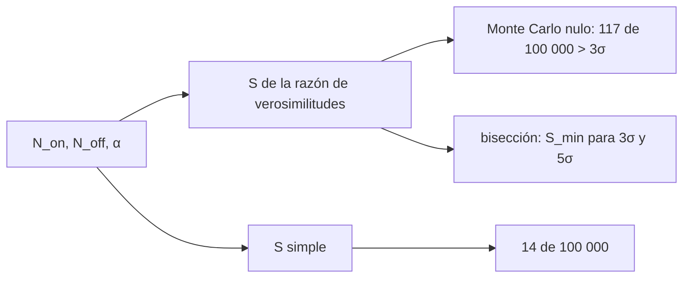

# B27-C19 — Observatorios de rayos X y gamma

<!-- nav:top -->
[🏠 Programa](../../../../README.md) · [📚 Bloque B27](../../../tronco-comun/B27-objetos-compactos-y-altas-energias.md) · [← Anterior: B27-C18 — Neutrinos de supernova](../B27-C18-neutrinos-de-supernova/CLASE.md) · [Siguiente: B27-C20 — Análisis multibanda de evento extremo →](../B27-C20-analisis-multibanda-de-evento-extremo/CLASE.md)
<!-- /nav -->

## 1. Ubicación, nivel y alcance

Clase 19 del bloque B27. Nivel N3. Los rayos X y gamma llegan como fotones individuales, contados uno a uno sobre un fondo. Aquí calculas la **significancia** de una detección con la razón de verosimilitudes, estimas por Monte Carlo la tasa de falsos positivos y hallas la **sensibilidad** (la señal mínima detectable). Usas probabilidad ([B12-C26](../../B12/B12-C26-sesgos-y-potencia-estadistica-en-poblaciones-pequenas/CLASE.md)) y los fotones de [C17](../B27-C17-explosiones-de-rayos-gamma/CLASE.md). Se trata un fondo constante y conteos de Poisson independientes.

## 2. Por qué esta clase existe

Decir «detectamos la fuente a 5σ» exige saber qué fórmula se usó y cuántos falsos positivos produce. La decisión central: **¿qué significancia tiene un par de conteos y qué señal mínima se necesita para una detección?**

## 3. Lo que podrás hacer al terminar

1. Calcular la significancia por razón de verosimilitudes.
2. Compararla con una fórmula simple.
3. Estimar por Monte Carlo la tasa nula por encima de `3σ`.
4. Hallar por bisección la señal mínima para `3σ` y `5σ`.
5. Reconocer cómo crece el umbral con el fondo.
6. Declarar los supuestos de la prueba.

La evidencia es la **ficha de sensibilidad de un observatorio** del ejercicio 12 (sección 20).

## 4. Con qué llegas y cómo comprobarlo

1. ¿Qué es una distribución de Poisson?
2. ¿Qué es una hipótesis nula?
3. ¿Qué es un falso positivo?
4. ¿Qué es la razón de verosimilitudes?
5. ¿Qué es una semilla aleatoria?

<details>
<summary>Ver respuestas</summary>

1. La distribución de un conteo de eventos independientes. 2. La hipótesis de que no hay señal. 3. Declarar señal cuando no la hay. 4. El cociente de verosimilitudes de dos hipótesis. 5. El valor inicial que hace repetible una secuencia.
</details>

Con cuatro o cinco aciertos, sigue; si no, repasa B12-C26.

## 5. Un caso de contexto: Fermi-LAT

Atwood y colaboradores describen el telescopio de área grande de Fermi, sensible desde menos de `20 MeV` hasta más de `300 GeV` y con un campo de visión de `2,4 sr` (S2, resumen). Aquí no se usa ninguna cifra de su rendimiento: los conteos son sintéticos. Con un fondo esperado de `20` cuentas en la región de la fuente y `α = 0,2`, se obtienen `117` falsos positivos por encima de `3σ` en `100 000` ensayos. Es el **ejemplo conductor**.

## 6. Vocabulario

Los **conteos «on»** `N_on` son los de la región de la fuente. Los **conteos «off»** `N_off` son los de una región de fondo. El **cociente de exposición** `α`. La **significancia** `S` en desviaciones estándar. Una **semilla** fija hace repetible el Monte Carlo. La **sensibilidad** es la señal mínima para una significancia dada.

## 7. Modelo mental: un ruido que a veces parece señal

El fondo fluctúa; la significancia dice cuán improbable es la fluctuación observada. Una fórmula adecuada hace que, sin fuente, `3σ` ocurra con la frecuencia que le corresponde (`1,35 × 10⁻³`).



*Descripción textual:* los conteos alimentan dos fórmulas de significancia; el Monte Carlo bajo la hipótesis nula compara sus tasas de falsos positivos; la razón de verosimilitudes sirve para hallar la señal mínima.

Analogía: un detector de humo. Límite: el fondo se supone constante y conocido.

## 8. La explicación, paso a paso

### 8.1 La significancia

`S = √2 [N_on ln((1+α)/α · N_on/(N_on+N_off)) + N_off ln((1+α) N_off/(N_on+N_off))]^{1/2}`, con signo según `N_on − αN_off`. La fórmula simple es `(N_on − αN_off)/√(N_on + α²N_off)`.

### 8.2 Ejemplos

Con `α = 0,2` y `N_off = 100`:

| `N_on` | razón de verosimilitudes | simple |
|---|---|---|
| 30 | 1,875 | 1,715 |
| 45 | 4,255 | 3,571 |
| 60 | 6,307 | 5,000 |

### 8.3 La tasa nula

Sin fuente (fondo `20` en la región, `100` en la de referencia) y con semilla `20261109`, en `100 000` ensayos: esperados `135,0` casos por encima de `3σ` bajo una gaussiana; la razón de verosimilitudes da `117` (`1,170 × 10⁻³`) y la fórmula simple `14` (`1,400 × 10⁻⁴`). En este caso concreto la fórmula simple es mucho más conservadora; no se generaliza a otros fondos.

### 8.4 La señal mínima

Con la significancia «Asimov» (`N_on = S + B`, `N_off = B/α`):

| fondo `B` | `S_min` 3σ | `S_min` 5σ | `S_min/√B` (5σ) |
|---|---|---|---|
| 1 | 5,348 | 11,267 | 11,267 |
| 5 | 9,409 | 17,963 | 8,033 |
| 20 | 16,769 | 30,226 | 6,759 |
| 100 | 34,948 | 60,543 | 6,054 |
| 1000 | 106,018 | 179,015 | 5,661 |

### 8.5 Lectura

Con fondo bajo, la señal necesaria supera varias veces `√B`; con fondo alto se acerca a `5,66 √B` (el valor `5√(1+α)` es `5,48`). Reducir el fondo ayuda más que acumular señal.

## 9. Magnitudes, símbolos y unidades

| Símbolo | Qué es | Unidad | Valor / nota |
|---|---|---|---|
| `N_on`, `N_off` | conteos | — | enteros |
| `α` | cociente de exposición | — | 0,2 (ilustrativo) |
| `S` | significancia | σ | 3; 5 |
| `B` | fondo en la región | cuentas | 1–1000 |
| `S_min` | señal mínima | cuentas | ver 8.4 |
| semilla | repetibilidad | — | 20261109 |

## 10. Convenciones y referencias

Conteos de Poisson independientes; fondo constante; la tasa gaussiana de `3σ` es `1,35 × 10⁻³` (una cola); todos los valores son **ilustrativos**.

## 11. De dónde sale lo que afirmamos

| ID | Fuente | Localizador | Respalda | Estado |
|---|---|---|---|---|
| S1 | Cálculo propio de la razón de verosimilitudes y de la tasa gaussiana | implementado en `significancia.py` | significancia, falsos positivos, sensibilidad | Verificado por Monte Carlo; no se consultó el artículo original de la fórmula |
| S2 | Atwood et al., arXiv:0902.1089 | https://arxiv.org/abs/0902.1089 | `< 20 MeV` a `> 300 GeV`; `2,4 sr` | Solo resumen, consultado el 2026-11-09 |

Límites: S2 solo resumen; la fórmula de la razón de verosimilitudes se implementa y se contrasta por simulación, pero no se citó su fuente original; los resultados dependen de `α` y del fondo elegidos.

## 12. Cómo ver la tasa

| Fórmula | casos > 3σ (de 100 000) |
|---|---|
| gaussiana esperada | 135,0 |
| razón de verosimilitudes | 117 |
| simple | 14 |

Descripción larga: la razón de verosimilitudes se acerca al valor gaussiano; la simple queda muy por debajo para estos parámetros.

## 13. Ejemplo trabajado: ¿detección?

**Paso 1 · Datos.** `N_on = 45`, `N_off = 100`, `α = 0,2`.

**Paso 2 · Esperado.** `αN_off = 20`; exceso `25`.

**Paso 3 · Significancia.** Razón de verosimilitudes `4,255`.

**Paso 4 · Sentido.** Más de `3σ`, menos de `5σ`: indicio, no descubrimiento.

## 14. Distintas formas de describir la detección

**Por significancia:** `S`. **Por valor p:** cola gaussiana. **Por señal mínima:** sensibilidad. **Por falsos positivos:** Monte Carlo.

## 15. Práctica guiada

**Ejercicio 1 · con los pasos indicados.** Exceso para `N_on = 60`, `N_off = 100`, `α = 0,2`. *Pasos:* `N_on − αN_off`.

<details><summary>Solución comentada</summary>

`60 − 20 = 40`.
</details>

**Ejercicio 2 · con una pista.** Significancia simple. *Pista:* denominador `√(60 + 0,04 × 100)`.

<details><summary>Solución comentada</summary>

`40/8 = 5,000`.
</details>

**Ejercicio 3 · casi autónomo.** Significancia de razón de verosimilitudes para `N_on = 30`.

<details><summary>Solución comentada</summary>

`1,875`.
</details>

## 16. Práctica autónoma, transferencia e integrador

**Ejercicio 4.** Probabilidad gaussiana de más de `3σ`.

<details><summary>Solución comentada</summary>

`1,350 × 10⁻³`.
</details>

**Ejercicio 5.** Casos esperados en `100 000` ensayos.

<details><summary>Solución comentada</summary>

`135,0`.
</details>

**Ejercicio 6.** `S_min` para `5σ` con `B = 100`.

<details><summary>Solución comentada</summary>

`60,543` cuentas.
</details>

**Ejercicio 7.** Cociente `S_min(5σ)/S_min(3σ)` con `B = 20`.

<details><summary>Solución comentada</summary>

`30,226/16,769 = 1,80`.
</details>

**Ejercicio 8.** ¿Cómo cambia `S_min/√B` al pasar de `B = 20` a `B = 1000`?

<details><summary>Solución comentada</summary>

De `6,759` a `5,661`.
</details>

**Ejercicio 9 · transferencia.** Un compañero dice que la fórmula simple es peor siempre. Responde con 8.3.

<details><summary>Solución comentada</summary>

Solo se midió una configuración; en ella es más conservadora. No se generaliza.
</details>

**Ejercicio 10 · transferencia.** ¿Por qué se fija la semilla?

<details><summary>Solución comentada</summary>

Para que el Monte Carlo sea repetible y se pueda verificar.
</details>

**Ejercicio 11 · transferencia.** ¿Qué valida el Monte Carlo?

<details><summary>Solución comentada</summary>

La tasa de falsos positivos bajo la hipótesis nula; no la potencia de la prueba con señal real.
</details>

**Ejercicio 12 · integrador.** Elabora tu *ficha de sensibilidad de un observatorio*: tres ejemplos de significancia, la tasa nula y la tabla de señal mínima.

<details><summary>Solución modelo</summary>

Secciones 8.2–8.4.
</details>

## 17. Laboratorio: significancia y sensibilidad

El script [significancia.py](significancia.py) calcula significancias, simula `100 000` ensayos nulos (**comprueba** entre 90 y 190 casos para la razón de verosimilitudes) y halla `S_min` por bisección.

**Datos:** ninguna constante; todos los conteos **sintéticos**. **Predice antes de ejecutar:** ¿cuántos falsos positivos esperas? (≈135.) **Ejecución del 2026-11-09 (Python 3.12.9):**

```text
Python 3.12.9 (biblioteca estandar)
hipotesis nula: fondo 20.0 en la region, alpha = 0.2, 100000 ensayos (semilla 20261109)
probabilidad gaussiana de > 3 sigma = 1.350e-03 (135.0 casos esperados)
razon de verosimilitudes: 117 casos (1.170e-03) ; formula simple: 14 casos (1.400e-04)
 fondo B  S minima 3 sigma  S minima 5 sigma  S/sqrt(B) a 5 sigma
       1             5.348            11.267               11.267
       5             9.409            17.963                8.033
      20            16.769            30.226                6.759
     100            34.948            60.543                6.054
    1000           106.018           179.015                5.661
N_on = 30, N_off = 100, alpha = 0.2: Li-Ma = 1.875 ; simple = 1.715
N_on = 45, N_off = 100, alpha = 0.2: Li-Ma = 4.255 ; simple = 3.571
N_on = 60, N_off = 100, alpha = 0.2: Li-Ma = 6.307 ; simple = 5.000
Pruebas superadas.
```

```bash
python programa/clases/B27/B27-C19-observatorios-de-rayos-x-y-gamma/significancia.py
```

**Límites:** fondo constante y conocido, sin sistemáticos, sin efectos de umbral instrumental.

## 18. Errores frecuentes y cómo corregirlos

**Usar una fórmula sin saber su tasa nula.** Se corrige con 8.3.

**Confundir `N_off` con el fondo en la región.** Se corrige con la sección 6.

**Confundir `3σ` de una cola y de dos.** Se corrige con la sección 10.

**Olvidar la semilla.** Se corrige con el ejercicio 10.

**Generalizar un Monte Carlo.** Se corrige con el ejercicio 9.

## 19. Cómo sabrás que vas bien

Tras 8.1: ¿qué dos fórmulas hay? Si dudas, ejercicios 2–3. Tras 8.3: ¿qué mide la tasa nula? Ejercicio 11. Tras el laboratorio: ¿qué comprueba el rango de 90 a 190? (que la razón de verosimilitudes es compatible con la gaussiana).

## 20. Qué entregas y cómo se evalúa

El producto es tu **ficha de sensibilidad de un observatorio** (ejercicio 12).

| Criterio | Inicial | En desarrollo | Logrado | Destacado |
|---|---|---|---|---|
| Conceptos | Los confunde | Parciales | Significancia, falsos positivos | Explica el fondo |
| Cálculo | Sin cifras | Con errores | Tres ejemplos y tabla | Compara fórmulas |
| Numérico | Sin comprobar | Un caso | Monte Carlo y bisección | Interpreta la semilla |
| Fuentes | Sin fuente | Sin fecha | S1–S2 con fecha | Declara que S1 es implementación propia |
| Límites | No los nombra | Uno | Tres | Discute sistemáticos |

**Condiciones críticas (no se compensan con promedio):** rotular los conteos como sintéticos; no generalizar la comparación de fórmulas; citar solo lo consultado.

## 21. Ética, seguridad y límites

Clase educativa: no sustituye el análisis estadístico de una colaboración. Accesibilidad: tablas equivalentes a las gráficas, fórmulas en texto, ejercicios sin conexión.

## 22. Para cerrar y seguir

La significancia depende de la fórmula; sin fuente, `3σ` aparece unas `117` veces de cada `100 000` con la razón de verosimilitudes, y el umbral de detección crece con el fondo. Queda una pregunta: ¿cómo se combinan observaciones de varias bandas?

**Glosario español–inglés.** significancia · *significance*; razón de verosimilitudes · *likelihood ratio*; hipótesis nula · *null hypothesis*; falso positivo · *false positive*; sensibilidad · *sensitivity*; fondo · *background*.

**Continuidad.** [B27-C20](../B27-C20-analisis-multibanda-de-evento-extremo/CLASE.md) estudia el análisis multibanda.

**Referencias:** ver sección 11.

<!-- nav:bottom -->
---

[← Anterior: B27-C18 — Neutrinos de supernova](../B27-C18-neutrinos-de-supernova/CLASE.md) · [📚 Bloque B27](../../../tronco-comun/B27-objetos-compactos-y-altas-energias.md) · [Siguiente: B27-C20 — Análisis multibanda de evento extremo →](../B27-C20-analisis-multibanda-de-evento-extremo/CLASE.md)
<!-- /nav -->
