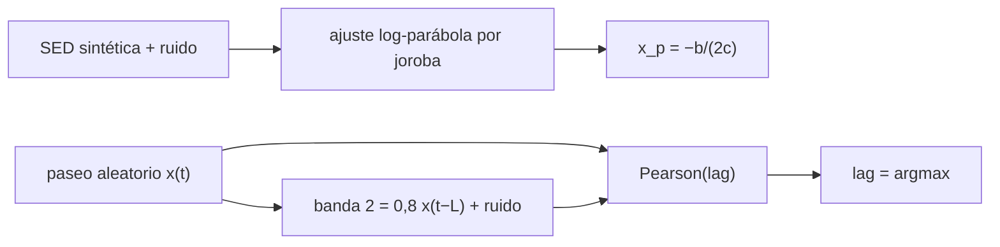

# B27-C20 — Análisis multibanda de un evento extremo

<!-- nav:top -->
[🏠 Programa](../../../../README.md) · [📚 Bloque B27](../../../tronco-comun/B27-objetos-compactos-y-altas-energias.md) · [← Anterior: B27-C19 — Observatorios de rayos X y gamma](../B27-C19-observatorios-de-rayos-x-y-gamma/CLASE.md) · [Siguiente: B27-C21 — Dispersión Compton inversa y emisión de alta energía →](../B27-C21-dispersion-compton-inversa-y-emision-de-alta-energia/CLASE.md)
<!-- /nav -->

## 1. Ubicación, nivel y alcance

Clase 20 del bloque B27. Nivel N3. Un mismo evento se observa en radio, óptico, rayos X y gamma; cada banda cuenta una parte de la historia. Aquí ajustas la **distribución espectral de energía** (SED) de dos jorobas —la que se asocia a radiación sincrotrón de [C12](../B27-C12-radiacion-sincrotron/CLASE.md) y la de alta energía— y recuperas el **retardo entre bandas** con la correlación cruzada. Usas mínimos cuadrados ([B09-C11](../../B09/B09-C11-integrales-definidas/CLASE.md) como base) y estadística de [C19](../B27-C19-observatorios-de-rayos-x-y-gamma/CLASE.md). Todos los datos son sintéticos.

## 2. Por qué esta clase existe

El caso de GW170817 con GRB 170817A mostró el valor de combinar mensajeros y bandas. La decisión central: **¿dónde están los picos de las dos jorobas y qué retardo hay entre dos bandas?**

## 3. Lo que podrás hacer al terminar

1. Ajustar una log-parábola por mínimos cuadrados lineales.
2. Obtener la posición y el valor del pico de cada joroba.
3. Generar curvas de luz sintéticas con un retardo conocido.
4. Recuperar el retardo con la correlación de Pearson en función del desfase.
5. Repetir con 100 realizaciones y resumir.
6. Reconocer los supuestos de la prueba.

La evidencia es el **análisis multibanda de un evento** del ejercicio 12 (sección 20).

## 4. Con qué llegas y cómo comprobarlo

1. ¿Qué es una SED?
2. ¿Qué es el coeficiente de correlación de Pearson?
3. ¿Qué es un paseo aleatorio?
4. ¿Qué son los mínimos cuadrados?
5. ¿Qué es un retardo entre bandas?

<details>
<summary>Ver respuestas</summary>

1. La energía por frecuencia, `νF_ν`, frente a la frecuencia. 2. La covarianza dividida por las desviaciones. 3. Una suma de pasos aleatorios. 4. El ajuste que minimiza la suma de residuos al cuadrado. 5. El desfase temporal con que una banda sigue a otra.
</details>

Con cuatro o cinco aciertos, sigue; si no, repasa B12-C26.

## 5. Un caso de contexto y un caso sintético

La observación conjunta de GW170817 y GRB 170817A (S2, resumen) es el ejemplo de por qué se combinan mensajeros. Aquí no se usa ninguna cifra de esos resultados: la SED es sintética, con picos verdaderos en `log ν = 15` y `22` y ruido de `0,03` dex, y las curvas de luz tienen un retardo verdadero de `7` muestras. Es el **ejemplo conductor**.

## 6. Vocabulario

La **SED** es `νF_ν` frente a `ν`. La **log-parábola** `log(νF_ν) = a + bx + cx²`, con `x = log ν`. El **pico** `x_p = −b/(2c)`. La **correlación cruzada** compara una curva con otra desplazada. El **retardo** es el desfase que la maximiza. Un **paseo aleatorio** sirve de curva de luz «roja».

## 7. Modelo mental: dos jorobas y un eco

La SED tiene dos jorobas; cada una es casi una parábola cerca de su máximo. Y una banda puede ser un eco retrasado y escalado de otra; el desfase que más las correlaciona es el retardo.



*Descripción textual:* cada joroba se ajusta con una parábola y su pico se calcula con una fórmula; la banda 2 es una copia retrasada de la banda 1 y el retardo se recupera maximizando la correlación.

Analogía: dos instrumentos que tocan la misma melodía con un pequeño desfase. Límite: con fuentes reales hay huecos de muestreo y ruido correlacionado.

## 8. La explicación, paso a paso

### 8.1 El ajuste

Las ecuaciones normales de una parábola son un sistema lineal de 3×3; se resuelve por eliminación gaussiana con pivoteo.

### 8.2 Los picos

| joroba | rango (`log ν`) | pico recuperado | pico verdadero | valor del pico | curvatura |
|---|---|---|---|---|---|
| baja | 11,0–18,0 | 15,006 | 15,0 | −10,008 | −0,1175 |
| alta | 19,5–25,0 | 21,979 | 22,0 | −10,814 | −0,0946 |

El error de posición es menor que `0,05` dex, la tolerancia del laboratorio.

### 8.3 Las curvas de luz

La banda 1 es un paseo aleatorio de 1000 muestras con pasos gaussianos unitarios; la banda 2 es `0,8 x(t − 7) + ruido` con ruido de desviación `0,5`.

### 8.4 El retardo

En `100` realizaciones, el desfase que maximiza la correlación (entre `−30` y `+30`) es `7` en todas: mediana `7`, media `7,00`, desviación `0,00`.

### 8.5 Alcance

La recuperación perfecta se debe a que la señal domina al ruido. Con ruido mayor o con muestreo irregular, aparecerían errores; esa prueba no se hace aquí.

## 9. Magnitudes, símbolos y unidades

| Símbolo | Qué es | Unidad | Valor / nota |
|---|---|---|---|
| `ν` | frecuencia | Hz | `10¹⁰`–`10²⁵` |
| `νF_ν` | energía por frecuencia | unidades arbitrarias | sintética |
| `x_p` | posición del pico | log Hz | 15,006; 21,979 |
| `L` | retardo verdadero | muestras | 7 |
| `lag` | retardo recuperado | muestras | 7 |
| semilla | repetibilidad | — | 20261109 |

## 10. Convenciones y referencias

SED en `log₁₀`; ruido gaussiano de `0,03` dex en la SED y de `0,5` en la banda 2; todo el material es **sintético**.

## 11. De dónde sale lo que afirmamos

| ID | Fuente | Localizador | Respalda | Estado |
|---|---|---|---|---|
| S1 | Cálculo propio: mínimos cuadrados y correlación de Pearson | implementado en `multibanda.py` | picos y retardo | Verificado contra los valores verdaderos de la simulación |
| S2 | LIGO, Virgo, Fermi y INTEGRAL, arXiv:1710.05834 | https://arxiv.org/abs/1710.05834 | contexto multimensajero | Solo resumen, consultado el 2026-11-09 |

Límites: S2 solo resumen y sin cifras usadas; no se cita ninguna SED real ni ningún retardo medido; los métodos son estándar pero no se consultó una referencia.

## 12. Cómo ver los resultados

| Cantidad | Verdadero | Recuperado |
|---|---|---|
| pico baja (`log ν`) | 15,0 | 15,006 |
| pico alta (`log ν`) | 22,0 | 21,979 |
| retardo (muestras) | 7 | 7 (mediana de 100) |

Descripción larga: los dos picos y el retardo se recuperan con errores pequeños en esta simulación.

## 13. Ejemplo trabajado: pico de una parábola

**Paso 1 · Datos.** `b = 3,525`, `c = −0,1175` (valores redondeados e ilustrativos, coherentes con la joroba baja).

**Paso 2 · Pico.** `x_p = −b/(2c)`.

**Paso 3 · Resultado.** `15,0`.

**Paso 4 · Sentido.** La joroba baja se centra en `10¹⁵ Hz`.

## 14. Distintas formas de describir el evento

**Por SED:** espectral. **Por curva de luz:** temporal. **Por retardo:** relación entre bandas. **Por mensajero:** otra información.

## 15. Práctica guiada

**Ejercicio 1 · con los pasos indicados.** Pico de `y = −0,1x² + 3x`. *Pasos:* `−b/(2c)`.

<details><summary>Solución comentada</summary>

`−3/(−0,2) = 15`.
</details>

**Ejercicio 2 · con una pista.** Valor del pico del ejercicio 1.

<details><summary>Solución comentada</summary>

`−0,1 × 225 + 45 = 22,5`.
</details>

**Ejercicio 3 · casi autónomo.** Error de posición de la joroba alta.

<details><summary>Solución comentada</summary>

`22 − 21,979 = 0,021` dex.
</details>

## 16. Práctica autónoma, transferencia e integrador

**Ejercicio 4.** Error de la joroba baja.

<details><summary>Solución comentada</summary>

`0,006` dex.
</details>

**Ejercicio 5.** Separación entre jorobas.

<details><summary>Solución comentada</summary>

`21,979 − 15,006 = 6,973` dex.
</details>

**Ejercicio 6.** Retardo recuperado menos verdadero.

<details><summary>Solución comentada</summary>

`0`.
</details>

**Ejercicio 7.** Si cada muestra son `10 s`, retardo en segundos.

<details><summary>Solución comentada</summary>

`70 s`.
</details>

**Ejercicio 8.** Ancho a media altura de una parábola con `c = −0,1175` en dex de `νF_ν`.

<details><summary>Solución comentada</summary>

Caída de `log 2 = 0,301`: `Δx = √(0,301/0,1175) = 1,60` a cada lado.
</details>

**Ejercicio 9 · transferencia.** Un compañero dice que 100/100 aciertos prueba que el método funciona con datos reales. Responde con 8.5.

<details><summary>Solución comentada</summary>

Solo prueba el caso con señal dominante; los datos reales tienen huecos y ruido correlacionado.
</details>

**Ejercicio 10 · transferencia.** ¿Por qué se ajusta cada joroba por separado?

<details><summary>Solución comentada</summary>

Porque cada una es casi parabólica en su entorno, pero la SED completa no lo es.
</details>

**Ejercicio 11 · transferencia.** ¿Qué valida comparar con los valores verdaderos?

<details><summary>Solución comentada</summary>

El código; no el modelo físico.
</details>

**Ejercicio 12 · integrador.** Elabora tu *análisis multibanda de un evento*: ajuste de las dos jorobas, tabla de picos y retardo con su histograma.

<details><summary>Solución modelo</summary>

Tabla de 8.2 y resultado de 8.4.
</details>

## 17. Laboratorio: SED y retardo

El script [multibanda.py](multibanda.py) ajusta las dos jorobas (**comprueba** `0,05` dex) y recupera el retardo en 100 realizaciones (**comprueba** `1` muestra en la mediana).

**Datos:** todo **sintético** con semilla fija. **Predice antes de ejecutar:** ¿qué retardo se recupera? (`7`.) **Ejecución del 2026-11-09 (Python 3.12.9):**

```text
Python 3.12.9 (biblioteca estandar)
joroba baja: pico en log nu = 15.006 (verdadero 15.0) ; log10(nu F_nu) en el pico = -10.008 ; curvatura = -0.1175
joroba alta: pico en log nu = 21.979 (verdadero 22.0) ; log10(nu F_nu) en el pico = -10.814 ; curvatura = -0.0946
retardo verdadero = 7 muestras ; 100 realizaciones: mediana = 7.0 ; media = 7.00 ; desviacion = 0.00
histograma de retardos (valor: veces): {7: 100}
Pruebas superadas.
```

```bash
python programa/clases/B27/B27-C20-analisis-multibanda-de-evento-extremo/multibanda.py
```

**Límites:** ruido gaussiano, muestreo regular, sin huecos, sin ruido correlacionado.

## 18. Errores frecuentes y cómo corregirlos

**Ajustar toda la SED con una parábola.** Se corrige con el ejercicio 10.

**Confundir el pico en `νF_ν` y en `F_ν`.** Se corrige con la sección 6.

**Interpretar 100/100 como prueba general.** Se corrige con el ejercicio 9.

**Olvidar la unidad del retardo.** Se corrige con el ejercicio 7.

**Tomar la SED sintética por real.** Se corrige con la sección 10.

## 19. Cómo sabrás que vas bien

Tras 8.1: ¿cómo se obtiene el pico? Si dudas, ejercicio 1. Tras 8.4: ¿qué retardo sale? Ejercicio 6. Tras el laboratorio: ¿qué valida? (el código con valores conocidos).

## 20. Qué entregas y cómo se evalúa

El producto es tu **análisis multibanda de un evento** (ejercicio 12).

| Criterio | Inicial | En desarrollo | Logrado | Destacado |
|---|---|---|---|---|
| Conceptos | Los confunde | Parciales | SED, pico, retardo | Explica los supuestos |
| Cálculo | Sin cifras | Con errores | Tabla y retardo | Compara errores |
| Numérico | Sin comprobar | Un caso | Dos comprobaciones | Interpreta la perfección del retardo |
| Fuentes | Sin fuente | Sin fecha | S1–S2 con fecha | Declara que los datos son sintéticos |
| Límites | No los nombra | Uno | Tres | Discute huecos de muestreo |

**Condiciones críticas (no se compensan con promedio):** rotular todo como sintético; no inferir resultados sobre datos reales; citar solo lo consultado.

## 21. Ética, seguridad y límites

Clase educativa: no es un análisis de datos observados. Accesibilidad: tablas equivalentes a las gráficas, fórmulas en texto, ejercicios sin conexión.

## 22. Para cerrar y seguir

Una SED de dos jorobas se resume con dos picos y la correlación entre bandas da su retardo, siempre que la señal domine el ruido. Queda una pregunta: ¿qué mecanismo produce la joroba de alta energía?

**Glosario español–inglés.** distribución espectral de energía · *spectral energy distribution (SED)*; log-parábola · *log-parabola*; correlación cruzada · *cross-correlation*; retardo · *lag*; paseo aleatorio · *random walk*; curva de luz · *light curve*.

**Continuidad.** [B27-C21](../B27-C21-dispersion-compton-inversa-y-emision-de-alta-energia/CLASE.md) estudia la dispersión Compton inversa.

**Referencias:** ver sección 11.

<!-- nav:bottom -->
---

[← Anterior: B27-C19 — Observatorios de rayos X y gamma](../B27-C19-observatorios-de-rayos-x-y-gamma/CLASE.md) · [📚 Bloque B27](../../../tronco-comun/B27-objetos-compactos-y-altas-energias.md) · [Siguiente: B27-C21 — Dispersión Compton inversa y emisión de alta energía →](../B27-C21-dispersion-compton-inversa-y-emision-de-alta-energia/CLASE.md)
<!-- /nav -->
