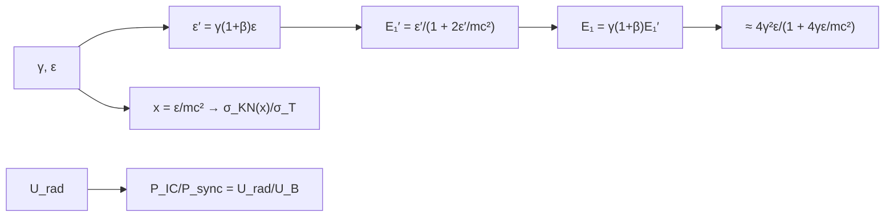

# B27-C21 — Dispersión Compton inversa y emisión de alta energía

<!-- nav:top -->
[🏠 Programa](../../../../README.md) · [📚 Bloque B27](../../../tronco-comun/B27-objetos-compactos-y-altas-energias.md) · [← Anterior: B27-C20 — Análisis multibanda de evento extremo](../B27-C20-analisis-multibanda-de-evento-extremo/CLASE.md) · [Siguiente: B27-C22 — Análisis espectral de rayos X y gamma: ajuste con respuesta instrumental →](../../../tronco-comun/B27-objetos-compactos-y-altas-energias.md#b27-c22)
<!-- /nav -->

## 1. Ubicación, nivel y alcance

Clase 21 del bloque B27. Nivel N3. La joroba de alta energía de la SED de [C20](../B27-C20-analisis-multibanda-de-evento-extremo/CLASE.md) suele producirse cuando los mismos electrones relativistas de [C12](../B27-C12-radiacion-sincrotron/CLASE.md) dispersan fotones de baja energía y les transfieren su energía: la **dispersión Compton inversa**. Aquí calculas la energía máxima del fotón dispersado de forma exacta y aproximada, el **régimen de Klein–Nishina** donde la dispersión pierde eficacia y la **razón** entre la potencia Compton y la sincrotrón. Usas relatividad especial ([B26-C03](../../B26/B26-C03-dilatacion-temporal-y-contraccion/CLASE.md)). Se trata una colisión frontal con un fotón monoenergético.

## 2. Por qué esta clase existe

Los fotones de TeV que se detectan en algunos objetos proceden de este mecanismo, y la comparación entre la potencia Compton y la sincrotrón permite estimar el campo magnético. La decisión central: **¿qué energía alcanza el fotón dispersado, cuándo deja de valer la aproximación de Thomson y qué razón de potencias se espera?**

## 3. Lo que podrás hacer al terminar

1. Calcular la energía exacta del fotón dispersado por transformación de sistemas.
2. Compararla con `4γ²ε/(1 + 4γε/mc²)`.
3. Identificar el régimen de Klein–Nishina con `x = ε/mc²`.
4. Integrar numéricamente la sección eficaz de Klein–Nishina y compararla con la forma cerrada.
5. Calcular `U_rad/U_B`.
6. Reconocer los supuestos de la colisión frontal.

La evidencia es la **ficha de dispersión Compton inversa** del ejercicio 12 (sección 20).

## 4. Con qué llegas y cómo comprobarlo

1. ¿Qué es la sección eficaz de Thomson?
2. ¿Qué es la energía de un fotón dispersado por Compton?
3. ¿Qué es una transformación de Lorentz de la energía?
4. ¿Qué es la densidad de energía de un cuerpo negro?
5. ¿Qué es el radio clásico del electrón?

<details>
<summary>Ver respuestas</summary>

1. `σ_T = (8π/3) r_e²`. 2. Depende del ángulo y de `ε/mc²`. 3. `ε′ = γ(1 + β)ε` para un fotón de frente. 4. `u = aT⁴`, con `a = 4σ_SB/c`. 5. `r_e = 2,817 940 3205 × 10⁻¹⁵ m`.
</details>

Con cuatro o cinco aciertos, sigue; si no, repasa B26-C03.

## 5. Un caso ilustrativo: fotones de 2,7 K

No se cita ninguna medición. Un fotón de un cuerpo negro de `2,7 K` tiene una energía típica de `2,7 k_BT = 6,282 × 10⁻⁴ eV` (ilustrativa). Un electrón con `γ = 10⁷` lo dispersa hasta `2,395 × 10¹¹ eV`, y con `γ = 10⁹`, hasta `4,246 × 10¹⁴ eV`. Es el **ejemplo conductor**.

## 6. Vocabulario

La **dispersión Compton inversa** transfiere energía de un electrón a un fotón. El **régimen de Thomson** vale si `4γε ≪ mc²`. El **régimen de Klein–Nishina** vale si no. La **sección eficaz de Klein–Nishina** `σ_KN(x)`. El **cociente** `P_IC/P_sync = U_rad/U_B` (Thomson). El **parámetro** `x = ε/mc²`.

## 7. Modelo mental: una raqueta que devuelve la pelota más fuerte

Un electrón muy veloz golpea un fotón lento de frente y lo devuelve con mucha más energía. Pero si la energía del fotón, vista desde el electrón, se aproxima a `mc²`, el golpe pierde eficacia y parte de la energía no se transfiere.



*Descripción textual:* se pasa al sistema de reposo del electrón, se dispersa hacia atrás con pérdida de retroceso y se vuelve al laboratorio; la aproximación compacta se compara con ese resultado; la sección eficaz decrece en Klein–Nishina; la razón de potencias depende de las dos densidades de energía.

Analogía: una raqueta contra una pelota lenta. Límite: la colisión frontal da la energía máxima, no la distribución.

## 8. La explicación, paso a paso

### 8.1 Energía exacta y aproximada

Con `ε = 6,282 × 10⁻⁴ eV`:

| `γ` | exacta (eV) | aproximada (eV) | `4γε/mc²` | `E₁/(4γ²ε)` |
|---|---|---|---|---|
| `10²` | `2,5127 × 10¹` | `2,5128 × 10¹` | `4,9175 × 10⁻⁷` | 0,999 950 |
| `10³` | `2,5128 × 10³` | `2,5128 × 10³` | `4,9175 × 10⁻⁶` | 0,999 995 |
| `10⁵` | `2,5116 × 10⁷` | `2,5116 × 10⁷` | `4,9175 × 10⁻⁴` | 0,999 508 |
| `10⁷` | `2,3950 × 10¹¹` | `2,3950 × 10¹¹` | `4,9175 × 10⁻²` | 0,953 130 |
| `10⁹` | `4,2464 × 10¹⁴` | `4,2464 × 10¹⁴` | `4,9175` | 0,168 992 |

Exacta y aproximada coinciden a `10⁻³` para `γ ≥ 100`.

### 8.2 De Thomson a Klein–Nishina

El factor `E₁/(4γ²ε)` pasa de 1 (Thomson) a `0,17` cuando `4γε/mc²` es del orden de `5`: el electrón de `γ = 10⁹` solo transfiere el 17 % de lo que daría la fórmula de Thomson.

### 8.3 La sección eficaz

`σ_KN(x)` integrada numéricamente sobre el ángulo coincide con la forma cerrada a `10⁻⁸`:

| `x` | `σ_KN` (m²) | `σ_KN/σ_T` |
|---|---|---|
| `10⁻⁶` | `6,652 445 × 10⁻²⁹` | 0,999 998 |
| `10⁻²` | `6,522 782 × 10⁻²⁹` | 0,980 507 |
| `1` | `2,865 399 × 10⁻²⁹` | 0,430 728 |
| `10` | `8,166 543 × 10⁻³⁰` | 0,122 760 |
| `100` | `1,430 985 × 10⁻³⁰` | 0,021 511 |

Además, `8πr_e²/3` coincide con `σ_T` de NIST a `10⁻⁹`.

### 8.4 La razón de potencias

`U_rad(2,7 K) = 4,0207 × 10⁻¹⁴ J/m³` y `U_B(10⁻⁹ T) = 3,9789 × 10⁻¹³ J/m³`; `P_IC/P_sync = 0,1011` en el régimen de Thomson.

### 8.5 Lectura

La energía crece como `γ²` hasta que el retroceso limita el aumento; la razón de potencias da una estimación de `B` si se miden ambas jorobas.

## 9. Magnitudes, símbolos y unidades

| Símbolo | Qué es | Unidad | Valor / nota |
|---|---|---|---|
| `γ` | factor de Lorentz | — | `10²`–`10⁹` |
| `ε` | energía del fotón | eV | `6,282 × 10⁻⁴` (ilustrativa) |
| `x` | `ε/mc²` | — | `10⁻⁶`–`10²` |
| `E₁` | energía dispersada | eV | ver 8.1 |
| `σ_KN` | sección eficaz | m² | ver 8.3 |
| `U_rad`, `U_B` | densidades de energía | J/m³ | `4,02 × 10⁻¹⁴`; `3,98 × 10⁻¹³` |

## 10. Convenciones y referencias

Colisión frontal; fotón monoenergético; electrón libre; `T = 2,7 K`, los `γ` y `B = 10⁻⁹ T` son **ilustrativos**. `m_ec² = 0,511 MeV` (S1).

## 11. De dónde sale lo que afirmamos

| ID | Fuente | Localizador | Respalda | Estado |
|---|---|---|---|---|
| S1 | NIST, *Fundamental Physical Constants — Complete Listing* (CODATA 2022) | https://physics.nist.gov/cuu/Constants/Table/allascii.txt | `c`, `e`, `m_e`, `r_e`, `σ_T`, `σ_SB`, `k_B`, `μ₀` | Consultada el 2026-11-09 |

Límites: no se cita ninguna medición; las fórmulas de la transformación, de Klein–Nishina y de la razón de potencias son estándar y se verifican en el laboratorio (energía exacta frente a aproximada, integral frente a forma cerrada, `σ_T = 8πr_e²/3`); no se consultó un texto de procesos radiativos.

## 12. Cómo ver la transición

| `γ` | `4γε/mc²` | `E₁/(4γ²ε)` |
|---|---|---|
| `10⁵` | `4,9 × 10⁻⁴` | 0,9995 |
| `10⁷` | `4,9 × 10⁻²` | 0,9531 |
| `10⁹` | `4,9` | 0,1690 |

Descripción larga: el factor cae de 1 a `0,17` cuando el parámetro de Klein–Nishina supera 1.

## 13. Ejemplo trabajado: energía de un electrón de γ = 10⁷

**Paso 1 · Datos.** `ε = 6,282 × 10⁻⁴ eV`, `γ = 10⁷`.

**Paso 2 · Thomson.** `4γ²ε = 4 × 10¹⁴ × 6,282 × 10⁻⁴ = 2,513 × 10¹¹ eV`.

**Paso 3 · Corrección.** Dividir por `1 + 0,0492` da `2,395 × 10¹¹ eV`.

**Paso 4 · Sentido.** `239,5 GeV`: una corrección del 5 %.

## 14. Distintas formas de describir el proceso

**Por energía:** `E₁`. **Por régimen:** `4γε/mc²`. **Por sección eficaz:** `σ_KN/σ_T`. **Por potencia:** `U_rad/U_B`.

## 15. Práctica guiada

**Ejercicio 1 · con los pasos indicados.** `E₁` (Thomson) para `γ = 10³`. *Pasos:* `4γ²ε`.

<details><summary>Solución comentada</summary>

`4 × 10⁶ × 6,282 × 10⁻⁴ = 2,513 × 10³ eV`.
</details>

**Ejercicio 2 · con una pista.** Parámetro `4γε/mc²` para `γ = 10⁹`. *Pista:* tabla 8.1.

<details><summary>Solución comentada</summary>

`4,92`.
</details>

**Ejercicio 3 · casi autónomo.** `σ_KN/σ_T` para `x = 1`.

<details><summary>Solución comentada</summary>

`0,4307`.
</details>

## 16. Práctica autónoma, transferencia e integrador

**Ejercicio 4.** `E₁` exacta para `γ = 10⁵` en MeV.

<details><summary>Solución comentada</summary>

`25,1 MeV`.
</details>

**Ejercicio 5.** Cociente de `E₁` entre `γ = 10⁷` y `γ = 10⁵`.

<details><summary>Solución comentada</summary>

`2,3950 × 10¹¹/2,5116 × 10⁷ = 9 536`, algo menos que `10⁴` por Klein–Nishina.
</details>

**Ejercicio 6.** `P_IC/P_sync` si `B` se divide por 10.

<details><summary>Solución comentada</summary>

Sube a `10,11`.
</details>

**Ejercicio 7.** Energía de un electrón de `γ = 10⁹` en TeV.

<details><summary>Solución comentada</summary>

`424,6 TeV`.
</details>

**Ejercicio 8.** Fracción de transferencia a `γ = 10⁹`.

<details><summary>Solución comentada</summary>

`16,9 %`.
</details>

**Ejercicio 9 · transferencia.** Un compañero dice que la energía crece siempre como `γ²`. Responde con 8.2.

<details><summary>Solución comentada</summary>

Solo en Thomson; en Klein–Nishina el crecimiento es mucho menor.
</details>

**Ejercicio 10 · transferencia.** ¿Por qué `σ_KN` decrece con `x`?

<details><summary>Solución comentada</summary>

Por el retroceso del electrón: el fotón cede energía y la interacción se hace menos probable (8.3).
</details>

**Ejercicio 11 · transferencia.** ¿Qué valida comparar la integral con la forma cerrada?

<details><summary>Solución comentada</summary>

La implementación de ambas; no la física del fotón monoenergético.
</details>

**Ejercicio 12 · integrador.** Elabora tu *ficha de dispersión Compton inversa*: energías exacta y aproximada para tres `γ`, parámetro de KN, `σ_KN/σ_T` para cinco `x` y `P_IC/P_sync`.

<details><summary>Solución modelo</summary>

Tablas de 8.1 y 8.3 y sección 8.4.
</details>

## 17. Laboratorio: Compton inversa

El script [compton_inversa.py](compton_inversa.py) calcula la energía exacta y aproximada (**comprueba** `10⁻³`), integra Klein–Nishina (**comprueba** `10⁻⁸`) y verifica `σ_T = 8πr_e²/3` y el límite de Thomson (`10⁻⁵`).

**Datos:** constantes de NIST; campo de fotones, `γ` y `B` **ilustrativos**. **Predice antes de ejecutar:** ¿cuánto vale `σ_KN/σ_T` para `x = 1`? (menos de 0,5.) **Ejecución del 2026-11-09 (Python 3.12.9):**

```text
Python 3.12.9 (biblioteca estandar)
foton tipico (2.7 kT, T = 2.7 K): eps = 6.2820e-04 eV
   gamma   E1 exacta [eV]   E1 aprox [eV]  4 gamma eps/mc2  E1/(4 gamma^2 eps)
   1e+02       2.5127e+01      2.5128e+01       4.9175e-07            0.999950
   1e+03       2.5128e+03      2.5128e+03       4.9175e-06            0.999995
   1e+05       2.5116e+07      2.5116e+07       4.9175e-04            0.999508
   1e+07       2.3950e+11      2.3950e+11       4.9175e-02            0.953130
   1e+09       4.2464e+14      4.2464e+14       4.9175e+00            0.168992
 x = eps/mc2   sigma_KN numerica [m2]   cerrada [m2]  sigma_KN/sigma_T
       1e-06             6.652445e-29   6.652445e-29          0.999998
       1e-02             6.522782e-29   6.522782e-29          0.980507
       1e+00             2.865399e-29   2.865399e-29          0.430728
       1e+01             8.166543e-30   8.166543e-30          0.122760
       1e+02             1.430985e-30   1.430985e-30          0.021511
U_rad(2.7 K) = 4.0207e-14 J/m3 ; U_B(1e-9 T) = 3.9789e-13 J/m3 ; P_IC/P_sincrotron = U_rad/U_B = 0.1011
Pruebas superadas.
```

```bash
python programa/clases/B27/B27-C21-dispersion-compton-inversa-y-emision-de-alta-energia/compton_inversa.py
```

**Límites:** colisión frontal, fotón monoenergético, sin distribución angular ni espectral.

## 18. Errores frecuentes y cómo corregirlos

**Usar Thomson con `x` grande.** Se corrige con el ejercicio 9.

**Confundir `x` y `4γx`.** Se corrige con la sección 6.

**Olvidar los dos factores `γ(1 + β)`.** Se corrige con el esquema de 7.

**Tomar el cociente de potencias como general.** Se corrige con 8.4.

**Tomar `T` y `B` ilustrativos por medidas.** Se corrige con la sección 10.

## 19. Cómo sabrás que vas bien

Tras 8.1: ¿cómo escala `E₁`? Si dudas, ejercicio 1. Tras 8.2: ¿cuándo falla Thomson? Ejercicio 9. Tras el laboratorio: ¿qué verifican las tres comprobaciones? (la energía, la sección eficaz y las constantes).

## 20. Qué entregas y cómo se evalúa

El producto es tu **ficha de dispersión Compton inversa** (ejercicio 12).

| Criterio | Inicial | En desarrollo | Logrado | Destacado |
|---|---|---|---|---|
| Conceptos | Los confunde | Parciales | Thomson, KN, razón | Explica el retroceso |
| Cálculo | Sin unidades | Con errores | Todas las magnitudes | Compara regímenes |
| Numérico | Sin comprobar | Un caso | Tres comprobaciones | Interpreta tolerancias |
| Fuentes | Sin fuente | Sin fecha | S1 con fecha | Declara que no hay datos reales |
| Límites | No los nombra | Uno | Tres | Discute distribuciones angulares |

**Condiciones críticas (no se compensan con promedio):** rotular los valores como ilustrativos; no atribuir energías a una fuente real; citar solo lo consultado.

## 21. Ética, seguridad y límites

Clase educativa: no sustituye un modelo espectral completo. Accesibilidad: tablas equivalentes a las gráficas, fórmulas en texto, ejercicios sin conexión.

## 22. Para cerrar y seguir

La energía dispersada crece como `γ²` hasta que el retroceso la limita, la sección eficaz cae con `x` y `P_IC/P_sync = U_rad/U_B` en el régimen de Thomson. Queda una pregunta: ¿cómo se ajusta un modelo espectral a conteos reales con la respuesta del instrumento?

**Glosario español–inglés.** dispersión Compton inversa · *inverse Compton scattering*; Klein–Nishina · *Klein–Nishina*; régimen de Thomson · *Thomson regime*; campo de fotones · *photon field*; retroceso · *recoil*; sección eficaz · *cross section*.

**Continuidad.** [B27-C22](../B27-C22-analisis-espectral-de-rayos-x-y-gamma/CLASE.md) estudia el ajuste espectral con respuesta instrumental.

**Referencias:** ver sección 11.

<!-- nav:bottom -->
---

[← Anterior: B27-C20 — Análisis multibanda de evento extremo](../B27-C20-analisis-multibanda-de-evento-extremo/CLASE.md) · [📚 Bloque B27](../../../tronco-comun/B27-objetos-compactos-y-altas-energias.md) · [Siguiente: B27-C22 — Análisis espectral de rayos X y gamma: ajuste con respuesta instrumental →](../../../tronco-comun/B27-objetos-compactos-y-altas-energias.md#b27-c22)
<!-- /nav -->
