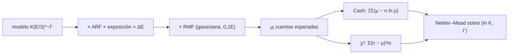

# B27-C22 — Análisis espectral de rayos X y gamma: ajuste con respuesta instrumental

<!-- nav:top -->
<!-- /nav -->

## 1. Ubicación, nivel y alcance

Clase 22 del bloque B27, la última. Nivel N3. Un detector de rayos X o gamma no mide el espectro del cielo: mide cuentas en canales, tras pasar el espectro por el **área efectiva** y la **matriz de redistribución** del instrumento. Aquí **pliegas** un modelo de ley de potencias con una respuesta sintética, ajustas con la **estadística de Cash** y con un `χ²` de varianza igual a las cuentas, y comparas el sesgo cuando hay pocas cuentas. Usas estadística de conteos ([C19](../B27-C19-observatorios-de-rayos-x-y-gamma/CLASE.md)), la ley de potencias de [C12](../B27-C12-radiacion-sincrotron/CLASE.md) y optimización numérica. Todo es sintético.

## 2. Por qué esta clase existe

Ajustar un espectro «de fotones» directamente a las cuentas da resultados engañosos; hay que plegar el modelo con la respuesta y usar la estadística correcta para conteos pequeños. La decisión central: **¿qué parámetros recupera cada estadística y con qué sesgo cuando las cuentas son pocas?**

## 3. Lo que podrás hacer al terminar

1. Construir una matriz de redistribución gaussiana normalizada.
2. Plegar un modelo con área efectiva y exposición.
3. Escribir la estadística de Cash y el `χ²` con varianza igual a las cuentas.
4. Minimizar con Nelder–Mead de dos parámetros.
5. Medir el sesgo por Monte Carlo con semilla fija.
6. Reconocer cuándo falla el `χ²`.

La evidencia es el **ajuste espectral con respuesta** del ejercicio 12 (sección 20).

## 4. Con qué llegas y cómo comprobarlo

1. ¿Qué es una ley de potencias?
2. ¿Qué es la verosimilitud de Poisson?
3. ¿Qué es un sesgo estadístico?
4. ¿Qué es un área efectiva?
5. ¿Qué es un método de optimización sin derivadas?

<details>
<summary>Ver respuestas</summary>

1. `N(E) ∝ E^{−Γ}`. 2. `∏ μⱼ^{nⱼ}e^{−μⱼ}/nⱼ!`. 3. La diferencia entre el valor medio de un estimador y el verdadero. 4. El área que cuenta fotones tras la eficiencia del instrumento. 5. Un método que usa solo valores de la función.
</details>

Con cuatro o cinco aciertos, sigue; si no, repasa B12-C26 y [C19](../B27-C19-observatorios-de-rayos-x-y-gamma/CLASE.md).

## 5. Un caso sintético con contexto

El manual de XSPEC describe el ajuste de modelos a datos con respuesta (S2, página consultada sin las definiciones de `χ²`, C-stat, RMF ni ARF); el telescopio Fermi-LAT cubre de menos de `20 MeV` a más de `300 GeV` (S3, resumen). Esta clase no usa ninguna cifra de esas fuentes: la respuesta, el espectro (`Γ = 2`, `K = 5 × 10⁻⁴` ph/cm²/s/keV a 3 keV) y la exposición (`1000 s` y `100 s`) son sintéticos. Es el **ejemplo conductor**.

## 6. Vocabulario

La **ARF** es el área efectiva en función de la energía. La **RMF** es la matriz de redistribución de energía a canal. El **plegado** (*forward folding*) es aplicar el modelo y la respuesta para predecir cuentas. La **estadística de Cash** `C = 2Σ(μ − n ln μ)`. El **`χ²` con varianza igual a las cuentas** `Σ(n − μ)²/n`. El **sesgo** es la diferencia entre la media del estimador y el valor verdadero.

## 7. Modelo mental: ver a través de un cristal borroso

El instrumento emborrona la energía y filtra los fotones. Para comparar modelo y datos hay que aplicar el mismo cristal al modelo y contar.



*Descripción textual:* el modelo se multiplica por área efectiva y exposición, se redistribuye por canales y da las cuentas esperadas; dos estadísticas se minimizan con el mismo algoritmo.

Analogía: mirar a través de un cristal borroso. Límite: la respuesta se supone perfectamente conocida.

## 8. La explicación, paso a paso

### 8.1 La respuesta sintética

15 intervalos de energía de `1` a `10 keV` (logarítmicos), 20 canales; `ARF = 200 (E/1 keV)^{−0,3} cm²`; RMF gaussiana con `σ = 0,1E`, normalizada de modo que cada columna suma 1.

### 8.2 Comprobaciones previas

Con respuesta identidad, el plegado coincide con el cálculo directo a `10⁻⁹`; las columnas de la RMF suman 1; Nelder–Mead recupera el mínimo de una cuadratica conocida (`10⁻⁶`); y un ajuste sin ruido (`n = μ`) devuelve `Γ = 2,00000` y `K = 0,00050`.

### 8.3 Exposición de 1000 s

Con `657,2` cuentas esperadas en 20 canales y 100 realizaciones:

| estadística | `Γ` medio | sesgo | desviación |
|---|---|---|---|
| Cash | 1,9963 | −0,0037 | 0,0745 |
| `χ²` (varianza = cuentas) | 2,0546 | +0,0546 | 0,0902 |

### 8.4 Exposición de 100 s

Con `65,7` cuentas esperadas:

| estadística | `Γ` medio | sesgo | desviación |
|---|---|---|---|
| Cash | 2,0022 | +0,0022 | 0,2356 |
| `χ²` (varianza = cuentas) | 2,2296 | +0,2296 | 0,3472 |

### 8.5 Lectura

Con pocas cuentas, el `χ²` con varianza igual a las observadas da un espectro sistemáticamente más blando (`Γ` mayor) y más disperso; la estadística de Cash casi no tiene sesgo. El resultado vale para este modelo y esta respuesta.

## 9. Magnitudes, símbolos y unidades

| Símbolo | Qué es | Unidad | Valor / nota |
|---|---|---|---|
| `K` | normalización a 3 keV | ph/cm²/s/keV | `5 × 10⁻⁴` (sintético) |
| `Γ` | índice fotónico | — | 2 (sintético) |
| `T` | exposición | s | 1000; 100 |
| `A(E)` | área efectiva | cm² | `200 (E/keV)^{−0,3}` |
| `μⱼ`, `nⱼ` | cuentas esperadas y observadas | — | ver 8.3–8.4 |
| semilla | repetibilidad | — | 20261109 |

## 10. Convenciones y referencias

Respuesta conocida y sin fondo; Poisson exacto (Knuth) para media `≤ 30` y gaussiana redondeada para media `> 30`; 100 realizaciones; **todo sintético**.

## 11. De dónde sale lo que afirmamos

| ID | Fuente | Localizador | Respalda | Estado |
|---|---|---|---|---|
| S1 | Cálculo propio: plegado, Cash, `χ²`, Nelder–Mead, Monte Carlo | implementado en `ajuste.py` | sesgos de 8.3–8.4 | Verificado con respuesta identidad, cuadrática conocida y ajuste sin ruido |
| S2 | Manual de XSPEC (NASA/HEASARC) | https://heasarc.gsfc.nasa.gov/xanadu/xspec/manual/ | contexto del ajuste con respuesta | Página consultada el 2026-11-09 sin las definiciones de `χ²`, C-stat, RMF ni ARF; no respalda cifras |
| S3 | Atwood et al., arXiv:0902.1089 | https://arxiv.org/abs/0902.1089 | rango de energía de Fermi-LAT | Solo resumen, consultado el 2026-11-09 |

Límites: S2 y S3 no respaldan ninguna cifra; los sesgos son de este experimento sintético con 100 realizaciones; la aproximación gaussiana del Poisson para medias grandes introduce un error menor que el de las comparaciones mostradas.

## 12. Cómo ver los sesgos

| Cuentas | Cash | `χ²` |
|---|---|---|
| 657,2 | −0,0037 | +0,0546 |
| 65,7 | +0,0022 | +0,2296 |

Descripción larga: el sesgo del `χ²` crece al bajar las cuentas; el de Cash permanece cerca de cero.

## 13. Ejemplo trabajado: error en un canal

**Paso 1 · Datos.** Un canal con `μ = 2,0` cuentas esperadas y `n = 0` observadas.

**Paso 2 · `χ²`.** `(0 − 2)²/1 = 4,0` (con varianza 1 por convención cuando `n = 0`).

**Paso 3 · Cash.** `2(μ − n ln μ) = 2 × 2,0 = 4,0`.

**Paso 4 · Con `n = 4`.** `χ² = (4 − 2)²/4 = 1,0`; la diferencia de Cash respecto de su mínimo (`μ = n`) es `2[(μ − n) + n ln(n/μ)] = 2(−2 + 4 ln 2) = 1,545`.

**Paso 5 · Sentido.** Las dos estadísticas pesan distinto los canales con pocas cuentas: el `χ²` con `n` en el denominador infravalora las fluctuaciones altas.

## 14. Distintas formas de describir el ajuste

**Por estadística:** Cash o `χ²`. **Por modelo:** ley de potencias. **Por respuesta:** ARF y RMF. **Por parámetro:** `Γ` y `K`.

## 15. Práctica guiada

**Ejercicio 1 · con los pasos indicados.** Suma de una columna de la RMF. *Pasos:* normalización.

<details><summary>Solución comentada</summary>

1, por construcción.
</details>

**Ejercicio 2 · con una pista.** `ARF` a `10 keV`. *Pista:* `200 × 10^{−0,3}`.

<details><summary>Solución comentada</summary>

`200 × 0,501 = 100,2 cm²`.
</details>

**Ejercicio 3 · casi autónomo.** Cuentas esperadas en el modelo de 1000 s respecto al de 100 s.

<details><summary>Solución comentada</summary>

`657,2/65,7 = 10`.
</details>

## 16. Práctica autónoma, transferencia e integrador

**Ejercicio 4.** Sesgo del `χ²` con 1000 s.

<details><summary>Solución comentada</summary>

`+0,0546`.
</details>

**Ejercicio 5.** Sesgo del `χ²` con 100 s.

<details><summary>Solución comentada</summary>

`+0,2296`.
</details>

**Ejercicio 6.** Cociente de las desviaciones de Cash entre 100 s y 1000 s.

<details><summary>Solución comentada</summary>

`0,2356/0,0745 = 3,16 ≈ √10`.
</details>

**Ejercicio 7.** Error típico del promedio de 100 realizaciones de Cash con 100 s.

<details><summary>Solución comentada</summary>

`0,2356/√100 = 0,024`: el sesgo `+0,0022` es indistinguible de cero.
</details>

**Ejercicio 8.** Mismo cálculo para el `χ²` con 100 s.

<details><summary>Solución comentada</summary>

`0,3472/10 = 0,035`: el sesgo `+0,2296` es unas 6,6 veces mayor que su error.
</details>

**Ejercicio 9 · transferencia.** Un compañero dice que el `χ²` es válido siempre que haya más de 20 canales. Responde con 8.4.

<details><summary>Solución comentada</summary>

La validez depende de las cuentas por canal, no del número de canales; con pocas, el `χ²` con varianza observada es sesgado.
</details>

**Ejercicio 10 · transferencia.** ¿Por qué se usan dos parámetros `(ln K, Γ)` con pivote en 3 keV?

<details><summary>Solución comentada</summary>

El pivote reduce la correlación entre `K` y `Γ` y mejora la convergencia del minimizador.
</details>

**Ejercicio 11 · transferencia.** ¿Qué valida el ajuste sin ruido?

<details><summary>Solución comentada</summary>

Que el plegado y el minimizador recuperan los parámetros; no el comportamiento con ruido.
</details>

**Ejercicio 12 · integrador.** Elabora tu *ajuste espectral con respuesta*: tablas de 8.3 y 8.4, las tres comprobaciones previas y una frase sobre cuándo usar cada estadística.

<details><summary>Solución modelo</summary>

Secciones 8.2–8.5.
</details>

## 17. Laboratorio: ajuste con respuesta

El script [ajuste.py](ajuste.py) construye la respuesta, pliega, ajusta con Cash y con `χ²` en 100 realizaciones por exposición (**comprueba** `|sesgo de Cash| < 0,1`) y verifica el plegado con respuesta identidad (`10⁻⁹`).

**Datos:** todo **sintético** con semilla fija. **Predice antes de ejecutar:** ¿cuál de las dos estadísticas tendrá menos sesgo con pocas cuentas? (Cash.) **Ejecución del 2026-11-09 (Python 3.12.9):**

```text
Python 3.12.9 (biblioteca estandar)
plegado con respuesta identidad: correcto ; columnas de la RMF suman 1 ; Nelder-Mead recupera el minimo de una cuadratica
cuentas esperadas totales = 657.2 en 20 canales (1.0-10.0 keV, exposicion 1000 s)
ajuste sin ruido (n = mu): Gamma = 2.00000 ; K = 0.00050
Cash: Gamma medio = 1.9963 (sesgo -0.0037) ; desviacion = 0.0745
chi2 con varianza = cuentas: Gamma medio = 2.0546 (sesgo +0.0546) ; desviacion = 0.0902
exposicion reducida a 100 s: cuentas esperadas = 65.7
Cash: Gamma medio = 2.0022 (sesgo +0.0022) ; desviacion = 0.2356
chi2 con varianza = cuentas: Gamma medio = 2.2296 (sesgo +0.2296) ; desviacion = 0.3472
Pruebas superadas.
```

```bash
python programa/clases/B27/B27-C22-analisis-espectral-de-rayos-x-y-gamma/ajuste.py
```

**Límites:** respuesta conocida, sin fondo, modelo de dos parámetros, 100 realizaciones.

## 18. Errores frecuentes y cómo corregirlos

**Ajustar sin plegar.** Se corrige con la sección 7.

**Usar `χ²` con pocas cuentas.** Se corrige con el ejercicio 9.

**Olvidar el pivote.** Se corrige con el ejercicio 10.

**Confundir cuentas esperadas y observadas.** Se corrige con la sección 6.

**Generalizar el sesgo medido.** Se corrige con la sección 11.

## 19. Cómo sabrás que vas bien

Tras 8.1: ¿qué hace la RMF? Si dudas, ejercicio 1. Tras 8.4: ¿qué estadística es mejor con pocas cuentas? Ejercicio 9. Tras el laboratorio: ¿qué valida el ajuste sin ruido? (el plegado y el minimizador).

## 20. Qué entregas y cómo se evalúa

El producto es tu **ajuste espectral con respuesta** (ejercicio 12).

| Criterio | Inicial | En desarrollo | Logrado | Destacado |
|---|---|---|---|---|
| Conceptos | Los confunde | Parciales | Plegado, Cash, `χ²` | Explica el sesgo |
| Cálculo | Sin cifras | Con errores | Dos tablas | Compara exposiciones |
| Numérico | Sin comprobar | Un caso | Tres comprobaciones | Interpreta errores del promedio |
| Fuentes | Sin fuente | Sin fecha | S1–S3 con fecha | Declara que S2 no respalda cifras |
| Límites | No los nombra | Uno | Tres | Discute fondo y respuesta incierta |

**Condiciones críticas (no se compensan con promedio):** rotular todo como sintético; no inferir sesgos sobre datos reales; citar solo lo consultado.

## 21. Ética, seguridad y límites

Clase educativa: no sustituye un paquete de análisis espectral. Accesibilidad: tablas equivalentes a las gráficas, fórmulas en texto, ejercicios sin conexión.

## 22. Para cerrar y seguir

Un modelo se compara con las cuentas tras plegarlo con la respuesta; con pocas cuentas, la estadística de Cash casi no tiene sesgo y el `χ²` con varianza observada sí. Con esta clase se cierra el bloque B27; el siguiente es [B28](../../../tronco-comun/B28-astronomia-multimensajero.md).

**Glosario español–inglés.** matriz de redistribución · *redistribution matrix (RMF)*; área efectiva · *effective area (ARF)*; plegado · *forward folding*; estadística de Cash · *Cash statistic*; índice fotónico · *photon index*; sesgo · *bias*.

**Continuidad.** Fin del bloque B27.

**Referencias:** ver sección 11.

<!-- nav:bottom -->
<!-- /nav -->
