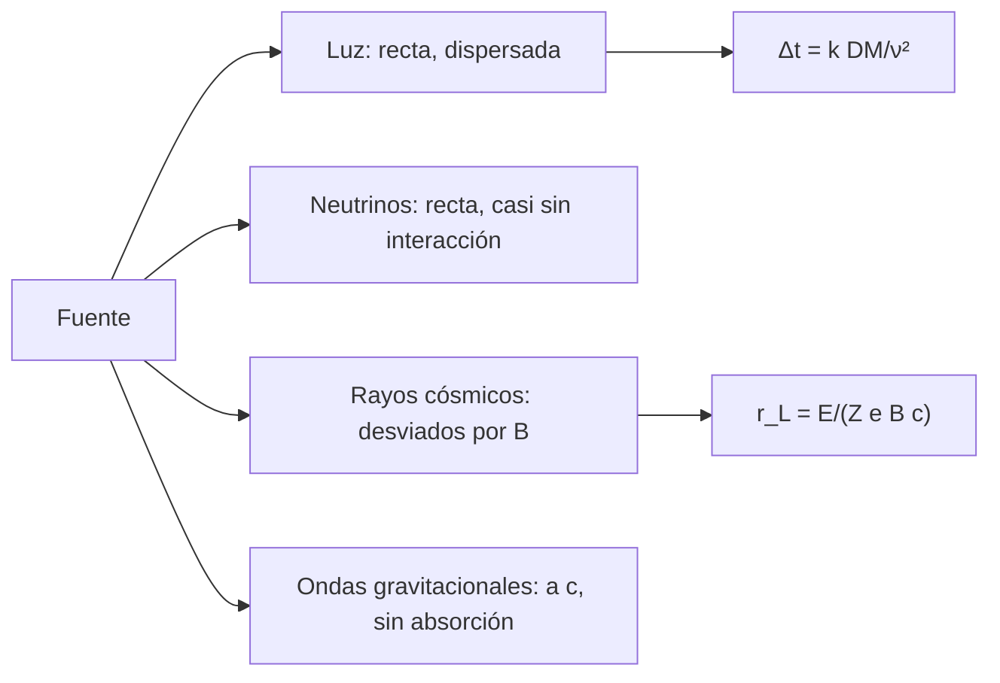

# B28-C01 — Fundamentos de mensajeros astronómicos

<!-- nav:top -->
[🏠 Programa](../../../../README.md) · [📚 Bloque B28](../../../tronco-comun/B28-astronomia-multimensajero.md) · [← Anterior: B27-C22 — Análisis espectral de rayos X y gamma: ajuste con respuesta instrumental](../../../tronco-comun/B27-objetos-compactos-y-altas-energias.md#b27-c22) · [Siguiente: B28-C02 — Fotones en múltiples longitudes de onda →](../B28-C02-fotones-en-multiples-longitudes-de-onda/CLASE.md)
<!-- /nav -->

## 1. Ubicación, nivel y alcance

Clase 1 del bloque B28. Nivel N3. La astronomía clásica usa un solo mensajero, la luz. La astronomía multimensajero suma otros tres: **neutrinos**, **rayos cósmicos** y **ondas gravitacionales**. Aquí aprendes qué distingue a cada uno —carga, masa, interacción, velocidad— y calculas tres consecuencias: la **deflexión** de una partícula cargada en un campo magnético, la **dispersión** de una señal de radio en el plasma y el **retardo** de un neutrino con masa. Usas electromagnetismo ([B05-C17](../../B05/B05-C17-campos-magneticos/CLASE.md)) y los objetos de [B27](../../../tronco-comun/B27-objetos-compactos-y-altas-energias.md). Se trata un campo uniforme y un plasma frío.

## 2. Por qué esta clase existe

Un solo evento, como una fusión de estrellas de neutrones, emite varios mensajeros que llegan por caminos y en momentos distintos. Entender por qué unos llegan alineados con la fuente y otros no es el primer paso para combinarlos. La decisión central: **¿qué mensaje trae cada mensajero y cuánto se desvía o se retrasa en el camino?**

## 3. Lo que podrás hacer al terminar

1. Comparar los cuatro mensajeros por carga, masa y capacidad de atravesar materia.
2. Calcular el radio de Larmor `r_L = E/(Z e B c)` de una partícula cargada.
3. Estimar el exceso de camino de un rayo cósmico en un campo magnético.
4. Calcular la constante y el retardo de dispersión del plasma.
5. Calcular el retraso de un neutrino con masa de forma estable.
6. Reconocer qué mensajeros apuntan a la fuente y cuáles no.

La evidencia es la **ficha de comparación de mensajeros** del ejercicio 12 (sección 20).

## 4. Con qué llegas y cómo comprobarlo

1. ¿Qué fuerza siente una carga en un campo magnético?
2. ¿Qué es la frecuencia de plasma?
3. ¿Qué es un neutrino?
4. ¿Qué es una onda gravitacional?
5. ¿Qué es un parsec en metros?

<details>
<summary>Ver respuestas</summary>

1. La de Lorentz, perpendicular a la velocidad. 2. La frecuencia propia de oscilación de los electrones del plasma. 3. Una partícula neutra y muy ligera que casi no interactúa. 4. Una perturbación de la métrica que se propaga a `c`. 5. `648 000/π` unidades astronómicas, `3,0857 × 10¹⁶ m`.
</details>

Con cuatro o cinco aciertos, sigue; si no, repasa B05-C17.

## 5. Un caso real: GW170817 con cuatro formas de llegar

El evento GW170817 se observó en ondas gravitacionales y, unos `1,7 s` después de la fusión, como destello gamma (S3, resumen). Se localizó en `31 grados cuadrados` a una distancia de `40 (+8, −8) Mpc` (S3, resumen). La luz y las ondas gravitacionales tardaron `4,1171 × 10¹⁵ s` (130 millones de años) en llegar; un rayo cósmico cargado habría llegado desviado y mucho después, y por eso no se asocia a una dirección. Es el **ejemplo conductor**.

## 6. Vocabulario

Un **mensajero** es el portador de información de una fuente. El **radio de Larmor** es el radio de la órbita circular de una carga en un campo. La **dispersión del plasma** retrasa más las frecuencias bajas. La **medida de dispersión** (DM) es la columna de electrones. El **retraso por masa** afecta a partículas con masa en reposo. Una **cota** es un límite, no una medición.

## 7. Modelo mental: cuatro carteros

Cuatro carteros salen de la misma ciudad. El de la luz llega por el camino recto pero se atrasa si cruza un pueblo con niebla (plasma). El de los neutrinos llega recto y casi sin parar, pero es difícil de atrapar. El de los rayos cósmicos va dando vueltas por los campos magnéticos y llega por cualquier lado. El de las ondas gravitacionales cruza todo sin tocar nada.



*Descripción textual:* de la misma fuente salen cuatro mensajeros; la luz se dispersa en el plasma, los neutrinos y las ondas gravitacionales viajan rectos, y los rayos cósmicos se desvían según su radio de Larmor.

Analogía: carteros con rutas distintas. Límite: no todos los eventos emiten los cuatro.

## 8. La explicación, paso a paso

### 8.1 Radio de Larmor

`r_L = E/(Z e B c)`. Con `B = 3 μG = 3 × 10⁻¹⁰ T`:

| `E` (eV) | `Z` | `r_L` (pc) |
|---|---|---|
| `10¹⁵` | 1 | 0,36034 |
| `10¹⁸` | 1 | 360,34 |
| `10¹⁸` | 26 | 13,859 |
| `10²⁰` | 1 | `3,6034 × 10⁴` (36,03 kpc) |

Un protón de `10¹⁸ eV` gira en un radio de `0,36 kpc`, comparable al grosor del disco galáctico: no apunta a su fuente.

### 8.2 Exceso de camino

Para un protón de `10¹⁹ eV` (`r_L = 3,603 kpc`) y `d = 1 kpc`, el arco mide `s = r_L · 2 asin(d/2r_L)`. El exceso `s − d` es `3,2372 pc` exacto y `3,2090 pc` con `d³/(24 r_L²)`, un `0,9 %` de diferencia; el retardo es `10,56 años`.

### 8.3 Dispersión del plasma

La constante `e²/(8π²ε₀m_ec)` da `4148,81 s MHz² cm³/pc`. Con `DM = 100 pc/cm³`: `0,2117 s` a `1,4 GHz` y `2,5930 s` a `0,4 GHz`. Las frecuencias bajas llegan después.

### 8.4 Neutrino con masa

Con `mc² = 0,1 eV` (ilustrativa) y `d = 40 Mpc`: retraso de `0,2059 s` a `10 MeV` y `2,06 × 10⁻¹¹ s` a `1 TeV`. Cae como `1/E²`.

### 8.5 Quién apunta a la fuente

Ondas gravitacionales, neutrinos y luz (si el plasma se corrige) conservan la dirección; los rayos cósmicos solo a energías extremas o sobre distancias cortas.

## 9. Magnitudes, símbolos y unidades

| Símbolo | Qué es | Unidad | Valor / nota |
|---|---|---|---|
| `r_L` | radio de Larmor | m, pc | ver 8.1 |
| `B` | campo magnético | T | `3 × 10⁻¹⁰` (ilustrativo) |
| `Z` | número atómico | — | 1; 26 |
| `DM` | medida de dispersión | pc cm⁻³ | 100 (ilustrativa) |
| `mc²` | masa del neutrino | eV | 0,1 (ilustrativa) |
| `d` | distancia | Mpc | 40 (S3) |

## 10. Convenciones y referencias

Campo uniforme; plasma frío; `E` en eV; `1 pc = 648 000/π au`. El campo, la DM y la masa del neutrino son **ilustrativos**.

## 11. De dónde sale lo que afirmamos

| ID | Fuente | Localizador | Respalda | Estado |
|---|---|---|---|---|
| S1 | NIST, *Fundamental Physical Constants — Complete Listing* (CODATA 2022) | https://physics.nist.gov/cuu/Constants/Table/allascii.txt | `c`, `e`, `m_e`, `ε₀` | Consultada el 2026-11-09 |
| S2 | IERS Technical Note 36, Tabla 1.1 | https://iers-conventions.obspm.fr/ | `au` | Consultada el 2026-11-09 |
| S3 | LIGO Scientific, Virgo y colaboraciones, arXiv:1710.05833 | https://arxiv.org/abs/1710.05833 | `~1,7 s`; `31 grados²`; `40 (+8, −8) Mpc` | Solo resumen, consultado el 2026-11-09 |

Límites: S3 solo resumen; las fórmulas de Larmor, de la dispersión y del retraso son estándar y se verifican en el laboratorio (arco exacto frente a aproximado y constante de dispersión dentro del `0,5 %` de `4,149 × 10³`); no se consultó un texto de plasma.

## 12. Cómo ver la comparación

| Mensajero | Carga | Se desvía | Atraviesa materia | Retardo típico |
|---|---|---|---|---|
| Luz | no | no (se dispersa) | poco | `Δt ∝ DM/ν²` |
| Neutrino | no | no | mucho | `∝ 1/E²` |
| Rayo cósmico | sí | sí | poco | años |
| Onda gravitacional | no | no | todo | ninguno |

Descripción larga: la tabla resume qué mensajeros conservan la dirección y cuáles se retrasan.

## 13. Ejemplo trabajado: ¿apunta a la fuente?

**Paso 1 · Datos.** Protón de `10¹⁸ eV` en `3 μG`.

**Paso 2 · Radio.** `r_L = 360 pc`.

**Paso 3 · Comparación.** La fuente está a varios kpc.

**Paso 4 · Sentido.** `d ≫ r_L`: el protón se desvía por completo y no apunta a su fuente.

## 14. Distintas formas de describir un mensajero

**Por carga:** neutro o cargado. **Por interacción:** fuerte, electromagnética, débil o gravitatoria. **Por retraso:** con o sin dispersión. **Por dirección:** conserva o pierde la fuente.

## 15. Práctica guiada

**Ejercicio 1 · con los pasos indicados.** `r_L` de un protón de `10¹⁸ eV` en `3 μG`. *Pasos:* `E/(ZBc)`.

<details><summary>Solución comentada</summary>

`10¹⁸/(3 × 10⁻¹⁰ × 2,998 × 10⁸) = 1,11 × 10¹⁹ m = 360 pc`.
</details>

**Ejercicio 2 · con una pista.** `r_L` de un núcleo de hierro de igual energía. *Pista:* divide por `Z`.

<details><summary>Solución comentada</summary>

`360,34/26 = 13,86 pc`.
</details>

**Ejercicio 3 · casi autónomo.** Retardo por dispersión a `1,4 GHz` con `DM = 100`.

<details><summary>Solución comentada</summary>

`4148,81 × 100/1400² = 0,2117 s`.
</details>

## 16. Práctica autónoma, transferencia e integrador

**Ejercicio 4.** Retardo a `0,4 GHz`.

<details><summary>Solución comentada</summary>

`2,5930 s`.
</details>

**Ejercicio 5.** Cociente de retardos entre `0,4` y `1,4 GHz`.

<details><summary>Solución comentada</summary>

`(1,4/0,4)² = 12,25`.
</details>

**Ejercicio 6.** Tiempo de viaje de la luz desde `40 Mpc` en millones de años.

<details><summary>Solución comentada</summary>

`4,1171 × 10¹⁵ s ≈ 130,5 Ma`.
</details>

**Ejercicio 7.** Retraso de un neutrino de `100 MeV` con `0,1 eV`.

<details><summary>Solución comentada</summary>

`0,2059 s × (10/100)² = 2,06 × 10⁻³ s`.
</details>

**Ejercicio 8.** Energía de un protón con `r_L = 1 kpc` en `3 μG`.

<details><summary>Solución comentada</summary>

`E = r_L Z B c = 3,0857 × 10¹⁹ × 3 × 10⁻¹⁰ × 2,998 × 10⁸ = 2,78 × 10¹⁸ eV`.
</details>

**Ejercicio 9 · transferencia.** Un compañero dice que un rayo cósmico de `10¹⁸ eV` apunta a su fuente. Responde con 8.1.

<details><summary>Solución comentada</summary>

Su `r_L` de `360 pc` es menor que las distancias a las fuentes galácticas: se desvía.
</details>

**Ejercicio 10 · transferencia.** ¿Por qué se observan los púlsares de radio con retardo dependiente de la frecuencia?

<details><summary>Solución comentada</summary>

Por la dispersión del plasma interestelar: `Δt ∝ DM/ν²`.
</details>

**Ejercicio 11 · transferencia.** ¿Qué valida comparar el arco exacto y el aproximado?

<details><summary>Solución comentada</summary>

Que la aproximación `d³/(24r²)` es buena para `d/r < 0,3`; no que el campo sea realista.
</details>

**Ejercicio 12 · integrador.** Elabora tu *ficha de comparación de mensajeros*: tabla de la sección 12 completada con cifras para una fuente a 40 Mpc, `r_L` para tres energías y retardos por dispersión y masa.

<details><summary>Solución modelo</summary>

Secciones 8.1–8.4 y 12.
</details>

## 17. Laboratorio: deflexión, dispersión y retardo

El script [mensajeros.py](mensajeros.py) calcula `r_L`, el arco exacto y aproximado (**comprueba** `1 %`), la constante de dispersión (**comprueba** `0,5 %`) y los retrasos.

**Datos:** constantes de NIST/IERS; campo, DM y masa del neutrino **ilustrativos**; `40 Mpc` de S3. **Predice antes de ejecutar:** ¿qué `r_L` tiene un protón de `10¹⁸ eV`? (≈`0,36 kpc`.) **Ejecución del 2026-11-09 (Python 3.12.9):**

```text
Python 3.12.9 (biblioteca estandar)
B = 3 microgauss = 3.0e-10 T ; 1 pc = 3.085678e+16 m
   E [eV]   Z     r_L [pc]  r_L [kpc]
    1e+15   1   3.6034e-01     0.0004
    1e+18   1   3.6034e+02     0.3603
    1e+18  26   1.3859e+01     0.0139
    1e+20   1   3.6034e+04    36.0336
proton de 1e19 eV, d = 1 kpc, r_L = 3.603 kpc: exceso de camino = 3.2372 pc (aprox 3.2090) ; retardo = 10.56 anios
constante de dispersion = 4148.81 s MHz^2 cm^3/pc
DM = 100 pc/cm3, nu = 1.4 GHz: retardo = 0.2117 s
DM = 100 pc/cm3, nu = 0.4 GHz: retardo = 2.5930 s
40 Mpc = 1.2343e+24 m ; luz/ondas gravitacionales: 4.1171e+15 s
neutrino de 1e+01 MeV con mc2 = 0.1 eV: retraso = 2.0585e-01 s
neutrino de 1e+06 MeV con mc2 = 0.1 eV: retraso = 2.0585e-11 s
Pruebas superadas.
```

```bash
python programa/clases/B28/B28-C01-fundamentos-de-mensajeros-astronomicos/mensajeros.py
```

**Límites:** campo uniforme, sin pérdidas de energía, plasma frío, sin anisotropía del campo galáctico.

## 18. Errores frecuentes y cómo corregirlos

**Confundir `E` en J y en eV.** Se corrige con la sección 10.

**Olvidar `Z`.** Se corrige con el ejercicio 2.

**Creer que la dispersión es un retraso de la fuente.** Se corrige con el ejercicio 10.

**Tomar la masa del neutrino por medida.** Se corrige con la sección 10.

**Creer que todo rayo cósmico apunta a su fuente.** Se corrige con el ejercicio 9.

## 19. Cómo sabrás que vas bien

Tras 8.1: ¿qué pasa con `r_L` si `Z` crece? Si dudas, ejercicio 2. Tras 8.3: ¿qué frecuencia llega antes? La alta. Tras el laboratorio: ¿qué valida la constante de dispersión? (la derivación desde constantes fundamentales).

## 20. Qué entregas y cómo se evalúa

El producto es tu **ficha de comparación de mensajeros** (ejercicio 12).

| Criterio | Inicial | En desarrollo | Logrado | Destacado |
|---|---|---|---|---|
| Conceptos | Los confunde | Parciales | Cuatro mensajeros | Explica por qué unos apuntan y otros no |
| Cálculo | Sin unidades | Con errores | `r_L`, DM, retraso | Compara escalas |
| Numérico | Sin comprobar | Un caso | Dos tolerancias | Interpreta aproximaciones |
| Fuentes | Sin fuente | Sin fecha | S1–S3 con fecha | Declara S3 como resumen |
| Límites | No los nombra | Uno | Tres | Discute campos reales |

**Condiciones críticas (no se compensan con promedio):** rotular campo, DM y masa como ilustrativos; no atribuir un retardo a la fuente sin separar la dispersión; citar solo lo consultado.

## 21. Ética, seguridad y límites

Clase educativa: no sustituye un modelo de propagación. Accesibilidad: tablas equivalentes a las gráficas, fórmulas en texto, ejercicios sin conexión.

## 22. Para cerrar y seguir

Cada mensajero trae información distinta y llega por un camino distinto: la luz se dispersa, los neutrinos y las ondas gravitacionales viajan rectos y los rayos cósmicos se desvían. Queda una pregunta: ¿cómo se aprovecha la luz en todas sus longitudes de onda?

**Glosario español–inglés.** mensajero · *messenger*; radio de Larmor · *Larmor (gyro)radius*; medida de dispersión · *dispersion measure*; retraso por masa · *mass-induced delay*; rayo cósmico · *cosmic ray*; onda gravitacional · *gravitational wave*.

**Continuidad.** [B28-C02](../B28-C02-fotones-en-multiples-longitudes-de-onda/CLASE.md) estudia los fotones en múltiples longitudes de onda.

**Referencias:** ver sección 11.

<!-- nav:bottom -->
---

[← Anterior: B27-C22 — Análisis espectral de rayos X y gamma: ajuste con respuesta instrumental](../../../tronco-comun/B27-objetos-compactos-y-altas-energias.md#b27-c22) · [📚 Bloque B28](../../../tronco-comun/B28-astronomia-multimensajero.md) · [Siguiente: B28-C02 — Fotones en múltiples longitudes de onda →](../B28-C02-fotones-en-multiples-longitudes-de-onda/CLASE.md)
<!-- /nav -->
