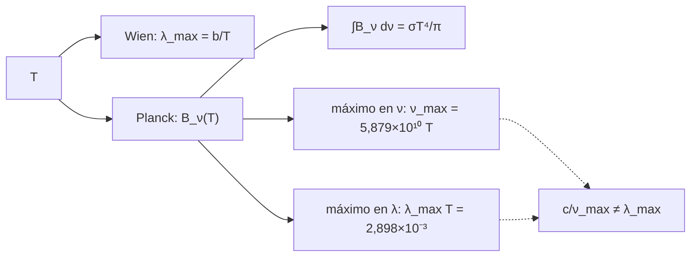

# B28-C02 — Fotones en múltiples longitudes de onda

<!-- nav:top -->
[🏠 Programa](../../../../README.md) · [📚 Bloque B28](../../../tronco-comun/B28-astronomia-multimensajero.md) · [← Anterior: B28-C01 — Fundamentos de mensajeros astronómicos](../B28-C01-fundamentos-de-mensajeros-astronomicos/CLASE.md) · [Siguiente: B28-C03 — Neutrinos astrofísicos →](../B28-C03-neutrinos-astrofisicos/CLASE.md)
<!-- /nav -->

## 1. Ubicación, nivel y alcance

Clase 2 del bloque B28. Nivel N3. Los fotones son el mensajero más antiguo y más rico: de las ondas de radio a los rayos gamma cubren más de veinte órdenes de magnitud de energía. Aquí conviertes entre **frecuencia, longitud de onda, energía y temperatura equivalente**, calculas la **ley de Planck**, verificas su integral total y los **desplazamientos de Wien**, y descubres por qué los dos máximos del cuerpo negro (en frecuencia y en longitud de onda) no coinciden. Usas el espectro estelar de [B24-C10](../../B24/B24-C10-espectros-y-clasificacion-estelar/CLASE.md) y los procesos de [B27-C12](../../B27/B27-C12-radiacion-sincrotron/CLASE.md). Se trata un cuerpo negro ideal.

## 2. Por qué esta clase existe

Cada banda revela un proceso distinto; combinarlas exige convertir bien las unidades y saber qué banda corresponde a qué temperatura. La decisión central: **¿en qué banda emite un objeto de temperatura dada y cómo se pasa de una magnitud a otra sin error?**

## 3. Lo que podrás hacer al terminar

1. Convertir entre `ν`, `λ`, `E` y `E/k_B`.
2. Calcular la radiancia de Planck `B_ν` y `B_λ`.
3. Verificar `∫B_ν dν = σT⁴/π` por cuadratura.
4. Localizar los máximos de `B_ν` y `B_λ` y compararlos con Wien.
5. Explicar por qué `c/ν_max ≠ λ_max`.
6. Asociar una temperatura con una banda.

La evidencia es la **ficha de bandas y temperaturas** del ejercicio 12 (sección 20).

## 4. Con qué llegas y cómo comprobarlo

1. ¿Qué relación hay entre `λ` y `ν`?
2. ¿Qué es la energía de un fotón?
3. ¿Qué es el cuerpo negro?
4. ¿Qué es una cuadratura de Simpson?
5. ¿Qué es la temperatura efectiva?

<details>
<summary>Ver respuestas</summary>

1. `c = λν`. 2. `E = hν`. 3. Un emisor ideal que sigue la ley de Planck. 4. Una integral con parábolas. 5. La temperatura del cuerpo negro con el mismo flujo.
</details>

Con cuatro o cinco aciertos, sigue; si no, repasa B24-C10.

## 5. Un caso real: el Sol como cuerpo negro de referencia

La UAI fija una temperatura efectiva nominal del Sol de `5772 K` (S2). Con ella, el flujo del cuerpo negro es `σT⁴ = 6,2939 × 10⁷ W/m²` y el máximo de `B_λ` cae en `502,04 nm`, en el óptico; el máximo de `B_ν` cae en `3,3933 × 10¹⁴ Hz`, que equivale a `883,5 nm`, en el infrarrojo cercano. Es el **ejemplo conductor**.

## 6. Vocabulario

La **radiancia espectral** `B_ν` es energía por área, tiempo, ángulo sólido y frecuencia. La **ley de Wien** relaciona el máximo con `T`. Una **banda** es un intervalo de energía. La **temperatura equivalente** `E/k_B` compara una energía con una temperatura. El **cuerpo negro** emite según Planck.

## 7. Modelo mental: un abanico de ventanas

Cada banda es una ventana distinta al mismo objeto: el radio ve gas frío y electrones en campos magnéticos, el óptico ve estrellas, los rayos X ven gas a millones de grados. La temperatura equivalente dice cuán caliente tendría que estar un cuerpo negro para emitir su máximo allí.



*Descripción textual:* de la temperatura salen la ley de Planck y los desplazamientos de Wien; su integral da el flujo total; los dos máximos no coinciden porque dependen de la variable espectral.

Analogía: medir la altura de una multitud por personas o por filas. Límite: los objetos reales no son cuerpos negros ideales.

## 8. La explicación, paso a paso

### 8.1 Conversión entre magnitudes

| banda | `ν` (Hz) | `λ` (m) | `E` (eV) | `E/k_B` (K) |
|---|---|---|---|---|
| radio 1 GHz | `1,000 × 10⁹` | `2,998 × 10⁻¹` | `4,1357 × 10⁻⁶` | `4,7992 × 10⁻²` |
| mm 300 GHz | `3,000 × 10¹¹` | `9,993 × 10⁻⁴` | `1,2407 × 10⁻³` | `1,4398 × 10¹` |
| IR 10 µm | `2,998 × 10¹³` | `1,000 × 10⁻⁵` | `1,2398 × 10⁻¹` | `1,4388 × 10³` |
| óptico 550 nm | `5,451 × 10¹⁴` | `5,500 × 10⁻⁷` | `2,2543` | `2,6160 × 10⁴` |
| UV 100 nm | `2,998 × 10¹⁵` | `1,000 × 10⁻⁷` | `1,2398 × 10¹` | `1,4388 × 10⁵` |
| X 1 keV | `2,418 × 10¹⁷` | `1,240 × 10⁻⁹` | `1,0000 × 10³` | `1,1605 × 10⁷` |
| gamma 1 MeV | `2,418 × 10²⁰` | `1,240 × 10⁻¹²` | `1,0000 × 10⁶` | `1,1605 × 10¹⁰` |
| gamma 1 TeV | `2,418 × 10²⁶` | `1,240 × 10⁻¹⁸` | `1,0000 × 10¹²` | `1,1605 × 10¹⁶` |

### 8.2 La integral de Planck

Con `T = 5772 K`, la cuadratura de Simpson da `∫B_ν dν = 2,003398 × 10⁷ W m⁻² sr⁻¹`, igual a `σT⁴/π` a `10⁻⁹`.

### 8.3 Los máximos de Wien

La razón áurea localiza `ν_max = 3,3933 × 10¹⁴ Hz` y `λ_max = 502,04 nm`, ambos iguales a las constantes de Wien de NIST a `10⁻⁶` (el máximo es plano, y la precisión de la búsqueda está limitada).

### 8.4 Por qué no coinciden

`c/ν_max = 883,5 nm`, no `502,0 nm`: al cambiar la variable de `ν` a `λ` cambia la forma del espectro por el factor `dν/dλ ∝ λ⁻²`.

### 8.5 Temperatura y banda

| `T` (K) | `λ_max` (m) | banda del máximo |
|---|---|---|
| 2,7255 | `1,063 × 10⁻³` | radio-mm |
| 300 | `9,659 × 10⁻⁶` | IR |
| 5772 | `5,020 × 10⁻⁷` | óptico |
| `10⁴` | `2,898 × 10⁻⁷` | UV |
| `10⁷` | `2,898 × 10⁻¹⁰` | X |
| `10⁹` | `2,898 × 10⁻¹²` | gamma |

## 9. Magnitudes, símbolos y unidades

| Símbolo | Qué es | Unidad | Valor / nota |
|---|---|---|---|
| `h` | constante de Planck | J s | `6,62607015 × 10⁻³⁴` (exacta, S1) |
| `k_B` | constante de Boltzmann | J/K | `1,380649 × 10⁻²³` (exacta, S1) |
| `σ` | Stefan–Boltzmann | W m⁻² K⁻⁴ | `5,670374419 × 10⁻⁸` (S1) |
| `b_λ` | Wien en longitud | m K | `2,897771955 × 10⁻³` (S1) |
| `b_ν` | Wien en frecuencia | Hz/K | `5,878925757 × 10¹⁰` (S1) |
| `T_eff` | temperatura solar nominal | K | 5772 (S2) |

## 10. Convenciones y referencias

`B_ν` en W m⁻² Hz⁻¹ sr⁻¹; las bandas de la tabla de 8.1 son **ilustrativas** (valores representativos, no límites oficiales). `T` en kelvin.

## 11. De dónde sale lo que afirmamos

| ID | Fuente | Localizador | Respalda | Estado |
|---|---|---|---|---|
| S1 | NIST, *Fundamental Physical Constants — Complete Listing* (CODATA 2022) | https://physics.nist.gov/cuu/Constants/Table/allascii.txt | `h`, `c`, `k_B`, `σ`, Wien, `e` | Consultada el 2026-11-09 |
| S2 | UAI, Resolución B3 de 2015 | https://arxiv.org/abs/1510.07674 | `T_eff` solar nominal `5772 K` | Consultada el 2026-11-09 |

Límites: las fórmulas de Planck y Wien son estándar y se verifican en el laboratorio con las constantes de NIST; las bandas son ilustrativas.

## 12. Cómo ver los dos máximos

| Variable | máximo en | valor |
|---|---|---|
| `B_ν` | `ν` | `3,3933 × 10¹⁴ Hz` (883,5 nm) |
| `B_λ` | `λ` | `502,04 nm` |

Descripción larga: el mismo espectro tiene dos máximos distintos según la variable; ninguno es «el» máximo.

## 13. Ejemplo trabajado: ¿en qué banda emite una estrella de 10⁴ K?

**Paso 1 · Fórmula.** `λ_max = b_λ/T`.

**Paso 2 · Cálculo.** `2,8978 × 10⁻³/10⁴ = 2,898 × 10⁻⁷ m = 290 nm`.

**Paso 3 · Banda.** Ultravioleta cercano.

**Paso 4 · Sentido.** Una estrella caliente emite sobre todo en el UV.

## 14. Distintas formas de describir un fotón

**Por energía:** `E`. **Por frecuencia:** `ν`. **Por longitud de onda:** `λ`. **Por temperatura equivalente:** `E/k_B`.

## 15. Práctica guiada

**Ejercicio 1 · con los pasos indicados.** `E` de un fotón de `550 nm`. *Pasos:* `hc/λ`.

<details><summary>Solución comentada</summary>

`2,254 eV`.
</details>

**Ejercicio 2 · con una pista.** `T` del máximo en `502 nm`. *Pista:* Wien.

<details><summary>Solución comentada</summary>

`2,8978 × 10⁻³/5,02 × 10⁻⁷ = 5772 K`.
</details>

**Ejercicio 3 · casi autónomo.** Flujo de un cuerpo negro de `5772 K`.

<details><summary>Solución comentada</summary>

`σT⁴ = 6,2939 × 10⁷ W/m²`.
</details>

## 16. Práctica autónoma, transferencia e integrador

**Ejercicio 4.** Temperatura equivalente de `1 keV`.

<details><summary>Solución comentada</summary>

`1,1605 × 10⁷ K`.
</details>

**Ejercicio 5.** `λ_max` de la radiación de fondo (`2,7255 K`).

<details><summary>Solución comentada</summary>

`1,063 mm`.
</details>

**Ejercicio 6.** Cociente de flujos entre `10⁴` y `5772 K`.

<details><summary>Solución comentada</summary>

`(10⁴/5772)⁴ = 9,0`.
</details>

**Ejercicio 7.** `ν` de un fotón de `10 µm`.

<details><summary>Solución comentada</summary>

`2,998 × 10¹³ Hz`.
</details>

**Ejercicio 8.** ¿Qué banda corresponde a `10⁷ K`?

<details><summary>Solución comentada</summary>

Rayos X (`0,29 nm`).
</details>

**Ejercicio 9 · transferencia.** Un compañero dice que el máximo de `B_ν` está en `502 nm`. Responde con 8.4.

<details><summary>Solución comentada</summary>

`502 nm` es el máximo de `B_λ`; el de `B_ν` equivale a `883,5 nm`.
</details>

**Ejercicio 10 · transferencia.** ¿Por qué se verifica la integral de Planck?

<details><summary>Solución comentada</summary>

Para comprobar la implementación de `B_ν` y de la cuadratura contra `σT⁴/π`.
</details>

**Ejercicio 11 · transferencia.** ¿Qué limita la precisión de la localización del máximo?

<details><summary>Solución comentada</summary>

Que la función es plana cerca del máximo (error del orden de `√ε`).
</details>

**Ejercicio 12 · integrador.** Elabora tu *ficha de bandas y temperaturas*: tabla de 8.1 para tus ocho bandas, máximos para tres temperaturas y la banda de cada una.

<details><summary>Solución modelo</summary>

Tablas de 8.1 y 8.5.
</details>

## 17. Laboratorio: Planck y Wien

El script [fotones.py](fotones.py) convierte bandas, integra Planck (**comprueba** `10⁻⁹`) y localiza los máximos (**comprueba** `10⁻⁶`).

**Datos:** constantes de NIST; `T_eff` solar de la UAI; bandas **ilustrativas**. **Predice antes de ejecutar:** ¿en qué nm cae el máximo de `B_λ` del Sol? (≈`502`.) **Ejecución del 2026-11-09 (Python 3.12.9):**

```text
Python 3.12.9 (biblioteca estandar)
banda              nu [Hz]   lambda [m]       E [eV]    E/k_B [K]
radio 1 GHz      1.000e+09    2.998e-01   4.1357e-06   4.7992e-02
mm 300 GHz       3.000e+11    9.993e-04   1.2407e-03   1.4398e+01
IR 10 um         2.998e+13    1.000e-05   1.2398e-01   1.4388e+03
optico 550 nm    5.451e+14    5.500e-07   2.2543e+00   2.6160e+04
UV 100 nm        2.998e+15    1.000e-07   1.2398e+01   1.4388e+05
X 1 keV          2.418e+17    1.240e-09   1.0000e+03   1.1605e+07
gamma 1 MeV      2.418e+20    1.240e-12   1.0000e+06   1.1605e+10
gamma 1 TeV      2.418e+26    1.240e-18   1.0000e+12   1.1605e+16
T = 5772.0 K: Int B_nu dnu = 2.003398e+07 W m-2 sr-1 ; sigma T^4/pi = 2.003398e+07 ; flujo sigma T^4 = 6.2939e+07 W/m2
maximo de B_nu: nu = 3.3933e+14 Hz (Wien: 3.3933e+14) ; maximo de B_lambda: lambda = 502.04 nm (Wien: 502.04)
los dos maximos no coinciden: c/nu_max = 883.5 nm frente a lambda_max = 502.0 nm
    T [K]   lambda_max   banda del maximo
    2.725    1.063e-03           radio-mm
      300    9.659e-06                 IR
     5772    5.020e-07             optico
    1e+04    2.898e-07                 UV
    1e+07    2.898e-10                  X
    1e+09    2.898e-12              gamma
Pruebas superadas.
```

```bash
python programa/clases/B28/B28-C02-fotones-en-multiples-longitudes-de-onda/fotones.py
```

**Límites:** cuerpo negro ideal, sin emisividad ni absorción.

## 18. Errores frecuentes y cómo corregirlos

**Mezclar los dos máximos.** Se corrige con el ejercicio 9.

**Confundir `E/k_B` con la temperatura del objeto.** Se corrige con la sección 6.

**Usar `eV` y `J` sin conversión.** Se corrige con la sección 10.

**Tomar las bandas ilustrativas por límites oficiales.** Se corrige con la sección 10.

**Olvidar la cuarta potencia de `T`.** Se corrige con el ejercicio 6.

## 19. Cómo sabrás que vas bien

Tras 8.1: ¿cuántos eV tiene un fotón de `550 nm`? Si dudas, ejercicio 1. Tras 8.4: ¿por qué dos máximos? Ejercicio 9. Tras el laboratorio: ¿qué valida la integral? (la implementación de Planck y de la cuadratura).

## 20. Qué entregas y cómo se evalúa

El producto es tu **ficha de bandas y temperaturas** (ejercicio 12).

| Criterio | Inicial | En desarrollo | Logrado | Destacado |
|---|---|---|---|---|
| Conceptos | Los confunde | Parciales | Planck y Wien | Explica los dos máximos |
| Cálculo | Sin unidades | Con errores | Tabla completa | Compara bandas |
| Numérico | Sin comprobar | Un caso | Dos tolerancias | Interpreta el máximo plano |
| Fuentes | Sin fuente | Sin fecha | S1–S2 con fecha | Declara bandas como ilustrativas |
| Límites | No los nombra | Uno | Tres | Discute emisividad |

**Condiciones críticas (no se compensan con promedio):** rotular las bandas como ilustrativas; no mezclar los dos máximos; citar solo lo consultado.

## 21. Ética, seguridad y límites

Clase educativa: no sustituye una calibración espectral. Accesibilidad: tablas equivalentes a las gráficas, fórmulas en texto, ejercicios sin conexión.

## 22. Para cerrar y seguir

Los fotones cubren más de veinte décadas de energía y el cuerpo negro de `T` emite su máximo en `b/T` o en `5,879 × 10¹⁰ T Hz`, que no son la misma longitud de onda. Queda una pregunta: ¿qué mensajero atraviesa el material que detiene a los fotones?

**Glosario español–inglés.** radiancia espectral · *spectral radiance*; ley de Planck · *Planck's law*; desplazamiento de Wien · *Wien displacement*; cuerpo negro · *blackbody*; temperatura efectiva · *effective temperature*; banda · *band*.

**Continuidad.** [B28-C03](../B28-C03-neutrinos-astrofisicos/CLASE.md) estudia los neutrinos astrofísicos.

**Referencias:** ver sección 11.

<!-- nav:bottom -->
---

[← Anterior: B28-C01 — Fundamentos de mensajeros astronómicos](../B28-C01-fundamentos-de-mensajeros-astronomicos/CLASE.md) · [📚 Bloque B28](../../../tronco-comun/B28-astronomia-multimensajero.md) · [Siguiente: B28-C03 — Neutrinos astrofísicos →](../B28-C03-neutrinos-astrofisicos/CLASE.md)
<!-- /nav -->
