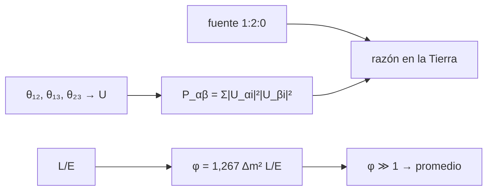

# B28-C03 — Neutrinos astrofísicos

<!-- nav:top -->
[🏠 Programa](../../../../README.md) · [📚 Bloque B28](../../../tronco-comun/B28-astronomia-multimensajero.md) · [← Anterior: B28-C02 — Fotones en múltiples longitudes de onda](../B28-C02-fotones-en-multiples-longitudes-de-onda/CLASE.md) · [Siguiente: B28-C04 — Rayos cósmicos de alta energía →](../B28-C04-rayos-cosmicos-de-alta-energia/CLASE.md)
<!-- /nav -->

## 1. Ubicación, nivel y alcance

Clase 3 del bloque B28. Nivel N3. Los neutrinos casi no interactúan: atraviesan estrellas enteras y llegan sin desviarse, por lo que apuntan a la fuente. Pero **oscilan** entre tres sabores mientras viajan. Aquí calculas la oscilación en dos sabores, construyes la matriz de mezcla de tres sabores, promedias las oscilaciones en distancias astrofísicas y obtienes la **razón de sabores en la Tierra**. Usas física cuántica ([B31](../../../tronco-comun/B31-fisica-cuantica-nuclear-y-astroparticulas.md)), la clase de neutrinos de supernova [B27-C18](../../B27/B27-C18-neutrinos-de-supernova/CLASE.md) y álgebra matricial. Se trata el vacío, sin materia ni fase CP.

## 2. Por qué esta clase existe

Un detector que ve neutrinos muónicos de una fuente lejana no ve lo que salió de ella. Para interpretar la razón de sabores hay que conocer la mezcla. La decisión central: **¿qué razón de sabores llega a la Tierra si la fuente produce 1:2:0 y cuándo se puede promediar la oscilación?**

## 3. Lo que podrás hacer al terminar

1. Calcular la fase de oscilación `φ = 1,267 Δm² L/E` y su constante desde `ħc`.
2. Hallar la distancia del primer máximo de oscilación.
3. Construir la matriz de mezcla `U` de tres sabores.
4. Comprobar la unitariedad de `U` y de la matriz de probabilidades.
5. Calcular la razón de sabores en la Tierra.
6. Justificar el promedio de las oscilaciones.

La evidencia es la **ficha de sabores de neutrinos** del ejercicio 12 (sección 20).

## 4. Con qué llegas y cómo comprobarlo

1. ¿Qué es un autoestado de masa?
2. ¿Qué es una matriz unitaria?
3. ¿Qué es un sabor de neutrino?
4. ¿Qué es `ħc` en eV·m?
5. ¿Qué es promediar sobre una fase rápida?

<details>
<summary>Ver respuestas</summary>

1. Un estado con masa definida. 2. `U†U = 1`. 3. Electrónico, muónico o tauónico. 4. `1,973 269 804 × 10⁻⁷ eV m`. 5. Sustituir `sin²` por `1/2`.
</details>

Con cuatro o cinco aciertos, sigue; si no, repasa B27-C18.

## 5. Un caso real: IceCube-170922A

La colaboración IceCube detectó el 22 de septiembre de 2017 un neutrino de unos `290 TeV` cuya dirección coincidía con el blazar TXS 0506+056 en estado de llamarada (S2, resumen). Para ese `E` y distancias de gigaparsecs, la fase de oscilación solar (con `Δm² = 7,4 × 10⁻⁵ eV²`, ilustrativo) es `~10¹³ rad`: la oscilación se promedia. Es el **ejemplo conductor**.

## 6. Vocabulario

El **sabor** es el tipo de leptón asociado. El **autoestado de masa** tiene masa definida. La **matriz de mezcla** `U` (PMNS) los relaciona. La **fase de oscilación** `φ`. La **probabilidad promediada** `P_αβ = Σ_i |U_αi|²|U_βi|²`. La **razón de sabores** `ν_e:ν_μ:ν_τ`.

## 7. Modelo mental: un reloj muy rápido

Cada autoestado de masa avanza con una fase distinta. Si la fase total es enorme, solo importa el promedio y desaparecen las oscilaciones finas: queda un reparto fijo entre sabores.



*Descripción textual:* los ángulos de mezcla definen `U`; las probabilidades promediadas aplicadas a la razón en la fuente dan la razón observada; si la fase es enorme, el promedio se justifica.

Analogía: una rueda que gira tan rápido que solo se ve el color medio. Límite: en la Tierra, para energías bajas y distancias cortas, las oscilaciones sí se ven.

## 8. La explicación, paso a paso

### 8.1 La fase

`φ = Δm²c⁴L/(4ħcE) = K Δm²[eV²] L[km]/E[GeV]`, con `K = 1,26693` calculada desde `ħc`.

### 8.2 El primer máximo

Con `Δm² = 2,5 × 10⁻³ eV²` (ilustrativo) y `sin²2θ = 1`: `L = 495,9 km` a `1 GeV` y `4959,4 km` a `10 GeV`, con `P = 1`.

### 8.3 La matriz de mezcla

Con `sin²θ₁₂ = 0,307`, `sin²θ₁₃ = 0,022`, `sin²θ₂₃ = 0,55` (ilustrativos) y fase CP nula, las filas y columnas de `U` suman 1 a `10⁻¹²`.

### 8.4 Probabilidades promediadas

| de \ a | e | μ | τ |
|---|---|---|---|
| e | 0,5500 | 0,2316 | 0,2184 |
| μ | 0,2316 | 0,3966 | 0,3718 |
| τ | 0,2184 | 0,3718 | 0,4098 |

Cada fila suma 1.

### 8.5 La razón en la Tierra

De `1:2:0` en la fuente se llega a `1,0132 : 1,0249 : 0,9619`, a menos del `4 %` de `1:1:1`. La fase para `L = 1 Gpc`, `E = 290 TeV` y `Δm² = 7,4 × 10⁻⁵ eV²` es `9,976 × 10¹² rad`.

## 9. Magnitudes, símbolos y unidades

| Símbolo | Qué es | Unidad | Valor / nota |
|---|---|---|---|
| `K` | constante de fase | eV⁻² km⁻¹ GeV | `1,26693` |
| `Δm²` | diferencia de masas al cuadrado | eV² | `2,5 × 10⁻³`; `7,4 × 10⁻⁵` (ilustrativos) |
| `sin²θ_ij` | mezcla | — | 0,307; 0,022; 0,55 (ilustrativos) |
| `φ` | fase de oscilación | rad | ver 8.5 |
| `ħc` | constante | eV m | `1,973 269 804 × 10⁻⁷` (S1) |

## 10. Convenciones y referencias

Vacío; matriz real (sin fase CP); `L` en km, `E` en GeV; los ángulos y los `Δm²` son **ilustrativos**.

## 11. De dónde sale lo que afirmamos

| ID | Fuente | Localizador | Respalda | Estado |
|---|---|---|---|---|
| S1 | NIST, *Fundamental Physical Constants — Complete Listing* (CODATA 2022) | https://physics.nist.gov/cuu/Constants/Table/allascii.txt | `ħc` | Consultada el 2026-11-09 |
| S2 | IceCube y colaboraciones, arXiv:1807.08816 | https://arxiv.org/abs/1807.08816 | neutrino de `~290 TeV`; blazar TXS 0506+056 | Solo resumen, consultado el 2026-11-09 |

Límites: S2 solo resumen; los ángulos y diferencias de masas son ilustrativos y no provienen de ninguna fuente consultada; las fórmulas de oscilación son estándar y se verifican por unitariedad.

## 12. Cómo ver la mezcla

| Razón en la fuente | Razón en la Tierra |
|---|---|
| 1 : 2 : 0 | 1,0132 : 1,0249 : 0,9619 |

Descripción larga: la oscilación promediada reparte los sabores casi por igual.

## 13. Ejemplo trabajado: primer máximo a 1 GeV

**Paso 1 · Datos.** `Δm² = 2,5 × 10⁻³ eV²`, `E = 1 GeV`.

**Paso 2 · Condición.** `φ = π/2`.

**Paso 3 · Distancia.** `L = (π/2)/(1,26693 × 2,5 × 10⁻³) = 495,9 km`.

**Paso 4 · Sentido.** Del orden del diámetro de un país.

## 14. Distintas formas de describir los sabores

**Por sabor inicial:** fila de `P`. **Por razón:** `1:2:0`. **Por ángulos:** `θ_ij`. **Por fase:** `φ`.

## 15. Práctica guiada

**Ejercicio 1 · con los pasos indicados.** `K` desde `ħc`. *Pasos:* `10³/(4 × 1,9733 × 10⁻⁷ × 10⁹)`.

<details><summary>Solución comentada</summary>

`1,2669`.
</details>

**Ejercicio 2 · con una pista.** Primer máximo a `10 GeV`. *Pista:* proporcional a `E`.

<details><summary>Solución comentada</summary>

`4959,4 km`.
</details>

**Ejercicio 3 · casi autónomo.** Suma de la fila e de `P`.

<details><summary>Solución comentada</summary>

`0,5500 + 0,2316 + 0,2184 = 1`.
</details>

## 16. Práctica autónoma, transferencia e integrador

**Ejercicio 4.** Razón e:μ:τ en la Tierra si la fuente emite 1:0:0.

<details><summary>Solución comentada</summary>

La fila e de `P`: `0,55 : 0,23 : 0,22`.
</details>

**Ejercicio 5.** Razón si la fuente emite 0:1:0.

<details><summary>Solución comentada</summary>

`0,23 : 0,40 : 0,37`.
</details>

**Ejercicio 6.** Desviación máxima de 1:1:1 en 8.5.

<details><summary>Solución comentada</summary>

`0,0381` (en el sabor τ).
</details>

**Ejercicio 7.** Fase a `L = 1000 km`, `E = 1 GeV`, `Δm² = 2,5 × 10⁻³`.

<details><summary>Solución comentada</summary>

`1,26693 × 2,5 × 10⁻³ × 1000 = 3,17 rad`.
</details>

**Ejercicio 8.** Probabilidad de supervivencia en esa fase con `sin²2θ = 1`.

<details><summary>Solución comentada</summary>

`1 − sin²(3,17) = 0,9993`.
</details>

**Ejercicio 9 · transferencia.** Un compañero dice que un neutrino muónico detectado nació muónico. Responde con 8.5.

<details><summary>Solución comentada</summary>

Pudo nacer de otro sabor: tras oscilar, los sabores se reparten casi por igual.
</details>

**Ejercicio 10 · transferencia.** ¿Por qué se puede promediar?

<details><summary>Solución comentada</summary>

Porque la fase vale `~10¹³ rad` y las oscilaciones rápidas se borran.
</details>

**Ejercicio 11 · transferencia.** ¿Qué valida la unitariedad de `U`?

<details><summary>Solución comentada</summary>

La construcción de la matriz; no los valores de los ángulos.
</details>

**Ejercicio 12 · integrador.** Elabora tu *ficha de sabores de neutrinos*: `K`, el primer máximo a dos energías, la matriz `P`, la razón para tres fuentes y la fase astrofísica.

<details><summary>Solución modelo</summary>

Secciones 8.1–8.5.
</details>

## 17. Laboratorio: oscilaciones

El script [oscilaciones.py](oscilaciones.py) calcula `K` desde `ħc` (**comprueba** `10⁻³` frente a `1,267`), construye `U` (**comprueba** `10⁻¹²`) y la razón en la Tierra (**comprueba** `5 %`).

**Datos:** `ħc` de NIST; ángulos y `Δm²` **ilustrativos**. **Predice antes de ejecutar:** ¿cuál es la razón de sabores en la Tierra? (≈`1:1:1`.) **Ejecución del 2026-11-09 (Python 3.12.9):**

```text
Python 3.12.9 (biblioteca estandar)
constante de fase K = 1.26693 (eV^-2 km^-1 GeV)
E =  1.0 GeV, dm2 = 0.0025 eV2: primer maximo de oscilacion en L = 495.9 km (P = 1.000)
E = 10.0 GeV, dm2 = 0.0025 eV2: primer maximo de oscilacion en L = 4959.4 km (P = 1.000)
P_ab promediada (filas: sabor inicial e, mu, tau; columnas: final):
   0.5500  0.2316  0.2184
   0.2316  0.3966  0.3718
   0.2184  0.3718  0.4098
razon de sabores en la fuente 1:2:0 -> en la Tierra 1.0132:1.0249:0.9619
fase de oscilacion solar para L = 1 Gpc y E = 290 TeV (dm2 = 7.4e-5 eV2): 9.976e+12 rad (>> 1: se promedia)
Pruebas superadas.
```

```bash
python programa/clases/B28/B28-C03-neutrinos-astrofisicos/oscilaciones.py
```

**Límites:** vacío, sin fase CP, sin efectos de materia, sin decoherencia.

## 18. Errores frecuentes y cómo corregirlos

**Confundir sabor y masa.** Se corrige con la sección 6.

**Promediar a distancias cortas.** Se corrige con el ejercicio 7.

**Olvidar la unitariedad.** Se corrige con el ejercicio 3.

**Tomar los ángulos ilustrativos por medidas.** Se corrige con la sección 10.

**Creer que el sabor se conserva.** Se corrige con el ejercicio 9.

## 19. Cómo sabrás que vas bien

Tras 8.1: ¿qué constante pesa la fase? Si dudas, ejercicio 1. Tras 8.5: ¿qué razón llega? Ejercicio 4. Tras el laboratorio: ¿qué comprueban las filas que suman 1? (la unitariedad).

## 20. Qué entregas y cómo se evalúa

El producto es tu **ficha de sabores de neutrinos** (ejercicio 12).

| Criterio | Inicial | En desarrollo | Logrado | Destacado |
|---|---|---|---|---|
| Conceptos | Los confunde | Parciales | Mezcla, fase, promedio | Explica cuándo no se puede promediar |
| Cálculo | Sin unidades | Con errores | `K`, `P`, razón | Compara fuentes |
| Numérico | Sin comprobar | Un caso | Tres tolerancias | Interpreta la unitariedad |
| Fuentes | Sin fuente | Sin fecha | S1–S2 con fecha | Declara S2 como resumen |
| Límites | No los nombra | Uno | Tres | Discute materia y fase CP |

**Condiciones críticas (no se compensan con promedio):** rotular ángulos y `Δm²` como ilustrativos; no atribuir razones medidas; citar solo lo consultado.

## 21. Ética, seguridad y límites

Clase educativa: no es un ajuste de datos de oscilación. Accesibilidad: tablas equivalentes a las gráficas, fórmulas en texto, ejercicios sin conexión.

## 22. Para cerrar y seguir

La oscilación promediada reparte los sabores casi a partes iguales, de modo que una fuente `1:2:0` se ve `1:1:1`. Queda una pregunta: ¿qué pasa con las partículas cargadas de energías aún mayores?

**Glosario español–inglés.** sabor · *flavour*; matriz de mezcla · *mixing matrix (PMNS)*; fase de oscilación · *oscillation phase*; autoestado de masa · *mass eigenstate*; razón de sabores · *flavour ratio*; promedio · *averaging*.

**Continuidad.** [B28-C04](../B28-C04-rayos-cosmicos-de-alta-energia/CLASE.md) estudia los rayos cósmicos de alta energía.

**Referencias:** ver sección 11.

<!-- nav:bottom -->
---

[← Anterior: B28-C02 — Fotones en múltiples longitudes de onda](../B28-C02-fotones-en-multiples-longitudes-de-onda/CLASE.md) · [📚 Bloque B28](../../../tronco-comun/B28-astronomia-multimensajero.md) · [Siguiente: B28-C04 — Rayos cósmicos de alta energía →](../B28-C04-rayos-cosmicos-de-alta-energia/CLASE.md)
<!-- /nav -->
