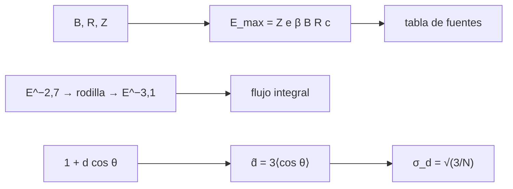

# B28-C04 — Rayos cósmicos de alta energía

<!-- nav:top -->
[🏠 Programa](../../../../README.md) · [📚 Bloque B28](../../../tronco-comun/B28-astronomia-multimensajero.md) · [← Anterior: B28-C03 — Neutrinos astrofísicos](../B28-C03-neutrinos-astrofisicos/CLASE.md) · [Siguiente: B28-C05 — Ondas gravitacionales →](../../../tronco-comun/B28-astronomia-multimensajero.md#b28-c05)
<!-- /nav -->

## 1. Ubicación, nivel y alcance

Clase 4 del bloque B28. Nivel N3. Los rayos cósmicos son núcleos atómicos que llegan con energías de hasta `10²⁰ eV`, millones de veces más que lo que alcanzan los aceleradores. Aquí calculas la **energía máxima** que una fuente puede dar con el **criterio de Hillas**, el flujo integral de un **espectro de potencias con rodilla** y la **recuperación de un dipolo de anisotropía** por Monte Carlo, como el que reporta el Observatorio Pierre Auger. Usas el radio de Larmor de [B28-C01](../B28-C01-fundamentos-de-mensajeros-astronomicos/CLASE.md), la radiación de [B27-C12](../../B27/B27-C12-radiacion-sincrotron/CLASE.md) y estadística de [B27-C19](../../B27/B27-C19-observatorios-de-rayos-x-y-gamma/CLASE.md). Se trata un modelo simplificado.

## 2. Por qué esta clase existe

El origen de los rayos cósmicos de mayor energía sigue abierto; el criterio de Hillas descarta fuentes y la anisotropía apunta a regiones. La decisión central: **¿qué fuentes pueden alcanzar una energía dada y qué anisotropía se puede detectar con un número dado de eventos?**

## 3. Lo que podrás hacer al terminar

1. Aplicar `E_max = Z e β B R c`.
2. Comparar fuentes para protones y hierro.
3. Calcular el flujo integral de un espectro con rodilla.
4. Estimar la precisión de un dipolo con `N` eventos: `σ = √(3/N)`.
5. Simular la recuperación de un dipolo con semilla fija.
6. Reconocer los supuestos de cielo completo.

La evidencia es la **ficha de energía y anisotropía de rayos cósmicos** del ejercicio 12 (sección 20).

## 4. Con qué llegas y cómo comprobarlo

1. ¿Qué es el radio de Larmor?
2. ¿Qué es una ley de potencias?
3. ¿Qué es un dipolo en la esfera?
4. ¿Qué es una distribución uniforme en `cos θ`?
5. ¿Qué es una semilla aleatoria?

<details>
<summary>Ver respuestas</summary>

1. `r_L = E/(ZeBc)`. 2. `J ∝ E^{−γ}`. 3. Una variación `1 + d cos θ`. 4. La de una isotropía sobre la esfera. 5. El valor inicial que hace repetible la simulación.
</details>

Con cuatro o cinco aciertos, sigue; si no, repasa B28-C01.

## 5. Un caso real: el dipolo de Auger

El Observatorio Pierre Auger usó `3 × 10⁴` rayos cósmicos por encima de `8 × 10¹⁸ eV` y una exposición de `76 800 km² sr año`, y encontró un dipolo de `6,5 (+1,3, −0,9) %` hacia `α = 100 ± 10°`, con más de `5,2σ` (S2, resumen). Esta clase usa esos tres números solo como contexto del experimento simulado. Es el **ejemplo conductor**.

## 6. Vocabulario

El **criterio de Hillas** limita `E_max` por el tamaño y el campo de la fuente. La **rodilla** es el cambio de pendiente del espectro. El **flujo integral** es el número por área y tiempo sobre una energía. El **dipolo** es la anisotropía `1 + d cos θ`. El **estimador** `d̂ = 3⟨cos θ⟩`. El **cielo completo** supone exposición uniforme.

## 7. Modelo mental: una carrera de vueltas

Una partícula se acelera mientras su órbita cabe en la fuente: `r_L ≤ R`. Cuando el radio de giro supera el tamaño, escapa. Eso fija el techo de energía.



*Descripción textual:* el campo y el tamaño de la fuente dan la energía máxima; el espectro con rodilla se integra; un dipolo se recupera con un estimador cuya incertidumbre es `√(3/N)`.

Analogía: un coche en una pista circular, que no puede pasar de cierta velocidad sin salirse. Límite: no se modelan pérdidas ni la geometría real.

## 8. La explicación, paso a paso

### 8.1 El criterio de Hillas

`E_max[eV] = Z β B[T] R[m] c`. Con valores ilustrativos:

| fuente | `B` (T) | `R` (m) | `E_max` protón (eV) | `E_max` hierro (eV) |
|---|---|---|---|---|
| remanente de supernova | `10⁻⁸` | `9,257 × 10¹⁶` | `2,7752 × 10¹⁷` | `7,2155 × 10¹⁸` |
| lóbulo de radiogalaxia | `10⁻⁹` | `3,086 × 10²²` | `9,2506 × 10²¹` | `2,4052 × 10²³` |
| núcleo activo, chorro | `10⁻⁴` | `3,086 × 10¹³` | `9,2506 × 10¹⁷` | `2,4052 × 10¹⁹` |
| estrella de neutrones | `10⁸` | `10⁴` | `2,9979 × 10²⁰` | `7,7946 × 10²¹` |

### 8.2 Flujo integral

Con `γ₁ = 2,7`, `γ₂ = 3,1` y rodilla en `10¹⁵ eV`, el flujo integral analítico y el numérico (Simpson en `ln E`) coinciden a `10⁻⁶`: `1,173684 × 10⁻¹⁹` por encima de `10¹¹ eV` y `4,672165 × 10⁻²³` por encima de `10¹³ eV` (unidades arbitrarias).

### 8.3 Cociente de flujos

Por encima de la rodilla, `flujo(>10¹⁶)/flujo(>10¹⁵) = 0,0079 = 10^{−(γ₂−1)}`.

### 8.4 El dipolo

Se inyecta `d = 0,065` con `N = 30 000` eventos y 200 realizaciones: media del estimador `0,0660`, desviación `0,0104`, frente a `√(3/N) = 0,0100`. La significancia típica es `d/σ = 6,5` con cielo completo.

### 8.5 Diferencia con el resultado publicado

El resultado de Auger usa exposición parcial del cielo y tiene más de `5,2σ`; en esta clase la exposición es total, lo que da una significancia algo mayor para igual amplitud. No se comparan como equivalentes.

## 9. Magnitudes, símbolos y unidades

| Símbolo | Qué es | Unidad | Valor / nota |
|---|---|---|---|
| `E_max` | energía máxima | eV | ver 8.1 |
| `B`, `R` | campo y tamaño | T, m | ilustrativos |
| `γ₁`, `γ₂` | índices espectrales | — | 2,7; 3,1 (ilustrativos) |
| `d` | amplitud del dipolo | — | 0,065 |
| `N` | número de eventos | — | 30 000 |
| `σ_d` | error del dipolo | — | `√(3/N) = 0,0100` |

## 10. Convenciones y referencias

`E` en eV; cielo completo; semilla `20261109`; los campos, tamaños, índices y rodilla son **ilustrativos**. `1 pc = 648 000/π au`.

## 11. De dónde sale lo que afirmamos

| ID | Fuente | Localizador | Respalda | Estado |
|---|---|---|---|---|
| S1 | NIST, *Fundamental Physical Constants — Complete Listing* (CODATA 2022) | https://physics.nist.gov/cuu/Constants/Table/allascii.txt | `c`, `e` | Consultada el 2026-11-09 |
| S2 | Pierre Auger Collaboration, arXiv:1709.07321 | https://arxiv.org/abs/1709.07321 | `3 × 10⁴` eventos; `> 8 × 10¹⁸ eV`; `76 800 km² sr año`; dipolo `6,5 %`; `> 5,2σ` | Solo resumen, consultado el 2026-11-09 |
| S3 | IERS Technical Note 36, Tabla 1.1 | https://iers-conventions.obspm.fr/ | `au` | Consultada el 2026-11-09 |

Límites: S2 solo resumen; el estimador `3⟨cos θ⟩` y su varianza son estándar y se contrastan por simulación; los parámetros de las fuentes son ilustrativos.

## 12. Cómo ver la recuperación del dipolo

| Magnitud | Valor |
|---|---|
| inyectado | 0,065 |
| media recuperada | 0,0660 |
| desviación observada | 0,0104 |
| desviación esperada | 0,0100 |

Descripción larga: el estimador es insesgado y su dispersión coincide con `√(3/N)` en una simulación de 200 realizaciones.

## 13. Ejemplo trabajado: ¿puede un remanente dar 10¹⁸ eV?

**Paso 1 · Datos.** `B = 10⁻⁸ T`, `R = 3 pc = 9,257 × 10¹⁶ m`.

**Paso 2 · Protón.** `E_max = 10⁻⁸ × 9,257 × 10¹⁶ × 2,998 × 10⁸ = 2,78 × 10¹⁷ eV`.

**Paso 3 · Hierro.** Multiplicar por `Z = 26`: `7,2 × 10¹⁸ eV`.

**Paso 4 · Sentido.** Un protón no llega a `10¹⁸ eV`; un núcleo de hierro sí.

## 14. Distintas formas de describir un rayo cósmico

**Por energía:** `E`. **Por rigidez:** `E/Z`. **Por radio de Larmor:** `r_L`. **Por llegada:** anisotropía.

## 15. Práctica guiada

**Ejercicio 1 · con los pasos indicados.** `E_max` de un protón con `B = 10⁻⁴ T`, `R = 3,086 × 10¹³ m`. *Pasos:* `BRc`.

<details><summary>Solución comentada</summary>

`9,2506 × 10¹⁷ eV`.
</details>

**Ejercicio 2 · con una pista.** `E_max` del hierro en esa fuente. *Pista:* multiplica por 26.

<details><summary>Solución comentada</summary>

`2,4052 × 10¹⁹ eV`.
</details>

**Ejercicio 3 · casi autónomo.** `σ_d` para `N = 30 000`.

<details><summary>Solución comentada</summary>

`√(3/30 000) = 0,0100`.
</details>

## 16. Práctica autónoma, transferencia e integrador

**Ejercicio 4.** `N` para detectar un dipolo de `0,065` a `5σ`.

<details><summary>Solución comentada</summary>

`σ = 0,013`; `N = 3/σ² = 17 750`.
</details>

**Ejercicio 5.** Significancia de un dipolo de `0,02` con `N = 30 000`.

<details><summary>Solución comentada</summary>

`0,02/0,0100 = 2,0σ`.
</details>

**Ejercicio 6.** Cociente de `E_max` entre una estrella de neutrones y un remanente (protones).

<details><summary>Solución comentada</summary>

`2,9979 × 10²⁰/2,7752 × 10¹⁷ = 1080`.
</details>

**Ejercicio 7.** Cociente `flujo(>10¹⁶)/flujo(>10¹⁵)` si `γ₂ = 3,0`.

<details><summary>Solución comentada</summary>

`10⁻² = 0,01`.
</details>

**Ejercicio 8.** Error del promedio de 200 realizaciones.

<details><summary>Solución comentada</summary>

`0,0104/√200 = 7,4 × 10⁻⁴`.
</details>

**Ejercicio 9 · transferencia.** Un compañero dice que un dipolo de 6,5 % «prueba» una fuente extragaláctica. Responde con 8.5 y la sección 11.

<details><summary>Solución comentada</summary>

El cálculo solo muestra la recuperación de un dipolo inyectado; no interpreta su origen ni usa la exposición parcial real.
</details>

**Ejercicio 10 · transferencia.** ¿Por qué el hierro alcanza más energía?

<details><summary>Solución comentada</summary>

Porque `E_max ∝ Z`: la carga mayor mantiene al núcleo confinado a más energía.
</details>

**Ejercicio 11 · transferencia.** ¿Qué valida el flujo numérico frente al analítico?

<details><summary>Solución comentada</summary>

La integración; no el espectro real.
</details>

**Ejercicio 12 · integrador.** Elabora tu *ficha de energía y anisotropía de rayos cósmicos*: tabla de Hillas, flujo integral, precisión del dipolo y resultado de la simulación.

<details><summary>Solución modelo</summary>

Secciones 8.1–8.4.
</details>

## 17. Laboratorio: Hillas, espectro y dipolo

El script [rayos_cosmicos.py](rayos_cosmicos.py) calcula `E_max`, integra el flujo (**comprueba** `10⁻⁶`) y recupera un dipolo en 200 realizaciones (**comprueba** media y desviación).

**Datos:** `c` de NIST; todo lo demás **ilustrativo**; contexto de S2. **Predice antes de ejecutar:** ¿qué desviación tendrá el estimador? (≈`0,010`.) **Ejecución del 2026-11-09 (Python 3.12.9):**

```text
Python 3.12.9 (biblioteca estandar)
fuente (ilustrativa)           B [T]      R [m]  E_max protón [eV]  E_max hierro [eV]
remanente de supernova       1.0e-08  9.257e+16         2.7752e+17         7.2155e+18
lóbulo de radiogalaxia       1.0e-09  3.086e+22         9.2506e+21         2.4052e+23
núcleo activo, chorro        1.0e-04  3.086e+13         9.2506e+17         2.4052e+19
estrella de neutrones        1.0e+08  1.000e+04         2.9979e+20         7.7946e+21
flujo integral (>1e+11 eV) analitico = 1.173684e-19 ; numerico = 1.173684e-19 (unidades arbitrarias)
flujo integral (>1e+13 eV) analitico = 4.672165e-23 ; numerico = 4.672165e-23 (unidades arbitrarias)
cociente flujo(>1e16)/flujo(>1e15) = 0.0079 (10^-(g2-1) = 0.0079)
dipolo inyectado 0.065: 200 realizaciones de N = 30000: media = 0.0660 ; desviacion = 0.0104 (esperada sqrt(3/N) = 0.0100)
significancia tipica d/sigma = 6.5 (cielo completo; el valor publicado usa exposicion parcial)
Pruebas superadas.
```

```bash
python programa/clases/B28/B28-C04-rayos-cosmicos-de-alta-energia/rayos_cosmicos.py
```

**Límites:** cielo completo, sin pérdidas, sin composición mixta, sin campo galáctico.

## 18. Errores frecuentes y cómo corregirlos

**Olvidar `Z`.** Se corrige con el ejercicio 10.

**Mezclar J y eV.** Se corrige con la sección 10.

**Aplicar `√(3/N)` con exposición parcial.** Se corrige con 8.5.

**Interpretar una amplitud como origen.** Se corrige con el ejercicio 9.

**Tomar los parámetros ilustrativos por medidas.** Se corrige con la sección 10.

## 19. Cómo sabrás que vas bien

Tras 8.1: ¿quién alcanza más, protón o hierro? Si dudas, ejercicio 10. Tras 8.4: ¿cuánto vale `σ_d`? Ejercicio 3. Tras el laboratorio: ¿qué valida? (la integración y el estimador).

## 20. Qué entregas y cómo se evalúa

El producto es tu **ficha de energía y anisotropía de rayos cósmicos** (ejercicio 12).

| Criterio | Inicial | En desarrollo | Logrado | Destacado |
|---|---|---|---|---|
| Conceptos | Los confunde | Parciales | Hillas, espectro, dipolo | Explica `E_max ∝ Z` |
| Cálculo | Sin unidades | Con errores | Todas las magnitudes | Compara fuentes |
| Numérico | Sin comprobar | Un caso | Flujo y dipolo | Interpreta `√(3/N)` |
| Fuentes | Sin fuente | Sin fecha | S1–S3 con fecha | Declara S2 como resumen |
| Límites | No los nombra | Uno | Tres | Discute exposición parcial |

**Condiciones críticas (no se compensan con promedio):** rotular fuentes y espectros como ilustrativos; no comparar el cielo completo con el resultado publicado como equivalentes; citar solo lo consultado.

## 21. Ética, seguridad y límites

Clase educativa: no es un análisis de datos de Auger. Accesibilidad: tablas equivalentes a las gráficas, fórmulas en texto, ejercicios sin conexión.

## 22. Para cerrar y seguir

El criterio de Hillas acota la energía por `Z B R`, un espectro con rodilla se integra en forma cerrada y un dipolo se recupera con error `√(3/N)`. Queda una pregunta: ¿cómo se detecta un mensajero que ni siquiera es materia ni luz, las ondas gravitacionales?

**Glosario español–inglés.** rayo cósmico · *cosmic ray*; criterio de Hillas · *Hillas criterion*; rodilla · *knee*; flujo integral · *integral flux*; dipolo · *dipole*; anisotropía · *anisotropy*.

**Continuidad.** [B28-C05](../B28-C05-ondas-gravitacionales/CLASE.md) estudia las ondas gravitacionales.

**Referencias:** ver sección 11.

<!-- nav:bottom -->
---

[← Anterior: B28-C03 — Neutrinos astrofísicos](../B28-C03-neutrinos-astrofisicos/CLASE.md) · [📚 Bloque B28](../../../tronco-comun/B28-astronomia-multimensajero.md) · [Siguiente: B28-C05 — Ondas gravitacionales →](../../../tronco-comun/B28-astronomia-multimensajero.md#b28-c05)
<!-- /nav -->
