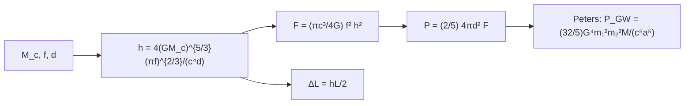

# B28-C05 — Ondas gravitacionales

<!-- nav:top -->
[🏠 Programa](../../../../README.md) · [📚 Bloque B28](../../../tronco-comun/B28-astronomia-multimensajero.md) · [← Anterior: B28-C04 — Rayos cósmicos de alta energía](../B28-C04-rayos-cosmicos-de-alta-energia/CLASE.md) · [Siguiente: B28-C06 — Interferómetros gravitacionales →](../B28-C06-interferometros-gravitacionales/CLASE.md)
<!-- /nav -->

## 1. Ubicación, nivel y alcance

Clase 5 del bloque B28. Nivel N3. Una binaria compacta ([B27-C13](../../B27/B27-C13-binarias-compactas/CLASE.md)) pierde energía emitiendo ondas gravitacionales: deformaciones del espacio que se propagan a `c`. Aquí calculas la **amplitud** `h`, el **flujo de energía**, la **potencia total** y el **desplazamiento** que la onda produce en una barra, y comprobas que la fórmula de la amplitud es coherente con la de Peters de la clase de binarias. Usas relatividad ([B26-C07](../../B26/B26-C07-curvatura-y-metricas/CLASE.md)) y la masa de chirrido. Se trata el orden de cuadrupolo y la órbita circular vista de frente.

## 2. Por qué esta clase existe

La amplitud de una señal real es de `10⁻²¹` a `10⁻²³`: un cambio de longitud mil veces menor que un protón en un brazo de kilómetros. Entender esa escala explica por qué hace falta un instrumento extraordinario. La decisión central: **¿qué amplitud, qué flujo y qué desplazamiento produce una binaria dada a una distancia dada?**

## 3. Lo que podrás hacer al terminar

1. Calcular `h = 4(GM_c)^{5/3}(πf)^{2/3}/(c⁴d)`.
2. Calcular el flujo `F = (πc³/4G) f²h²` y la potencia total.
3. Comprobar que la potencia total es `2/5` del flujo de frente por `4πd²`.
4. Calcular el desplazamiento `ΔL = hL/2`.
5. Reconocer cómo escala `h` con la distancia, la masa de chirrido y la frecuencia.
6. Estimar la distancia a la que una binaria da una amplitud dada.

La evidencia es la **ficha de una onda gravitacional** del ejercicio 12 (sección 20).

## 4. Con qué llegas y cómo comprobarlo

1. ¿Qué es la masa de chirrido?
2. ¿Qué es una deformación `h`?
3. ¿Qué es una polarización de una onda?
4. ¿Qué es un promedio sobre un ciclo?
5. ¿Qué es un megaparsec en metros?

<details>
<summary>Ver respuestas</summary>

1. `M_c = (m₁m₂)^{3/5}/(m₁+m₂)^{1/5}`. 2. El cambio relativo de longitud, `ΔL/L`. 3. Cada una de las dos formas de deformar el espacio (`+` y `×`). 4. El valor medio sobre un periodo. 5. `3,0857 × 10²² m`.
</details>

Con cuatro o cinco aciertos, sigue; si no, repasa B27-C13.

## 5. Un caso real y un caso ilustrativo

GW150914 tuvo un pico de deformación de `1,0 × 10⁻²¹`, barrió de `35` a `250 Hz` y se detectó con una relación señal-ruido de `24` (S2, resumen). GW170817 se produjo a `40 (+8, −8) Mpc` con masa total `2,74 M☉` (S3, resumen). Con masas iguales de `1,37 M☉` (ilustrativas), la amplitud a `100 Hz` es `8,587 × 10⁻²³`. Es el **ejemplo conductor**.

## 6. Vocabulario

La **deformación** `h` es la amplitud de la onda. La **polarización** `+`/`×`. El **flujo** `F` es energía por área y tiempo. La **potencia total** `P_GW` es el flujo integrado sobre la esfera. La **vista de frente** supone la inclinación `ι = 0`. El **desplazamiento** `ΔL`.

## 7. Modelo mental: ondas en la superficie de un estanque

Una binaria agita el espacio como un remo agita el agua. La onda se debilita como `1/d`; cuanto más rápida y masiva la binaria, más fuerte la onda.



*Descripción textual:* la masa de chirrido, la frecuencia y la distancia dan la amplitud; de ella salen el flujo, la potencia total y el desplazamiento; la potencia total se contrasta con la fórmula de Peters.

Analogía: un estanque y un remo. Límite: el modelo es de orden de cuadrupolo, lejos de la fusión.

## 8. La explicación, paso a paso

### 8.1 La amplitud

Con `M_c = 1,1927 M☉` y `d = 40 Mpc = 1,2343 × 10²⁴ m`:

| `f_GW` (Hz) | `h` | `ΔL` en 4 km (m) | `F` (W/m²) | `P_GW` (W) |
|---|---|---|---|---|
| 30 | `3,8482 × 10⁻²³` | `7,6964 × 10⁻²⁰` | `4,2258 × 10⁻⁷` | `3,2359 × 10⁴²` |
| 100 | `8,5870 × 10⁻²³` | `1,7174 × 10⁻¹⁹` | `2,3379 × 10⁻⁵` | `1,7903 × 10⁴⁴` |
| 400 | `2,1638 × 10⁻²²` | `4,3276 × 10⁻¹⁹` | `2,3752 × 10⁻³` | `1,8188 × 10⁴⁶` |

### 8.2 Comprobación con Peters

La potencia de Peters dividida por `4πd²F` vale `0,400000000` a `10⁻⁹`: el flujo de frente es `5/2` del flujo medio sobre todos los ángulos.

### 8.3 Escalas

`h(80 Mpc)/h(40 Mpc) = 0,5000` y `h(2M_c)/h(M_c) = 3,1748 = 2^{5/3}`.

### 8.4 Distancia para una amplitud dada

Para `h = 1 × 10⁻²¹` (el pico citado de GW150914) con `M_c = 1,1927 M☉` a `100 Hz`, la distancia sería `3,435 Mpc`: una binaria de estrellas de neutrones tendría esa amplitud solo muy cerca.

### 8.5 Lectura

La potencia de `10⁴⁴ W` a `100 Hz` es enorme, pero la amplitud en la Tierra es minúscula por la distancia. El desplazamiento de `10⁻¹⁹ m` es unas diez mil veces menor que un protón.

## 9. Magnitudes, símbolos y unidades

| Símbolo | Qué es | Unidad | Valor / nota |
|---|---|---|---|
| `M_c` | masa de chirrido | `M☉` | `1,1927` |
| `f` | frecuencia gravitacional | Hz | 30; 100; 400 |
| `d` | distancia | Mpc | 40 (S3) |
| `h` | deformación | — | `8,5870 × 10⁻²³` (100 Hz) |
| `F` | flujo | W/m² | ver tabla |
| `ΔL` | desplazamiento | m | ver tabla |

## 10. Convenciones y referencias

Orden de cuadrupolo; órbita circular; vista de frente; `h` es la amplitud de cada polarización; masas iguales de `1,37 M☉`, frecuencias y `L = 4 km` **ilustrativas**. `1 Mpc = 10⁶ × 648 000/π au`.

## 11. De dónde sale lo que afirmamos

| ID | Fuente | Localizador | Respalda | Estado |
|---|---|---|---|---|
| S1 | NIST, *Fundamental Physical Constants — Complete Listing* (CODATA 2022) | https://physics.nist.gov/cuu/Constants/Table/allascii.txt | `G`, `c` | Consultada el 2026-11-09 |
| S2 | LIGO Scientific y Virgo, GW150914, arXiv:1602.03837 | https://arxiv.org/abs/1602.03837 | pico `1,0 × 10⁻²¹`; `35`–`250 Hz`; SNR `24` | Solo resumen, consultado el 2026-11-09 |
| S3 | LIGO Scientific, Virgo y colaboraciones, arXiv:1710.05833 | https://arxiv.org/abs/1710.05833 | `40 (+8, −8) Mpc` | Solo resumen, consultado el 2026-11-09 |
| S4 | UAI, Resolución B3 de 2015 e IERS TN36 | https://arxiv.org/abs/1510.07674 | `GM_☉`; `au` | Consultadas el 2026-11-09 |

Límites: S2 y S3 solo resumen; las fórmulas de amplitud y flujo son estándar y se contrastan con Peters en el laboratorio; no se consultó un texto de ondas gravitacionales.

## 12. Cómo ver las escalas

| Cambio | Efecto en `h` |
|---|---|
| distancia ×2 | ×0,5 |
| `M_c` ×2 | ×3,1748 |
| `f` ×2 | ×`2^{2/3}` = 1,587 |

Descripción larga: `h` decrece como `1/d`, crece como `M_c^{5/3}` y como `f^{2/3}`.

## 13. Ejemplo trabajado: ¿cuánto se desplaza un brazo?

**Paso 1 · Datos.** `h = 8,587 × 10⁻²³`, `L = 4000 m`.

**Paso 2 · Fórmula.** `ΔL = hL/2`.

**Paso 3 · Cálculo.** `1,717 × 10⁻¹⁹ m`.

**Paso 4 · Sentido.** Unos `10⁻⁴` del diámetro de un protón.

## 14. Distintas formas de describir la onda

**Por amplitud:** `h`. **Por flujo:** `F`. **Por potencia:** `P_GW`. **Por desplazamiento:** `ΔL`.

## 15. Práctica guiada

**Ejercicio 1 · con los pasos indicados.** `h` si la distancia es 80 Mpc y `h(40 Mpc) = 8,587 × 10⁻²³`. *Pasos:* proporcional a `1/d`.

<details><summary>Solución comentada</summary>

`4,29 × 10⁻²³`.
</details>

**Ejercicio 2 · con una pista.** `ΔL` en 4 km para `h = 10⁻²¹`. *Pista:* `hL/2`.

<details><summary>Solución comentada</summary>

`2 × 10⁻¹⁸ m`.
</details>

**Ejercicio 3 · casi autónomo.** Potencia total a partir del flujo de frente a `100 Hz`.

<details><summary>Solución comentada</summary>

`0,4 × 4π d² F = 0,4 × 4π(1,2343 × 10²⁴)² × 2,3379 × 10⁻⁵ = 1,79 × 10⁴⁴ W`.
</details>

## 16. Práctica autónoma, transferencia e integrador

**Ejercicio 4.** Cociente `h(400 Hz)/h(100 Hz)`.

<details><summary>Solución comentada</summary>

`2,1638/0,8587 = 2,520 = 4^{2/3}`.
</details>

**Ejercicio 5.** Cociente `F(400)/F(100)`.

<details><summary>Solución comentada</summary>

`101,6 = 4^{10/3}`.
</details>

**Ejercicio 6.** Distancia para `h = 10⁻²¹` con `2M_c`.

<details><summary>Solución comentada</summary>

`3,435 × 3,1748 = 10,9 Mpc`.
</details>

**Ejercicio 7.** `ΔL` relativo al diámetro de un protón (`~10⁻¹⁵ m`).

<details><summary>Solución comentada</summary>

`1,7 × 10⁻¹⁹/10⁻¹⁵ = 1,7 × 10⁻⁴`.
</details>

**Ejercicio 8.** Factor de la relación `P/(4πd²F)`.

<details><summary>Solución comentada</summary>

`0,4 = 2/5`.
</details>

**Ejercicio 9 · transferencia.** Un compañero dice que `ΔL = 10⁻¹⁹ m` es imposible de medir. Responde con la sección 5.

<details><summary>Solución comentada</summary>

Los interferómetros miden promedios sobre muchos fotones y cavidades que amplifican el efecto (clase siguiente); no se mide un solo desplazamiento instantáneo.
</details>

**Ejercicio 10 · transferencia.** ¿Por qué la potencia de `10⁴⁴ W` da una amplitud tan pequeña?

<details><summary>Solución comentada</summary>

Por la distancia: el flujo cae como `1/d²` y `h` como `1/d`.
</details>

**Ejercicio 11 · transferencia.** ¿Qué valida la razón `0,4`?

<details><summary>Solución comentada</summary>

La coherencia entre la fórmula de la amplitud y la de Peters; no la física más allá del cuadrupolo.
</details>

**Ejercicio 12 · integrador.** Elabora tu *ficha de una onda gravitacional*: tabla de 8.1 para tus tres frecuencias, escalas, distancia a `h = 10⁻²¹` y la comprobación con Peters.

<details><summary>Solución modelo</summary>

Secciones 8.1–8.4.
</details>

## 17. Laboratorio: amplitud y energía

El script [onda.py](onda.py) calcula `h`, `F`, `P_GW` y `ΔL` y verifica la relación con Peters (**comprueba** `10⁻⁹`).

**Datos:** constantes de NIST/UAI/IERS; masas, frecuencias y `L` **ilustrativas**. **Predice antes de ejecutar:** ¿qué orden de magnitud tiene `h` a 100 Hz y 40 Mpc? (`10⁻²²`.) **Ejecución del 2026-11-09 (Python 3.12.9):**

```text
Python 3.12.9 (biblioteca estandar)
GW170817 ilustrativa: masas iguales de 1.37 Msol, M_c = 1.1927 Msol, d = 40 Mpc = 1.2343e+24 m
 f_GW [Hz]            h   dL en 4 km [m]     F [W/m2]     P_GW [W]  P/(4 pi d2 F)
      30.0   3.8482e-23       7.6964e-20   4.2258e-07   3.2359e+42    0.400000000
     100.0   8.5870e-23       1.7174e-19   2.3379e-05   1.7903e+44    0.400000000
     400.0   2.1638e-22       4.3276e-19   2.3752e-03   1.8188e+46    0.400000000
h(80 Mpc)/h(40 Mpc) = 0.5000 (esperado 0.5)
h(2 M_c)/h(M_c) = 3.1748 (esperado 2^(5/3) = 3.1748)
distancia para h = 1e-21 con M_c = 1.1927 Msol a 100 Hz: 3.435 Mpc
Pruebas superadas.
```

```bash
python programa/clases/B28/B28-C05-ondas-gravitacionales/onda.py
```

**Límites:** cuadrupolo, órbita circular, vista de frente, sin efectos post-newtonianos ni cosmología.

## 18. Errores frecuentes y cómo corregirlos

**Confundir flujo de frente y medio.** Se corrige con el ejercicio 8.

**Usar la masa total en vez de `M_c`.** Se corrige con la sección 6.

**Confundir `f_GW` con la frecuencia orbital.** Se corrige con la sección 10.

**Tomar las masas ilustrativas por medidas.** Se corrige con la sección 10.

**Esperar que `ΔL` sea medible directamente.** Se corrige con el ejercicio 9.

## 19. Cómo sabrás que vas bien

Tras 8.1: ¿cómo escala `h`? Si dudas, tabla de la sección 12. Tras 8.2: ¿por qué `0,4`? Ejercicio 8. Tras el laboratorio: ¿qué valida? (la coherencia con Peters).

## 20. Qué entregas y cómo se evalúa

El producto es tu **ficha de una onda gravitacional** (ejercicio 12).

| Criterio | Inicial | En desarrollo | Logrado | Destacado |
|---|---|---|---|---|
| Conceptos | Los confunde | Parciales | `h`, `F`, `P` | Explica el `2/5` |
| Cálculo | Sin unidades | Con errores | Tabla completa | Compara escalas |
| Numérico | Sin comprobar | Un caso | Peters y escalas | Interpreta tolerancias |
| Fuentes | Sin fuente | Sin fecha | S1–S4 con fecha | Declara S2 y S3 como resumen |
| Límites | No los nombra | Uno | Tres | Discute efectos post-newtonianos |

**Condiciones críticas (no se compensan con promedio):** rotular masas y frecuencias como ilustrativas; no mezclar flujo de frente y medio; citar solo lo consultado.

## 21. Ética, seguridad y límites

Clase educativa: no sustituye el análisis de datos de detectores. Accesibilidad: tablas equivalentes a las gráficas, fórmulas en texto, ejercicios sin conexión.

## 22. Para cerrar y seguir

La amplitud cae como `1/d`, crece como `M_c^{5/3}f^{2/3}` y una binaria que irradia `10⁴⁴ W` produce un desplazamiento de `10⁻¹⁹ m` en la Tierra. Queda una pregunta: ¿cómo se mide algo tan pequeño?

**Glosario español–inglés.** onda gravitacional · *gravitational wave*; deformación · *strain*; masa de chirrido · *chirp mass*; polarización · *polarization*; flujo · *flux*; cuadrupolo · *quadrupole*.

**Continuidad.** [B28-C06](../B28-C06-interferometros-gravitacionales/CLASE.md) estudia los interferómetros gravitacionales.

**Referencias:** ver sección 11.

<!-- nav:bottom -->
---

[← Anterior: B28-C04 — Rayos cósmicos de alta energía](../B28-C04-rayos-cosmicos-de-alta-energia/CLASE.md) · [📚 Bloque B28](../../../tronco-comun/B28-astronomia-multimensajero.md) · [Siguiente: B28-C06 — Interferómetros gravitacionales →](../B28-C06-interferometros-gravitacionales/CLASE.md)
<!-- /nav -->
