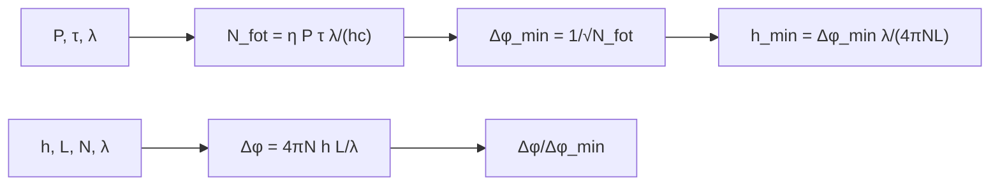

# B28-C06 — Interferómetros gravitacionales

<!-- nav:top -->
[🏠 Programa](../../../../README.md) · [📚 Bloque B28](../../../tronco-comun/B28-astronomia-multimensajero.md) · [← Anterior: B28-C05 — Ondas gravitacionales](../B28-C05-ondas-gravitacionales/CLASE.md) · [Siguiente: B28-C07 — Fuentes compactas binarias →](../B28-C07-fuentes-compactas-binarias/CLASE.md)
<!-- /nav -->

## 1. Ubicación, nivel y alcance

Clase 6 del bloque B28. Nivel N3. Un interferómetro de Michelson compara dos brazos: una onda gravitacional estira uno y comprime el otro, y la diferencia aparece como cambio de la luz en el puerto oscuro. Aquí calculas la **respuesta de fase**, el **límite del ruido de disparo** y su escalado con la potencia y la ganancia de las cavidades, y compruebas por Monte Carlo la desviación de la fase estimada con conteos de Poisson. Usas la amplitud de [B28-C05](../B28-C05-ondas-gravitacionales/CLASE.md), óptica ondulatoria ([B05](../../../tronco-comun/B05-fisica-fundamental-para-el-espacio.md)) y estadística de conteos ([B27-C19](../../B27/B27-C19-observatorios-de-rayos-x-y-gamma/CLASE.md)). Se trata un interferómetro ideal.

## 2. Por qué esta clase existe

Un detector que mide `10⁻¹⁹ m` necesita muchos fotones y cavidades que multipliquen el efecto. La decisión central: **¿qué fase produce una onda, qué fase mínima permite el ruido de disparo y cómo se mejora la sensibilidad?**

## 3. Lo que podrás hacer al terminar

1. Escribir la potencia del puerto oscuro `P₀ sin²(Δφ/2)`.
2. Calcular la fase producida por una onda: `Δφ = 4πN h L/λ`.
3. Calcular el número de fotones y la fase mínima `1/√N_fot`.
4. Obtener `h_min` y su escalado con la potencia.
5. Verificar por Monte Carlo la desviación de la fase estimada.
6. Distinguir ruido de disparo de otros ruidos.

La evidencia es la **ficha de sensibilidad de un interferómetro** del ejercicio 12 (sección 20).

## 4. Con qué llegas y cómo comprobarlo

1. ¿Qué es la interferencia de dos haces?
2. ¿Qué es un fotón y cuánta energía lleva?
3. ¿Qué es una cavidad Fabry–Perot?
4. ¿Qué es el ruido de disparo?
5. ¿Qué es una distribución de Poisson?

<details>
<summary>Ver respuestas</summary>

1. La suma de ondas con fase relativa. 2. `E = hc/λ`. 3. Dos espejos que hacen que la luz recorra el camino varias veces. 4. La fluctuación por la llegada discreta de fotones. 5. La de un conteo de eventos independientes.
</details>

Con cuatro o cinco aciertos, sigue; si no, repasa B28-C05.

## 5. Un caso real: Advanced LIGO

Advanced LIGO está formado por dos detectores idénticos en Hanford (WA) y Livingston (LA), especializaciones de un interferómetro de Michelson con brazos de `4 km`, cavidades Fabry–Perot en los brazos, reciclaje de potencia y reciclaje de señal (S2, resumen). Esta clase no reproduce su curva de sensibilidad: calcula el **límite de ruido de disparo** de un diseño ilustrativo con `λ = 1064 nm`, `P = 100 W` y ganancia de cavidad `300`. Es el **ejemplo conductor**.

## 6. Vocabulario

El **puerto oscuro** es la salida donde, sin onda, no llega luz. El **ruido de disparo** es la incertidumbre por conteo de fotones. La **ganancia de cavidad** `N` es el número medio de pasadas. La **fase mínima** `Δφ_min = 1/√N_fot`. La **deformación mínima** `h_min`. El **punto de trabajo** es la fase donde se mide la pendiente máxima.

## 7. Modelo mental: dos relojes de luz

Cada brazo es un reloj de luz. Si uno se alarga por la onda, los fotones tardan más y llegan desfasados; la fase se lee en la intensidad del puerto oscuro. Cuantos más fotones, menor la incertidumbre.



*Descripción textual:* la deformación y los parámetros ópticos dan la fase producida; la potencia y el tiempo dan el número de fotones y la fase mínima; su cociente indica si la señal es detectable y de ahí sale `h_min`.

Analogía: leer una escala con luz tenue. Límite: no se incluyen ruidos térmico, sísmico ni de presión de radiación.

## 8. La explicación, paso a paso

### 8.1 Fotones disponibles

Un fotón de `1064 nm` lleva `1,8670 × 10⁻¹⁹ J`. Con `100 W` durante `1 s` hay `5,3563 × 10²⁰` fotones.

### 8.2 La fase mínima y `h_min`

`Δφ_min = 4,3208 × 10⁻¹¹ rad` y, con `N = 300` y `L = 4000 m`, `h_min = 3,0487 × 10⁻²⁴`.

### 8.3 La respuesta a una onda

Para `h = 10⁻²¹`: `ΔL = 4 × 10⁻¹⁸ m` y `Δφ = 1,417 × 10⁻⁸ rad`, `328` veces la fase mínima. Para `h = 10⁻²²`: `Δφ = 1,417 × 10⁻⁹ rad`, `32,8` veces.

### 8.4 Escalado con la potencia

Con `4` veces más potencia, `h_min = 1,5244 × 10⁻²⁴`: la mitad, como exige `h_min ∝ 1/√P`.

### 8.5 Monte Carlo

Con `4 × 10⁴` fotones esperados en el puerto en el punto de trabajo (`φ₀ = π/2`) y una fase inyectada de `2,0 × 10⁻³ rad`, 2000 realizaciones con semilla fija dan una fase media `1,8476 × 10⁻³` y una desviación `4,9942 × 10⁻³`, frente a `5,0000 × 10⁻³` esperada (`√P/(dP/dφ)`).

## 9. Magnitudes, símbolos y unidades

| Símbolo | Qué es | Unidad | Valor / nota |
|---|---|---|---|
| `λ` | longitud de onda | m | `1064 × 10⁻⁹` (ilustrativa) |
| `L` | longitud del brazo | m | 4000 (S2) |
| `P` | potencia | W | 100 (ilustrativa) |
| `N` | ganancia de cavidad | — | 300 (ilustrativa) |
| `N_fot` | fotones en `τ` | — | `5,3563 × 10²⁰` |
| `Δφ_min` | fase mínima | rad | `4,3208 × 10⁻¹¹` |
| `h_min` | deformación mínima | — | `3,0487 × 10⁻²⁴` |

## 10. Convenciones y referencias

Michelson ideal; sin ruido térmico ni sísmico; `τ = 1 s`; `η = 1`; la longitud de onda, la potencia y la ganancia son **ilustrativas**; la longitud de 4 km es de S2.

## 11. De dónde sale lo que afirmamos

| ID | Fuente | Localizador | Respalda | Estado |
|---|---|---|---|---|
| S1 | NIST, *Fundamental Physical Constants — Complete Listing* (CODATA 2022) | https://physics.nist.gov/cuu/Constants/Table/allascii.txt | `h`, `c` | Consultada el 2026-11-09 |
| S2 | Advanced LIGO, arXiv:1411.4547 | https://arxiv.org/abs/1411.4547 | brazos de `4 km`; cavidades Fabry–Perot; reciclaje de potencia y de señal | Solo resumen, consultado el 2026-11-09 |

Límites: S2 solo resumen y no respalda ninguna cifra de sensibilidad; las fórmulas son estándar y se verifican con la simulación y el escalado.

## 12. Cómo ver el escalado

| Cambio | Efecto en `h_min` |
|---|---|
| potencia ×4 | ×0,5 |
| ganancia ×2 | ×0,5 |
| brazo ×2 | ×0,5 |
| tiempo ×4 | ×0,5 |

Descripción larga: `h_min ∝ 1/(N L √(Pτ))`.

## 13. Ejemplo trabajado: ¿es detectable h = 10⁻²²?

**Paso 1 · Fase.** `Δφ = 4π × 300 × 10⁻²² × 4000/1064 × 10⁻⁹ = 1,417 × 10⁻⁹ rad`.

**Paso 2 · Fase mínima.** `4,32 × 10⁻¹¹ rad`.

**Paso 3 · Cociente.** `32,8`.

**Paso 4 · Sentido.** La señal supera 30 veces el límite de ruido de disparo en 1 s, en este diseño idealizado.

## 14. Distintas formas de describir la sensibilidad

**Por fase mínima:** `Δφ_min`. **Por deformación mínima:** `h_min`. **Por cociente señal/ruido:** `Δφ/Δφ_min`. **Por escalado:** `1/√P`.

## 15. Práctica guiada

**Ejercicio 1 · con los pasos indicados.** Energía de un fotón de `1064 nm`. *Pasos:* `hc/λ`.

<details><summary>Solución comentada</summary>

`1,867 × 10⁻¹⁹ J`.
</details>

**Ejercicio 2 · con una pista.** Fotones en `1 s` con `100 W`. *Pista:* `P τ/E`.

<details><summary>Solución comentada</summary>

`5,356 × 10²⁰`.
</details>

**Ejercicio 3 · casi autónomo.** `Δφ_min`.

<details><summary>Solución comentada</summary>

`1/√(5,356 × 10²⁰) = 4,32 × 10⁻¹¹ rad`.
</details>

## 16. Práctica autónoma, transferencia e integrador

**Ejercicio 4.** `h_min` con `N = 600`.

<details><summary>Solución comentada</summary>

`1,52 × 10⁻²⁴`.
</details>

**Ejercicio 5.** `h_min` con `P = 25 W`.

<details><summary>Solución comentada</summary>

`6,10 × 10⁻²⁴`.
</details>

**Ejercicio 6.** `Δφ` para `h = 10⁻²³`.

<details><summary>Solución comentada</summary>

`1,417 × 10⁻¹⁰ rad`.
</details>

**Ejercicio 7.** `Δφ/Δφ_min` para `h = 10⁻²³`.

<details><summary>Solución comentada</summary>

`3,28`.
</details>

**Ejercicio 8.** Error de la media del Monte Carlo (2000 realizaciones).

<details><summary>Solución comentada</summary>

`4,9942 × 10⁻³/√2000 = 1,12 × 10⁻⁴`; la diferencia con la fase inyectada (`1,5 × 10⁻⁴`) es de 1,4 errores.
</details>

**Ejercicio 9 · transferencia.** Un compañero dice que con `P` mayor siempre mejora el detector. Responde con la sección 7 (límite).

<details><summary>Solución comentada</summary>

Solo el ruido de disparo mejora con `1/√P`; con potencias altas crecen la presión de radiación y los efectos térmicos.
</details>

**Ejercicio 10 · transferencia.** ¿Por qué se usan cavidades en los brazos?

<details><summary>Solución comentada</summary>

Para multiplicar por `N` el cambio de fase de una misma onda.
</details>

**Ejercicio 11 · transferencia.** ¿Qué valida el Monte Carlo?

<details><summary>Solución comentada</summary>

Que la desviación de la fase estimada coincide con `√P/(dP/dφ)`; no la sensibilidad de un detector real.
</details>

**Ejercicio 12 · integrador.** Elabora tu *ficha de sensibilidad de un interferómetro*: fotones, `Δφ_min`, `h_min`, la fase producida por tres amplitudes y el escalado con potencia y ganancia.

<details><summary>Solución modelo</summary>

Secciones 8.1–8.4.
</details>

## 17. Laboratorio: fase y ruido de disparo

El script [interferometro.py](interferometro.py) calcula fotones, fase mínima y `h_min`, verifica el escalado (**comprueba** `10⁻¹²`) y simula el ruido de disparo (**comprueba** `5 %`).

**Datos:** `h`, `c` de NIST; parámetros ópticos **ilustrativos**; `4 km` de S2. **Predice antes de ejecutar:** ¿qué `h_min` sale con `100 W`? (≈`10⁻²⁴`.) **Ejecución del 2026-11-09 (Python 3.12.9):**

```text
Python 3.12.9 (biblioteca estandar)
energia de un foton = 1.8670e-19 J ; fotones en 1.0 s con 100.0 W: 5.3563e+20
fase minima por ruido de disparo = 4.3208e-11 rad ; h_min = 3.0487e-24 (ganancia 300, L = 4000 m)
h = 1e-21: dL = 4.000e-18 m ; dphi = 1.417e-08 rad ; dphi/fase minima = 3.280e+02
h = 1e-22: dL = 4.000e-19 m ; dphi = 1.417e-09 rad ; dphi/fase minima = 3.280e+01
h_min con 4x potencia: 1.5244e-24 (cociente 0.5000, esperado 0.5)
Monte Carlo: fase inyectada 2.0e-03 rad ; media estimada = 1.8476e-03 ; desviacion = 4.9942e-03 ; esperada sqrt(P)/(dP/dphi) = 5.0000e-03
Pruebas superadas.
```

```bash
python programa/clases/B28/B28-C06-interferometros-gravitacionales/interferometro.py
```

**Límites:** Michelson ideal, sin ruido térmico, sísmico ni de presión de radiación, sin respuesta en frecuencia.

## 18. Errores frecuentes y cómo corregirlos

**Confundir `ΔL` y `Δφ`.** Se corrige con la sección 7.

**Olvidar la ganancia `N`.** Se corrige con el ejercicio 10.

**Pensar que más potencia siempre ayuda.** Se corrige con el ejercicio 9.

**Tomar `h_min` por la sensibilidad real.** Se corrige con la sección 11.

**Mezclar `τ` con la frecuencia de la onda.** Se corrige con la sección 10.

## 19. Cómo sabrás que vas bien

Tras 8.2: ¿cómo escala `h_min`? Si dudas, tabla de 12. Tras 8.5: ¿qué mide la desviación? Ejercicio 11. Tras el laboratorio: ¿qué valida? (el modelo del ruido de disparo).

## 20. Qué entregas y cómo se evalúa

El producto es tu **ficha de sensibilidad de un interferómetro** (ejercicio 12).

| Criterio | Inicial | En desarrollo | Logrado | Destacado |
|---|---|---|---|---|
| Conceptos | Los confunde | Parciales | Fase, ruido, `h_min` | Explica el papel de la cavidad |
| Cálculo | Sin unidades | Con errores | Todas las magnitudes | Compara diseños |
| Numérico | Sin comprobar | Un caso | Escalado y Monte Carlo | Interpreta el error de la media |
| Fuentes | Sin fuente | Sin fecha | S1–S2 con fecha | Declara S2 como resumen |
| Límites | No los nombra | Uno | Tres | Discute otros ruidos |

**Condiciones críticas (no se compensan con promedio):** rotular los parámetros ópticos como ilustrativos; no presentar `h_min` como la sensibilidad de un detector; citar solo lo consultado.

## 21. Ética, seguridad y límites

Clase educativa: no sustituye la caracterización de un detector. Accesibilidad: tablas equivalentes a las gráficas, fórmulas en texto, ejercicios sin conexión.

## 22. Para cerrar y seguir

La fase mínima por ruido de disparo cae como `1/√N_fot`, la cavidad multiplica la respuesta y `h_min ∝ 1/(NL√(Pτ))`. Queda una pregunta: ¿qué fuentes producen las señales que estos instrumentos buscan?

**Glosario español–inglés.** interferómetro · *interferometer*; puerto oscuro · *dark port*; ruido de disparo · *shot noise*; ganancia de cavidad · *cavity gain*; deformación mínima · *minimum strain*; punto de trabajo · *operating point*.

**Continuidad.** [B28-C07](../B28-C07-fuentes-compactas-binarias/CLASE.md) estudia las fuentes compactas binarias.

**Referencias:** ver sección 11.

<!-- nav:bottom -->
---

[← Anterior: B28-C05 — Ondas gravitacionales](../B28-C05-ondas-gravitacionales/CLASE.md) · [📚 Bloque B28](../../../tronco-comun/B28-astronomia-multimensajero.md) · [Siguiente: B28-C07 — Fuentes compactas binarias →](../B28-C07-fuentes-compactas-binarias/CLASE.md)
<!-- /nav -->
