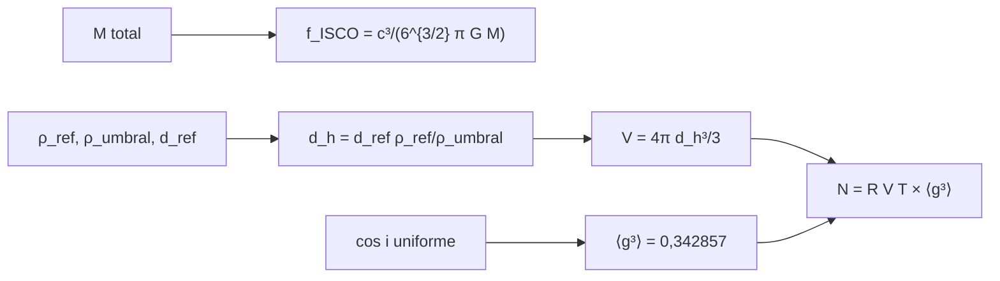

# B28-C07 — Fuentes compactas binarias

<!-- nav:top -->
[🏠 Programa](../../../../README.md) · [📚 Bloque B28](../../../tronco-comun/B28-astronomia-multimensajero.md) · [← Anterior: B28-C06 — Interferómetros gravitacionales](../B28-C06-interferometros-gravitacionales/CLASE.md) · [Siguiente: B28-C08 — Señales transitorias →](../B28-C08-senales-transitorias/CLASE.md)
<!-- /nav -->

## 1. Ubicación, nivel y alcance

Clase 7 del bloque B28. Nivel N3. Las fuentes más estudiadas de ondas gravitacionales son las binarias de agujeros negros y de estrellas de neutrones. Aquí calculas la **frecuencia de la última órbita estable** (el techo de frecuencia de la fase de inspiral), el **alcance** de un detector en función de la relación señal-ruido y el **número esperado de eventos** por año, incluyendo el efecto de la orientación aleatoria. Usas las binarias de [B27-C13](../../B27/B27-C13-binarias-compactas/CLASE.md), el horizonte de [B27-C07](../../B27/B27-C07-metricas-de-agujeros-negros/CLASE.md) y la amplitud de [B28-C05](../B28-C05-ondas-gravitacionales/CLASE.md). Se trata un detector de sensibilidad plana y una tasa constante.

## 2. Por qué esta clase existe

La tasa de eventos detectados depende del volumen que el detector ve, que crece como el cubo del alcance. Una mejora pequeña en sensibilidad se traduce en muchos más eventos. La decisión central: **¿hasta qué frecuencia dura el inspiral, hasta qué distancia se ve una fuente y cuántos eventos por año cabe esperar?**

## 3. Lo que podrás hacer al terminar

1. Calcular `f_ISCO = c³/(6^{3/2}πGM)` por dos vías.
2. Relacionar la masa total con la banda de frecuencias.
3. Calcular el alcance con `d_h = d_ref ρ_ref/ρ_umbral`.
4. Calcular el número de eventos `N = R V T`.
5. Verificar por Monte Carlo la razón de volúmenes y el factor de orientación `⟨g³⟩`.
6. Reconocer los supuestos de una tasa constante.

La evidencia es la **ficha de fuentes y alcance de detección** del ejercicio 12 (sección 20).

## 4. Con qué llegas y cómo comprobarlo

1. ¿Qué es la última órbita circular estable?
2. ¿Qué dice la tercera ley de Kepler?
3. ¿Qué es una relación señal-ruido?
4. ¿Qué es el volumen de una esfera?
5. ¿Qué es un Monte Carlo con semilla?

<details>
<summary>Ver respuestas</summary>

1. La órbita estable más interna, `6GM/c²` en Schwarzschild. 2. `P² ∝ a³`. 3. La amplitud de la señal dividida por el ruido. 4. `4πr³/3`. 5. Una simulación repetible por la semilla.
</details>

Con cuatro o cinco aciertos, sigue; si no, repasa B27-C07 y B27-C13.

## 5. Un caso real: el catálogo GWTC-1

El catálogo GWTC-1 presenta los resultados de las dos primeras campañas de observación: en la primera, `3` fusiones de agujeros negros; en la segunda, la primera inspiral de estrellas de neutrones y otras fusiones de agujeros negros (S3, resumen). GW150914 se detectó con una relación señal-ruido de `24` (S2, resumen). Esta clase usa esa cifra como referencia para el escalado del alcance. Es el **ejemplo conductor**.

## 6. Vocabulario

La **frecuencia ISCO** es la frecuencia gravitacional en la última órbita estable. El **alcance** (o distancia de horizonte) es hasta donde se supera el umbral. El **volumen** es `4πd³/3`. La **tasa** `R` es el número de fusiones por volumen y año. El **factor de orientación** `g = (1 + cos²ι)/2`. Una **fuente compacta binaria** es un par de estrellas de neutrones o agujeros negros.

## 7. Modelo mental: una red de pesca

El detector tiene una red cuyo radio es el alcance. El número de peces (eventos) crece con el volumen. Si los peces no miran de frente, la red atrapa solo una fracción.



*Descripción textual:* la masa fija la frecuencia máxima; el alcance sale de la relación señal-ruido; el volumen y la tasa dan los eventos, reducidos por el factor de orientación.

Analogía: una red de pesca con radio variable. Límite: la tasa real cambia con el tiempo cósmico y con la masa.

## 8. La explicación, paso a paso

### 8.1 Frecuencia ISCO

La fórmula y la tercera ley de Kepler (a `r = 6GM/c²`, `f_GW = 2f_orb`) coinciden a `10⁻¹²`:

| `M` total (`M☉`) | `f_ISCO` (Hz) |
|---|---|
| 2,74 | 1604,81 |
| 10 | 439,72 |
| 65 | 67,65 |
| 200 | 21,99 |

Las binarias de estrellas de neutrones llegan a kilohercios; las de agujeros negros pesados, a decenas de hercios.

### 8.2 El alcance

Con `d_ref = 100 Mpc` (ilustrativo), `ρ_ref = 24` y umbral `ρ = 8` (ilustrativo): `d_h = 300 Mpc`.

### 8.3 Eventos por año

Con `R = 10⁻⁶ Mpc⁻³ año⁻¹` (ilustrativa):

| alcance (Mpc) | volumen (Mpc³) | eventos por año |
|---|---|---|
| 50 | `5,2360 × 10⁵` | 0,52 |
| 100 | `4,1888 × 10⁶` | 4,19 |
| 200 | `3,3510 × 10⁷` | 33,51 |
| 400 | `2,6808 × 10⁸` | 268,08 |

Duplicar el alcance multiplica los eventos por 8.

### 8.4 Comprobaciones por Monte Carlo

La fracción de fuentes uniformes en una esfera de `2R` que cae dentro de `R` es `0,1250` (esperado `1/8`). El valor medio de `g³` es `0,3425` frente a `0,342857` analítico.

### 8.5 Con orientación aleatoria

A `100 Mpc` el número de eventos por año se reduce de `4,19` a `1,44`.

## 9. Magnitudes, símbolos y unidades

| Símbolo | Qué es | Unidad | Valor / nota |
|---|---|---|---|
| `f_ISCO` | frecuencia en la última órbita | Hz | ver 8.1 |
| `ρ` | relación señal-ruido | — | 24 (GW150914, S2); umbral 8 (ilustrativo) |
| `d_h` | alcance | Mpc | 300 (ilustrativo) |
| `R` | tasa de fusiones | Mpc⁻³ año⁻¹ | `10⁻⁶` (ilustrativa) |
| `N` | eventos por año | — | ver 8.3 |
| `⟨g³⟩` | factor de orientación | — | `0,342857` |

## 10. Convenciones y referencias

Frecuencia gravitacional `f_GW = 2f_orb`; sensibilidad plana; tasa constante; `d_ref`, el umbral y `R` son **ilustrativos**; `ρ = 24` es de S2.

## 11. De dónde sale lo que afirmamos

| ID | Fuente | Localizador | Respalda | Estado |
|---|---|---|---|---|
| S1 | NIST, *Fundamental Physical Constants — Complete Listing* (CODATA 2022) | https://physics.nist.gov/cuu/Constants/Table/allascii.txt | `G`, `c` | Consultada el 2026-11-09 |
| S2 | LIGO Scientific y Virgo, GW150914, arXiv:1602.03837 | https://arxiv.org/abs/1602.03837 | SNR `24` | Solo resumen, consultado el 2026-11-09 |
| S3 | LIGO Scientific y Virgo, GWTC-1, arXiv:1811.12907 | https://arxiv.org/abs/1811.12907 | tres fusiones de agujeros negros en O1; primera inspiral de estrellas de neutrones en O2 | Solo resumen, consultado el 2026-11-09 |
| S4 | UAI, Resolución B3 de 2015 | https://arxiv.org/abs/1510.07674 | `GM_☉` nominal | Consultada el 2026-11-09 |

Límites: S2 y S3 solo resumen; ninguna tasa de fusiones publicada se usa; las fórmulas son estándar y se verifican por dos vías y por Monte Carlo.

## 12. Cómo ver el volumen

| alcance | eventos relativos |
|---|---|
| ×2 | ×8 |
| ×3 | ×27 |
| ×0,5 | ×0,125 |

Descripción larga: los eventos escalan como el cubo del alcance.

## 13. Ejemplo trabajado: eventos con alcance de 200 Mpc

**Paso 1 · Volumen.** `V = 4π(200)³/3 = 3,351 × 10⁷ Mpc³`.

**Paso 2 · Tasa.** `R = 10⁻⁶`.

**Paso 3 · Eventos.** `N = R V = 33,5` por año.

**Paso 4 · Orientación.** `× 0,3429 = 11,5` por año.

## 14. Distintas formas de describir la fuente

**Por masa:** `M`. **Por frecuencia:** `f_ISCO`. **Por distancia:** `d_h`. **Por tasa:** `R`.

## 15. Práctica guiada

**Ejercicio 1 · con los pasos indicados.** `f_ISCO` para `10 M☉`. *Pasos:* escala como `1/M`.

<details><summary>Solución comentada</summary>

`4397/10 = 439,7 Hz` (a partir de `4397 Hz/M☉`).
</details>

**Ejercicio 2 · con una pista.** Alcance con `ρ_ref = 24`, `ρ_umbral = 12`, `d_ref = 100`.

<details><summary>Solución comentada</summary>

`200 Mpc`.
</details>

**Ejercicio 3 · casi autónomo.** Eventos con alcance de `100 Mpc` y `R = 10⁻⁶`.

<details><summary>Solución comentada</summary>

`4,19`.
</details>

## 16. Práctica autónoma, transferencia e integrador

**Ejercicio 4.** Cociente de eventos entre 400 y 100 Mpc.

<details><summary>Solución comentada</summary>

`268,08/4,19 = 64`.
</details>

**Ejercicio 5.** Eventos a `50 Mpc` con orientación aleatoria.

<details><summary>Solución comentada</summary>

`0,52 × 0,3429 = 0,18`.
</details>

**Ejercicio 6.** Cociente `f_ISCO(2,74)/f_ISCO(65)`.

<details><summary>Solución comentada</summary>

`1604,81/67,65 = 23,7 = 65/2,74`.
</details>

**Ejercicio 7.** Masa total cuya `f_ISCO` es `100 Hz`.

<details><summary>Solución comentada</summary>

`4397/100 = 44 M☉`.
</details>

**Ejercicio 8.** Años para tener 10 eventos con `R V = 1,44` por año.

<details><summary>Solución comentada</summary>

`10/1,44 = 6,9` años.
</details>

**Ejercicio 9 · transferencia.** Un compañero dice que cuadruplicar la potencia del láser cuadruplica los eventos. Responde con 8.3 y B28-C06.

<details><summary>Solución comentada</summary>

El alcance mejora como `√4 = 2` en ruido de disparo, y los eventos como `2³ = 8`.
</details>

**Ejercicio 10 · transferencia.** ¿Por qué las fuentes pesadas dominan a baja frecuencia?

<details><summary>Solución comentada</summary>

Porque `f_ISCO ∝ 1/M`: su inspiral termina a frecuencias más bajas.
</details>

**Ejercicio 11 · transferencia.** ¿Qué valida el Monte Carlo?

<details><summary>Solución comentada</summary>

Los cocientes de volúmenes y el factor de orientación; no la tasa real.
</details>

**Ejercicio 12 · integrador.** Elabora tu *ficha de fuentes y alcance de detección*: `f_ISCO` para cuatro masas, alcance, eventos por año con y sin orientación y los supuestos.

<details><summary>Solución modelo</summary>

Tablas de 8.1 y 8.3 y sección 8.5.
</details>

## 17. Laboratorio: ISCO, alcance y eventos

El script [fuentes.py](fuentes.py) compara `f_ISCO` por dos vías (**comprueba** `10⁻¹²`), calcula volúmenes y eventos y simula razones de volumen y orientación (**comprueba** `3 %`).

**Datos:** `G`, `c` de NIST; `GM_☉` de la UAI; SNR de S2; el resto **ilustrativo**. **Predice antes de ejecutar:** ¿qué `f_ISCO` tiene `10 M☉`? (≈`440 Hz`.) **Ejecución del 2026-11-09 (Python 3.12.9):**

```text
Python 3.12.9 (biblioteca estandar)
M total [Msol]  f_ISCO [Hz]  (Kepler) [Hz]
          2.74      1604.81        1604.81
         10.00       439.72         439.72
         65.00        67.65          67.65
        200.00        21.99          21.99
alcance (ilustrativo): d_h = d_ref rho_ref/rho_umbral = 100.0 x 24.0/8.0 = 300.0 Mpc
alcance   50.0 Mpc: volumen = 5.2360e+05 Mpc3 ; eventos por anio con R = 1e-6 Mpc-3 anio-1:       0.52
alcance  100.0 Mpc: volumen = 4.1888e+06 Mpc3 ; eventos por anio con R = 1e-6 Mpc-3 anio-1:       4.19
alcance  200.0 Mpc: volumen = 3.3510e+07 Mpc3 ; eventos por anio con R = 1e-6 Mpc-3 anio-1:      33.51
alcance  400.0 Mpc: volumen = 2.6808e+08 Mpc3 ; eventos por anio con R = 1e-6 Mpc-3 anio-1:     268.08
MC: fraccion dentro de R en una esfera de 2R = 0.1250 (esperado 1/8 = 0.1250)
MC: <g^3> = 0.3425 ; analitico = 0.342857
eventos por anio a 100 Mpc con orientacion aleatoria: 1.44
Pruebas superadas.
```

```bash
python programa/clases/B28/B28-C07-fuentes-compactas-binarias/fuentes.py
```

**Límites:** sensibilidad plana, tasa constante, sin cosmología ni evolución de la población.

## 18. Errores frecuentes y cómo corregirlos

**Confundir `f_GW` con `f_orb`.** Se corrige con la sección 10.

**Olvidar el cubo del alcance.** Se corrige con el ejercicio 4.

**Tomar la tasa ilustrativa por medida.** Se corrige con la sección 10.

**Ignorar la orientación.** Se corrige con 8.5.

**Usar la masa de chirrido en vez de la total.** Se corrige con la sección 6.

## 19. Cómo sabrás que vas bien

Tras 8.1: ¿cómo escala `f_ISCO`? Si dudas, ejercicio 6. Tras 8.3: ¿qué pasa al duplicar el alcance? Ejercicio 4. Tras el laboratorio: ¿qué valida el Monte Carlo? (los cocientes).

## 20. Qué entregas y cómo se evalúa

El producto es tu **ficha de fuentes y alcance de detección** (ejercicio 12).

| Criterio | Inicial | En desarrollo | Logrado | Destacado |
|---|---|---|---|---|
| Conceptos | Los confunde | Parciales | ISCO, alcance, tasa | Explica la orientación |
| Cálculo | Sin unidades | Con errores | Tablas completas | Compara masas |
| Numérico | Sin comprobar | Un caso | Dos vías y Monte Carlo | Interpreta tolerancias |
| Fuentes | Sin fuente | Sin fecha | S1–S4 con fecha | Declara S2 y S3 como resumen |
| Límites | No los nombra | Uno | Tres | Discute la evolución cósmica |

**Condiciones críticas (no se compensan con promedio):** rotular tasa y alcance como ilustrativos; no presentar números de eventos como predicciones; citar solo lo consultado.

## 21. Ética, seguridad y límites

Clase educativa: no estima tasas reales de fusión. Accesibilidad: tablas equivalentes a las gráficas, fórmulas en texto, ejercicios sin conexión.

## 22. Para cerrar y seguir

La frecuencia ISCO escala como `1/M`, el alcance como la relación señal-ruido y los eventos como el cubo del alcance, reducidos a un tercio por la orientación. Queda una pregunta: ¿cómo se buscan señales breves de cualquier origen, no solo de binarias?

**Glosario español–inglés.** fuente compacta binaria · *compact binary source*; frecuencia ISCO · *ISCO frequency*; alcance · *range (horizon distance)*; tasa de fusiones · *merger rate*; orientación · *orientation*; umbral · *threshold*.

**Continuidad.** [B28-C08](../B28-C08-senales-transitorias/CLASE.md) estudia las señales transitorias.

**Referencias:** ver sección 11.

<!-- nav:bottom -->
---

[← Anterior: B28-C06 — Interferómetros gravitacionales](../B28-C06-interferometros-gravitacionales/CLASE.md) · [📚 Bloque B28](../../../tronco-comun/B28-astronomia-multimensajero.md) · [Siguiente: B28-C08 — Señales transitorias →](../B28-C08-senales-transitorias/CLASE.md)
<!-- /nav -->
