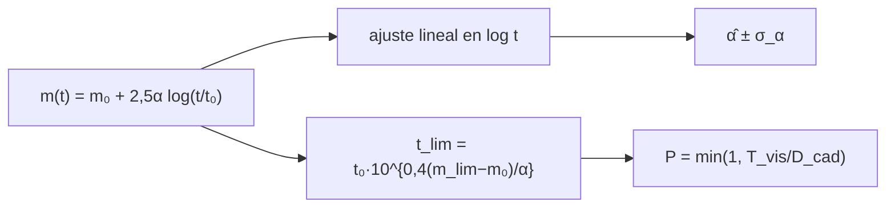

# B28-C08 — Señales transitorias

<!-- nav:top -->
[🏠 Programa](../../../../README.md) · [📚 Bloque B28](../../../tronco-comun/B28-astronomia-multimensajero.md) · [← Anterior: B28-C07 — Fuentes compactas binarias](../B28-C07-fuentes-compactas-binarias/CLASE.md) · [Siguiente: B28-C09 — Alertas científicas en tiempo real →](../B28-C09-alertas-cientificas-en-tiempo-real/CLASE.md)
<!-- /nav -->

## 1. Ubicación, nivel y alcance

Clase 8 del bloque B28. Nivel N3. Un transitorio es una fuente que aparece y desaparece en horas, días o semanas: una kilonova, una supernova, una llamarada. Aquí ajustas la caída de una **curva de luz** con una ley de potencias, calculas el **tiempo que el evento queda por encima del límite de un telescopio** y estimas la **probabilidad de detectarlo según la cadencia** de observación. Usas regresión lineal ([B12](../../../tronco-comun/B12-probabilidad-estadistica-e-incertidumbre.md)), las supernovas de [B27-C14](../../B27/B27-C14-supernovas-termonucleares/CLASE.md) y los eventos de [B27-C16](../../B27/B27-C16-eventos-de-disrupcion-por-marea/CLASE.md). Los datos son sintéticos.

## 2. Por qué esta clase existe

Un transitorio que dura menos que el intervalo entre visitas se pierde. El índice de caída decide cuánto dura un evento sobre el límite de detección. La decisión central: **¿con qué precisión se recupera el índice de caída y qué cadencia garantiza detectar el evento?**

## 3. Lo que podrás hacer al terminar

1. Ajustar `m(t) = m₀ + 2,5α log₁₀(t/t₀)` por mínimos cuadrados.
2. Calcular el error estándar `σ_α = σ/(2,5√S_xx)`.
3. Calcular el tiempo sobre un límite: `t_lim = t₀ 10^{0,4(m_lim − m₀)/α}`.
4. Estimar la probabilidad de detección `min(1, T_vis/D_cad)`.
5. Verificar el ajuste por Monte Carlo con semilla fija.
6. Reconocer los supuestos del modelo.

La evidencia es la **ficha de un transitorio y su cadencia** del ejercicio 12 (sección 20).

## 4. Con qué llegas y cómo comprobarlo

1. ¿Qué es una magnitud aparente?
2. ¿Qué es una regresión lineal?
3. ¿Qué es una ley de potencias?
4. ¿Qué es una cadencia de observación?
5. ¿Qué es un límite de detección?

<details>
<summary>Ver respuestas</summary>

1. Una escala logarítmica de brillo: `m = −2,5 log F + cte`. 2. El ajuste de una recta por mínimos cuadrados. 3. `F ∝ t^{−α}`. 4. El intervalo entre dos visitas. 5. La magnitud más débil que se detecta.
</details>

Con cuatro o cinco aciertos, sigue; si no, repasa B12.

## 5. Un caso real y un caso sintético

La contrapartida óptica de GW170817 se identificó a unos `10 arcsec` de una galaxia (S2, resumen). Esta clase no usa ninguna curva de luz medida: genera una sintética con `m₀ = 17`, `t₀ = 1 d`, `α = 1,3` (ilustrativos), 14 épocas entre `1` y `18,2 d` y un ruido de `0,1 mag`. Es el **ejemplo conductor**.

## 6. Vocabulario

Un **transitorio** es una fuente de brillo variable en escala corta. La **curva de luz** es el brillo en función del tiempo. El **índice de caída** `α`. El **límite de detección** `m_lim`. La **cadencia** `D_cad` es el intervalo entre visitas. El **tiempo visible** `T_vis` es el que pasa sobre el límite.

## 7. Modelo mental: una vela que se apaga y un vigilante que pasa

La vela se apaga siguiendo una ley de potencias; el vigilante pasa cada cierto tiempo. Si la vela se apaga antes de la siguiente ronda, nadie la ve.



*Descripción textual:* la curva de luz se ajusta con una recta en `log t`; el tiempo sobre el límite sale del modelo; la probabilidad de detección depende de la razón entre el tiempo visible y la cadencia.

Analogía: una vela y un vigilante. Límite: el modelo es de una sola banda y sin enrojecimiento.

## 8. La explicación, paso a paso

### 8.1 El ajuste

Se genera la curva con 14 épocas entre `1,0` y `18,2 d`. En 500 realizaciones: `α` medio `1,3003`, desviación `0,0278`, error estándar analítico `0,0274`.

### 8.2 El tiempo sobre el límite

| `m_lim` | `t_lim` (d) |
|---|---|
| 19,0 | 4,12 |
| 20,0 | 8,38 |
| 21,0 | 17,01 |
| 22,0 | 34,55 |

Cada magnitud más profunda alarga el tiempo visible en un factor `10^{0,4/α} = 2,03`.

### 8.3 La cadencia

Con `T_vis = 17,01 d` (para `m_lim = 21`):

| cadencia (d) | `P` analítica | `P` Monte Carlo |
|---|---|---|
| 2 | 1,0000 | 1,0000 |
| 5 | 1,0000 | 1,0000 |
| 10 | 1,0000 | 1,0000 |
| 17 | 1,0000 | 1,0000 |
| 30 | 0,5671 | 0,5697 |
| 60 | 0,2835 | 0,2833 |

### 8.4 Lectura

La cadencia debe ser menor que el tiempo visible para garantizar la detección: `17 d` o menos en este ejemplo.

### 8.5 Alcance

El Monte Carlo de la cadencia verifica que la ventana de visibilidad cae dentro del primer intervalo con la probabilidad esperada; no modela varias bandas ni condiciones meteorológicas.

## 9. Magnitudes, símbolos y unidades

| Símbolo | Qué es | Unidad | Valor / nota |
|---|---|---|---|
| `m₀` | magnitud en `t₀` | mag | 17 (ilustrativa) |
| `t₀` | tiempo de referencia | d | 1 |
| `α` | índice de caída | — | 1,3 (ilustrativo) |
| `σ` | ruido fotométrico | mag | 0,1 (ilustrativo) |
| `m_lim` | límite de detección | mag | 19–22 |
| `D_cad` | cadencia | d | 2–60 |

## 10. Convenciones y referencias

Una banda; ruido gaussiano; sin extinción; semilla `20261109`; **todo sintético**.

## 11. De dónde sale lo que afirmamos

| ID | Fuente | Localizador | Respalda | Estado |
|---|---|---|---|---|
| S1 | Cálculo propio: regresión lineal y Monte Carlo | implementado en `transitorios.py` | ajuste y probabilidades | Verificado contra el error estándar analítico |
| S2 | Abbott et al., arXiv:1710.05835 | https://arxiv.org/abs/1710.05835 | contrapartida a `~10 arcsec` de la galaxia | Solo resumen, consultado el 2026-11-09 |

Límites: S2 solo resumen y no respalda ninguna cifra de la curva de luz; ninguna medición se usa; el error estándar `σ/(2,5√S_xx)` es el de la regresión lineal.

## 12. Cómo ver el efecto del límite

| `m_lim` más profundo en | tiempo visible |
|---|---|
| 1 mag | ×2,03 |
| 2 mag | ×4,12 |
| 3 mag | ×8,38 |

Descripción larga: cada magnitud de profundidad añadida multiplica por `2,03` el tiempo visible.

## 13. Ejemplo trabajado: ¿cuánto dura sobre 21?

**Paso 1 · Datos.** `m₀ = 17`, `α = 1,3`, `m_lim = 21`.

**Paso 2 · Exponente.** `0,4 × 4/1,3 = 1,2308`.

**Paso 3 · Tiempo.** `10^{1,2308} = 17,0 d`.

**Paso 4 · Cadencia.** Una cadencia de 30 d detecta con probabilidad `17,0/30 = 0,567`.

## 14. Distintas formas de describir la curva

**Por magnitud:** `m(t)`. **Por flujo:** `F ∝ t^{−α}`. **Por tiempo visible:** `t_lim`. **Por probabilidad:** `P`.

## 15. Práctica guiada

**Ejercicio 1 · con los pasos indicados.** `t_lim` para `m_lim = 19`. *Pasos:* `10^{0,4×2/1,3}`.

<details><summary>Solución comentada</summary>

`10^{0,6154} = 4,12 d`.
</details>

**Ejercicio 2 · con una pista.** Factor por magnitud. *Pista:* `10^{0,4/α}`.

<details><summary>Solución comentada</summary>

`2,03`.
</details>

**Ejercicio 3 · casi autónomo.** `P` con cadencia de 30 d.

<details><summary>Solución comentada</summary>

`0,567`.
</details>

## 16. Práctica autónoma, transferencia e integrador

**Ejercicio 4.** Error estándar de `α` con 14 épocas.

<details><summary>Solución comentada</summary>

`0,0274`.
</details>

**Ejercicio 5.** Tiempo visible si `α = 1,0`.

<details><summary>Solución comentada</summary>

`10^{1,6} = 39,8 d`.
</details>

**Ejercicio 6.** Cadencia máxima para detección garantizada con `m_lim = 20`.

<details><summary>Solución comentada</summary>

`8,38 d`.
</details>

**Ejercicio 7.** `P` con cadencia de 60 d y `m_lim = 22`.

<details><summary>Solución comentada</summary>

`34,55/60 = 0,576`.
</details>

**Ejercicio 8.** Diferencia entre `α` medio y verdadero.

<details><summary>Solución comentada</summary>

`0,0003`, 0,2 errores estándar de la media (`0,0278/√500 = 0,0012`).
</details>

**Ejercicio 9 · transferencia.** Un compañero dice que con cadencia de 30 días se detecta la mitad de los eventos. Responde con 8.3.

<details><summary>Solución comentada</summary>

Con `T_vis = 17 d` la probabilidad es `0,567`, no `0,5`; y depende del límite.
</details>

**Ejercicio 10 · transferencia.** ¿Por qué un transitorio que cae más rápido es más difícil de detectar?

<details><summary>Solución comentada</summary>

Porque `T_vis ∝ 10^{0,4Δm/α}` decrece al crecer `α`.
</details>

**Ejercicio 11 · transferencia.** ¿Qué valida el Monte Carlo del ajuste?

<details><summary>Solución comentada</summary>

Que la dispersión del estimador coincide con el error de la regresión; no que el modelo describa un evento real.
</details>

**Ejercicio 12 · integrador.** Elabora tu *ficha de un transitorio y su cadencia*: ajuste, tabla de `t_lim`, tabla de probabilidades y una recomendación de cadencia.

<details><summary>Solución modelo</summary>

Secciones 8.1–8.4.
</details>

## 17. Laboratorio: ajuste y cadencia

El script [transitorios.py](transitorios.py) ajusta `α` (**comprueba** `10 %` en la desviación), calcula `t_lim` y simula la cadencia (**comprueba** `0,01`).

**Datos:** todo **sintético** con semilla fija. **Predice antes de ejecutar:** ¿qué `α` se recupera? (≈`1,30`.) **Ejecución del 2026-11-09 (Python 3.12.9):**

```text
Python 3.12.9 (biblioteca estandar)
14 epocas entre 1.0 y 18.2 d, ruido 0.1 mag, alpha verdadero = 1.3
500 realizaciones: alpha medio = 1.3003 ; desviacion = 0.0278 ; error estandar analitico = 0.0274
 m_lim  t_lim [d]
  19.0       4.12
  20.0       8.38
  21.0      17.01
  22.0      34.55
visible por encima de m = 21 durante 17.01 d
 cadencia [d]  P analitica  P Monte Carlo
          2.0       1.0000         1.0000
          5.0       1.0000         1.0000
         10.0       1.0000         1.0000
         17.0       1.0000         1.0000
         30.0       0.5671         0.5697
         60.0       0.2835         0.2833
Pruebas superadas.
```

```bash
python programa/clases/B28/B28-C08-senales-transitorias/transitorios.py
```

**Límites:** una banda, ruido gaussiano, sin extinción, sin variaciones de calidad de observación.

## 18. Errores frecuentes y cómo corregirlos

**Confundir magnitud y flujo.** Se corrige con la sección 4.

**Olvidar el factor 2,5.** Se corrige con el ejercicio 4.

**Tomar `P` por una certeza.** Se corrige con el ejercicio 9.

**Aplicar una cadencia sin mirar el límite.** Se corrige con el ejercicio 6.

**Tomar la curva sintética por real.** Se corrige con la sección 10.

## 19. Cómo sabrás que vas bien

Tras 8.1: ¿qué error tiene `α`? Si dudas, ejercicio 4. Tras 8.3: ¿cómo se obtiene `P`? Ejercicio 3. Tras el laboratorio: ¿qué valida? (el estimador y la probabilidad).

## 20. Qué entregas y cómo se evalúa

El producto es tu **ficha de un transitorio y su cadencia** (ejercicio 12).

| Criterio | Inicial | En desarrollo | Logrado | Destacado |
|---|---|---|---|---|
| Conceptos | Los confunde | Parciales | Ajuste, `t_lim`, `P` | Explica la dependencia de `α` |
| Cálculo | Sin unidades | Con errores | Tablas completas | Recomienda una cadencia |
| Numérico | Sin comprobar | Un caso | Dos comprobaciones | Interpreta el error de la media |
| Fuentes | Sin fuente | Sin fecha | S1–S2 con fecha | Declara que todo es sintético |
| Límites | No los nombra | Uno | Tres | Discute varias bandas |

**Condiciones críticas (no se compensan con promedio):** rotular todo como sintético; no inferir resultados sobre eventos reales; citar solo lo consultado.

## 21. Ética, seguridad y límites

Clase educativa: no es una canalización de búsqueda de transitorios. Accesibilidad: tablas equivalentes a las gráficas, fórmulas en texto, ejercicios sin conexión.

## 22. Para cerrar y seguir

El índice de caída se recupera con error `σ/(2,5√S_xx)`, el tiempo visible crece `2,03` veces por magnitud y la probabilidad de detección es `min(1, T_vis/D_cad)`. Queda una pregunta: ¿cómo se avisa al resto de la comunidad en tiempo real?

**Glosario español–inglés.** transitorio · *transient*; curva de luz · *light curve*; índice de caída · *decline index*; cadencia · *cadence*; límite de detección · *limiting magnitude*; tiempo visible · *visibility time*.

**Continuidad.** [B28-C09](../B28-C09-alertas-cientificas-en-tiempo-real/CLASE.md) estudia las alertas científicas en tiempo real.

**Referencias:** ver sección 11.

<!-- nav:bottom -->
---

[← Anterior: B28-C07 — Fuentes compactas binarias](../B28-C07-fuentes-compactas-binarias/CLASE.md) · [📚 Bloque B28](../../../tronco-comun/B28-astronomia-multimensajero.md) · [Siguiente: B28-C09 — Alertas científicas en tiempo real →](../B28-C09-alertas-cientificas-en-tiempo-real/CLASE.md)
<!-- /nav -->
