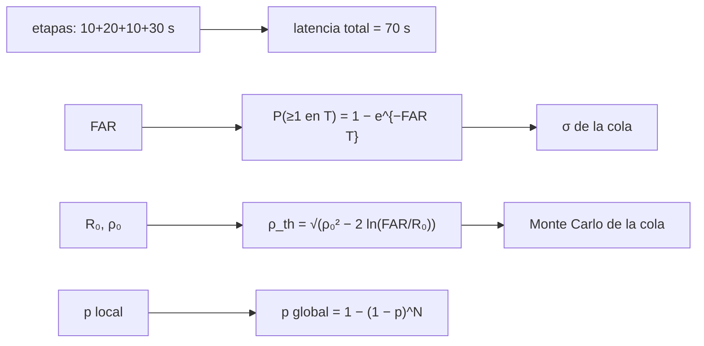

# B28-C09 — Alertas científicas en tiempo real

<!-- nav:top -->
[🏠 Programa](../../../../README.md) · [📚 Bloque B28](../../../tronco-comun/B28-astronomia-multimensajero.md) · [← Anterior: B28-C08 — Señales transitorias](../B28-C08-senales-transitorias/CLASE.md) · [Siguiente: B28-C10 — Localización probabilística de eventos →](../B28-C10-localizacion-probabilistica-de-eventos/CLASE.md)
<!-- /nav -->

## 1. Ubicación, nivel y alcance

Clase 9 del bloque B28. Nivel N3. Un transitorio ([C08](../B28-C08-senales-transitorias/CLASE.md)) se desvanece: para estudiarlo con otros mensajeros hay que avisar en minutos. Aquí calculas el **presupuesto de latencia** de una alerta, la **tasa de falsas alarmas** y su traducción a sigmas, el **umbral** que da una tasa deseada y el **factor de pruebas** cuando se hacen muchas búsquedas. Usas probabilidad ([B12](../../../tronco-comun/B12-probabilidad-estadistica-e-incertidumbre.md)) y la significancia de [B27-C19](../../B27/B27-C19-observatorios-de-rayos-x-y-gamma/CLASE.md). Los números son sintéticos salvo los citados.

## 2. Por qué esta clase existe

Una alerta tardía pierde el evento; una alerta con muchas falsas alarmas agota a los observadores. La decisión central: **¿qué umbral produce una tasa de falsas alarmas aceptable y cuánto tarda la alerta en llegar?**

## 3. Lo que podrás hacer al terminar

1. Sumar un presupuesto de latencia por etapas.
2. Convertir una tasa de falsas alarmas en probabilidad y en sigmas.
3. Calcular el umbral de `ρ` para un FAR dado: `ρ = √(ρ₀² − 2 ln(FAR/R₀))`.
4. Verificar la cola del ruido por Monte Carlo con semilla fija.
5. Aplicar el factor de pruebas `1 − (1 − p)^N`.
6. Distinguir tasa local de probabilidad global.

La evidencia es la **ficha de una alerta con su latencia** del ejercicio 12 (sección 20).

## 4. Con qué llegas y cómo comprobarlo

1. ¿Qué es un proceso de Poisson?
2. ¿Qué es la probabilidad de una cola gaussiana?
3. ¿Qué es una relación señal-ruido de red?
4. ¿Qué es un Monte Carlo?
5. ¿Qué es la transformada inversa?

<details>
<summary>Ver respuestas</summary>

1. Eventos independientes a tasa constante. 2. `p = ½ erfc(σ/√2)`. 3. La combinación cuadrática de las SNR de los detectores. 4. Una simulación aleatoria. 5. Generar una variable aleatoria a partir de una uniforme invirtiendo su distribución acumulada.
</details>

Con cuatro o cinco aciertos, sigue; si no, repasa B12 y B27-C19.

## 5. Un caso real y un caso sintético

GW150914 tuvo una tasa de falsas alarmas estimada menor que `1` por `203 000 años` (S2, resumen). BAYESTAR produce mapas de localización en segundos (S3, resumen), y en GW170817 el destello gamma llegó unos `1,7 s` después de la fusión (S4, resumen). Esta clase usa esas tres cifras como contexto y simula el resto: latencias por etapa de `10`, `20`, `10` y `30 s`, una tasa base de `1000` candidatos al día sobre `ρ = 4`. Es el **ejemplo conductor**.

## 6. Vocabulario

La **latencia** es el tiempo entre el suceso y la alerta. La **tasa de falsas alarmas** (FAR) es el número de disparos por ruido por unidad de tiempo. El **umbral** `ρ_th` es la SNR mínima para alertar. El **factor de pruebas** corrige por el número de búsquedas. La **significancia** `σ` equivale a una probabilidad de cola. Una **alerta** es el mensaje a la comunidad.

## 7. Modelo mental: un detector de humo

Un detector de humo muy sensible suena con cualquier vapor; uno poco sensible llega tarde al incendio. El umbral equilibra ambos y se calibra con la tasa de falsas alarmas que se tolera.



*Descripción textual:* las etapas suman la latencia; el FAR se traduce a probabilidad y sigmas; el umbral sale de la cola del ruido y se contrasta por Monte Carlo; el factor de pruebas pasa de p local a global.

Analogía: un detector de humo. Límite: el ruido real no es estacionario.

## 8. La explicación, paso a paso

### 8.1 Latencia

| etapa (ilustrativa) | `Δt` (s) | acumulado (s) |
|---|---|---|
| detección y transferencia | 10 | 10 |
| búsqueda y disparo | 20 | 30 |
| localización rápida | 10 | 40 |
| revisión y envío | 30 | 70 |

### 8.2 Del FAR a sigmas

Con `FAR = 1/203 000 año⁻¹`: la probabilidad de al menos una falsa alarma es `4,926 × 10⁻⁶` en `1 año` (`4,42σ` de una cola), `2,463 × 10⁻⁵` en `5 años` (`4,06σ`) y `4,925 × 10⁻⁴` en `100 años` (`3,29σ`).

### 8.3 Umbrales

Con `R₀ = 1000 d⁻¹`, `ρ₀ = 4`: `ρ_th = 5,460` (1 por día), `6,051` (1 por mes), `6,451` (1 por año).

### 8.4 Monte Carlo

Con `2 × 10⁶` candidatos y umbral `5,460`: `1996` sobre el umbral, frente a `2000 ± 45` esperados.

### 8.5 Factor de pruebas

Con `p = 10⁻³`: `N = 1`: `0,0010` (`3,09σ`); `10`: `0,0100` (`2,33σ`); `100`: `0,0952` (`1,31σ`); `1000`: `0,6323`.

## 9. Magnitudes, símbolos y unidades

| Símbolo | Qué es | Unidad | Valor / nota |
|---|---|---|---|
| `Δt` | latencia por etapa | s | ver 8.1 (ilustrativa) |
| `FAR` | tasa de falsas alarmas | año⁻¹ | `1/203 000` (S2) |
| `ρ` | SNR de red | — | umbral 5,46–6,45 |
| `R₀` | tasa base de candidatos | d⁻¹ | 1000 (ilustrativa) |
| `ρ₀` | SNR mínima de candidato | — | 4 (ilustrativa) |
| `N` | número de pruebas | — | 1–1000 |

## 10. Convenciones y referencias

Probabilidad de una cola; ruido estacionario con cola `e^{−(ρ²−ρ₀²)/2}`; semilla `20261109`; latencias, `R₀`, `ρ₀` **ilustrativas**; el FAR de GW150914 es de S2.

## 11. De dónde sale lo que afirmamos

| ID | Fuente | Localizador | Respalda | Estado |
|---|---|---|---|---|
| S1 | Cálculo propio: cola de Poisson y de Rayleigh | implementado en `alertas.py` | umbrales, sigmas, factor de pruebas | Verificado por Monte Carlo |
| S2 | LIGO Scientific y Virgo, GW150914, arXiv:1602.03837 | https://arxiv.org/abs/1602.03837 | FAR `< 1/203 000 año⁻¹` | Solo resumen, consultado el 2026-11-09 |
| S3 | Singer y Price, BAYESTAR, arXiv:1508.03634 | https://arxiv.org/abs/1508.03634 | localización en segundos | Solo resumen, consultado el 2026-11-09 |
| S4 | LIGO Scientific, Virgo y colaboraciones, arXiv:1710.05833 | https://arxiv.org/abs/1710.05833 | `~1,7 s` de retardo del destello | Solo resumen, consultado el 2026-11-09 |

Límites: S2–S4 solo resumen; el modelo de cola del ruido es una simplificación y no el de ninguna canalización; las latencias son ilustrativas.

## 12. Cómo ver el umbral

| FAR | `ρ_th` |
|---|---|
| 1 por día | 5,460 |
| 1 por mes | 6,051 |
| 1 por año | 6,451 |

Descripción larga: reducir el FAR 365 veces solo exige subir el umbral en `1` unidad de SNR.

## 13. Ejemplo trabajado: umbral para 1 falsa alarma al mes

**Paso 1 · Datos.** `R₀ = 1000/d`, `ρ₀ = 4`, `FAR = 1/30 d⁻¹`.

**Paso 2 · Cociente.** `FAR/R₀ = 3,33 × 10⁻⁵`; `ln = −10,31`.

**Paso 3 · Umbral.** `ρ_th = √(16 + 20,62) = 6,051`.

**Paso 4 · Sentido.** Se alerta solo con SNR mayor que `6,05`.

## 14. Distintas formas de describir la calidad

**Por FAR:** sucesos por año. **Por p:** probabilidad. **Por sigma:** cola gaussiana. **Por umbral:** SNR.

## 15. Práctica guiada

**Ejercicio 1 · con los pasos indicados.** Latencia total. *Pasos:* suma.

<details><summary>Solución comentada</summary>

`10 + 20 + 10 + 30 = 70 s`.
</details>

**Ejercicio 2 · con una pista.** `P` en 1 año con `FAR = 1/203 000`. *Pista:* `1 − e^{−FAR}`.

<details><summary>Solución comentada</summary>

`4,926 × 10⁻⁶`.
</details>

**Ejercicio 3 · casi autónomo.** Umbral para 1 falsa alarma al día.

<details><summary>Solución comentada</summary>

`√(16 + 2 ln 1000) = 5,460`.
</details>

## 16. Práctica autónoma, transferencia e integrador

**Ejercicio 4.** Umbral para 1 falsa alarma al año.

<details><summary>Solución comentada</summary>

`6,451`.
</details>

**Ejercicio 5.** Falsos positivos esperados en `2 × 10⁶` candidatos con umbral para 1 por día.

<details><summary>Solución comentada</summary>

`2000`.
</details>

**Ejercicio 6.** `p` global con `p = 10⁻³` y `N = 10`.

<details><summary>Solución comentada</summary>

`0,0100`.
</details>

**Ejercicio 7.** Sigmas de `p = 0,0100`.

<details><summary>Solución comentada</summary>

`2,33σ`.
</details>

**Ejercicio 8.** Latencia si la revisión humana se elimina.

<details><summary>Solución comentada</summary>

`40 s`.
</details>

**Ejercicio 9 · transferencia.** Un compañero dice que `4,4σ` es lo mismo que «1 falsa alarma en 203 000 años». Responde con 8.2.

<details><summary>Solución comentada</summary>

Son magnitudes distintas: el FAR es una tasa; la probabilidad en un año es `4,9 × 10⁻⁶`, que equivale a `4,4σ` en una cola.
</details>

**Ejercicio 10 · transferencia.** ¿Por qué hay que corregir por el número de pruebas?

<details><summary>Solución comentada</summary>

Porque con muchas búsquedas aumenta la probabilidad de una fluctuación local grande (8.5).
</details>

**Ejercicio 11 · transferencia.** ¿Qué valida el Monte Carlo?

<details><summary>Solución comentada</summary>

Que el umbral analítico produce la tasa esperada para la cola supuesta; no que el ruido real tenga esa cola.
</details>

**Ejercicio 12 · integrador.** Elabora tu *ficha de una alerta con su latencia*: presupuesto, FAR y sigmas, tres umbrales y la corrección por pruebas.

<details><summary>Solución modelo</summary>

Secciones 8.1–8.5.
</details>

## 17. Laboratorio: latencia, FAR y umbral

El script [alertas.py](alertas.py) suma la latencia, traduce FAR a sigmas, calcula umbrales y simula `2 × 10⁶` candidatos (**comprueba** 5 desviaciones de Poisson).

**Datos:** sin constantes; FAR de S2 y retardo de S4; el resto **ilustrativo**. **Predice antes de ejecutar:** ¿qué umbral da 1 falsa alarma al día? (≈`5,5`.) **Ejecución del 2026-11-09 (Python 3.12.9):**

```text
Python 3.12.9 (biblioteca estandar)
etapa (ilustrativa)                   dt [s]  acumulado [s]
deteccion y transferencia de datos      10.0           10.0
busqueda y disparo                      20.0           30.0
localizacion rapida                     10.0           40.0
revision y envio                        30.0           70.0
latencia total = 70.0 s ; el destello gamma de GW170817 llego 1.7 s despues de la fusion (S)
FAR = 1/203000 por anio: P(al menos una falsa alarma en 1 anios) = 4.926e-06 = 4.42 sigma (una cola)
FAR = 1/203000 por anio: P(al menos una falsa alarma en 5 anios) = 2.463e-05 = 4.06 sigma (una cola)
FAR = 1/203000 por anio: P(al menos una falsa alarma en 100 anios) = 4.925e-04 = 3.29 sigma (una cola)
FAR = 1 por dia : umbral rho = 5.460
FAR = 1 por mes : umbral rho = 6.051
FAR = 1 por anio: umbral rho = 6.451
Monte Carlo: 2000000 candidatos, umbral 5.460: 1996 sobre el umbral (esperados 2000 +/- 45)
p local = 0.001,    1 pruebas: p global = 0.0010 (3.09 sigma)
p local = 0.001,   10 pruebas: p global = 0.0100 (2.33 sigma)
p local = 0.001,  100 pruebas: p global = 0.0952 (1.31 sigma)
p local = 0.001, 1000 pruebas: p global = 0.6323 (0.00 sigma)
Pruebas superadas.
```

```bash
python programa/clases/B28/B28-C09-alertas-cientificas-en-tiempo-real/alertas.py
```

**Límites:** ruido estacionario, candidatos independientes, sin correlaciones entre detectores.

## 18. Errores frecuentes y cómo corregirlos

**Confundir tasa y probabilidad.** Se corrige con el ejercicio 9.

**Olvidar el factor de pruebas.** Se corrige con el ejercicio 10.

**Usar dos colas en vez de una.** Se corrige con la sección 10.

**Tomar las latencias por medidas.** Se corrige con la sección 10.

**Creer que el umbral elimina las falsas alarmas.** Se corrige con la sección 7.

## 19. Cómo sabrás que vas bien

Tras 8.2: ¿qué relación hay entre FAR y p? Si dudas, ejercicio 2. Tras 8.3: ¿cómo cambia el umbral con el FAR? Ejercicios 3–4. Tras el laboratorio: ¿qué valida el Monte Carlo? (el umbral frente a la cola supuesta).

## 20. Qué entregas y cómo se evalúa

El producto es tu **ficha de una alerta con su latencia** (ejercicio 12).

| Criterio | Inicial | En desarrollo | Logrado | Destacado |
|---|---|---|---|---|
| Conceptos | Los confunde | Parciales | Latencia, FAR, umbral | Explica el factor de pruebas |
| Cálculo | Sin unidades | Con errores | Tablas completas | Compara umbrales |
| Numérico | Sin comprobar | Un caso | Monte Carlo | Interpreta la desviación de Poisson |
| Fuentes | Sin fuente | Sin fecha | S1–S4 con fecha | Declara S2–S4 como resumen |
| Límites | No los nombra | Uno | Tres | Discute ruido no estacionario |

**Condiciones críticas (no se compensan con promedio):** rotular latencias y tasas como ilustrativas; no confundir FAR con probabilidad; citar solo lo consultado.

## 21. Ética, seguridad y límites

Clase educativa: no es la canalización de ningún observatorio. Accesibilidad: tablas equivalentes a las gráficas, fórmulas en texto, ejercicios sin conexión.

## 22. Para cerrar y seguir

La latencia es la suma de etapas, el umbral sale de la cola del ruido (`ρ_th = 5,46` para una falsa alarma al día) y el factor de pruebas pasa de p local a global. Queda una pregunta: ¿dónde en el cielo hay que mirar?

**Glosario español–inglés.** alerta · *alert*; latencia · *latency*; tasa de falsas alarmas · *false alarm rate (FAR)*; umbral · *threshold*; factor de pruebas · *trials factor*; significancia · *significance*.

**Continuidad.** [B28-C10](../B28-C10-localizacion-probabilistica-de-eventos/CLASE.md) estudia la localización probabilística de eventos.

**Referencias:** ver sección 11.

<!-- nav:bottom -->
---

[← Anterior: B28-C08 — Señales transitorias](../B28-C08-senales-transitorias/CLASE.md) · [📚 Bloque B28](../../../tronco-comun/B28-astronomia-multimensajero.md) · [Siguiente: B28-C10 — Localización probabilística de eventos →](../B28-C10-localizacion-probabilistica-de-eventos/CLASE.md)
<!-- /nav -->
