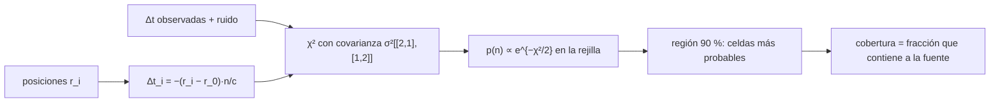

# B28-C10 — Localización probabilística de eventos

<!-- nav:top -->
[🏠 Programa](../../../../README.md) · [📚 Bloque B28](../../../tronco-comun/B28-astronomia-multimensajero.md) · [← Anterior: B28-C09 — Alertas científicas en tiempo real](../B28-C09-alertas-cientificas-en-tiempo-real/CLASE.md) · [Siguiente: B28-C11 — Coincidencias entre observatorios →](../B28-C11-coincidencias-entre-observatorios/CLASE.md)
<!-- /nav -->

## 1. Ubicación, nivel y alcance

Clase 10 del bloque B28. Nivel N3. Tras la alerta ([C09](../B28-C09-alertas-cientificas-en-tiempo-real/CLASE.md)), la pregunta es dónde mirar. Una red de detectores mide **diferencias de tiempo de llegada**; cada diferencia confina la fuente a un anillo, y el posterior bayesiano sobre la esfera da un mapa de probabilidad. Aquí construyes ese mapa sobre una rejilla de Fibonacci, calculas la **región creíble** del 90 % y compruebas por Monte Carlo su **cobertura**. Usas vectores ([B04](../../../tronco-comun/B04-algebra-trigonometria-y-geometria-espacial.md)), la distribución normal ([B12](../../../tronco-comun/B12-probabilidad-estadistica-e-incertidumbre.md)) y el algoritmo rápido de [BAYESTAR](https://arxiv.org/abs/1508.03634) como contexto. Se trata una versión simplificada solo con tiempos.

## 2. Por qué esta clase existe

El área de localización decide cuántas fotos hacen falta para encontrar la contrapartida. Un mapa mal calibrado engaña. La decisión central: **¿qué área cubre la región del 90 % con 2 y con 3 detectores y está bien calibrada?**

## 3. Lo que podrás hacer al terminar

1. Modelar las diferencias de tiempo `Δt = −(r_i − r_0)·n/c`.
2. Calcular el posterior con la covarianza correcta de las diferencias.
3. Construir una rejilla de Fibonacci sobre la esfera.
4. Obtener la región de máxima densidad del 90 % y su área.
5. Medir la cobertura por Monte Carlo con semilla fija.
6. Comparar 2 y 3 detectores.

La evidencia es el **mapa de probabilidad y área creíble** del ejercicio 12 (sección 20).

## 4. Con qué llegas y cómo comprobarlo

1. ¿Qué es un producto escalar?
2. ¿Qué es una covarianza?
3. ¿Qué es un posterior bayesiano?
4. ¿Qué es un grado cuadrado?
5. ¿Qué es la cobertura de una región creíble?

<details>
<summary>Ver respuestas</summary>

1. `a·b = |a||b| cos θ`. 2. La medida de cómo varían juntas dos variables. 3. La distribución de los parámetros dados los datos. 4. `(π/180)²` estereorradianes. 5. La fracción de veces que la región contiene el valor verdadero.
</details>

Con cuatro o cinco aciertos, sigue; si no, repasa B04 y B12.

## 5. Un caso real y un caso sintético

GW170817 se localizó inicialmente en `31 grados cuadrados` (S2, resumen) y BAYESTAR genera mapas en segundos (S3, resumen). Esta clase no reproduce esa red: usa tres sitios ilustrativos (latitud, longitud en grados: `46,5; −119,4`, `30,6; −90,8`, `43,6; 10,5`), un radio terrestre nominal de `6,3781 × 10⁶ m` (S1) y un error temporal de `0,5 ms` por detector. Es el **ejemplo conductor**.

## 6. Vocabulario

El **tiempo de llegada** `t_i = t₀ − r_i·n/c`. La **línea de base** es la separación entre dos detectores. El **anillo** es el conjunto de direcciones con la misma diferencia de tiempo. La **rejilla de Fibonacci** reparte puntos casi uniformes. La **región creíble** acumula probabilidad. La **cobertura** mide la calibración.

## 7. Modelo mental: anillos que se cruzan

Con dos detectores la fuente está sobre un anillo ancho; un tercero añade otro anillo y la intersección reduce el área a dos manchas simétricas respecto del plano de los detectores.



*Descripción textual:* las posiciones dan las diferencias de tiempo esperadas; se comparan con las observadas con la covarianza correcta; el posterior sobre la rejilla da la región del 90 % cuya cobertura se contrasta por simulación.

Analogía: dos radiofaros que dicen «estás en esta curva». Límite: no se usa la amplitud ni la fase de la señal.

## 8. La explicación, paso a paso

### 8.1 Geometría

Con los tres sitios ilustrativos, las líneas de base son `2999 km` (`10,00 ms`) y `8166 km` (`27,24 ms`) respecto del detector A.

### 8.2 La rejilla

`12 000` puntos de Fibonacci; cada celda ocupa `3,44` grados cuadrados; el cielo completo tiene `41 253`.

### 8.3 La covarianza

Las dos diferencias comparten el tiempo del detector A, así que su covarianza es `σ²[[2,1],[1,2]]` y su inversa `σ⁻²/3 [[2,−1],[−1,2]]`. Ignorarla da un posterior incorrecto.

### 8.4 Áreas y cobertura

En `400` ensayos con fuente aleatoria y semilla `20261109`: con 3 detectores, la mediana del área del 90 % es `299` grados cuadrados y la cobertura `0,877`; con 2 detectores, `4799` grados cuadrados y `0,900`. El cociente de áreas es `16,0`.

### 8.5 Lectura

Un tercer detector reduce el área unas `16` veces. La cobertura de `0,877` con el error binomial de `0,016` está a `1,4` desviaciones del `0,90` ideal; la discretización de la rejilla puede explicar parte.

## 9. Magnitudes, símbolos y unidades

| Símbolo | Qué es | Unidad | Valor / nota |
|---|---|---|---|
| `r_i` | posición del detector | m | `R = 6,3781 × 10⁶` (S1) |
| `σ` | error temporal por detector | s | `5 × 10⁻⁴` (ilustrativo) |
| `N` | puntos de la rejilla | — | 12 000 |
| `A_90` | área del 90 % | deg² | 299 (3 det.); 4799 (2 det.) |
| cobertura | fracción que contiene la fuente | — | 0,877; 0,900 |

## 10. Convenciones y referencias

`n` apunta a la fuente; `t_i = t₀ − r_i·n/c`; posterior con prior uniforme sobre la esfera; las posiciones de los sitios y `σ` son **ilustrativos**.

## 11. De dónde sale lo que afirmamos

| ID | Fuente | Localizador | Respalda | Estado |
|---|---|---|---|---|
| S1 | NIST (`c`) e IAU 2015 B3 (`R_E^eq` nominal) | https://physics.nist.gov/cuu/Constants/Table/allascii.txt ; https://arxiv.org/abs/1510.07674 | `c`; `6,3781 × 10⁶ m` | Consultadas el 2026-11-09 |
| S2 | LIGO Scientific, Virgo y colaboraciones, arXiv:1710.05833 | https://arxiv.org/abs/1710.05833 | `31 grados²` | Solo resumen, consultado el 2026-11-09 |
| S3 | Singer y Price, arXiv:1508.03634 | https://arxiv.org/abs/1508.03634 | BAYESTAR en segundos | Solo resumen, consultado el 2026-11-09 |

Límites: S2 y S3 solo resumen; no se usa la amplitud ni la fase; los sitios y el error son ilustrativos; no es BAYESTAR.

## 12. Cómo ver la calibración

| Red | área 90 % mediana (deg²) | cobertura |
|---|---|---|
| 2 detectores | 4799 | 0,900 |
| 3 detectores | 299 | 0,877 |

Descripción larga: el tercer detector reduce el área en un factor `16` y la cobertura permanece cerca del valor nominal.

## 13. Ejemplo trabajado: tamaño de una celda

**Paso 1 · Datos.** `N = 12 000`.

**Paso 2 · Área.** `4π/N = 1,047 × 10⁻³ sr`.

**Paso 3 · Grados cuadrados.** `× (180/π)² = 3,44`.

**Paso 4 · Sentido.** Una región de `299 deg²` ocupa unas 87 celdas.

## 14. Distintas formas de describir la localización

**Por anillo:** una diferencia de tiempo. **Por mapa:** posterior en la esfera. **Por área creíble:** una cifra. **Por cobertura:** calibración.

## 15. Práctica guiada

**Ejercicio 1 · con los pasos indicados.** Tiempo máximo entre sitios a `2999 km`. *Pasos:* `d/c`.

<details><summary>Solución comentada</summary>

`2,999 × 10⁶/2,998 × 10⁸ = 10,00 ms`.
</details>

**Ejercicio 2 · con una pista.** Área de una celda con `N = 12 000`. *Pista:* `41 253/N`.

<details><summary>Solución comentada</summary>

`3,44 deg²`.
</details>

**Ejercicio 3 · casi autónomo.** Celdas en `299 deg²`.

<details><summary>Solución comentada</summary>

`299/3,44 = 87`.
</details>

## 16. Práctica autónoma, transferencia e integrador

**Ejercicio 4.** Cociente de áreas 2/3 detectores.

<details><summary>Solución comentada</summary>

`4799/299 = 16,0`.
</details>

**Ejercicio 5.** Error binomial de una cobertura con `400` ensayos y `p = 0,9`.

<details><summary>Solución comentada</summary>

`√(0,09/400) = 0,015`.
</details>

**Ejercicio 6.** Desviaciones entre `0,877` y `0,900`.

<details><summary>Solución comentada</summary>

`(0,900 − 0,877)/0,015 = 1,5`.
</details>

**Ejercicio 7.** Fracción del cielo que cubre `299 deg²`.

<details><summary>Solución comentada</summary>

`299/41 253 = 0,72 %`.
</details>

**Ejercicio 8.** Tiempo máximo de llegada entre A y C.

<details><summary>Solución comentada</summary>

`27,24 ms`.
</details>

**Ejercicio 9 · transferencia.** Un compañero dice que con 2 detectores la fuente está en un punto. Responde con 8.4.

<details><summary>Solución comentada</summary>

Con 2 detectores el área del 90 % es `4799 deg²`, el 12 % del cielo.
</details>

**Ejercicio 10 · transferencia.** ¿Por qué hay dos manchas con 3 detectores?

<details><summary>Solución comentada</summary>

Porque las diferencias de tiempo no distinguen entre una dirección y su reflejo respecto del plano de los tres detectores.
</details>

**Ejercicio 11 · transferencia.** ¿Qué valida la cobertura?

<details><summary>Solución comentada</summary>

Que las regiones del 90 % contienen la fuente cerca del 90 % de las veces; no la calidad de un detector real.
</details>

**Ejercicio 12 · integrador.** Elabora tu *mapa de probabilidad y área creíble*: líneas de base, rejilla, áreas y coberturas para 2 y 3 detectores, y una frase sobre calibración.

<details><summary>Solución modelo</summary>

Secciones 8.1–8.5.
</details>

## 17. Laboratorio: posterior sobre la esfera

El script [localizacion.py](localizacion.py) construye el posterior en una rejilla de Fibonacci, calcula la región del 90 % y la cobertura en 400 ensayos (**comprueba** entre 0,84 y 0,96).

**Datos:** `c` de NIST; `R` nominal de la UAI; sitios y `σ` **ilustrativos**. **Predice antes de ejecutar:** ¿cuánto vale el cociente de áreas 2/3? (decenas.) **Ejecución del 2026-11-09 (Python 3.12.9):**

```text
Python 3.12.9 (biblioteca estandar)
lineas de base: A-B = 2999 km (tiempo maximo 10.00 ms) ; A-C = 8166 km (27.24 ms)
rejilla de Fibonacci: 12000 puntos ; area de celda = 3.44 grados cuadrados ; cielo = 41253 grados cuadrados
3 detectores: area 90 %: mediana = 299 grados cuadrados ; cobertura = 0.877 (esperada 0.90)
2 detectores: area 90 %: mediana = 4799 grados cuadrados ; cobertura = 0.900 (esperada 0.90)
cociente de areas 2 detectores / 3 detectores = 16.0
Pruebas superadas.
```

```bash
python programa/clases/B28/B28-C10-localizacion-probabilistica-de-eventos/localizacion.py
```

**Límites:** solo tiempos, ruido gaussiano, sin amplitud ni polarización, rejilla de 12 000 puntos.

## 18. Errores frecuentes y cómo corregirlos

**Ignorar la covarianza.** Se corrige con 8.3.

**Confundir área creíble y error.** Se corrige con la sección 6.

**Creer que 3 detectores dan un punto.** Se corrige con el ejercicio 10.

**Tomar la cobertura de un solo ensayo.** Se corrige con el ejercicio 5.

**Tomar los sitios por reales.** Se corrige con la sección 10.

## 19. Cómo sabrás que vas bien

Tras 8.3: ¿qué covarianza tienen las diferencias? Si dudas, repasa la sección 8.3. Tras 8.4: ¿qué área da el tercer detector? Ejercicio 4. Tras el laboratorio: ¿qué valida la cobertura? (la calibración).

## 20. Qué entregas y cómo se evalúa

El producto es tu **mapa de probabilidad y área creíble** (ejercicio 12).

| Criterio | Inicial | En desarrollo | Logrado | Destacado |
|---|---|---|---|---|
| Conceptos | Los confunde | Parciales | Anillo, posterior, región | Explica la covarianza |
| Cálculo | Sin unidades | Con errores | Áreas y cobertura | Compara redes |
| Numérico | Sin comprobar | Un caso | Cobertura por Monte Carlo | Interpreta el error binomial |
| Fuentes | Sin fuente | Sin fecha | S1–S3 con fecha | Declara S2 y S3 como resumen |
| Límites | No los nombra | Uno | Tres | Discute el uso de la amplitud |

**Condiciones críticas (no se compensan con promedio):** rotular sitios y `σ` como ilustrativos; no presentar este mapa como el de un observatorio; citar solo lo consultado.

## 21. Ética, seguridad y límites

Clase educativa: no sustituye una localización oficial. Accesibilidad: tablas equivalentes a las gráficas, fórmulas en texto, ejercicios sin conexión.

## 22. Para cerrar y seguir

Con tiempos de llegada y la covarianza correcta, el posterior en la esfera da regiones del 90 % de `4799 deg²` (2 detectores) y `299 deg²` (3 detectores), con cobertura cercana a la nominal. Queda una pregunta: ¿cómo se decide que dos observaciones corresponden al mismo evento?

**Glosario español–inglés.** diferencia de tiempos de llegada · *time-of-arrival difference*; línea de base · *baseline*; región creíble · *credible region*; cobertura · *coverage*; rejilla de Fibonacci · *Fibonacci grid*; posterior · *posterior*.

**Continuidad.** [B28-C11](../B28-C11-coincidencias-entre-observatorios/CLASE.md) estudia las coincidencias entre observatorios.

**Referencias:** ver sección 11.

<!-- nav:bottom -->
---

[← Anterior: B28-C09 — Alertas científicas en tiempo real](../B28-C09-alertas-cientificas-en-tiempo-real/CLASE.md) · [📚 Bloque B28](../../../tronco-comun/B28-astronomia-multimensajero.md) · [Siguiente: B28-C11 — Coincidencias entre observatorios →](../B28-C11-coincidencias-entre-observatorios/CLASE.md)
<!-- /nav -->
