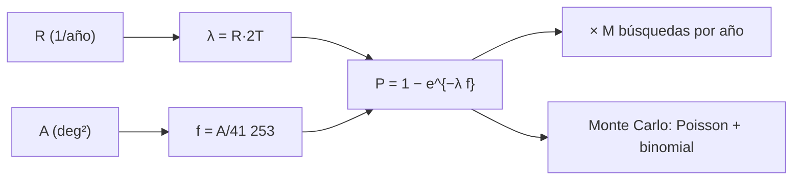

# B28-C11 — Coincidencias entre observatorios

<!-- nav:top -->
[🏠 Programa](../../../../README.md) · [📚 Bloque B28](../../../tronco-comun/B28-astronomia-multimensajero.md) · [← Anterior: B28-C10 — Localización probabilística de eventos](../B28-C10-localizacion-probabilistica-de-eventos/CLASE.md) · [Siguiente: B28-C12 — Modelos de emisión conjunta →](../B28-C12-modelos-de-emision-conjunta/CLASE.md)
<!-- /nav -->

## 1. Ubicación, nivel y alcance

Clase 11 del bloque B28. Nivel N3. Dos señales de observatorios distintos que coinciden en el tiempo y en el cielo pueden venir del mismo evento o ser una casualidad. Aquí calculas la **probabilidad de una coincidencia fortuita** a partir de la tasa de un fenómeno de fondo, el ancho de la ventana temporal y el área de la región de localización, y la verificas por **Monte Carlo**. Usas procesos de Poisson ([B12](../../../tronco-comun/B12-probabilidad-estadistica-e-incertidumbre.md)), el mapa de [B28-C10](../B28-C10-localizacion-probabilistica-de-eventos/CLASE.md) y los destellos de [B27-C17](../../B27/B27-C17-explosiones-de-rayos-gamma/CLASE.md). Se trata un fondo isótropo y estacionario.

## 2. Por qué esta clase existe

Que dos señales coincidan no prueba que estén relacionadas: la pregunta es cuán probable es la coincidencia por azar. Una probabilidad fortuita muy baja es lo que convierte una coincidencia en un descubrimiento. La decisión central: **¿cuál es la probabilidad de que un fondo produzca una coincidencia así por casualidad?**

## 3. Lo que podrás hacer al terminar

1. Calcular `P = 1 − exp(−R · 2T · f_cielo)`.
2. Obtener `f_cielo = A/41 253 deg²`.
3. Despejar la tasa que daría una probabilidad dada.
4. Verificar la fórmula por Monte Carlo con semilla fija.
5. Multiplicar por el número de búsquedas por año.
6. Reconocer los supuestos de isotropía y estacionariedad.

La evidencia es la **ficha de una coincidencia con su probabilidad fortuita** del ejercicio 12 (sección 20).

## 4. Con qué llegas y cómo comprobarlo

1. ¿Qué es un proceso de Poisson?
2. ¿Qué es un grado cuadrado?
3. ¿Qué es una fracción del cielo?
4. ¿Qué es una ventana temporal?
5. ¿Qué es un Monte Carlo?

<details>
<summary>Ver respuestas</summary>

1. Eventos independientes a tasa constante. 2. Un cuadrado de un grado de lado, `(π/180)²` sr. 3. El área dividida por `4π` sr. 4. El intervalo en que se acepta una coincidencia. 5. Una simulación aleatoria repetible.
</details>

Con cuatro o cinco aciertos, sigue; si no, repasa B12.

## 5. Un caso real y un caso ilustrativo

La detección de GRB 170817A llegó `1,74 ± 0,05 s` después de GW170817, y la colaboración estimó una probabilidad de coincidencia fortuita de `5 × 10⁻⁸` (S2, resumen); GW170817 se localizó inicialmente en `31 grados cuadrados` (S3, resumen). Esta clase no reproduce ese cálculo: con una tasa ilustrativa de `100` destellos al año, una ventana de `±5 s` y `31 deg²`, la fórmula da `2,381 × 10⁻⁸`, del mismo orden. Es el **ejemplo conductor**.

## 6. Vocabulario

La **probabilidad fortuita** es la de una coincidencia por azar. La **ventana** `±T`. La **tasa** `R` del fenómeno de fondo. La **fracción del cielo** `f`. La **isotropía** supone igual probabilidad en todas direcciones. La **coincidencia** exige tiempo y posición compatibles.

## 7. Modelo mental: lotería con dos números

Para ganar la lotería hay que acertar el momento y el lugar. Cada ventana abre un número limitado de boletos y cada boleto cae en la región con baja probabilidad. El producto suele ser diminuto.



*Descripción textual:* la tasa y la ventana dan el número medio de eventos de fondo; el área da la fracción del cielo; su producto, en una distribución de Poisson, da la probabilidad fortuita, que se verifica por simulación.

Analogía: acertar hora y lugar. Límite: los fondos reales no son isótropos ni estacionarios.

## 8. La explicación, paso a paso

### 8.1 La fórmula

`P = 1 − exp(−R · 2T · f)`, con `f = A/41 253`.

### 8.2 Tabla de probabilidades

| `R` (año⁻¹) | `T` (s) | `A` (deg²) | `P` fortuita |
|---|---|---|---|
| 100 | 5 | 31 | `2,381 × 10⁻⁸` |
| 100 | 5 | 300 | `2,304 × 10⁻⁷` |
| 100 | 86 400 | 31 | `4,114 × 10⁻⁴` |
| 300 | 5 | 31 | `7,144 × 10⁻⁸` |
| 100 | 5 | 4800 | `3,687 × 10⁻⁶` |

### 8.3 Inversión

Para `P = 5 × 10⁻⁸` con `T = 5 s` y `31 deg²`, la tasa sería `210,0` año⁻¹ (ilustrativo; no es el cálculo publicado).

### 8.4 Monte Carlo

Con `R = 100`, `T = 1 d`, `A = 2000 deg²` y `2 × 10⁵` ensayos: `P_MC = 0,02664` frente a `0,02620` de la fórmula (diferencia relativa `1,7 %`, dentro del `5 %` de la tolerancia).

### 8.5 Varias búsquedas

Con `P = 2,38 × 10⁻⁸` y `M` eventos por año, las coincidencias fortuitas esperadas por año son `2,38 × 10⁻⁸` (`M = 1`), `2,38 × 10⁻⁷` (`10`) y `2,38 × 10⁻⁶` (`100`).

## 9. Magnitudes, símbolos y unidades

| Símbolo | Qué es | Unidad | Valor / nota |
|---|---|---|---|
| `R` | tasa de fondo | año⁻¹ | 100 (ilustrativa) |
| `T` | semianchura de la ventana | s | 5 (ilustrativa) |
| `A` | área de localización | deg² | 31 (S3) |
| `f` | fracción del cielo | — | `7,5 × 10⁻⁴` |
| `P` | probabilidad fortuita | — | `2,381 × 10⁻⁸` |
| `M` | búsquedas por año | — | 1–100 |

## 10. Convenciones y referencias

Fondo isótropo y de Poisson; ventana simétrica `±T`; `41 253 deg² = 4π (180/π)²`; la tasa, la ventana y los parámetros del Monte Carlo son **ilustrativos**.

## 11. De dónde sale lo que afirmamos

| ID | Fuente | Localizador | Respalda | Estado |
|---|---|---|---|---|
| S1 | Cálculo propio: probabilidad de Poisson y Monte Carlo | implementado en `coincidencias.py` | fórmula y verificación | Verificado por simulación |
| S2 | LIGO, Virgo, Fermi y INTEGRAL, arXiv:1710.05834 | https://arxiv.org/abs/1710.05834 | retardo `1,74 ± 0,05 s`; probabilidad fortuita `5 × 10⁻⁸` | Solo resumen, consultado el 2026-11-09 |
| S3 | LIGO Scientific, Virgo y colaboraciones, arXiv:1710.05833 | https://arxiv.org/abs/1710.05833 | `31 grados²` | Solo resumen, consultado el 2026-11-09 |

Límites: S2 y S3 solo resumen; el cálculo de la colaboración no se reproduce; la tasa ilustrativa no es la de ningún instrumento.

## 12. Cómo ver la dependencia

| Cambio | Efecto en `P` (régimen pequeño) |
|---|---|
| tasa ×3 | ×3 |
| ventana ×2 | ×2 |
| área ×10 | ×10 |

Descripción larga: para `P` pequeña, la probabilidad es proporcional a cada factor.

## 13. Ejemplo trabajado: ¿cuánto vale P?

**Paso 1 · Datos.** `R = 100/año`, `T = 5 s`, `A = 31 deg²`.

**Paso 2 · Media.** `R · 2T = 100 × 10/3,156 × 10⁷ = 3,17 × 10⁻⁵`.

**Paso 3 · Fracción.** `f = 31/41 253 = 7,51 × 10⁻⁴`.

**Paso 4 · Probabilidad.** `P = 2,38 × 10⁻⁸`.

## 14. Distintas formas de describir la coincidencia

**Por probabilidad:** `P`. **Por sigma:** cola gaussiana equivalente. **Por tasa:** una por tantos años. **Por búsquedas:** `M·P`.

## 15. Práctica guiada

**Ejercicio 1 · con los pasos indicados.** `f` para `300 deg²`. *Pasos:* `A/41 253`.

<details><summary>Solución comentada</summary>

`7,27 × 10⁻³`.
</details>

**Ejercicio 2 · con una pista.** `P` para `300 deg²`. *Pista:* proporcional al área.

<details><summary>Solución comentada</summary>

`2,381 × 10⁻⁸ × 300/31 = 2,304 × 10⁻⁷`.
</details>

**Ejercicio 3 · casi autónomo.** `P` con tasa triple.

<details><summary>Solución comentada</summary>

`7,144 × 10⁻⁸`.
</details>

## 16. Práctica autónoma, transferencia e integrador

**Ejercicio 4.** Años entre coincidencias fortuitas con `M = 100` y `P = 2,38 × 10⁻⁸`.

<details><summary>Solución comentada</summary>

`1/(2,38 × 10⁻⁶) = 4,2 × 10⁵` años.
</details>

**Ejercicio 5.** Diferencia relativa del Monte Carlo.

<details><summary>Solución comentada</summary>

`0,02664/0,02620 − 1 = 1,7 %`.
</details>

**Ejercicio 6.** Error estadístico del Monte Carlo (binomial).

<details><summary>Solución comentada</summary>

`√(0,0262 × 0,9738/2 × 10⁵) = 3,6 × 10⁻⁴`, es decir `1,4 %`.
</details>

**Ejercicio 7.** `P` con ventana de `±1 s`.

<details><summary>Solución comentada</summary>

`2,381 × 10⁻⁸/5 = 4,76 × 10⁻⁹`.
</details>

**Ejercicio 8.** Probabilidad con `T = 86 400 s` y `31 deg²`.

<details><summary>Solución comentada</summary>

`4,114 × 10⁻⁴`.
</details>

**Ejercicio 9 · transferencia.** Un compañero dice que `P = 5 × 10⁻⁸` significa que el evento es real al 99,999995 %. Responde con 8.3 y la sección 11.

<details><summary>Solución comentada</summary>

Es la probabilidad de la coincidencia bajo la hipótesis de azar, no la probabilidad de que la hipótesis alternativa sea cierta.
</details>

**Ejercicio 10 · transferencia.** ¿Por qué ensanchar la ventana reduce la convicción?

<details><summary>Solución comentada</summary>

Porque `P ∝ T`: una ventana más ancha admite más casualidades.
</details>

**Ejercicio 11 · transferencia.** ¿Qué valida el Monte Carlo?

<details><summary>Solución comentada</summary>

Que la fórmula de Poisson y el adelgazamiento binomial son coherentes; no que el fondo real sea Poisson.
</details>

**Ejercicio 12 · integrador.** Elabora tu *ficha de una coincidencia con su probabilidad fortuita*: tabla de 8.2, inversión de 8.3, Monte Carlo y varias búsquedas.

<details><summary>Solución modelo</summary>

Secciones 8.1–8.5.
</details>

## 17. Laboratorio: probabilidad fortuita

El script [coincidencias.py](coincidencias.py) evalúa la fórmula, la invierte y la verifica por Monte Carlo (**comprueba** `5 %`).

**Datos:** sin constantes; `31 deg²` y `5 × 10⁻⁸` de S3 y S2; el resto **ilustrativo**. **Predice antes de ejecutar:** ¿qué orden tiene `P` con `100/año`, `±5 s` y `31 deg²`? (`10⁻⁸`.) **Ejecución del 2026-11-09 (Python 3.12.9):**

```text
Python 3.12.9 (biblioteca estandar)
cielo completo = 41253.0 grados cuadrados
R [1/anio]    T [s]  area [deg2]   P fortuita
       100        5           31    2.381e-08
       100        5          300    2.304e-07
       100    86400           31    4.114e-04
       300        5           31    7.144e-08
       100        5         4800    3.687e-06
tasa que daria P = 5e-8 con T = 5 s y 31 deg2: 210.0 por anio (ilustrativo, no es el calculo publicado)
Monte Carlo (R = 100/anio, T = 1 d, area = 2000 deg2, 200000 ensayos): P_MC = 0.02664 ; P formula = 0.02620
  1 eventos por anio con P = 2.38e-08: coincidencias fortuitas esperadas por anio = 2.38e-08
 10 eventos por anio con P = 2.38e-08: coincidencias fortuitas esperadas por anio = 2.38e-07
100 eventos por anio con P = 2.38e-08: coincidencias fortuitas esperadas por anio = 2.38e-06
Pruebas superadas.
```

```bash
python programa/clases/B28/B28-C11-coincidencias-entre-observatorios/coincidencias.py
```

**Límites:** fondo isótropo y estacionario, ventana simétrica, sin correlaciones.

## 18. Errores frecuentes y cómo corregirlos

**Confundir `P` con la probabilidad de que sea real.** Se corrige con el ejercicio 9.

**Olvidar el ancho total `2T`.** Se corrige con el ejemplo 13.

**Mezclar grados cuadrados y estereorradianes.** Se corrige con la sección 10.

**Olvidar las búsquedas múltiples.** Se corrige con 8.5.

**Tomar la tasa ilustrativa por medida.** Se corrige con la sección 10.

## 19. Cómo sabrás que vas bien

Tras 8.1: ¿cuáles son los tres factores? Si dudas, sección 12. Tras 8.4: ¿qué verifica el Monte Carlo? Ejercicio 11. Tras el laboratorio: ¿qué diferencia relativa sale? `1,7 %`.

## 20. Qué entregas y cómo se evalúa

El producto es tu **ficha de una coincidencia con su probabilidad fortuita** (ejercicio 12).

| Criterio | Inicial | En desarrollo | Logrado | Destacado |
|---|---|---|---|---|
| Conceptos | Los confunde | Parciales | Fórmula y supuestos | Explica qué no es `P` |
| Cálculo | Sin unidades | Con errores | Tabla completa | Compara ventanas |
| Numérico | Sin comprobar | Un caso | Monte Carlo | Interpreta el error binomial |
| Fuentes | Sin fuente | Sin fecha | S1–S3 con fecha | Declara que no reproduce S2 |
| Límites | No los nombra | Uno | Tres | Discute fondos no isótropos |

**Condiciones críticas (no se compensan con promedio):** rotular tasa y ventana como ilustrativas; no presentar `P` como probabilidad de realidad; citar solo lo consultado.

## 21. Ética, seguridad y límites

Clase educativa: no sustituye el cálculo de ninguna colaboración. Accesibilidad: tablas equivalentes a las gráficas, fórmulas en texto, ejercicios sin conexión.

## 22. Para cerrar y seguir

La probabilidad fortuita crece con la tasa, la ventana y el área, vale `2,4 × 10⁻⁸` en el caso ilustrativo y debe multiplicarse por el número de búsquedas. Queda una pregunta: ¿qué modelo físico explica la emisión de una fuente que se ve en varios mensajeros?

**Glosario español–inglés.** coincidencia fortuita · *chance coincidence*; ventana temporal · *time window*; fracción del cielo · *sky fraction*; proceso de Poisson · *Poisson process*; isotropía · *isotropy*; tasa de fondo · *background rate*.

**Continuidad.** [B28-C12](../B28-C12-modelos-de-emision-conjunta/CLASE.md) estudia los modelos de emisión conjunta.

**Referencias:** ver sección 11.

<!-- nav:bottom -->
---

[← Anterior: B28-C10 — Localización probabilística de eventos](../B28-C10-localizacion-probabilistica-de-eventos/CLASE.md) · [📚 Bloque B28](../../../tronco-comun/B28-astronomia-multimensajero.md) · [Siguiente: B28-C12 — Modelos de emisión conjunta →](../B28-C12-modelos-de-emision-conjunta/CLASE.md)
<!-- /nav -->
