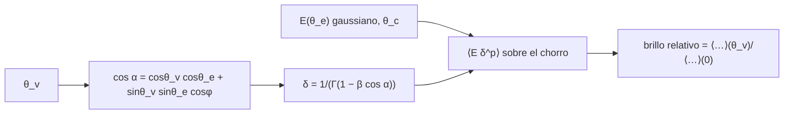

# B28-C12 — Modelos de emisión conjunta

<!-- nav:top -->
[🏠 Programa](../../../../README.md) · [📚 Bloque B28](../../../tronco-comun/B28-astronomia-multimensajero.md) · [← Anterior: B28-C11 — Coincidencias entre observatorios](../B28-C11-coincidencias-entre-observatorios/CLASE.md) · [Siguiente: B28-C13 — Estadística de significancia →](../B28-C13-estadistica-de-significancia/CLASE.md)
<!-- /nav -->

## 1. Ubicación, nivel y alcance

Clase 12 del bloque B28. Nivel N3. Una fusión de estrellas de neutrones emite ondas gravitacionales en todas direcciones y, a la vez, un chorro relativista ([B27-C11](../../B27/B27-C11-chorros-relativistas/CLASE.md)) que ilumina muy distinto según el ángulo desde el que se mire. Aquí integras un **chorro estructurado** con perfil gaussiano de energía y **amplificación Doppler** para obtener el brillo observado en función del **ángulo de visión**, y lo normalizas al brillo visto sobre el eje. Usas integrales dobles, el factor Doppler de [B27-C11](../../B27/B27-C11-chorros-relativistas/CLASE.md) y la geometría esférica. Los números son sintéticos.

## 2. Por qué esta clase existe

Un destello gamma débil puede ser un evento normal visto de lado. Un modelo de emisión conjunta permite relacionar qué se ve en cada mensajero con el ángulo de visión. La decisión central: **¿cuánto cae el brillo observado al alejar la visual del eje del chorro?**

## 3. Lo que podrás hacer al terminar

1. Escribir `E(θ_e) = E₀ exp(−θ_e²/2θ_c²)` y el factor `δ = 1/(Γ(1 − β cos α))`.
2. Calcular `cos α = cos θ_v cos θ_e + sin θ_v sin θ_e cos φ`.
3. Integrar `⟨E δ³⟩` sobre el chorro por punto medio.
4. Comprobar la integral doble contra la unidimensional en el límite `β → 0`.
5. Construir la tabla de brillo relativo frente a `θ_v`.
6. Reconocer la resolución limitada de la cuadratura a ángulos grandes.

La evidencia es la **ficha de emisión conjunta según el ángulo** del ejercicio 12 (sección 20).

## 4. Con qué llegas y cómo comprobarlo

1. ¿Qué es el factor Doppler?
2. ¿Qué es una integral doble?
3. ¿Qué es un perfil gaussiano?
4. ¿Qué es un ángulo de visión?
5. ¿Qué es la cuadratura por punto medio?

<details>
<summary>Ver respuestas</summary>

1. `δ = 1/(Γ(1 − β cos θ))`. 2. La suma sobre dos variables. 3. `exp(−x²/2σ²)`. 4. El ángulo entre el eje y la visual. 5. Suma de valores centrales por el ancho de cada celda.
</details>

Con cuatro o cinco aciertos, sigue; si no, repasa B27-C11.

## 5. Un caso real y un caso sintético

GRB 170817A fue un destello corto «ordinario» que se detectó unos `1,7 s` después de la fusión (S2, resumen). Esta clase no ajusta ninguna observación: con `Γ = 100`, `θ_c = 0,1 rad` y exponente Doppler `3` (ilustrativos) calcula cómo cae el brillo con el ángulo de visión. Es el **ejemplo conductor**.

## 6. Vocabulario

El **chorro estructurado** tiene energía que decrece con el ángulo al eje. El **núcleo** de semiancho `θ_c` concentra la energía. El **ángulo de visión** `θ_v`. El **exponente Doppler** `p` de `δ^p`. El **brillo relativo** es el cociente con el visto sobre el eje. Un **evento fuera del eje** se ve con `θ_v > θ_c`.

## 7. Modelo mental: un foco con halo

Un foco muy colimado ilumina con intensidad al frente y casi nada a los lados; un halo débil se extiende a mayor ángulo. Quien lo ve de lado recibe poca luz.



*Descripción textual:* el perfil de energía y el factor Doppler, que depende del ángulo entre cada elemento y la visual, se integran sobre el chorro; el cociente con el valor sobre el eje da el brillo relativo.

Analogía: un foco con halo. Límite: se supone un único `Γ` y eficiencia uniforme.

## 8. La explicación, paso a paso

### 8.1 Comprobación independiente

Con `β = 10⁻⁹` el factor Doppler es 1 y la integral doble debe valer `½ ∫ E(θ) sin θ dθ`. El laboratorio obtiene `0,00498337` por ambas vías, con cociente `1,00000064` (tolerancia `10⁻⁵`).

### 8.2 Referencia sobre el eje

Con `Γ = 100`, `θ_c = 0,1 rad` y `δ³`, la media sobre el chorro visto sobre el eje es `99,5576`.

### 8.3 Brillo según el ángulo

| `θ_v` (rad) | `θ_v/θ_c` | brillo relativo | `−2,5 log₁₀` (mag) |
|---|---|---|---|
| 0,00 | 0,0 | 1,0000 | 0,00 |
| 0,05 | 0,5 | 0,8826 | 0,14 |
| 0,10 | 1,0 | 0,6077 | 0,54 |
| 0,20 | 2,0 | 0,1366 | 2,16 |
| 0,30 | 3,0 | 0,011 35 | 4,86 |
| 0,40 | 4,0 | `3,483 × 10⁻⁴` | 8,65 |
| 0,60 | 6,0 | `3,4 × 10⁻⁸` | 18,67 |
| 0,80 | 8,0 | `2,4 × 10⁻⁹` | 21,54 |

### 8.4 Precisión de la cuadratura

Al duplicar la resolución, los valores hasta `θ_v = 0,4` cambian pocos por ciento; a `θ_v ≥ 0,6` (por encima de `6θ_c`) la integral está dominada por una región estrecha y los valores son aproximados (±20 %).

### 8.5 Lectura

El brillo cae a la mitad cerca de `θ_v = 1,1 θ_c` y casi cinco magnitudes a `3θ_c`. Un evento con brillo bajo no implica una energía baja: puede estar visto fuera del eje.

## 9. Magnitudes, símbolos y unidades

| Símbolo | Qué es | Unidad | Valor / nota |
|---|---|---|---|
| `Γ` | factor de Lorentz | — | 100 (ilustrativo) |
| `θ_c` | semiancho del núcleo | rad | 0,1 (ilustrativo) |
| `θ_v` | ángulo de visión | rad | 0–0,8 |
| `p` | exponente Doppler | — | 3 (ilustrativo) |
| `δ` | factor Doppler | — | ver 8.3 |
| `E₀` | energía en el eje | — | normalizada |

## 10. Convenciones y referencias

Perfil gaussiano; integración sobre `θ_e ∈ [0, π/2]`; un solo `Γ`; todos los parámetros son **ilustrativos**.

## 11. De dónde sale lo que afirmamos

| ID | Fuente | Localizador | Respalda | Estado |
|---|---|---|---|---|
| S1 | Cálculo propio: integral del factor Doppler sobre un perfil gaussiano | implementado en `emision_conjunta.py` | tabla 8.3 | Verificado en el límite `β → 0` |
| S2 | Goldstein et al., arXiv:1710.05446 | https://arxiv.org/abs/1710.05446 | destello corto ordinario, ~1,7 s tras la fusión | Solo resumen, consultado el 2026-11-09 |

Límites: S2 solo resumen; no se ajusta a ninguna observación; la cuadratura es aproximada a ángulos grandes.

## 12. Cómo ver el brillo

| `θ_v/θ_c` | brillo relativo |
|---|---|
| 0 | 1 |
| 1 | 0,61 |
| 2 | 0,14 |
| 3 | 0,011 |
| 4 | 0,00035 |

Descripción larga: el brillo cae de forma monótona y cada incremento de `θ_c` lo reduce más.

## 13. Ejemplo trabajado: ¿cuánto se pierde a 2θ_c?

**Paso 1 · Datos.** `θ_v = 0,2 rad`.

**Paso 2 · Tabla.** Brillo relativo `0,1366`.

**Paso 3 · Magnitudes.** `−2,5 log₁₀ 0,1366 = 2,16`.

**Paso 4 · Sentido.** Un observador a `2θ_c` ve el evento `2,2` magnitudes más débil.

## 14. Distintas formas de describir el chorro

**Por perfil:** gaussiano. **Por energía total:** `E₀θ_c²/2`. **Por brillo relativo:** `B(θ_v)`. **Por magnitudes:** `−2,5 log B`.

## 15. Práctica guiada

**Ejercicio 1 · con los pasos indicados.** `θ_v/θ_c` para `θ_v = 0,3`. *Pasos:* división.

<details><summary>Solución comentada</summary>

`3,0`.
</details>

**Ejercicio 2 · con una pista.** Diferencia de magnitudes entre el eje y `θ_c`.

<details><summary>Solución comentada</summary>

`0,54`.
</details>

**Ejercicio 3 · casi autónomo.** Brillo relativo a `0,4 rad`.

<details><summary>Solución comentada</summary>

`3,483 × 10⁻⁴`.
</details>

## 16. Práctica autónoma, transferencia e integrador

**Ejercicio 4.** Cociente de brillos entre `0,1` y `0,2 rad`.

<details><summary>Solución comentada</summary>

`0,6077/0,1366 = 4,45`.
</details>

**Ejercicio 5.** Factor Doppler sobre el eje para `Γ = 100`.

<details><summary>Solución comentada</summary>

`δ = Γ(1 + β) = 199,99`.
</details>

**Ejercicio 6.** `δ³` en el eje.

<details><summary>Solución comentada</summary>

`8,0 × 10⁶`.
</details>

**Ejercicio 7.** Diferencia en magnitudes entre `0,2` y `0,4 rad`.

<details><summary>Solución comentada</summary>

`8,65 − 2,16 = 6,49`.
</details>

**Ejercicio 8.** Energía total relativa del perfil (`β → 0`, integral unidimensional).

<details><summary>Solución comentada</summary>

`0,00498337 E₀`, cercano a `θ_c²/2 = 0,005`.
</details>

**Ejercicio 9 · transferencia.** Un compañero dice que un destello débil implica un chorro débil. Responde con 8.5.

<details><summary>Solución comentada</summary>

Puede ser un chorro normal visto fuera del eje.
</details>

**Ejercicio 10 · transferencia.** ¿Por qué se normaliza al brillo sobre el eje?

<details><summary>Solución comentada</summary>

Para aislar el efecto del ángulo de visión del valor absoluto de la energía.
</details>

**Ejercicio 11 · transferencia.** ¿Qué valida la comparación con la integral unidimensional?

<details><summary>Solución comentada</summary>

La implementación de la integral doble; no el modelo del chorro.
</details>

**Ejercicio 12 · integrador.** Elabora tu *ficha de emisión conjunta según el ángulo*: tabla de brillo relativo para ocho ángulos, magnitudes y una nota sobre la precisión.

<details><summary>Solución modelo</summary>

Tabla de 8.3 y sección 8.4.
</details>

## 17. Laboratorio: brillo fuera del eje

El script [emision_conjunta.py](emision_conjunta.py) integra el factor Doppler sobre el chorro (**comprueba** `10⁻⁵` en el límite `β → 0`) y verifica la monotonía.

**Datos:** sin constantes; todo **ilustrativo**. **Predice antes de ejecutar:** ¿qué brillo relativo da `θ_v = θ_c`? (≈`0,6`.) **Ejecución del 2026-11-09 (Python 3.12.9):**

```text
Python 3.12.9 (biblioteca estandar)
beta -> 0: integral doble = 0.00498337 ; integral unidimensional = 0.00498337 (cociente 1.00000064)
Gamma = 100, theta_c = 0.1 rad, Doppler^3: referencia sobre el eje = 9.955757e+01
theta_v [rad]  theta_v/theta_c  brillo relativo  -2.5 log10 [mag]
         0.00              0.0       1.0000e+00             -0.00
         0.05              0.5       8.8262e-01              0.14
         0.10              1.0       6.0772e-01              0.54
         0.20              2.0       1.3660e-01              2.16
         0.30              3.0       1.1353e-02              4.86
         0.40              4.0       3.4832e-04              8.65
         0.60              6.0       3.4049e-08             18.67
         0.80              8.0       2.4301e-09             21.54
Pruebas superadas.
```

```bash
python programa/clases/B28/B28-C12-modelos-de-emision-conjunta/emision_conjunta.py
```

**Límites:** un solo `Γ`, perfil gaussiano, cuadratura de resolución limitada a ángulos grandes, sin emisión del chorro retardada.

## 18. Errores frecuentes y cómo corregirlos

**Confundir `θ_c` y `θ_v`.** Se corrige con la sección 6.

**Olvidar la normalización.** Se corrige con el ejercicio 10.

**Interpretar brillo bajo como energía baja.** Se corrige con el ejercicio 9.

**Tomar valores de la cola por exactos.** Se corrige con 8.4.

**Tomar los parámetros por medidas.** Se corrige con la sección 10.

## 19. Cómo sabrás que vas bien

Tras 8.1: ¿qué comprueba el límite `β → 0`? Si dudas, ejercicio 11. Tras 8.3: ¿cuánto cae el brillo a `2θ_c`? Ejercicio 2. Tras el laboratorio: ¿qué valida? (la integral doble).

## 20. Qué entregas y cómo se evalúa

El producto es tu **ficha de emisión conjunta según el ángulo** (ejercicio 12).

| Criterio | Inicial | En desarrollo | Logrado | Destacado |
|---|---|---|---|---|
| Conceptos | Los confunde | Parciales | Perfil, Doppler, ángulo | Explica la degeneración con la energía |
| Cálculo | Sin unidades | Con errores | Tabla completa | Convierte a magnitudes |
| Numérico | Sin comprobar | Un caso | Límite `β → 0` | Interpreta la resolución |
| Fuentes | Sin fuente | Sin fecha | S1–S2 con fecha | Declara S2 como resumen |
| Límites | No los nombra | Uno | Tres | Discute perfiles distintos |

**Condiciones críticas (no se compensan con promedio):** rotular todos los parámetros como ilustrativos; no presentar la tabla como ajuste de una observación; citar solo lo consultado.

## 21. Ética, seguridad y límites

Clase educativa: no es un ajuste de datos. Accesibilidad: tablas equivalentes a las gráficas, fórmulas en texto, ejercicios sin conexión.

## 22. Para cerrar y seguir

El brillo de un chorro estructurado cae de forma monótona con el ángulo de visión: `0,61` a `θ_c`, `0,14` a `2θ_c` y `3,5 × 10⁻⁴` a `4θ_c` con `Γ = 100`. Queda una pregunta: ¿cómo se combinan sin engañarse las significancias de varias detecciones?

**Glosario español–inglés.** chorro estructurado · *structured jet*; ángulo de visión · *viewing angle*; fuera del eje · *off-axis*; núcleo · *core*; brillo relativo · *relative brightness*; amplificación Doppler · *Doppler boosting*.

**Continuidad.** [B28-C13](../B28-C13-estadistica-de-significancia/CLASE.md) estudia la estadística de significancia.

**Referencias:** ver sección 11.

<!-- nav:bottom -->
---

[← Anterior: B28-C11 — Coincidencias entre observatorios](../B28-C11-coincidencias-entre-observatorios/CLASE.md) · [📚 Bloque B28](../../../tronco-comun/B28-astronomia-multimensajero.md) · [Siguiente: B28-C13 — Estadística de significancia →](../B28-C13-estadistica-de-significancia/CLASE.md)
<!-- /nav -->
