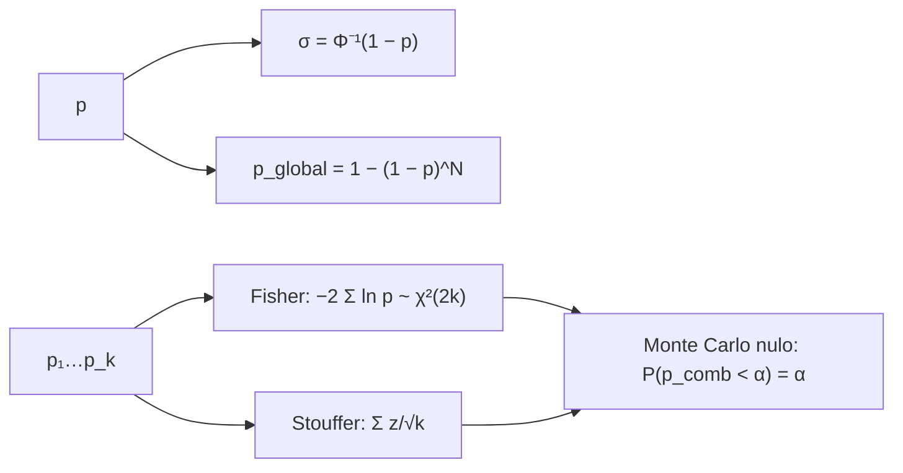

# B28-C13 — Estadística de significancia

<!-- nav:top -->
[🏠 Programa](../../../../README.md) · [📚 Bloque B28](../../../tronco-comun/B28-astronomia-multimensajero.md) · [← Anterior: B28-C12 — Modelos de emisión conjunta](../B28-C12-modelos-de-emision-conjunta/CLASE.md) · [Siguiente: B28-C14 — Ruidos instrumentales →](../B28-C14-ruidos-instrumentales/CLASE.md)
<!-- /nav -->

## 1. Ubicación, nivel y alcance

Clase 13 del bloque B28. Nivel N3. Cada mensajero entrega su propia significancia; combinarlas sin engañarse es el corazón de la astronomía multimensajero. Aquí conviertes entre **valor p y sigmas**, aplicas el **factor de pruebas**, combinas valores p independientes con los métodos de **Fisher** y de **Stouffer** y verificas su calibración por Monte Carlo bajo la hipótesis nula. Usas la tasa de falsas alarmas de [B28-C09](../B28-C09-alertas-cientificas-en-tiempo-real/CLASE.md), la coincidencia de [B28-C11](../B28-C11-coincidencias-entre-observatorios/CLASE.md) y la estadística de [B27-C19](../../B27/B27-C19-observatorios-de-rayos-x-y-gamma/CLASE.md). Se supone independencia entre las pruebas.

## 2. Por qué esta clase existe

Un valor p de `5 × 10⁻⁸` y una tasa de falsas alarmas de uno por 203 000 años no son comparables sin traducirlos a la misma escala. La decisión central: **¿cuántas sigmas equivale un valor p, cómo se corrige por las pruebas realizadas y cómo se combinan evidencias independientes?**

## 3. Lo que podrás hacer al terminar

1. Convertir `p ↔ σ` con `p = ½ erfc(σ/√2)` y su inversa numérica.
2. Distinguir una y dos colas.
3. Aplicar `p_global = 1 − (1 − p)^N`.
4. Combinar valores p con Fisher y con Stouffer.
5. Verificar la calibración nula por Monte Carlo con semilla fija.
6. Elegir el método según el caso.

La evidencia es la **ficha de significancia combinada** del ejercicio 12 (sección 20).

## 4. Con qué llegas y cómo comprobarlo

1. ¿Qué es un valor p?
2. ¿Qué es una distribución uniforme?
3. ¿Qué es la función de error complementaria?
4. ¿Qué es la hipótesis nula?
5. ¿Qué es una cola de una distribución?

<details>
<summary>Ver respuestas</summary>

1. La probabilidad, bajo la hipótesis nula, de un resultado al menos tan extremo. 2. Igual densidad en [0,1]. 3. `erfc(x) = 1 − erf(x)`. 4. La hipótesis de ausencia de efecto. 5. El extremo de la distribución.
</details>

Con cuatro o cinco aciertos, sigue; si no, repasa B12 y B27-C19.

## 5. Un caso real: dos cifras, una escala

La coincidencia GW170817–GRB 170817A tuvo una probabilidad fortuita de `5 × 10⁻⁸` (S2, resumen) y GW150914 una tasa de falsas alarmas menor que `1` por `203 000 años` (S3, resumen). Convertidas a la misma escala de una cola, la primera equivale a `5,327σ` y, tomando un año como ventana, la segunda a `4,420σ`. Es el **ejemplo conductor**.

## 6. Vocabulario

Un **valor p** es una probabilidad de cola. La **significancia** `σ` es el equivalente gaussiano. El **factor de pruebas** corrige por el número de búsquedas. El **método de Fisher** combina con `−2 Σ ln p`. El **método de Stouffer** combina con `Σ z/√k`. La **calibración nula** exige que `P(p < α) = α`.

## 7. Modelo mental: una balanza de evidencias

Cada valor p es un peso en una balanza. Fisher cuenta cada peso por su logaritmo y es sensible a un valor muy pequeño; Stouffer suma las distancias en sigmas y es sensible a varios valores moderados.



*Descripción textual:* un valor p se traduce a sigmas y, con N pruebas, a un valor global; varios valores p se combinan con Fisher o Stouffer y ambos se verifican bajo la hipótesis nula.

Analogía: una balanza de pesos. Límite: ambos métodos suponen independencia y calibración.

## 8. La explicación, paso a paso

### 8.1 De p a sigma

| `σ` | `p` (una cola) | `p` (dos colas) | 1 contra |
|---|---|---|---|
| 1 | `1,5866 × 10⁻¹` | `3,1731 × 10⁻¹` | 6,303 |
| 2 | `2,2750 × 10⁻²` | `4,5500 × 10⁻²` | 43,96 |
| 3 | `1,3499 × 10⁻³` | `2,6998 × 10⁻³` | 740,8 |
| 4 | `3,1671 × 10⁻⁵` | `6,3342 × 10⁻⁵` | `3,1574 × 10⁴` |
| 5 | `2,8665 × 10⁻⁷` | `5,7330 × 10⁻⁷` | `3,4886 × 10⁶` |
| 6 | `9,8659 × 10⁻¹⁰` | `1,9732 × 10⁻⁹` | `1,0136 × 10⁹` |

La inversión numérica recupera `σ` con error menor que `10⁻⁹`.

### 8.2 Las dos cifras del caso

`p = 5 × 10⁻⁸` equivale a `5,327σ` y `p = 4,926 × 10⁻⁶` (un año con `FAR = 1/203 000`) a `4,420σ`.

### 8.3 Factor de pruebas

Con `p = 10⁻⁴`: `N = 1`: `3,719σ`; `10`: `p = 9,9955 × 10⁻⁴`, `3,090σ`; `100`: `9,9507 × 10⁻³`, `2,328σ`; `1000`: `9,5167 × 10⁻²`, `1,310σ`.

### 8.4 Combinar tres valores p

Con `p = 0,04; 0,03; 0,2`: Fisher da `0,01058`, Stouffer `0,00490`, y el menor por separado `0,03`. Ambos métodos coinciden con `p` cuando `k = 1`.

### 8.5 Calibración nula

En `10⁵` ensayos de tres valores p uniformes, con `α = 0,02`: Fisher da `2012` y Stouffer `2051` casos, frente a `2000 ± 45` esperados. Ambos están calibrados.

## 9. Magnitudes, símbolos y unidades

| Símbolo | Qué es | Unidad | Valor / nota |
|---|---|---|---|
| `p` | valor p | — | una cola |
| `σ` | significancia gaussiana | — | `5,327` para `5 × 10⁻⁸` |
| `N` | número de pruebas | — | 1–1000 |
| `k` | número de valores p combinados | — | 3 |
| `X` | estadístico de Fisher | — | `−2 Σ ln p` |
| `Z` | estadístico de Stouffer | — | `Σ z/√k` |

## 10. Convenciones y referencias

Una cola (`p = ½ erfc(σ/√2)`); independencia; semilla `20261109`; los valores p de los ejemplos y las `N` son **ilustrativos**.

## 11. De dónde sale lo que afirmamos

| ID | Fuente | Localizador | Respalda | Estado |
|---|---|---|---|---|
| S1 | Cálculo propio: `erfc`, cola de Erlang y Monte Carlo | implementado en `significancia_combinada.py` | todas las tablas | Verificado por inversión y simulación |
| S2 | LIGO, Virgo, Fermi y INTEGRAL, arXiv:1710.05834 | https://arxiv.org/abs/1710.05834 | probabilidad fortuita `5 × 10⁻⁸` | Solo resumen, consultado el 2026-11-09 |
| S3 | LIGO Scientific y Virgo, GW150914, arXiv:1602.03837 | https://arxiv.org/abs/1602.03837 | FAR `< 1/203 000 año⁻¹` | Solo resumen, consultado el 2026-11-09 |

Límites: S2 y S3 solo resumen; los métodos de Fisher y Stouffer son estándar y no se consultó su fuente original; la traducción del FAR a un año es un cálculo propio.

## 12. Cómo ver la corrección por pruebas

| `N` | `p` global | `σ` global |
|---|---|---|
| 1 | `1,0 × 10⁻⁴` | 3,719 |
| 10 | `1,0 × 10⁻³` | 3,090 |
| 100 | `1,0 × 10⁻²` | 2,328 |
| 1000 | `9,5 × 10⁻²` | 1,310 |

Descripción larga: mil pruebas convierten `3,7σ` locales en `1,3σ` globales.

## 13. Ejemplo trabajado: de 10⁻⁷ a sigmas

**Paso 1 · Datos.** `p = 10⁻⁷`.

**Paso 2 · Interpolación.** Entre `4σ` (`3,2 × 10⁻⁵`) y `5σ` (`2,9 × 10⁻⁷`) y más cerca de `5σ`.

**Paso 3 · Resultado.** La inversión numérica da `5,199σ`.

**Paso 4 · Sentido.** Supera el umbral de `5σ`, pero no el de `5,327σ` del caso.

## 14. Distintas formas de describir la evidencia

**Por p:** probabilidad. **Por σ:** escala gaussiana. **Por cociente de verosimilitudes:** otra escala. **Por p global:** tras las pruebas.

## 15. Práctica guiada

**Ejercicio 1 · con los pasos indicados.** `p` de `3σ` (una cola). *Pasos:* `½ erfc(3/√2)`.

<details><summary>Solución comentada</summary>

`1,3499 × 10⁻³`.
</details>

**Ejercicio 2 · con una pista.** `p` de `3σ` a dos colas. *Pista:* doble.

<details><summary>Solución comentada</summary>

`2,6998 × 10⁻³`.
</details>

**Ejercicio 3 · casi autónomo.** `p` global con `p = 10⁻⁴` y `N = 100`.

<details><summary>Solución comentada</summary>

`9,9507 × 10⁻³`.
</details>

## 16. Práctica autónoma, transferencia e integrador

**Ejercicio 4.** `σ` de `p = 0,01`.

<details><summary>Solución comentada</summary>

`2,326σ`.
</details>

**Ejercicio 5.** Fisher para `p = 0,05; 0,05`.

<details><summary>Solución comentada</summary>

`X = −2(2 ln 0,05) = 11,98`; `P = e^{−5,99}(1 + 5,99) = 0,0175`.
</details>

**Ejercicio 6.** Stouffer para `p = 0,05; 0,05`.

<details><summary>Solución comentada</summary>

`z = 1,645`; `Z = 2 × 1,645/√2 = 2,326`; `p = 0,0100`.
</details>

**Ejercicio 7.** Veces que `5σ` es más improbable que `3σ`.

<details><summary>Solución comentada</summary>

`1,3499 × 10⁻³/2,8665 × 10⁻⁷ = 4709`.
</details>

**Ejercicio 8.** `N` para que `p = 10⁻⁴` local dé `p` global `0,01`.

<details><summary>Solución comentada</summary>

`N ≈ 100`.
</details>

**Ejercicio 9 · transferencia.** Un compañero dice que combinar dos resultados de `2σ` da `4σ`. Responde con 8.4 y el ejercicio 6.

<details><summary>Solución comentada</summary>

Stouffer da `2√2 = 2,83σ`; Fisher aún menos. No se suman las sigmas.
</details>

**Ejercicio 10 · transferencia.** ¿Por qué Stouffer y Fisher difieren?

<details><summary>Solución comentada</summary>

Pesan distinto: Fisher es sensible a valores p extremos; Stouffer, a la suma de las sigmas.
</details>

**Ejercicio 11 · transferencia.** ¿Qué prueba la calibración nula?

<details><summary>Solución comentada</summary>

Que con valores p uniformes el método da `P(p_comb < α) = α`; no que los datos reales sean independientes.
</details>

**Ejercicio 12 · integrador.** Elabora tu *ficha de significancia combinada*: tabla `p ↔ σ`, las dos cifras del caso, factor de pruebas, combinación de tres valores p y calibración.

<details><summary>Solución modelo</summary>

Secciones 8.1–8.5.
</details>

## 17. Laboratorio: sigmas y combinación

El script [significancia_combinada.py](significancia_combinada.py) invierte `p ↔ σ` (**comprueba** `10⁻⁹`), aplica el factor de pruebas, combina por Fisher y Stouffer y simula la hipótesis nula (**comprueba** 5 desviaciones binomiales).

**Datos:** sin constantes; cifras de S2 y S3; el resto **ilustrativo**. **Predice antes de ejecutar:** ¿cuántas sigmas es `5 × 10⁻⁸`? (≈`5,3`.) **Ejecución del 2026-11-09 (Python 3.12.9):**

```text
Python 3.12.9 (biblioteca estandar)
 sigma   p (una cola)  p (dos colas)     1 contra
     1     1.5866e-01     3.1731e-01   6.3030e+00
     2     2.2750e-02     4.5500e-02   4.3956e+01
     3     1.3499e-03     2.6998e-03   7.4080e+02
     4     3.1671e-05     6.3342e-05   3.1574e+04
     5     2.8665e-07     5.7330e-07   3.4886e+06
     6     9.8659e-10     1.9732e-09   1.0136e+09
p = 5.000e-08 -> 5.327 sigma (una cola)
p = 4.926e-06 -> 4.420 sigma (una cola)
     N    p local   p global  sigma global
     1    1.0e-04 1.0000e-04         3.719
    10    1.0e-04 9.9955e-04         3.090
   100    1.0e-04 9.9507e-03         2.328
  1000    1.0e-04 9.5167e-02         1.310
valores p [0.04, 0.03, 0.2]: Fisher = 0.01058 ; Stouffer = 0.00490 ; el menor solo = 0.03
Monte Carlo nulo (100000 ensayos de k = 3): p_combinado < 0.02: Fisher = 2012, Stouffer = 2051 (esperados 2000 +/- 45)
Pruebas superadas.
```

```bash
python programa/clases/B28/B28-C13-estadistica-de-significancia/significancia_combinada.py
```

**Límites:** valores p independientes y calibrados; una sola cola; sin dependencias entre pruebas.

## 18. Errores frecuentes y cómo corregirlos

**Sumar sigmas.** Se corrige con el ejercicio 9.

**Mezclar una y dos colas.** Se corrige con la sección 10.

**Olvidar el factor de pruebas.** Se corrige con 8.3.

**Aplicar Fisher a pruebas dependientes.** Se corrige con la sección 11 (límites).

**Tomar el valor p por probabilidad de la hipótesis.** Se corrige con la clase B28-C11.

## 19. Cómo sabrás que vas bien

Tras 8.1: ¿cuántas sigmas es `p = 0,01`? Si dudas, ejercicio 4. Tras 8.4: ¿qué método da más? Ejercicio 10. Tras el laboratorio: ¿qué prueba la calibración nula? (ejercicio 11).

## 20. Qué entregas y cómo se evalúa

El producto es tu **ficha de significancia combinada** (ejercicio 12).

| Criterio | Inicial | En desarrollo | Logrado | Destacado |
|---|---|---|---|---|
| Conceptos | Los confunde | Parciales | `p`, `σ`, pruebas | Explica la combinación |
| Cálculo | Sin unidades | Con errores | Tablas completas | Compara métodos |
| Numérico | Sin comprobar | Un caso | Inversión y calibración | Interpreta el error binomial |
| Fuentes | Sin fuente | Sin fecha | S1–S3 con fecha | Declara S2 y S3 como resumen |
| Límites | No los nombra | Uno | Tres | Discute dependencias |

**Condiciones críticas (no se compensan con promedio):** declarar una o dos colas; no sumar sigmas; citar solo lo consultado.

## 21. Ética, seguridad y límites

Clase educativa: no sustituye el análisis estadístico de una colaboración. Accesibilidad: tablas equivalentes a las gráficas, fórmulas en texto, ejercicios sin conexión.

## 22. Para cerrar y seguir

`p ↔ σ` se invierte con error de `10⁻⁹`, `N` pruebas convierten `3,7σ` en `1,3σ` si `N = 1000`, y Fisher y Stouffer están calibrados bajo la hipótesis nula. Queda una pregunta: ¿qué ruido limita cada medición?

**Glosario español–inglés.** valor p · *p-value*; significancia · *significance*; factor de pruebas · *trials factor*; método de Fisher · *Fisher's method*; método de Stouffer · *Stouffer's method*; calibración · *calibration*.

**Continuidad.** [B28-C14](../B28-C14-ruidos-instrumentales/CLASE.md) estudia los ruidos instrumentales.

**Referencias:** ver sección 11.

<!-- nav:bottom -->
---

[← Anterior: B28-C12 — Modelos de emisión conjunta](../B28-C12-modelos-de-emision-conjunta/CLASE.md) · [📚 Bloque B28](../../../tronco-comun/B28-astronomia-multimensajero.md) · [Siguiente: B28-C14 — Ruidos instrumentales →](../B28-C14-ruidos-instrumentales/CLASE.md)
<!-- /nav -->
