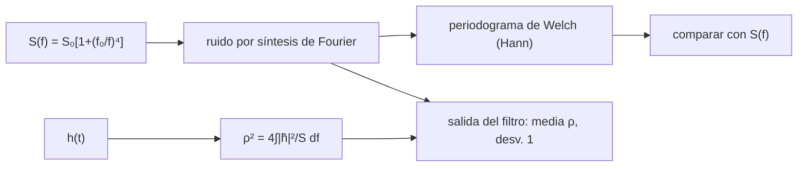

# B28-C14 — Ruidos instrumentales

<!-- nav:top -->
[🏠 Programa](../../../../README.md) · [📚 Bloque B28](../../../tronco-comun/B28-astronomia-multimensajero.md) · [← Anterior: B28-C13 — Estadística de significancia](../B28-C13-estadistica-de-significancia/CLASE.md) · [Siguiente: B28-C15 — Búsqueda de contrapartidas ópticas →](../B28-C15-busqueda-de-contrapartidas-opticas/CLASE.md)
<!-- /nav -->

## 1. Ubicación, nivel y alcance

Clase 14 del bloque B28. Nivel N3. Un detector no mide solo la señal: mide señal más ruido, y el ruido casi nunca es «blanco». Aquí generas **ruido gaussiano coloreado** con una densidad espectral que sube a baja frecuencia, implementas una **FFT** de Cooley–Tukey, estimas el **espectro de potencia** por periodograma promediado y calculas la **relación señal-ruido óptima** de un filtro acoplado, que compruebas por Monte Carlo. Usas Fourier ([B10](../../../tronco-comun/B10-algebra-lineal-y-matematicas-geometricas.md)), el interferómetro de [B28-C06](../B28-C06-interferometros-gravitacionales/CLASE.md) y la significancia de [B28-C13](../B28-C13-estadistica-de-significancia/CLASE.md). Todo es sintético.

## 2. Por qué esta clase existe

Entender la forma del ruido explica por qué un detector es sensible solo en una banda y por qué una señal débil puede perderse en baja frecuencia aunque sea fuerte en alta. La decisión central: **¿cómo se estima la densidad espectral del ruido y qué relación señal-ruido da el filtro óptimo?**

## 3. Lo que podrás hacer al terminar

1. Implementar y verificar una FFT de Cooley–Tukey.
2. Generar ruido con una densidad espectral dada.
3. Estimar la densidad por periodograma de Welch con ventana de Hann.
4. Calcular `ρ² = 4 ∫ |h|²/S df` de una señal.
5. Verificar por Monte Carlo la media y la dispersión de la salida del filtro.
6. Reconocer la fuga espectral.

La evidencia es la **ficha de ruido y blanqueo** del ejercicio 12 (sección 20).

## 4. Con qué llegas y cómo comprobarlo

1. ¿Qué es la transformada de Fourier discreta?
2. ¿Qué es una densidad espectral de potencia?
3. ¿Qué es el ruido blanco?
4. ¿Qué es una ventana?
5. ¿Qué es un filtro acoplado?

<details>
<summary>Ver respuestas</summary>

1. La descomposición en frecuencias de una serie. 2. La potencia por unidad de frecuencia. 3. Ruido con densidad constante. 4. Una función de peso que reduce la fuga. 5. La correlación con una plantilla ponderada por el inverso de la densidad.
</details>

Con cuatro o cinco aciertos, sigue; si no, repasa B10.

## 5. Un caso real y un caso sintético

Advanced LIGO usa brazos de `4 km`, cavidades Fabry–Perot y reciclaje de potencia y de señal (S2, resumen); su ruido a baja frecuencia crece mucho. Esta clase no reproduce su curva: genera un ruido sintético con `S(f) = S₀ [1 + (f₀/f)⁴]` y `f₀ = 20 Hz`, muestreado a `1024 Hz` durante `16 s`. Es el **ejemplo conductor**.

## 6. Vocabulario

La **densidad espectral** `S(f)`. El **periodograma** estima `S` a partir de un segmento. El **método de Welch** promedia segmentos. La **fuga espectral** es la potencia que se filtra entre bins. El **blanqueo** divide por `√S`. La **relación señal-ruido óptima** `ρ`.

## 7. Modelo mental: una radio con mucha estática grave

La estática domina en los graves y casi desaparece en los agudos. Una señal débil en los agudos se oye mejor que una fuerte en los graves. El filtro óptimo pesa cada frecuencia por `1/S`.



*Descripción textual:* la densidad espectral genera el ruido; el periodograma la recupera; la relación señal-ruido óptima de una señal se contrasta con la media de la salida del filtro acoplado sobre muchas realizaciones.

Analogía: una radio con estática grave. Límite: el ruido real no es estacionario ni gaussiano.

## 8. La explicación, paso a paso

### 8.1 La FFT

La FFT de 16 puntos coincide con la definición a `10⁻⁹` y su inversa recupera la serie a `10⁻¹²`.

### 8.2 El ruido

`N = 16 384`, `f_s = 1024 Hz`, duración `16 s`; la varianza es `4,948 × 10⁸`, dominada por las frecuencias más bajas (donde `S` vale más de `10¹⁰`).

### 8.3 El periodograma

| `f` (Hz) | `S` estimada | `S` teórica | cociente |
|---|---|---|---|
| 8 | 37,0903 | 40,0625 | 0,926 |
| 16 | 2,7160 | 3,4414 | 0,789 |
| 32 | 1,1693 | 1,1526 | 1,014 |
| 64 | 0,8698 | 1,0095 | 0,862 |
| 128 | 1,0169 | 1,0006 | 1,016 |
| 256 | 0,9110 | 1,0000 | 0,911 |

Los cocientes a 16, 64 y 128 Hz están dentro del 25 % exigido. La pendiente entre 5 y 10 Hz es `−3,370` frente a la teórica `−3,918`; la diferencia puede deberse a fuga espectral de la ventana de Hann, que aquí no se aísla.

### 8.4 La relación señal-ruido

Para una señal sintética (chirrido de 60 a 140 Hz modulado por un pulso gaussiano) con amplitud `10`, `ρ = 7,079`.

### 8.5 El filtro acoplado

En `100` realizaciones con la señal inyectada, la salida del filtro tiene media `7,064` (esperada `7,079`) y desviación `1,022` (esperada `1`).

## 9. Magnitudes, símbolos y unidades

| Símbolo | Qué es | Unidad | Valor / nota |
|---|---|---|---|
| `S(f)` | densidad espectral | unidad²/Hz | sintética |
| `f₀` | frecuencia de la pared | Hz | 20 (ilustrativa) |
| `f_s` | frecuencia de muestreo | Hz | 1024 |
| `N` | muestras | — | 16 384 |
| `ρ` | relación señal-ruido óptima | — | 7,079 |
| semilla | repetibilidad | — | 20261109 |

## 10. Convenciones y referencias

Densidad unilateral; convención `var(x) = ∫ S df`; ventana de Hann sin solapamiento; 8 segmentos; todo **sintético**.

## 11. De dónde sale lo que afirmamos

| ID | Fuente | Localizador | Respalda | Estado |
|---|---|---|---|---|
| S1 | Cálculo propio: FFT, periodograma de Welch y filtro acoplado | implementado en `ruido.py` | tablas de 8.3–8.5 | Verificado contra la definición y por Monte Carlo |
| S2 | Advanced LIGO, arXiv:1411.4547 | https://arxiv.org/abs/1411.4547 | brazos de `4 km`; cavidades; reciclaje | Solo resumen, consultado el 2026-11-09 |

Límites: S2 solo resumen y sin cifras de ruido; no se usa ninguna curva real; las fórmulas son estándar y se verifican.

## 12. Cómo ver el ruido

| Banda | Efecto |
|---|---|
| `f ≪ f₀` | `S ∝ f⁻⁴`: domina el ruido |
| `f ~ f₀` | transición |
| `f ≫ f₀` | `S ≈ S₀`: ruido blanco |

Descripción larga: la densidad es plana a alta frecuencia y crece como `f⁻⁴` por debajo de `f₀`.

## 13. Ejemplo trabajado: S a 8 Hz

**Paso 1 · Fórmula.** `S = 1 + (20/8)⁴`.

**Paso 2 · Cálculo.** `1 + 39,0625 = 40,0625`.

**Paso 3 · Comparación.** El periodograma da `37,09`, un `7,4 %` menos.

**Paso 4 · Sentido.** La estimación es buena en el centro de la banda y peor en los extremos.

## 14. Distintas formas de describir el ruido

**Por densidad:** `S(f)`. **Por amplitud:** `√S`. **Por varianza:** `∫S df`. **Por blanqueo:** dividir por `√S`.

## 15. Práctica guiada

**Ejercicio 1 · con los pasos indicados.** `S(32 Hz)`. *Pasos:* `1 + (20/32)⁴`.

<details><summary>Solución comentada</summary>

`1,1526`.
</details>

**Ejercicio 2 · con una pista.** `S(256 Hz)`.

<details><summary>Solución comentada</summary>

`1,0000`.
</details>

**Ejercicio 3 · casi autónomo.** Pendiente teórica entre 5 y 10 Hz.

<details><summary>Solución comentada</summary>

`ln(257/17)/ln 2 = 3,918`, es decir `−3,918`.
</details>

## 16. Práctica autónoma, transferencia e integrador

**Ejercicio 4.** Resolución de frecuencia del periodograma (segmentos de 2048 muestras).

<details><summary>Solución comentada</summary>

`1024/2048 = 0,5 Hz`.
</details>

**Ejercicio 5.** Duración de cada segmento.

<details><summary>Solución comentada</summary>

`2 s`.
</details>

**Ejercicio 6.** Diferencia entre la media del filtro y `ρ`.

<details><summary>Solución comentada</summary>

`7,064 − 7,079 = −0,015`, `0,15` errores de la media (`1,022/√100 = 0,10`).
</details>

**Ejercicio 7.** `ρ` si la amplitud pasa a `5`.

<details><summary>Solución comentada</summary>

`3,54`.
</details>

**Ejercicio 8.** Cociente de `S` entre 8 y 64 Hz.

<details><summary>Solución comentada</summary>

`40,0625/1,0095 = 39,7`.
</details>

**Ejercicio 9 · transferencia.** Un compañero dice que el ruido de un detector es blanco. Responde con la sección 12.

<details><summary>Solución comentada</summary>

Solo lo es por encima de cierta frecuencia; por debajo crece fuertemente.
</details>

**Ejercicio 10 · transferencia.** ¿Por qué se usa una ventana?

<details><summary>Solución comentada</summary>

Para reducir la fuga de potencia de las frecuencias bajas, enormes, hacia el resto.
</details>

**Ejercicio 11 · transferencia.** ¿Qué valida que la desviación del filtro sea `1`?

<details><summary>Solución comentada</summary>

Que la estadística del ruido y la normalización del filtro son coherentes; no la gaussianidad de un detector real.
</details>

**Ejercicio 12 · integrador.** Elabora tu *ficha de ruido y blanqueo*: la FFT verificada, tabla del periodograma, `ρ` y resultados del filtro.

<details><summary>Solución modelo</summary>

Secciones 8.1–8.5.
</details>

## 17. Laboratorio: ruido coloreado y filtro

El script [ruido.py](ruido.py) implementa la FFT, genera ruido, estima la densidad (**comprueba** 25 % a 16, 64 y 128 Hz) y simula el filtro acoplado (**comprueba** media y desviación).

**Datos:** todo **sintético** con semilla fija. **Predice antes de ejecutar:** ¿qué desviación tendrá la salida del filtro? (`1`.) **Ejecución del 2026-11-09 (Python 3.12.9):**

```text
Python 3.12.9 (biblioteca estandar)
FFT de Cooley-Tukey: coincide con la definicion (1e-9) y se invierte (1e-12)
ruido sintetico: N = 16384, fs = 1024.0 Hz, duracion = 16.0 s ; varianza = 4.948e+08
  f [Hz]   S estimada    S teorica  cociente
     8.0      37.0903      40.0625     0.926
    16.0       2.7160       3.4414     0.789
    32.0       1.1693       1.1526     1.014
    64.0       0.8698       1.0095     0.862
   128.0       1.0169       1.0006     1.016
   256.0       0.9110       1.0000     0.911
pendiente de S entre 5 y 10 Hz = -3.370 (teorica con f0 = 20 Hz: -3.918) ; la diferencia puede deberse a fuga espectral de la ventana de Hann (no se aisla aqui)
relacion senal-ruido optima (teorica) para amplitud 10.0: rho = 7.079
filtro acoplado, 100 realizaciones con la senal inyectada: media = 7.064 (esperada 7.079) ; desviacion = 1.022 (esperada 1)
Pruebas superadas.
```

```bash
python programa/clases/B28/B28-C14-ruidos-instrumentales/ruido.py
```

**Límites:** ruido gaussiano estacionario, sin glitches, sin acoplamientos entre bandas.

## 18. Errores frecuentes y cómo corregirlos

**Suponer ruido blanco.** Se corrige con el ejercicio 9.

**Olvidar la ventana.** Se corrige con el ejercicio 10.

**Confundir densidad unilateral y bilateral.** Se corrige con la sección 10.

**Interpretar un periodograma sin promediar.** Se corrige con 8.3.

**Tomar la curva sintética por real.** Se corrige con la sección 5.

## 19. Cómo sabrás que vas bien

Tras 8.1: ¿coincide la FFT con la definición? Si dudas, repasa el laboratorio. Tras 8.3: ¿dónde es fiable el periodograma? Ejercicio 3. Tras el laboratorio: ¿qué valida la desviación `1`? Ejercicio 11.

## 20. Qué entregas y cómo se evalúa

El producto es tu **ficha de ruido y blanqueo** (ejercicio 12).

| Criterio | Inicial | En desarrollo | Logrado | Destacado |
|---|---|---|---|---|
| Conceptos | Los confunde | Parciales | `S`, periodograma, filtro | Explica la fuga |
| Cálculo | Sin unidades | Con errores | Tablas completas | Compara frecuencias |
| Numérico | Sin comprobar | Un caso | FFT, densidad y filtro | Interpreta tolerancias |
| Fuentes | Sin fuente | Sin fecha | S1–S2 con fecha | Declara S2 como resumen |
| Límites | No los nombra | Uno | Tres | Discute ruido no estacionario |

**Condiciones críticas (no se compensan con promedio):** rotular todo como sintético; no presentar el ruido como el de un detector; citar solo lo consultado.

## 21. Ética, seguridad y límites

Clase educativa: no es una caracterización de ruido real. Accesibilidad: tablas equivalentes a las gráficas, fórmulas en texto, ejercicios sin conexión.

## 22. Para cerrar y seguir

El ruido coloreado exige estimar su densidad con ventanas y promedios, y el filtro acoplado óptimo reproduce `ρ = 7,08` con desviación unitaria. Queda una pregunta: ¿cómo se reparte el tiempo de telescopio una vez localizada la fuente?

**Glosario español–inglés.** ruido coloreado · *colored noise*; densidad espectral · *power spectral density*; periodograma de Welch · *Welch periodogram*; fuga espectral · *spectral leakage*; blanqueo · *whitening*; filtro acoplado · *matched filter*.

**Continuidad.** [B28-C15](../B28-C15-busqueda-de-contrapartidas-opticas/CLASE.md) estudia la búsqueda de contrapartidas ópticas.

**Referencias:** ver sección 11.

<!-- nav:bottom -->
---

[← Anterior: B28-C13 — Estadística de significancia](../B28-C13-estadistica-de-significancia/CLASE.md) · [📚 Bloque B28](../../../tronco-comun/B28-astronomia-multimensajero.md) · [Siguiente: B28-C15 — Búsqueda de contrapartidas ópticas →](../B28-C15-busqueda-de-contrapartidas-opticas/CLASE.md)
<!-- /nav -->
