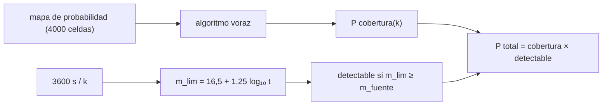

# B28-C15 — Búsqueda de contrapartidas ópticas

<!-- nav:top -->
[🏠 Programa](../../../../README.md) · [📚 Bloque B28](../../../tronco-comun/B28-astronomia-multimensajero.md) · [← Anterior: B28-C14 — Ruidos instrumentales](../B28-C14-ruidos-instrumentales/CLASE.md) · [Siguiente: B28-C16 — Redes internacionales de alertas →](../B28-C16-redes-internacionales-de-alertas/CLASE.md)
<!-- /nav -->

## 1. Ubicación, nivel y alcance

Clase 15 del bloque B28. Nivel N3. Con un mapa de localización de cientos de grados cuadrados ([B28-C10](../B28-C10-localizacion-probabilistica-de-eventos/CLASE.md)) y un telescopio de campo estrecho, hay que decidir qué campos observar y cuánto tiempo dedicar a cada uno. Aquí aplicas un **teselado voraz** sobre un mapa de probabilidad, lo comparas con una cota aproximada del óptimo y resuelves el **compromiso entre cobertura y profundidad**. Usas optimización combinatoria, la curva de luz de [B28-C08](../B28-C08-senales-transitorias/CLASE.md) y la geometría esférica de [B28-C10](../B28-C10-localizacion-probabilistica-de-eventos/CLASE.md). Todo es sintético.

## 2. Por qué esta clase existe

Observar más campos cubre más probabilidad, pero cada campo recibe menos tiempo y es menos profundo. Si la fuente es débil, el exceso de campos hace que no se vea. La decisión central: **¿cuántos campos conviene observar para maximizar la probabilidad de detectar la contrapartida?**

## 3. Lo que podrás hacer al terminar

1. Construir un mapa de probabilidad sobre una rejilla de Fibonacci.
2. Implementar el algoritmo voraz de cobertura.
3. Comparar la cobertura con una cota aproximada y con la garantía `1 − 1/e`.
4. Calcular la profundidad `m_lim = m_1s + 1,25 log₁₀ t`.
5. Elegir el número de campos que maximiza `P(cobertura) × P(detección)`.
6. Reconocer los supuestos del modelo.

La evidencia es el **plan de teselado con su cobertura** del ejercicio 12 (sección 20).

## 4. Con qué llegas y cómo comprobarlo

1. ¿Qué es un campo de visión?
2. ¿Qué es una magnitud límite?
3. ¿Qué es un algoritmo voraz?
4. ¿Cómo crece la relación señal-ruido con el tiempo de exposición?
5. ¿Qué es una cobertura de probabilidad?

<details>
<summary>Ver respuestas</summary>

1. La región del cielo que observa un apuntado. 2. La magnitud más débil que se detecta. 3. Elegir en cada paso la mejor opción local. 4. Como `√t` en el límite de fondo. 5. La probabilidad acumulada de las celdas observadas.
</details>

Con cuatro o cinco aciertos, sigue; si no, repasa B28-C08 y B28-C10.

## 5. Un caso real y un caso sintético

GW170817 se localizó inicialmente en `31 grados cuadrados` y su contrapartida óptica se identificó a unos `10 arcsec` de una galaxia (S2 y S3, resúmenes). Esta clase usa un mapa sintético de dos manchas gaussianas de `6°` (70 % y 30 %), un campo de `4°` de radio (`50,3 deg²`), `16,5 mag` de límite en 1 s, `3600 s` en total y una fuente de `19,5 mag`. Es el **ejemplo conductor**.

## 6. Vocabulario

El **teselado** es la elección de los campos. El **algoritmo voraz** escoge en cada paso el campo con más probabilidad no cubierta. La **garantía `1 − 1/e`** acota su rendimiento frente al óptimo. La **profundidad** `m_lim`. El **compromiso** cobertura–profundidad. La **cota aproximada** supone `k × (celdas medias por campo)` celdas.

## 7. Modelo mental: rastrear un lago de noche

Con una linterna de haz estrecho se barre el lago: cuantos más lugares se miran, menos tiempo se dedica a cada uno; si el objeto es tenue, una mirada breve no lo ve.



*Descripción textual:* el mapa alimenta un algoritmo voraz que da la cobertura en función de los campos; el tiempo por campo da la profundidad; el producto de cobertura y detectabilidad se maximiza.

Analogía: una linterna y un lago. Límite: la detectabilidad real es gradual, no un umbral.

## 8. La explicación, paso a paso

### 8.1 La rejilla y el campo

`4000` celdas de `10,31 deg²`; un campo de `50,3 deg²` cubre en promedio `5,4` celdas.

### 8.2 Cobertura voraz

| campos `k` | cobertura | cota aprox. | cociente |
|---|---|---|---|
| 1 | 0,1358 | 0,1426 | 0,952 |
| 2 | 0,2383 | 0,2766 | 0,861 |
| 3 | 0,3160 | 0,3651 | 0,865 |
| 5 | 0,4540 | 0,5039 | 0,901 |
| 10 | 0,6954 | 0,7340 | 0,947 |
| 20 | 0,8818 | 0,9251 | 0,953 |
| 30 | 0,9559 | 0,9788 | 0,977 |

El cociente supera siempre `1 − 1/e = 0,632`.

### 8.3 Profundidad

`m_lim(k) = 16,5 + 1,25 log₁₀(3600/k)`: `20,95` (`k = 1`), `20,57` (2), `20,35` (3), `20,07` (5), `19,70` (10), `19,32` (20), `19,10` (30).

### 8.4 El óptimo

Con una fuente de `19,5 mag`, los planes con `k ≤ 10` la detectan; con `k = 20` y `30` no. El mejor plan es `k = 10` con probabilidad total `0,6954`.

### 8.5 Lectura

Añadir campos mejora la cobertura (`0,88` con 20) pero destruye la profundidad. El óptimo está donde la profundidad iguala justo el brillo de la fuente.

## 9. Magnitudes, símbolos y unidades

| Símbolo | Qué es | Unidad | Valor / nota |
|---|---|---|---|
| `N` | celdas | — | 4000 |
| `k` | campos observados | — | 1–30 |
| `r_fov` | radio del campo | grados | 4 (ilustrativo) |
| `m_1s` | límite en 1 s | mag | 16,5 (ilustrativo) |
| `T` | tiempo total | s | 3600 (ilustrativo) |
| `m_fuente` | brillo de la fuente | mag | 19,5 (ilustrativo) |

## 10. Convenciones y referencias

Mapa conocido; campo circular; un solo filtro; límite por fondo; todos los parámetros son **ilustrativos**.

## 11. De dónde sale lo que afirmamos

| ID | Fuente | Localizador | Respalda | Estado |
|---|---|---|---|---|
| S1 | Cálculo propio: algoritmo voraz y profundidad por fondo | implementado en `teselado.py` | tablas 8.2–8.4 | Verificado frente a la garantía `1 − 1/e` |
| S2 | LIGO Scientific, Virgo y colaboraciones, arXiv:1710.05833 | https://arxiv.org/abs/1710.05833 | `31 grados²` | Solo resumen, consultado el 2026-11-09 |
| S3 | Abbott et al., arXiv:1710.05835 | https://arxiv.org/abs/1710.05835 | contrapartida a `~10 arcsec` de la galaxia | Solo resumen, consultado el 2026-11-09 |

Límites: S2 y S3 solo resumen; la cota «superior» es aproximada y no rigurosa; el mapa y los parámetros son sintéticos.

## 12. Cómo ver el compromiso

| `k` | profundidad (mag) | detectable (19,5 mag) | cobertura |
|---|---|---|---|
| 5 | 20,07 | sí | 0,454 |
| 10 | 19,70 | sí | 0,695 |
| 20 | 19,32 | no | 0,882 |

Descripción larga: la cobertura crece con `k`, pero a partir de `k = 10` la fuente deja de ser detectable.

## 13. Ejemplo trabajado: profundidad con 10 campos

**Paso 1 · Tiempo.** `3600/10 = 360 s`.

**Paso 2 · Ganancia.** `1,25 log₁₀ 360 = 3,20`.

**Paso 3 · Profundidad.** `16,5 + 3,20 = 19,70`.

**Paso 4 · Sentido.** Supera los `19,5 mag` de la fuente por `0,2 mag`.

## 14. Distintas formas de describir el plan

**Por cobertura:** probabilidad acumulada. **Por profundidad:** `m_lim`. **Por tiempo:** `T/k`. **Por producto:** `P total`.

## 15. Práctica guiada

**Ejercicio 1 · con los pasos indicados.** Área de un campo de `4°` de radio. *Pasos:* `π r²`.

<details><summary>Solución comentada</summary>

`50,3 deg²`.
</details>

**Ejercicio 2 · con una pista.** Celdas por campo. *Pista:* `50,3/10,31`.

<details><summary>Solución comentada</summary>

`4,9` (el promedio calculado es `5,4` por efectos de borde).
</details>

**Ejercicio 3 · casi autónomo.** `m_lim` con `k = 5`.

<details><summary>Solución comentada</summary>

`20,07`.
</details>

## 16. Práctica autónoma, transferencia e integrador

**Ejercicio 4.** Tiempo por campo con `k = 20`.

<details><summary>Solución comentada</summary>

`180 s`.
</details>

**Ejercicio 5.** Cuántas magnitudes se pierden al pasar de `k = 1` a `k = 10`.

<details><summary>Solución comentada</summary>

`20,95 − 19,70 = 1,25`.
</details>

**Ejercicio 6.** `k` máximo para detectar una fuente de `20 mag`.

<details><summary>Solución comentada</summary>

`k = 5` da `m_lim = 20,07` y cumple; `k = 6` da `19,97` y falla; el máximo es `k = 5`.
</details>

**Ejercicio 7.** Mejora de cobertura entre `k = 5` y `k = 10`.

<details><summary>Solución comentada</summary>

`0,6954 − 0,4540 = 0,2414`.
</details>

**Ejercicio 8.** Valor mínimo del cociente voraz/cota en la tabla.

<details><summary>Solución comentada</summary>

`0,861`, mayor que `0,632`.
</details>

**Ejercicio 9 · transferencia.** Un compañero dice que observar el máximo de campos siempre es mejor. Responde con 8.4.

<details><summary>Solución comentada</summary>

Con `k = 20` o más la fuente deja de ser detectable: la probabilidad total cae a cero.
</details>

**Ejercicio 10 · transferencia.** ¿Por qué el algoritmo voraz no es óptimo?

<details><summary>Solución comentada</summary>

Porque cada elección local ignora cómo se solapa con las futuras; solo garantiza `1 − 1/e` del óptimo.
</details>

**Ejercicio 11 · transferencia.** ¿Qué valida la comparación con la cota aproximada?

<details><summary>Solución comentada</summary>

Que la implementación cumple la garantía; no que la cota sea rigurosa.
</details>

**Ejercicio 12 · integrador.** Elabora tu *plan de teselado con su cobertura*: tabla de cobertura, profundidad y detectabilidad para siete valores de `k` y el plan elegido.

<details><summary>Solución modelo</summary>

Secciones 8.2–8.4.
</details>

## 17. Laboratorio: teselado voraz

El script [teselado.py](teselado.py) construye el mapa, aplica el algoritmo voraz (**comprueba** cociente `≥ 1 − 1/e`) y resuelve el compromiso.

**Datos:** sin constantes; `31 deg²` y `10 arcsec` de S2 y S3; el resto **ilustrativo**. **Predice antes de ejecutar:** ¿qué `k` será el óptimo? (alrededor de 10.) **Ejecución del 2026-11-09 (Python 3.12.9):**

```text
Python 3.12.9 (biblioteca estandar)
rejilla: 4000 celdas de 10.31 deg2 ; mapa: dos manchas gaussianas de 6 grados (70 % y 30 %)
campo de vision de 4 grados de radio: 50.3 deg2 ~ 5.4 celdas por apuntado
apuntados k  prob. acumulada    cota aprox.  cociente
          1           0.1358         0.1426     0.952
          2           0.2383         0.2766     0.861
          3           0.3160         0.3651     0.865
          5           0.4540         0.5039     0.901
         10           0.6954         0.7340     0.947
         20           0.8818         0.9251     0.953
         30           0.9559         0.9788     0.977
   k  t por campo [s]  m_lim [mag]  detectable  P cob x det
   1           3600.0        20.95        True       0.1358
   2           1800.0        20.57        True       0.2383
   3           1200.0        20.35        True       0.3160
   5            720.0        20.07        True       0.4540
  10            360.0        19.70        True       0.6954
  20            180.0        19.32       False       0.0000
  30            120.0        19.10       False       0.0000
mejor plan (fuente de 19.5 mag): k = 10 campos con probabilidad total 0.6954
Pruebas superadas.
```

```bash
python programa/clases/B28/B28-C15-busqueda-de-contrapartidas-opticas/teselado.py
```

**Límites:** mapa conocido, campo circular, un filtro, umbral duro de detección.

## 18. Errores frecuentes y cómo corregirlos

**Maximizar solo la cobertura.** Se corrige con el ejercicio 9.

**Olvidar que `m_lim` depende de `√t`.** Se corrige con 8.3.

**Creer que lo voraz es óptimo.** Se corrige con el ejercicio 10.

**Tomar la cota por rigurosa.** Se corrige con la sección 11.

**Tomar el mapa por real.** Se corrige con la sección 5.

## 19. Cómo sabrás que vas bien

Tras 8.2: ¿qué garantiza el cociente? Si dudas, ejercicio 8. Tras 8.4: ¿por qué `k = 10`? Ejercicio 9. Tras el laboratorio: ¿qué valida? (la garantía del algoritmo).

## 20. Qué entregas y cómo se evalúa

El producto es tu **plan de teselado con su cobertura** (ejercicio 12).

| Criterio | Inicial | En desarrollo | Logrado | Destacado |
|---|---|---|---|---|
| Conceptos | Los confunde | Parciales | Cobertura y profundidad | Explica el compromiso |
| Cálculo | Sin unidades | Con errores | Tablas completas | Compara planes |
| Numérico | Sin comprobar | Un caso | Garantía voraz | Interpreta la cota aproximada |
| Fuentes | Sin fuente | Sin fecha | S1–S3 con fecha | Declara S2 y S3 como resumen |
| Límites | No los nombra | Uno | Tres | Discute la detectabilidad gradual |

**Condiciones críticas (no se compensan con promedio):** rotular mapa y parámetros como sintéticos; no presentar la cota como rigurosa; citar solo lo consultado.

## 21. Ética, seguridad y límites

Clase educativa: no es un planificador de observación. Accesibilidad: tablas equivalentes a las gráficas, fórmulas en texto, ejercicios sin conexión.

## 22. Para cerrar y seguir

El algoritmo voraz cubre `0,70` del mapa con 10 campos, la profundidad cae `1,25 mag` y el plan óptimo equilibra ambas con `k = 10` para una fuente de `19,5 mag`. Queda una pregunta: ¿qué observatorios de una red pueden ejecutar el plan?

**Glosario español–inglés.** contrapartida óptica · *optical counterpart*; teselado · *tiling*; algoritmo voraz · *greedy algorithm*; campo de visión · *field of view*; magnitud límite · *limiting magnitude*; profundidad · *depth*.

**Continuidad.** [B28-C16](../B28-C16-redes-internacionales-de-alertas/CLASE.md) estudia las redes internacionales de alertas.

**Referencias:** ver sección 11.

<!-- nav:bottom -->
---

[← Anterior: B28-C14 — Ruidos instrumentales](../B28-C14-ruidos-instrumentales/CLASE.md) · [📚 Bloque B28](../../../tronco-comun/B28-astronomia-multimensajero.md) · [Siguiente: B28-C16 — Redes internacionales de alertas →](../B28-C16-redes-internacionales-de-alertas/CLASE.md)
<!-- /nav -->
