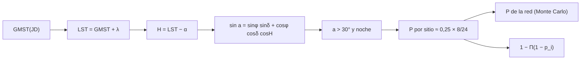

# B28-C16 — Redes internacionales de alertas

<!-- nav:top -->
[🏠 Programa](../../../../README.md) · [📚 Bloque B28](../../../tronco-comun/B28-astronomia-multimensajero.md) · [← Anterior: B28-C15 — Búsqueda de contrapartidas ópticas](../B28-C15-busqueda-de-contrapartidas-opticas/CLASE.md) · [Siguiente: B28-C17 — Archivos de eventos multimensajero →](../B28-C17-archivos-de-eventos-multimensajero/CLASE.md)
<!-- /nav -->

## 1. Ubicación, nivel y alcance

Clase 16 del bloque B28. Nivel N3. Una alerta ([B28-C09](../B28-C09-alertas-cientificas-en-tiempo-real/CLASE.md)) puede llegar en cualquier momento y desde cualquier lugar del cielo; ningún sitio la verá siempre. Aquí calculas la **altura de una fuente** sobre el horizonte de cada sitio, la probabilidad de que un sitio pueda observarla (altura mayor que `30°` y noche local) y la de que **al menos uno de seis sitios** repartidos en longitud pueda, y la comparas con la ingenua hipótesis de independencia. Usas astronomía de posición ([B08](../../../tronco-comun/B08-observacion-del-cielo-y-astronomia-practica.md)), el plan de seguimiento de [B28-C15](../B28-C15-busqueda-de-contrapartidas-opticas/CLASE.md) y la estadística de [B28-C11](../B28-C11-coincidencias-entre-observatorios/CLASE.md). Los sitios son ilustrativos.

## 2. Por qué esta clase existe

La cobertura de una red depende de su distribución geográfica, no solo del número de telescopios. La decisión central: **¿qué probabilidad hay de que, al llegar una alerta, al menos un sitio de la red pueda observar la fuente?**

## 3. Lo que podrás hacer al terminar

1. Calcular el tiempo sidéreo de Greenwich y el local.
2. Calcular la altura `sin a = sin φ sin δ + cos φ cos δ cos H`.
3. Verificar la fórmula con una fuente en el cenit.
4. Comprobar por Monte Carlo que la fracción del cielo sobre `30°` es `0,25`.
5. Calcular la probabilidad por sitio y la de la red.
6. Incorporar la disponibilidad de cada sitio.

La evidencia es la **ficha de cobertura de una red** del ejercicio 12 (sección 20).

## 4. Con qué llegas y cómo comprobarlo

1. ¿Qué son ascensión recta y declinación?
2. ¿Qué es el ángulo horario?
3. ¿Qué es el tiempo sidéreo?
4. ¿Qué es la altura sobre el horizonte?
5. ¿Qué es un Monte Carlo con semilla fija?

<details>
<summary>Ver respuestas</summary>

1. Coordenadas ecuatoriales. 2. `H = LST − α`. 3. La medida del tiempo según las estrellas. 4. El ángulo sobre el horizonte. 5. Una simulación repetible.
</details>

Con cuatro o cinco aciertos, sigue; si no, repasa B08.

## 5. Un caso de contexto y un caso sintético

Tras la alerta de GW170817 la fuente fue seguida por muchos observatorios en distintas longitudes (S2, resumen). Esta clase usa seis sitios ilustrativos que no corresponden a observatorios reales: `(−30°, −70°)`, `(20°, −156°)`, `(28°, −17°)`, `(−32°, 21°)`, `(−31°, 149°)` y `(37°, 138°)` (latitud, longitud). Se exige altura `> 30°` y noche entre las `20` y las `4` horas solares locales. Es el **ejemplo conductor**.

## 6. Vocabulario

La **red** es el conjunto de sitios. La **altura** es el ángulo sobre el horizonte. La **noche local** es el intervalo de horas solares oscuras. La **disponibilidad** es la probabilidad de que el sitio funcione. La **probabilidad de la red** es la de que al menos un sitio observe. La **independencia ingenua** supone que los sitios no están correlacionados.

## 7. Modelo mental: relevo de faros alrededor del planeta

La Tierra gira y, en cada instante, una parte de los sitios está de noche. Si están bien repartidos en longitud, siempre hay alguno oscuro; pero el cielo visible desde cada uno es solo una fracción.



*Descripción textual:* el tiempo sidéreo local y la ascensión recta dan el ángulo horario; con él, la altura; combinada con la noche local da la probabilidad por sitio, y la de la red se compara con la fórmula de independencia.

Analogía: faros repartidos que se turnan. Límite: no se modelan la Luna, las nubes ni los límites de montura.

## 8. La explicación, paso a paso

### 8.1 Comprobación en el cenit

Con la fuente en el cenit (`δ = φ`, `α = LST`) la altura es `90°` con error menor que `10⁻⁵°`.

### 8.2 Fracción del cielo sobre 30°

En `40 000` fuentes uniformes, la fracción es `0,2504` frente a `0,2500` analítica (`(1 − sin 30°)/2`), con error binomial `0,0022`.

### 8.3 Probabilidad por sitio

| sitio | latitud | longitud | `P(observar)` |
|---|---|---|---|
| S1 | −30,0 | −70,0 | 0,0833 |
| S2 | 20,0 | −156,0 | 0,0838 |
| S3 | 28,0 | −17,0 | 0,0811 |
| S4 | −32,0 | 21,0 | 0,0848 |
| S5 | −31,0 | 149,0 | 0,0835 |
| S6 | 37,0 | 138,0 | 0,0842 |

Todas cercanas al valor esperado `0,25 × 8/24 = 0,0833`.

### 8.4 La red

`P(al menos uno observa) = 0,4105` en la simulación, frente a `0,4071` de la independencia ingenua. Con una disponibilidad de `0,7` por sitio: `0,3054`.

### 8.5 Lectura

Con seis sitios repartidos, una alerta aleatoria puede observarse cerca del `41 %` de las veces, y solo cerca del `31 %` si cada sitio funciona el 70 % del tiempo. La coincidencia con la fórmula ingenua se debe a la buena distribución en longitud.

## 9. Magnitudes, símbolos y unidades

| Símbolo | Qué es | Unidad | Valor / nota |
|---|---|---|---|
| `φ`, `λ` | latitud y longitud del sitio | grados | ver 8.3 (ilustrativos) |
| `a` | altura | grados | > 30 |
| noche | horas solares locales | h | 20–4 |
| `p_i` | probabilidad por sitio | — | ≈ 0,083 |
| `P_red` | probabilidad de la red | — | 0,4105 |
| disp. | disponibilidad | — | 0,7 |

## 10. Convenciones y referencias

`GMST = 280,460 618 37 + 360,985 647 366 29 (JD − 2 451 545,0)` grados; fecha fija; sin Luna ni nubes; sitios, umbrales y disponibilidad **ilustrativos**.

## 11. De dónde sale lo que afirmamos

| ID | Fuente | Localizador | Respalda | Estado |
|---|---|---|---|---|
| S1 | Cálculo propio: tiempo sidéreo, altura y Monte Carlo | implementado en `red.py` | todas las tablas | Verificado en el cenit y con la fracción `0,25` |
| S2 | LIGO Scientific, Virgo y colaboraciones, arXiv:1710.05833 | https://arxiv.org/abs/1710.05833 | contexto del seguimiento | Solo resumen, consultado el 2026-11-09 |

Límites: S2 solo resumen; la fórmula de GMST es una aproximación estándar y no se consultó su fuente; los sitios no son observatorios reales.

## 12. Cómo ver la cobertura

| Modelo | `P_red` |
|---|---|
| Monte Carlo | 0,4105 |
| independencia ingenua | 0,4071 |
| con disponibilidad 0,7 | 0,3054 |

Descripción larga: la disponibilidad reduce la cobertura en un cuarto; la distribución en longitud hace casi válida la independencia.

## 13. Ejemplo trabajado: la probabilidad de un sitio

**Paso 1 · Cielo.** Fracción sobre `30°`: `(1 − 0,5)/2 = 0,25`.

**Paso 2 · Noche.** `8 h` de `24`: `1/3`.

**Paso 3 · Producto.** `0,25 × 1/3 = 0,0833`.

**Paso 4 · Sentido.** Solo uno de cada doce instantes y fuentes es observable desde un sitio.

## 14. Distintas formas de describir la red

**Por sitio:** `p_i`. **Por red:** `P_red`. **Por disponibilidad:** `P × disp`. **Por geometría:** distribución en longitud.

## 15. Práctica guiada

**Ejercicio 1 · con los pasos indicados.** Fracción del cielo sobre `45°`. *Pasos:* `(1 − sin 45°)/2`.

<details><summary>Solución comentada</summary>

`0,1464`.
</details>

**Ejercicio 2 · con una pista.** `P` de un sitio con noche de 6 h y altura mínima `30°`.

<details><summary>Solución comentada</summary>

`0,25 × 6/24 = 0,0625`.
</details>

**Ejercicio 3 · casi autónomo.** Independencia ingenua con seis sitios de `p = 0,0833`.

<details><summary>Solución comentada</summary>

`1 − 0,9167⁶ = 0,4071`.
</details>

## 16. Práctica autónoma, transferencia e integrador

**Ejercicio 4.** Sitios necesarios para `P ≥ 0,9` con `p = 0,0833` (independencia).

<details><summary>Solución comentada</summary>

`ln(0,1)/ln(0,9167) = 26,5`, es decir 27 sitios.
</details>

**Ejercicio 5.** `P_red` con disponibilidad `0,7`.

<details><summary>Solución comentada</summary>

`0,3054`.
</details>

**Ejercicio 6.** Cociente `P_red/P_ingenua`.

<details><summary>Solución comentada</summary>

`0,4105/0,4071 = 1,008`.
</details>

**Ejercicio 7.** Pérdida relativa por la disponibilidad.

<details><summary>Solución comentada</summary>

`1 − 0,3054/0,4105 = 25,6 %`.
</details>

**Ejercicio 8.** Error binomial de `0,0833` con `40 000` ensayos.

<details><summary>Solución comentada</summary>

`√(0,0833 × 0,9167/40 000) = 0,0014`.
</details>

**Ejercicio 9 · transferencia.** Un compañero dice que con seis sitios siempre se puede observar. Responde con 8.4.

<details><summary>Solución comentada</summary>

La probabilidad es `0,41`: la mayor parte del cielo no es visible desde ningún sitio en un instante dado.
</details>

**Ejercicio 10 · transferencia.** ¿Por qué la independencia ingenua funciona aquí?

<details><summary>Solución comentada</summary>

Porque los sitios están repartidos en longitud, de modo que sus noches y sus cielos visibles son casi independientes.
</details>

**Ejercicio 11 · transferencia.** ¿Qué prueba la fracción `0,25`?

<details><summary>Solución comentada</summary>

Que la fórmula de altura y el muestreo uniforme sobre la esfera son correctos; no la calidad de un sitio.
</details>

**Ejercicio 12 · integrador.** Elabora tu *ficha de cobertura de una red*: comprobaciones, probabilidad de cada sitio, probabilidad de la red con y sin disponibilidad.

<details><summary>Solución modelo</summary>

Secciones 8.1–8.4.
</details>

## 17. Laboratorio: visibilidad de una red

El script [red.py](red.py) calcula la altura (**comprueba** `10⁻⁵°` en el cenit), la fracción de cielo (**comprueba** 5 errores binomiales) y las probabilidades de la red.

**Datos:** sin constantes; `GMST` estándar; sitios y umbrales **ilustrativos**. **Predice antes de ejecutar:** ¿qué `P_red` sale? (≈`0,4`.) **Ejecución del 2026-11-09 (Python 3.12.9):**

```text
Python 3.12.9 (biblioteca estandar)
comprobacion: fuente en el cenit -> altura = 89.999999 grados
fraccion de fuentes a mas de 30 grados desde un sitio: MC = 0.2504 ; analitico (1 - sen 30)/2 = 0.2500 (+/- 0.0022)
sitio    lat     lon  P(observar)
   S1  -30.0   -70.0       0.0833
   S2   20.0  -156.0       0.0838
   S3   28.0   -17.0       0.0811
   S4  -32.0    21.0       0.0848
   S5  -31.0   149.0       0.0835
   S6   37.0   138.0       0.0842
esperado por sitio: 0.25 x 8/24 = 0.0833
red de 6 sitios: P(al menos uno observa) = 0.4105 ; independencia ingenua 1 - Prod(1 - p) = 0.4071
con disponibilidad 0.7 por sitio: P(al menos uno observa y esta disponible) = 0.3054
Pruebas superadas.
```

```bash
python programa/clases/B28/B28-C16-redes-internacionales-de-alertas/red.py
```

**Límites:** noche fija, sin Luna, nubes ni montura, fuentes uniformes en el cielo.

## 18. Errores frecuentes y cómo corregirlos

**Confundir latitud y declinación.** Se corrige con la sección 6.

**Olvidar la noche local.** Se corrige con el ejemplo 13.

**Suponer independencia siempre.** Se corrige con el ejercicio 10.

**Ignorar la disponibilidad.** Se corrige con el ejercicio 7.

**Tomar los sitios por reales.** Se corrige con la sección 5.

## 19. Cómo sabrás que vas bien

Tras 8.1: ¿qué altura tiene una fuente en el cenit? Si dudas, repasa la sección 8.1. Tras 8.4: ¿por qué `0,41`? Ejercicio 9. Tras el laboratorio: ¿qué valida la fracción `0,25`? Ejercicio 11.

## 20. Qué entregas y cómo se evalúa

El producto es tu **ficha de cobertura de una red** (ejercicio 12).

| Criterio | Inicial | En desarrollo | Logrado | Destacado |
|---|---|---|---|---|
| Conceptos | Los confunde | Parciales | Altura, noche, red | Explica la independencia |
| Cálculo | Sin unidades | Con errores | Tablas completas | Compara redes |
| Numérico | Sin comprobar | Un caso | Cenit y fracción | Interpreta el error binomial |
| Fuentes | Sin fuente | Sin fecha | S1–S2 con fecha | Declara que los sitios no son reales |
| Límites | No los nombra | Uno | Tres | Discute Luna y nubes |

**Condiciones críticas (no se compensan con promedio):** rotular sitios como ilustrativos; no inferir la cobertura de una red real; citar solo lo consultado.

## 21. Ética, seguridad y límites

Clase educativa: no es un planificador de seguimiento. Accesibilidad: tablas equivalentes a las gráficas, fórmulas en texto, ejercicios sin conexión.

## 22. Para cerrar y seguir

Un sitio puede observar una fuente aleatoria `1/12` de las veces; seis sitios bien repartidos, el `41 %`, y con 70 % de disponibilidad, el `31 %`. Queda una pregunta: ¿cómo se guarda todo esto para que otros lo reutilicen?

**Glosario español–inglés.** red de alertas · *alert network*; tiempo sidéreo · *sidereal time*; altura · *altitude*; noche local · *local night*; disponibilidad · *availability*; cobertura · *coverage*.

**Continuidad.** [B28-C17](../B28-C17-archivos-de-eventos-multimensajero/CLASE.md) estudia los archivos de eventos multimensajero.

**Referencias:** ver sección 11.

<!-- nav:bottom -->
---

[← Anterior: B28-C15 — Búsqueda de contrapartidas ópticas](../B28-C15-busqueda-de-contrapartidas-opticas/CLASE.md) · [📚 Bloque B28](../../../tronco-comun/B28-astronomia-multimensajero.md) · [Siguiente: B28-C17 — Archivos de eventos multimensajero →](../B28-C17-archivos-de-eventos-multimensajero/CLASE.md)
<!-- /nav -->
