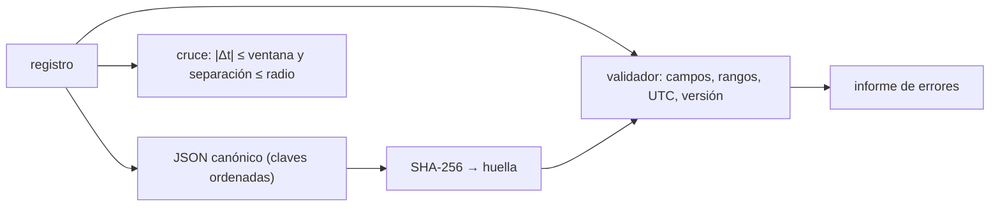

# B28-C17 — Archivos de eventos multimensajero

<!-- nav:top -->
[🏠 Programa](../../../../README.md) · [📚 Bloque B28](../../../tronco-comun/B28-astronomia-multimensajero.md) · [← Anterior: B28-C16 — Redes internacionales de alertas](../B28-C16-redes-internacionales-de-alertas/CLASE.md) · [Siguiente: B28-C18 — Interpretación de kilonovas →](../B28-C18-interpretacion-de-kilonovas/CLASE.md)
<!-- /nav -->

## 1. Ubicación, nivel y alcance

Clase 17 del bloque B28. Nivel N3. Un evento observado por varios mensajeros genera varios registros en distintos archivos; para reutilizarlos hay que identificarlos sin ambigüedad, versionarlos, protegerlos con una huella y cruzarlos. Aquí construyes un **archivo mínimo de eventos** con identificador, versión y **huella SHA-256**, escribes un **validador** que detecta errores de campo, rango, formato de tiempo, versión y manipulación, y haces un **cruce** por tiempo y posición. Usas estructuras de datos y criptografía básica ([B07](../../../tronco-comun/B07-informatica-cientifica-desde-cero.md)) y las coincidencias de [B28-C11](../B28-C11-coincidencias-entre-observatorios/CLASE.md). Todos los registros son sintéticos.

## 2. Por qué esta clase existe

Un catálogo sin identificadores estables, versiones ni huellas no se puede citar ni auditar. La decisión central: **¿cómo se guarda un evento para que se pueda verificar, actualizar y cruzar con otros?**

## 3. Lo que podrás hacer al terminar

1. Definir el esquema de un registro con campos y tipos.
2. Calcular una huella SHA-256 de la serialización canónica.
3. Comprobar que la huella no depende del orden de las claves y sí del valor.
4. Validar rangos, formato de tiempo en UTC, mensajeros y versiones.
5. Detectar manipulaciones por huella.
6. Cruzar registros de mensajeros distintos por tiempo y posición.

La evidencia es el **archivo validado con informe de errores** del ejercicio 12 (sección 20).

## 4. Con qué llegas y cómo comprobarlo

1. ¿Qué es una función hash?
2. ¿Qué es JSON?
3. ¿Qué es UTC?
4. ¿Qué es la separación angular?
5. ¿Qué es una versión de un registro?

<details>
<summary>Ver respuestas</summary>

1. Una función que resume datos en una huella de tamaño fijo. 2. Un formato de texto para datos estructurados. 3. El tiempo universal coordinado. 4. El ángulo entre dos direcciones del cielo. 5. Un número que crece cuando se corrige el registro.
</details>

Con cuatro o cinco aciertos, sigue; si no, repasa B07.

## 5. Un caso de contexto y un caso sintético

El catálogo GWTC-1 recoge fusiones de objetos compactos observadas en las dos primeras campañas de detectores (S2, resumen). Esta clase no usa ninguno de sus registros: crea cinco registros sintéticos con identificadores `SINT-0001` a `SINT-0005`, dos pares de mensajeros cercanos en tiempo y cielo, y siete registros defectuosos inyectados a propósito. Es el **ejemplo conductor**.

## 6. Vocabulario

Un **registro** es un evento de un mensajero. El **identificador** lo distingue. La **versión** crece con cada corrección. La **huella** SHA-256 resume el contenido. La **serialización canónica** ordena las claves y fija los separadores. Un **cruce** agrupa registros de mensajeros distintos. El **informe de errores** lista lo que falla.

## 7. Modelo mental: un sello de lacre sobre cada hoja

La huella es un sello: si alguien cambia una coma, el sello deja de coincidir. Y el esquema es el formulario: no se acepta una hoja sin los campos obligatorios, con valores fuera de rango o con una hora sin zona.



*Descripción textual:* cada registro se serializa de forma canónica y se firma con SHA-256; el validador revisa esquema, rangos, formato de tiempo, versión y huella; el cruce busca pares de mensajeros distintos.

Analogía: sello de lacre. Límite: la huella detecta cambios, no impide falsificar un registro con huella nueva.

## 8. La explicación, paso a paso

### 8.1 Esquema

Campos obligatorios: `id` (texto), `mensajero` (uno de `fotones`, `neutrinos`, `rayos_cosmicos`, `ondas_gravitacionales`), `tiempo_utc` (ISO 8601 con sufijo `Z`), `ra_deg`, `dec_deg`, `error_deg`, `significancia` (números) y `version` (entero).

### 8.2 Huella

La huella de `SINT-0001` empieza por `3d899bcae06cc191` y tiene 64 caracteres hexadecimales; no cambia si se reordenan las claves y sí cambia si la significancia pasa de `12,0` a `12,0001`.

### 8.3 Errores inyectados

| registro | defecto | mensaje del validador |
|---|---|---|
| SINT-0006 | `dec = 95` | `dec fuera de rango` |
| SINT-0007 | hora sin `Z` | `tiempo: falta sufijo Z (UTC)` |
| SINT-0008 | mensajero `neutrino` | `mensajero desconocido` |
| SINT-0009 | `ra = 361` | `ra fuera de rango` |
| SINT-0010 | sin `error_deg` | `falta error_deg` |
| SINT-0003 (copia) | misma versión | `version no creciente` y `huella no coincide` |
| SINT-0004 (manipulado) | significancia cambiada | `huella no coincide` |

El validador detecta exactamente estos ocho avisos y ninguno más.

### 8.4 Cruce

Con ventana `60 s` y radio `8°`: `SINT-0001–SINT-0002` (`Δt = 2 s`, onda gravitacional y fotones) y `SINT-0003–SINT-0004` (`Δt = 40 s`, neutrino y fotones).

### 8.5 Lectura

El archivo es auditable: cualquier cambio queda marcado, cada registro se puede citar por identificador y versión, y los pares candidatos se obtienen con parámetros declarados.

## 9. Magnitudes, símbolos y unidades

| Símbolo | Qué es | Unidad | Valor / nota |
|---|---|---|---|
| `id` | identificador | texto | `SINT-0001` … |
| `tiempo_utc` | instante | ISO 8601 UTC | sintético |
| `ra_deg`, `dec_deg` | posición | grados | `[0, 360)`; `[−90, 90]` |
| `error_deg` | error de posición | grados | ≥ 0 |
| `version` | versión | — | ≥ 1, creciente |
| huella | SHA-256 | hex | 64 caracteres |

## 10. Convenciones y referencias

JSON canónico (`sort_keys`, separadores `,` y `:`); UTC con sufijo `Z`; ventana de cruce y radio de **ilustrativos**; todos los registros son **sintéticos**.

## 11. De dónde sale lo que afirmamos

| ID | Fuente | Localizador | Respalda | Estado |
|---|---|---|---|---|
| S1 | Cálculo propio: validador, huella y cruce | implementado en `archivo.py` | todas las tablas | Verificado con errores inyectados |
| S2 | LIGO Scientific y Virgo, GWTC-1, arXiv:1811.12907 | https://arxiv.org/abs/1811.12907 | contexto de un catálogo de fusiones | Solo resumen, consultado el 2026-11-09 |

Límites: S2 solo resumen y sin datos usados; el esquema y la huella son una práctica estándar y no se consultó una especificación; ningún registro es real.

## 12. Cómo ver el informe

| Resultado | Cantidad |
|---|---|
| registros válidos del archivo base | 5 |
| avisos esperados en el archivo defectuoso | 8 |
| avisos detectados | 8 |
| pares cruzados | 2 |

Descripción larga: el validador detecta exactamente lo inyectado, sin falsos positivos ni omisiones.

## 13. Ejemplo trabajado: ¿pasa SINT-0006?

**Paso 1 · Campos.** Están todos y con tipos correctos.

**Paso 2 · Rangos.** `dec = 95` está fuera de `[−90, 90]`.

**Paso 3 · Resultado.** Aviso `dec fuera de rango`.

**Paso 4 · Sentido.** Se rechaza antes de que contamine un cruce.

## 14. Distintas formas de describir un archivo

**Por esquema:** campos y tipos. **Por huella:** integridad. **Por versión:** historia. **Por cruce:** relaciones entre registros.

## 15. Práctica guiada

**Ejercicio 1 · con los pasos indicados.** ¿Qué longitud tiene una huella SHA-256 en hexadecimal? *Pasos:* 256 bits / 4.

<details><summary>Solución comentada</summary>

`64` caracteres.
</details>

**Ejercicio 2 · con una pista.** ¿Pasa `ra = 360`? *Pista:* intervalo semiabierto.

<details><summary>Solución comentada</summary>

No: el rango es `[0, 360)`.
</details>

**Ejercicio 3 · casi autónomo.** ¿Pasa una hora `2030-01-05T10:00:00` sin `Z`?

<details><summary>Solución comentada</summary>

No: falta la marca de UTC.
</details>

## 16. Práctica autónoma, transferencia e integrador

**Ejercicio 4.** ¿Cambia la huella si se reordenan las claves?

<details><summary>Solución comentada</summary>

No, por la serialización canónica.
</details>

**Ejercicio 5.** ¿Qué detecta la huella que el esquema no?

<details><summary>Solución comentada</summary>

Un cambio de valor válido (por ejemplo, la significancia de `6,1` a `99`).
</details>

**Ejercicio 6.** Separación entre `SINT-0001` y `SINT-0002`.

<details><summary>Solución comentada</summary>

Menor que el radio de `8°` (calculada con el coseno esférico).
</details>

**Ejercicio 7.** ¿Se cruzarían con una ventana de `1 s`?

<details><summary>Solución comentada</summary>

No: `Δt = 2 s`.
</details>

**Ejercicio 8.** ¿Se cruzaría `SINT-0005` con alguno?

<details><summary>Solución comentada</summary>

No: está más de un mes después y a otra posición.
</details>

**Ejercicio 9 · transferencia.** Un compañero dice que la huella impide falsificar un registro. Responde con la sección 7.

<details><summary>Solución comentada</summary>

Solo detecta cambios; quien modifica el registro puede recalcular la huella. Hace falta además una firma o un control de acceso.
</details>

**Ejercicio 10 · transferencia.** ¿Por qué se exige la versión creciente?

<details><summary>Solución comentada</summary>

Para reconstruir la historia de correcciones y detectar duplicados o retrocesos.
</details>

**Ejercicio 11 · transferencia.** ¿Qué valida inyectar errores conocidos?

<details><summary>Solución comentada</summary>

Que el validador detecta lo previsto sin falsos positivos; no que cubra todos los errores posibles.
</details>

**Ejercicio 12 · integrador.** Elabora tu *archivo validado con informe de errores*: esquema, cinco registros válidos con huella, tres defectos inyectados y el informe.

<details><summary>Solución modelo</summary>

Secciones 8.1–8.4.
</details>

## 17. Laboratorio: archivo, huella y cruce

El script [archivo.py](archivo.py) valida un archivo base y uno defectuoso (**comprueba** que se detecten exactamente los errores inyectados), verifica la huella y cruza registros.

**Datos:** sin constantes; todo **sintético**. **Predice antes de ejecutar:** ¿cuántos avisos esperas? (8.) **Ejecución del 2026-11-09 (Python 3.12.9):**

```text
Python 3.12.9 (biblioteca estandar)
archivo base: 5 registros, sin errores
huella SHA-256 de SINT-0001: 3d899bcae06cc191... (64 hex) ; independiente del orden de claves y sensible a un cambio de 1e-4
errores detectados:
   SINT-0004: huella no coincide
   SINT-0006: dec fuera de rango
   SINT-0007: tiempo: falta sufijo Z (UTC)
   SINT-0008: mensajero desconocido
   SINT-0009: ra fuera de rango
   SINT-0010: falta error_deg
   SINT-0003: version no creciente
   SINT-0003: huella no coincide
coincidencias (ventana 60 s, radio 8 grados):
   SINT-0001 - SINT-0002: dt = 2 s
   SINT-0003 - SINT-0004: dt = 40 s
Pruebas superadas.
```

```bash
python programa/clases/B28/B28-C17-archivos-de-eventos-multimensajero/archivo.py
```

**Límites:** registros en memoria, sin firma criptográfica, sin esquema formal externo.

## 18. Errores frecuentes y cómo corregirlos

**Confundir huella con firma.** Se corrige con el ejercicio 9.

**Serializar sin orden canónico.** Se corrige con el ejercicio 4.

**Guardar horas sin zona.** Se corrige con el ejercicio 3.

**Reutilizar identificadores.** Se corrige con el ejercicio 10.

**Cruzar sin declarar la ventana.** Se corrige con la sección 10.

## 19. Cómo sabrás que vas bien

Tras 8.2: ¿qué cambia la huella? Si dudas, ejercicio 5. Tras 8.3: ¿cuántos avisos? 8. Tras el laboratorio: ¿qué valida? (el validador frente a errores conocidos).

## 20. Qué entregas y cómo se evalúa

El producto es tu **archivo validado con informe de errores** (ejercicio 12).

| Criterio | Inicial | En desarrollo | Logrado | Destacado |
|---|---|---|---|---|
| Conceptos | Los confunde | Parciales | Esquema, huella, versión | Explica los límites de la huella |
| Cálculo | Sin comprobar | Con errores | Validación completa | Declara ventana y radio |
| Numérico | Sin pruebas | Un caso | Errores inyectados | Interpreta los falsos positivos |
| Fuentes | Sin fuente | Sin fecha | S1–S2 con fecha | Declara que los registros son sintéticos |
| Límites | No los nombra | Uno | Tres | Discute firmas y esquemas formales |

**Condiciones críticas (no se compensan con promedio):** rotular los registros como sintéticos; no presentar la huella como firma; citar solo lo consultado.

## 21. Ética, seguridad y límites

Clase educativa: no es un sistema de archivo para datos reales. Accesibilidad: tablas equivalentes a las gráficas, fórmulas en texto, ejercicios sin conexión.

## 22. Para cerrar y seguir

Un archivo útil tiene esquema, identificador, versión y huella, y se valida con errores conocidos: aquí, 8 avisos esperados y 8 detectados. Queda una pregunta: ¿cómo se interpreta físicamente un transitorio como la kilonova?

**Glosario español–inglés.** archivo de eventos · *event archive*; huella · *hash (fingerprint)*; serialización canónica · *canonical serialization*; validador · *validator*; versión · *version*; cruce · *cross-match*.

**Continuidad.** [B28-C18](../B28-C18-interpretacion-de-kilonovas/CLASE.md) estudia la interpretación de kilonovas.

**Referencias:** ver sección 11.

<!-- nav:bottom -->
---

[← Anterior: B28-C16 — Redes internacionales de alertas](../B28-C16-redes-internacionales-de-alertas/CLASE.md) · [📚 Bloque B28](../../../tronco-comun/B28-astronomia-multimensajero.md) · [Siguiente: B28-C18 — Interpretación de kilonovas →](../B28-C18-interpretacion-de-kilonovas/CLASE.md)
<!-- /nav -->
