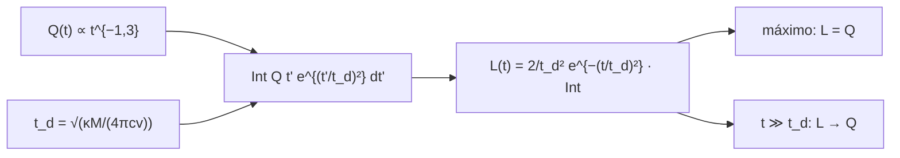

# B28-C18 — Interpretación de kilonovas

<!-- nav:top -->
[🏠 Programa](../../../../README.md) · [📚 Bloque B28](../../../tronco-comun/B28-astronomia-multimensajero.md) · [← Anterior: B28-C17 — Archivos de eventos multimensajero](../B28-C17-archivos-de-eventos-multimensajero/CLASE.md) · [Siguiente: B28-C19 — Limitaciones y sesgos de detección →](../B28-C19-limitaciones-y-sesgos-de-deteccion/CLASE.md)
<!-- /nav -->

## 1. Ubicación, nivel y alcance

Clase 18 del bloque B28. Nivel N3. La fusión de dos estrellas de neutrones expulsa materia rica en neutrones que sintetiza elementos pesados; su desintegración radiactiva calienta la nube y produce un transitorio térmico: la **kilonova**. Aquí modelas el **calentamiento**, la **difusión** de la luz en la nube en expansión y la **luminosidad pico** con un modelo de tipo Arnett, y compruebas la **regla de Arnett** (en el máximo, `L = Q`). Usas la cadena radiactiva de [B27-C14](../../B27/B27-C14-supernovas-termonucleares/CLASE.md), la curva de luz de [B28-C08](../B28-C08-senales-transitorias/CLASE.md) y las binarias de [B27-C13](../../B27/B27-C13-binarias-compactas/CLASE.md). Los parámetros son ilustrativos.

## 2. Por qué esta clase existe

La escala de tiempo y el brillo de una kilonova dependen de la masa eyectada y de su velocidad. Entender esa relación permite estimar ambos a partir de la curva de luz. La decisión central: **¿cuándo alcanza su máximo una kilonova y cuánta luminosidad tiene, dadas la masa, la velocidad y la opacidad de la nube?**

## 3. Lo que podrás hacer al terminar

1. Escribir el calentamiento `Q(t) = f M ε₀ (t/1 d)^{−1,3}`.
2. Calcular el tiempo de difusión `t_d = √(κM/(4π c v))`.
3. Calcular `L(t)` con la integral de Arnett.
4. Localizar el máximo y verificar `L_pico = Q(t_pico)`.
5. Describir los regímenes temprano y tardío.
6. Reconocer cómo escalan `t_d` y `L` con la masa.

La evidencia es la **ficha de una kilonova** del ejercicio 12 (sección 20).

## 4. Con qué llegas y cómo comprobarlo

1. ¿Qué es la captura rápida de neutrones?
2. ¿Qué es la opacidad?
3. ¿Qué es la expansión homóloga?
4. ¿Qué es una cuadratura con cambio de variable?
5. ¿Qué es un máximo local?

<details>
<summary>Ver respuestas</summary>

1. La formación de núcleos pesados por captura de neutrones antes de desintegrarse. 2. La sección eficaz de absorción por masa. 3. Una expansión en que `v ∝ r`. 4. Una integral transformada para suavizar el integrando. 5. Un punto donde la derivada se anula y cambia de signo.
</details>

Con cuatro o cinco aciertos, sigue; si no, repasa B27-C14.

## 5. Un caso de contexto y un caso sintético

Metzger describe las kilonovas como transitorios térmicos casi isótropos alimentados por la desintegración radiactiva de núcleos inestables formados en la fusión (S3, resumen). Esta clase usa un modelo sintético con `M = 0,03 M☉`, `v = 0,2 c`, `κ = 10 cm²/g`, un calentamiento de `10¹⁰ erg/g/s` a 1 día, un exponente `−1,3` y una fracción termalizada de `0,5`; ninguno de estos números proviene de la revisión citada. Es el **ejemplo conductor**.

## 6. Vocabulario

La **kilonova** es el transitorio térmico tras una fusión de estrellas de neutrones. El **calentamiento** `Q(t)` es la potencia de la desintegración radiactiva depositada. El **tiempo de difusión** `t_d`. La **regla de Arnett** dice que en el máximo `L = Q`. La **opacidad gris** es constante con la longitud de onda. La **termalización** es la fracción de la energía que se convierte en luz.

## 7. Modelo mental: una olla con tapa que se levanta

El calor se genera dentro de una nube opaca. Al principio la luz queda atrapada y luego escapa; el máximo ocurre cuando lo que sale iguala lo que entra.



*Descripción textual:* el calentamiento y el tiempo de difusión definen la integral de Arnett; de ella sale la luminosidad, cuyo máximo cumple `L = Q` y que tiende a `Q` a tiempos largos.

Analogía: una olla con tapa. Límite: opacidad gris y esfera homogénea.

## 8. La explicación, paso a paso

### 8.1 Escalas

Con `M = 0,03 M☉`, `v = 0,2 c` y `κ = 1 m²/kg`: `t_d = 5,1389 × 10⁵ s = 5,95 d`.

### 8.2 La integral

Con la sustitución `u = t'^{0,7}` el integrando es suave. A 3 días, `7,350764 × 10⁴⁴` con la sustitución y con Simpson fino, cociente `1,00000000`.

### 8.3 El máximo

El máximo ocurre a `4,215 d` con `L_pico = 4,5951 × 10³³ W = 4,595 × 10⁴⁰ erg/s`, igual a `Q(t_pico)` (cociente `1,000000`).

### 8.4 La curva

| `t` (d) | `Q` (W) | `L` (W) | `L/Q` |
|---|---|---|---|
| 0,5 | `7,3441 × 10³⁴` | `1,4751 × 10³³` | 0,020 |
| 1 | `2,9826 × 10³⁴` | `2,3590 × 10³³` | 0,079 |
| 2 | `1,2113 × 10³⁴` | `3,6007 × 10³³` | 0,297 |
| 5 | `3,6807 × 10³³` | `4,4999 × 10³³` | 1,223 |
| 10 | `1,4948 × 10³³` | `2,2102 × 10³³` | 1,479 |
| 20 | `6,0710 × 10³²` | `6,4908 × 10³²` | 1,069 |
| 50 | `1,8447 × 10³²` | `1,8621 × 10³²` | 1,009 |

### 8.5 Regímenes

Antes del máximo `L < Q` (la luz está atrapada); después `L > Q` (se libera la energía almacenada); a `12 t_d`, `L/Q = 1,0046`. Con cuatro veces la masa, `t_d` se duplica.

## 9. Magnitudes, símbolos y unidades

| Símbolo | Qué es | Unidad | Valor / nota |
|---|---|---|---|
| `M` | masa eyectada | `M☉` | 0,03 (ilustrativa) |
| `v` | velocidad | `c` | 0,2 (ilustrativa) |
| `κ` | opacidad | m²/kg | 1 (10 cm²/g, ilustrativa) |
| `ε₀` | calentamiento a 1 d | W/kg | `10⁶` (10¹⁰ erg/g/s, ilustrativo) |
| `t_d` | tiempo de difusión | d | 5,95 |
| `L_pico` | luminosidad máxima | W | `4,5951 × 10³³` |

## 10. Convenciones y referencias

Opacidad gris; esfera homogénea en expansión homóloga; exponente `−1,3` **ilustrativo**; todos los parámetros son **ilustrativos**.

## 11. De dónde sale lo que afirmamos

| ID | Fuente | Localizador | Respalda | Estado |
|---|---|---|---|---|
| S1 | NIST (`c`) y UAI 2015 B3 (`GM_☉`) | https://physics.nist.gov/cuu/Constants/Table/allascii.txt ; https://arxiv.org/abs/1510.07674 | constantes | Consultadas el 2026-11-09 |
| S2 | Cálculo propio: modelo de tipo Arnett | implementado en `kilonova.py` | tablas de 8.3–8.4 | Verificado con la regla `L = Q` y por Simpson fino |
| S3 | Metzger, *Kilonovae*, arXiv:1910.01617 | https://arxiv.org/abs/1910.01617 | contexto: transitorio térmico por desintegración radiactiva | Solo resumen, consultado el 2026-11-09 |

Límites: S3 solo resumen y no respalda ninguna cifra; el modelo de Arnett es una simplificación; el exponente de calentamiento y los demás parámetros no provienen de una fuente consultada.

## 12. Cómo ver los regímenes

| Fase | Relación |
|---|---|
| `t ≪ t_d` | `L ≪ Q` |
| `t = t_pico` | `L = Q` |
| `t ≫ t_d` | `L → Q` |

Descripción larga: la luminosidad sigue al calentamiento por detrás al principio, por delante después del máximo y converge a él a tiempos largos.

## 13. Ejemplo trabajado: tiempo de difusión

**Paso 1 · Datos.** `κM = 5,97 × 10²⁸ m²`; `4π c v = 2,26 × 10¹⁷ m²/s`.

**Paso 2 · Cociente.** `2,64 × 10¹¹ s²`.

**Paso 3 · Raíz.** `5,14 × 10⁵ s`.

**Paso 4 · Sentido.** `5,95 d`, del orden de la fecha del máximo.

## 14. Distintas formas de describir la kilonova

**Por calentamiento:** `Q`. **Por difusión:** `t_d`. **Por luminosidad:** `L(t)`. **Por regla:** `L = Q` en el máximo.

## 15. Práctica guiada

**Ejercicio 1 · con los pasos indicados.** `Q` a 1 día. *Pasos:* `f M ε₀`.

<details><summary>Solución comentada</summary>

`0,5 × 5,97 × 10²⁸ × 10⁶ = 2,98 × 10³⁴ W`.
</details>

**Ejercicio 2 · con una pista.** `Q` a 10 días. *Pista:* `10^{−1,3}`.

<details><summary>Solución comentada</summary>

`2,98 × 10³⁴ × 0,0501 = 1,49 × 10³³ W`.
</details>

**Ejercicio 3 · casi autónomo.** `t_d` si la velocidad es `0,1 c`.

<details><summary>Solución comentada</summary>

`5,95 × √2 = 8,4 d`.
</details>

## 16. Práctica autónoma, transferencia e integrador

**Ejercicio 4.** `t_pico/t_d`.

<details><summary>Solución comentada</summary>

`4,215/5,95 = 0,71`.
</details>

**Ejercicio 5.** `L/Q` a 10 días.

<details><summary>Solución comentada</summary>

`1,479`.
</details>

**Ejercicio 6.** `t_d` si la masa se multiplica por 4.

<details><summary>Solución comentada</summary>

Se duplica: `11,9 d`.
</details>

**Ejercicio 7.** `L_pico` en erg/s.

<details><summary>Solución comentada</summary>

`4,595 × 10⁴⁰ erg/s`.
</details>

**Ejercicio 8.** Cociente `L(5 d)/L(1 d)`.

<details><summary>Solución comentada</summary>

`4,4999 × 10³³/2,3590 × 10³³ = 1,91`.
</details>

**Ejercicio 9 · transferencia.** Un compañero dice que en el máximo la nube emite más de lo que se calienta. Responde con 8.3.

<details><summary>Solución comentada</summary>

En el máximo `L = Q` exactamente (regla de Arnett); después sí `L > Q`.
</details>

**Ejercicio 10 · transferencia.** ¿Por qué una nube más masiva tarda más en alcanzar el máximo?

<details><summary>Solución comentada</summary>

Porque `t_d ∝ √(κM/v)`: la luz tarda más en difundirse.
</details>

**Ejercicio 11 · transferencia.** ¿Qué valida la comparación con Simpson?

<details><summary>Solución comentada</summary>

La sustitución `u = t'^{0,7}`; no el modelo físico.
</details>

**Ejercicio 12 · integrador.** Elabora tu *ficha de una kilonova*: parámetros, `t_d`, `Q` y `L` en siete tiempos, máximo y comprobación de la regla.

<details><summary>Solución modelo</summary>

Secciones 8.1–8.5.
</details>

## 17. Laboratorio: kilonova de tipo Arnett

El script [kilonova.py](kilonova.py) integra con sustitución (**comprueba** `10⁻⁶` frente a Simpson fino), busca el máximo y verifica la regla de Arnett (**comprueba** `10⁻⁴`).

**Datos:** `c`, `GM_☉` de NIST y UAI; todo lo demás **ilustrativo**. **Predice antes de ejecutar:** ¿cuándo ocurre el máximo? (unos 4 días.) **Ejecución del 2026-11-09 (Python 3.12.9):**

```text
Python 3.12.9 (biblioteca estandar)
M = 0.03 Msol ; v = 0.2 c ; kappa = 10 cm2/g ; t_d = 5.1389e+05 s = 5.95 d
integral a 3 d: con sustitucion = 7.350764e+44 ; Simpson fino = 7.350764e+44 (cociente 1.00000000)
maximo: t_pico = 4.215 d ; L_pico = 4.5951e+33 W = 4.595e+40 erg/s ; Q(t_pico) = 4.5951e+33 W ; cociente = 1.000000
 t [d]        Q [W]        L [W]     L/Q
   0.5   7.3441e+34   1.4751e+33   0.020
   1.0   2.9826e+34   2.3590e+33   0.079
   2.0   1.2113e+34   3.6007e+33   0.297
   5.0   3.6807e+33   4.4999e+33   1.223
  10.0   1.4948e+33   2.2102e+33   1.479
  20.0   6.0710e+32   6.4908e+32   1.069
  50.0   1.8447e+32   1.8621e+32   1.009
tiempos largos (t = 12 t_d): L/Q = 1.0046
t_d con 4x masa / t_d = 2.000 (t_d es proporcional a la raiz de la masa)
Pruebas superadas.
```

```bash
python programa/clases/B28/B28-C18-interpretacion-de-kilonovas/kilonova.py
```

**Límites:** opacidad gris, esfera homogénea, sin dependencia espectral ni angular.

## 18. Errores frecuentes y cómo corregirlos

**Confundir `L` y `Q`.** Se corrige con la sección 12.

**Olvidar la termalización.** Se corrige con el ejercicio 1.

**Atribuir el exponente a una fuente.** Se corrige con la sección 10.

**Tomar el modelo por un ajuste.** Se corrige con la sección 5.

**Mezclar erg y julios.** Se corrige con la sección 9.

## 19. Cómo sabrás que vas bien

Tras 8.1: ¿cómo escala `t_d`? Si dudas, ejercicio 6. Tras 8.3: ¿qué relación hay en el máximo? Ejercicio 9. Tras el laboratorio: ¿qué valida? (la regla de Arnett).

## 20. Qué entregas y cómo se evalúa

El producto es tu **ficha de una kilonova** (ejercicio 12).

| Criterio | Inicial | En desarrollo | Logrado | Destacado |
|---|---|---|---|---|
| Conceptos | Los confunde | Parciales | `Q`, `t_d`, `L` | Explica la regla de Arnett |
| Cálculo | Sin unidades | Con errores | Tabla completa | Compara masas |
| Numérico | Sin comprobar | Un caso | Dos comprobaciones | Interpreta los regímenes |
| Fuentes | Sin fuente | Sin fecha | S1–S3 con fecha | Declara que los parámetros son ilustrativos |
| Límites | No los nombra | Uno | Tres | Discute opacidad dependiente de la longitud de onda |

**Condiciones críticas (no se compensan con promedio):** rotular el exponente y los parámetros como ilustrativos; no presentar la curva como ajuste; citar solo lo consultado.

## 21. Ética, seguridad y límites

Clase educativa: no es un modelo de kilonova para ajustar datos. Accesibilidad: tablas equivalentes a las gráficas, fórmulas en texto, ejercicios sin conexión.

## 22. Para cerrar y seguir

La difusión retrasa el máximo (`4,2 d` con `t_d = 5,95 d`), en el máximo la luminosidad iguala el calentamiento y a tiempos largos converge a él. Queda una pregunta: ¿qué sesgos distorsionan las muestras de transitorios detectados?

**Glosario español–inglés.** kilonova · *kilonova*; calentamiento radiactivo · *radioactive heating*; tiempo de difusión · *diffusion time*; regla de Arnett · *Arnett's rule*; opacidad gris · *grey opacity*; termalización · *thermalization*.

**Continuidad.** [B28-C19](../B28-C19-limitaciones-y-sesgos-de-deteccion/CLASE.md) estudia las limitaciones y sesgos de detección.

**Referencias:** ver sección 11.

<!-- nav:bottom -->
---

[← Anterior: B28-C17 — Archivos de eventos multimensajero](../B28-C17-archivos-de-eventos-multimensajero/CLASE.md) · [📚 Bloque B28](../../../tronco-comun/B28-astronomia-multimensajero.md) · [Siguiente: B28-C19 — Limitaciones y sesgos de detección →](../B28-C19-limitaciones-y-sesgos-de-deteccion/CLASE.md)
<!-- /nav -->
