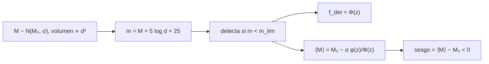

# B28-C19 — Limitaciones y sesgos de detección

<!-- nav:top -->
[🏠 Programa](../../../../README.md) · [📚 Bloque B28](../../../tronco-comun/B28-astronomia-multimensajero.md) · [← Anterior: B28-C18 — Interpretación de kilonovas](../B28-C18-interpretacion-de-kilonovas/CLASE.md) · [Siguiente: B28-C20 — Caso de estudio de evento combinado →](../B28-C20-caso-de-estudio-de-evento-combinado/CLASE.md)
<!-- /nav -->

## 1. Ubicación, nivel y alcance

Clase 19 del bloque B28. Nivel N3. Lo que un instrumento detecta no es una muestra representativa de lo que existe: ve mejor lo brillante y lo cercano. Aquí estudias el **sesgo de Malmquist** en una población limitada por flujo: cómo la luminosidad media de los objetos detectados es mayor que la de la población, y cómo el sesgo crece con la distancia. Usas distribuciones normales y truncadas ([B12](../../../tronco-comun/B12-probabilidad-estadistica-e-incertidumbre.md)), el alcance de [B28-C07](../B28-C07-fuentes-compactas-binarias/CLASE.md) y la curva de detección de [B28-C08](../B28-C08-senales-transitorias/CLASE.md). Los datos son sintéticos.

## 2. Por qué esta clase existe

Si se promedia la luminosidad de los eventos detectados sin corregir, se sobrestima la luminosidad típica de la población. El mismo razonamiento vale para las masas de fusiones de ondas gravitacionales detectadas. La decisión central: **¿cuánto se sesga una muestra limitada por flujo y cómo depende de la distancia?**

## 3. Lo que podrás hacer al terminar

1. Escribir la magnitud aparente `m = M + 5 log₁₀ d + 25` y el criterio de detección.
2. Calcular la fracción detectada `Φ(z)` en función de la distancia.
3. Calcular la media de los detectados con la normal truncada.
4. Verificar el cálculo con una simulación de semilla fija.
5. Cuantificar el sesgo global y por capas.
6. Enunciar qué correcciones se necesitan.

La evidencia es la **ficha de sesgos de selección** del ejercicio 12 (sección 20).

## 4. Con qué llegas y cómo comprobarlo

1. ¿Qué es la magnitud absoluta?
2. ¿Qué es el módulo de distancia?
3. ¿Qué es una distribución normal truncada?
4. ¿Qué es una función de selección?
5. ¿Qué es un Monte Carlo?

<details>
<summary>Ver respuestas</summary>

1. La magnitud a 10 pc. 2. `5 log₁₀(d/10 pc)`. 3. Una normal restringida a un intervalo. 4. La probabilidad de detección en función de las propiedades. 5. Una simulación aleatoria.
</details>

Con cuatro o cinco aciertos, sigue; si no, repasa B12 y B28-C08.

## 5. Un caso de contexto y un caso sintético

El catálogo GWTC-1 reúne las detecciones de las dos primeras campañas de observación (S2, resumen); los eventos detectados dependen del alcance del instrumento ([B28-C07](../B28-C07-fuentes-compactas-binarias/CLASE.md)). Esta clase no usa sus datos: simula `600 000` fuentes uniformes en volumen hasta `1000 Mpc` con magnitud absoluta `N(−16, 1)` y límite aparente `21`. Es el **ejemplo conductor**.

## 6. Vocabulario

El **sesgo de Malmquist** es el exceso de luminosidad de los detectados. La **función de selección** `Φ(z)`. La **muestra limitada por flujo** detecta lo más brillante que `m_lim`. La **normal truncada** da la media de los detectados. El **módulo de distancia** `5 log₁₀ d + 25` (con `d` en Mpc). El **sesgo global** es el de toda la muestra.

## 7. Modelo mental: pescar con una red de malla fija

La red solo retiene peces mayores que cierto tamaño; cuanto más lejos, más grande hay que ser. Al medir lo que cae en la red se sobrestima el tamaño medio del lago.



*Descripción textual:* la población y el volumen dan la magnitud aparente; el corte en flujo produce una fracción detectada y una media truncada, cuyo desfase con la media de la población es el sesgo.

Analogía: una red de malla fija. Límite: se ignora la extinción.

## 8. La explicación, paso a paso

### 8.1 El modelo

`z = (m_lim − μ(d) − M₀)/σ`, con `μ(d) = 5 log₁₀ d + 25`. Fracción detectada `Φ(z)`; media de los detectados `M₀ − σ φ(z)/Φ(z)`.

### 8.2 Resultados por capas

| capa (Mpc) | fuentes | detectadas | `f_det` MC | `f_det` analítica | `⟨M⟩` MC | `⟨M⟩` analítica | sesgo (mag) |
|---|---|---|---|---|---|---|---|
| 1–30 | 19 | 19 | 1,0000 | 1,0000 | −16,246 | −16,000 | −0,246 |
| 30–100 | 585 | 579 | 0,9897 | 0,9919 | −15,968 | −16,021 | +0,032 |
| 100–300 | 15 335 | 8866 | 0,5782 | 0,5779 | −16,583 | −16,603 | −0,583 |
| 300–1000 | 584 061 | 14 481 | 0,0248 | 0,0250 | −17,848 | −17,842 | −1,848 |

Las diferencias en las capas pequeñas (19 y 585 fuentes) están dentro del error estadístico.

### 8.3 Sesgo global

De `23 945` detectadas, `⟨M⟩ = −17,333` frente al verdadero `−16,0`: un sesgo de `−1,333 mag`, es decir, los detectados son un factor `3,4` más luminosos de media.

### 8.4 Lectura

La mayoría de las fuentes está lejos (volumen ∝ `d³`), pero casi todas se pierden; las pocas detectadas son las más brillantes. El sesgo crece con la distancia.

### 8.5 Correcciones

Para corregir hay que conocer la función de selección y ponderar por `1/Φ(z)`, o modelar conjuntamente la población y la selección.

## 9. Magnitudes, símbolos y unidades

| Símbolo | Qué es | Unidad | Valor / nota |
|---|---|---|---|
| `M₀`, `σ` | media y dispersión de `M` | mag | −16; 1 (ilustrativas) |
| `m_lim` | límite aparente | mag | 21 (ilustrativo) |
| `d_max` | distancia máxima | Mpc | 1000 (ilustrativa) |
| `Φ(z)` | fracción detectada | — | ver tabla |
| `⟨M⟩` | magnitud absoluta media de los detectados | mag | ver tabla |
| semilla | repetibilidad | — | 20261109 |

## 10. Convenciones y referencias

`d` en Mpc; `μ(d) = 5 log₁₀ d + 25`; sin extinción ni corrección K; todos los parámetros son **ilustrativos**.

## 11. De dónde sale lo que afirmamos

| ID | Fuente | Localizador | Respalda | Estado |
|---|---|---|---|---|
| S1 | Cálculo propio: normal truncada y Monte Carlo | implementado en `sesgos.py` | tablas de 8.2–8.3 | Verificado contra el cálculo analítico |
| S2 | LIGO Scientific y Virgo, GWTC-1, arXiv:1811.12907 | https://arxiv.org/abs/1811.12907 | contexto de un catálogo de detecciones | Solo resumen, consultado el 2026-11-09 |

Límites: S2 solo resumen y sin datos usados; el modelo es una población gaussiana sintética; no se aplica a ningún catálogo real.

## 12. Cómo ver el sesgo

| Distancia | Sesgo (mag) |
|---|---|
| 1–30 Mpc | ≈ 0 |
| 100–300 Mpc | −0,58 |
| 300–1000 Mpc | −1,85 |
| toda la muestra | −1,33 |

Descripción larga: el sesgo es despreciable cerca del instrumento y crece con la distancia hasta casi dos magnitudes.

## 13. Ejemplo trabajado: ¿qué fracción se ve a 300 Mpc?

**Paso 1 · Módulo.** `μ = 5 log₁₀ 300 + 25 = 37,39`.

**Paso 2 · z.** `(21 − 37,39 + 16)/1 = −0,39`.

**Paso 3 · Fracción.** `Φ(−0,39) = 0,35`.

**Paso 4 · Media.** `−16 − φ(−0,39)/Φ(−0,39) = −16 − 0,37/0,35 = −17,05`.

## 14. Distintas formas de describir el sesgo

**Por fracción detectada:** `Φ(z)`. **Por media:** `⟨M⟩`. **Por magnitudes:** `⟨M⟩ − M₀`. **Por factor de luminosidad:** `10^{0,4 Δ}`.

## 15. Práctica guiada

**Ejercicio 1 · con los pasos indicados.** Módulo de distancia a `100 Mpc`. *Pasos:* `5 log₁₀ 100 + 25`.

<details><summary>Solución comentada</summary>

`35`.
</details>

**Ejercicio 2 · con una pista.** `z` a `100 Mpc`. *Pista:* `(21 − 35 + 16)/1`.

<details><summary>Solución comentada</summary>

`2,0`: casi todos se detectan.
</details>

**Ejercicio 3 · casi autónomo.** Fracción detectada para `z = 2`.

<details><summary>Solución comentada</summary>

`Φ(2) = 0,977`.
</details>

## 16. Práctica autónoma, transferencia e integrador

**Ejercicio 4.** Factor de luminosidad del sesgo global.

<details><summary>Solución comentada</summary>

`10^{0,4 × 1,333} = 3,4`.
</details>

**Ejercicio 5.** Sesgo en la capa de 300–1000 Mpc en factor de luminosidad.

<details><summary>Solución comentada</summary>

`10^{0,4 × 1,848} = 5,5`.
</details>

**Ejercicio 6.** Porcentaje de fuentes totales que se detectan.

<details><summary>Solución comentada</summary>

`23 945/600 000 = 4,0 %`.
</details>

**Ejercicio 7.** Fracción de los detectados que viene de la capa lejana.

<details><summary>Solución comentada</summary>

`14 481/23 945 = 60 %`.
</details>

**Ejercicio 8.** Error estadístico de la media en la capa 100–300 si la dispersión es ~0,8.

<details><summary>Solución comentada</summary>

`0,8/√8866 = 0,0085 mag`.
</details>

**Ejercicio 9 · transferencia.** Un compañero dice que la media de los detectados estima la media de la población. Responde con 8.3.

<details><summary>Solución comentada</summary>

La subestima en magnitudes (los detectados son más luminosos) por `1,33 mag`.
</details>

**Ejercicio 10 · transferencia.** ¿Por qué el sesgo es casi nulo cerca?

<details><summary>Solución comentada</summary>

Porque `Φ(z) ≈ 1`: se detecta toda la población y el corte no la trunca.
</details>

**Ejercicio 11 · transferencia.** ¿Qué valida la comparación con el cálculo analítico?

<details><summary>Solución comentada</summary>

La coherencia de la simulación y de la fórmula de la normal truncada; no el catálogo real.
</details>

**Ejercicio 12 · integrador.** Elabora tu *ficha de sesgos de selección*: tabla por capas, sesgo global y una frase sobre cómo corregirlo.

<details><summary>Solución modelo</summary>

Secciones 8.2–8.5.
</details>

## 17. Laboratorio: Malmquist por simulación

El script [sesgos.py](sesgos.py) simula la población, calcula la fracción y la media analíticas en cada capa y las compara (**comprueba** 4 errores estadísticos).

**Datos:** sin constantes; todo **sintético** con semilla fija. **Predice antes de ejecutar:** ¿qué signo tiene el sesgo global? (negativo: más brillantes.) **Ejecución del 2026-11-09 (Python 3.12.9):**

```text
Python 3.12.9 (biblioteca estandar)
600000 fuentes uniformes en volumen hasta 1000 Mpc ; M0 = -16.0, sigma = 1.0, m_lim = 21.0
  capa [Mpc]   n capa  detectadas  f_det MC  f_det anal.   <M> MC  <M> anal.  sesgo [mag]
    1-   30       19          19    1.0000       1.0000  -16.246    -16.000       -0.246
   30-  100      585         579    0.9897       0.9919  -15.968    -16.021        0.032
  100-  300    15335        8866    0.5782       0.5779  -16.583    -16.603       -0.583
  300- 1000   584061       14481    0.0248       0.0250  -17.848    -17.842       -1.848
muestra completa de detectados: 23945 ; <M> = -17.333 (verdadero -16.0) ; sesgo = -1.333 mag
Pruebas superadas.
```

```bash
python programa/clases/B28/B28-C19-limitaciones-y-sesgos-de-deteccion/sesgos.py
```

**Límites:** sin extinción, sin corrección K, población gaussiana, distribución uniforme en volumen euclídeo.

## 18. Errores frecuentes y cómo corregirlos

**Promediar los detectados sin corregir.** Se corrige con el ejercicio 9.

**Olvidar que el volumen crece como `d³`.** Se corrige con el ejercicio 7.

**Confundir sesgo y error estadístico.** Se corrige con el ejercicio 8.

**Tomar la población sintética por real.** Se corrige con la sección 10.

**Ignorar la función de selección.** Se corrige con 8.5.

## 19. Cómo sabrás que vas bien

Tras 8.1: ¿qué es `Φ(z)`? Si dudas, ejercicio 3. Tras 8.3: ¿cuánto vale el sesgo global? `−1,33 mag`. Tras el laboratorio: ¿qué valida? (la simulación frente a lo analítico).

## 20. Qué entregas y cómo se evalúa

El producto es tu **ficha de sesgos de selección** (ejercicio 12).

| Criterio | Inicial | En desarrollo | Logrado | Destacado |
|---|---|---|---|---|
| Conceptos | Los confunde | Parciales | Selección y sesgo | Explica la corrección |
| Cálculo | Sin unidades | Con errores | Tablas completas | Compara capas |
| Numérico | Sin comprobar | Un caso | Simulación y analítico | Interpreta errores estadísticos |
| Fuentes | Sin fuente | Sin fecha | S1–S2 con fecha | Declara que todo es sintético |
| Límites | No los nombra | Uno | Tres | Discute extinción y corrección K |

**Condiciones críticas (no se compensan con promedio):** rotular la población como sintética; no aplicar el resultado a un catálogo real; citar solo lo consultado.

## 21. Ética, seguridad y límites

Clase educativa: no corrige ningún catálogo. Accesibilidad: tablas equivalentes a las gráficas, fórmulas en texto, ejercicios sin conexión.

## 22. Para cerrar y seguir

Una muestra limitada por flujo es más brillante que la población en `1,33 mag` de media y casi `1,85 mag` en las capas lejanas; sin función de selección no hay corrección posible. Queda una pregunta: ¿cómo se junta todo en un caso real de punta a punta?

**Glosario español–inglés.** sesgo de Malmquist · *Malmquist bias*; función de selección · *selection function*; limitado por flujo · *flux-limited*; normal truncada · *truncated normal*; módulo de distancia · *distance modulus*; magnitud aparente · *apparent magnitude*.

**Continuidad.** [B28-C20](../B28-C20-caso-de-estudio-de-evento-combinado/CLASE.md) estudia un caso integrado de evento combinado.

**Referencias:** ver sección 11.

<!-- nav:bottom -->
---

[← Anterior: B28-C18 — Interpretación de kilonovas](../B28-C18-interpretacion-de-kilonovas/CLASE.md) · [📚 Bloque B28](../../../tronco-comun/B28-astronomia-multimensajero.md) · [Siguiente: B28-C20 — Caso de estudio de evento combinado →](../B28-C20-caso-de-estudio-de-evento-combinado/CLASE.md)
<!-- /nav -->
