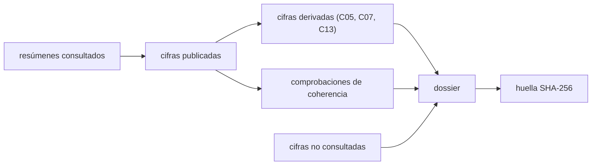

# B28-C20 — Caso de estudio de evento combinado

<!-- nav:top -->
[🏠 Programa](../../../../README.md) · [📚 Bloque B28](../../../tronco-comun/B28-astronomia-multimensajero.md) · [← Anterior: B28-C19 — Limitaciones y sesgos de detección](../B28-C19-limitaciones-y-sesgos-de-deteccion/CLASE.md) · [Siguiente: B28-C21 — Formas de onda gravitacionales y filtro acoplado →](../B28-C21-formas-de-onda-gravitacionales-y-filtro-acoplado/CLASE.md)
<!-- /nav -->

## 1. Ubicación, nivel y alcance

Clase 20 del bloque B28. Nivel N3. Esta clase reúne lo aprendido en un **dossier** de un evento observado con dos mensajeros: la fusión de estrellas de neutrones GW170817 y el destello gamma GRB 170817A. Construyes una cronología con las cifras publicadas en los resúmenes consultados, compruebas su **coherencia aritmética**, calculas las **magnitudes derivadas** con las fórmulas de las clases anteriores y dejas explícito **qué no se consultó**. Usas las clases [B28-C05](../B28-C05-ondas-gravitacionales/CLASE.md), [B28-C07](../B28-C07-fuentes-compactas-binarias/CLASE.md), [B28-C11](../B28-C11-coincidencias-entre-observatorios/CLASE.md), [B28-C13](../B28-C13-estadistica-de-significancia/CLASE.md) y [B28-C17](../B28-C17-archivos-de-eventos-multimensajero/CLASE.md). Se trabaja solo con resúmenes de artículos.

## 2. Por qué esta clase existe

Un caso de estudio sirve si es verificable: cada cifra debe llevar su fuente, y lo calculado debe distinguirse de lo publicado. La decisión central: **¿qué cifras del evento están respaldadas por lo consultado, cuáles se derivan y cuáles quedan fuera?**

## 3. Lo que podrás hacer al terminar

1. Ordenar la cronología de un evento con sus fuentes.
2. Comprobar la coherencia entre marcas de tiempo y retardo citado.
3. Comprobar que las masas son compatibles con el rango de componentes.
4. Calcular el tiempo de viaje, la cota de velocidad, la masa de chirrido, la frecuencia ISCO y la deformación.
5. Traducir la probabilidad fortuita a sigmas.
6. Registrar con huella lo consultado y lo excluido.

La evidencia es el **dossier de un evento combinado** del ejercicio 12 (sección 20).

## 4. Con qué llegas y cómo comprobarlo

1. ¿Qué es una cota?
2. ¿Qué es la masa de chirrido?
3. ¿Qué es una huella SHA-256?
4. ¿Qué significa «solo resumen»?
5. ¿Qué es una cifra derivada?

<details>
<summary>Ver respuestas</summary>

1. Un límite que no es una medición. 2. `M_c = (m₁m₂)^{3/5}/(m₁+m₂)^{1/5}`. 3. Un resumen de 256 bits. 4. Que el contenido citado proviene del resumen, no del artículo. 5. Una cifra calculada desde otras.
</details>

Con cuatro o cinco aciertos, sigue; si no, repasa B28-C07, C11 y C17.

## 5. El caso real: GW170817 y GRB 170817A

El 17 de agosto de 2017, a las `12:41:04 UTC`, la red de detectores de ondas gravitacionales registró la fusión; el destello gamma se disparó a las `12:41:06 UTC`, unos `1,7 s` después (S1, S2). La fuente se localizó inicialmente en `31 grados cuadrados`, a `40 (+8, −8) Mpc`, con masas de componentes entre `0,86` y `2,26 M☉` (S1) y una masa total de `2,74 M☉` (S4). El retardo se midió en `1,74 ± 0,05 s` y la probabilidad de coincidencia fortuita fue de `5 × 10⁻⁸` (S3). Es el **ejemplo conductor**.

## 6. Vocabulario

El **dossier** reúne cifras, fuentes y derivaciones. La **cifra publicada** viene de una fuente consultada. La **cifra derivada** se calcula aquí. La **coherencia** exige que las cifras no se contradigan. La **cifra excluida** no se consultó. La **huella** garantiza la integridad del dossier.

## 7. Modelo mental: un expediente con anexos

Cada afirmación del expediente lleva un anexo con su fuente; si no hay anexo, no entra. Lo calculado se distingue con un sello de «derivado».



*Descripción textual:* los resúmenes dan cifras publicadas; se comprueba su coherencia y se calculan magnitudes derivadas; el dossier incluye la lista de lo no consultado y se firma con una huella.

Analogía: un expediente con anexos. Límite: los resúmenes no contienen todo el detalle del artículo.

## 8. La explicación, paso a paso

### 8.1 Coherencia temporal

Las marcas de tiempo (resolución de `1 s`) dan `12:41:04` y `12:41:06`, es decir `2 s`; el retardo citado es `1,74 ± 0,05 s`. La diferencia de `0,26 s` es coherente con la resolución de la marca.

### 8.2 Coherencia de masas

`2 × 0,86 = 1,72 < 2,74 < 4,52 = 2 × 2,26`: la masa total es compatible con el rango de componentes.

### 8.3 Cifras publicadas y derivadas

| magnitud | valor | fuente |
|---|---|---|
| tiempo de la fusión (UTC) | `2017-08-17T12:41:04Z` | S1 |
| destello gamma tras la fusión | `~1,7 s`; `1,74 ± 0,05 s` | S1, S3 |
| localización inicial | `31 grados cuadrados` (`7,5 × 10⁻⁴` del cielo) | S1 |
| distancia | `40 (+8, −8) Mpc` | S1 |
| masa total | `2,74 M☉`; componentes `0,86`–`2,26 M☉` | S1, S4 |
| probabilidad fortuita | `5 × 10⁻⁸` (`5,327σ`, una cola) | S3 |
| tiempo de viaje de la luz (derivado) | `4,1171 × 10¹⁵ s = 130,5 Ma` | cálculo |
| cota `|v_g − c|/c` (derivada) | `4,23 × 10⁻¹⁶` | cálculo |
| masa de chirrido, masas iguales (derivada, ilustrativa) | `1,1927 M☉` | cálculo |
| frecuencia ISCO (derivada, ilustrativa) | `1604,8 Hz` | cálculo |
| deformación a 100 Hz (derivada, ilustrativa) | `8,587 × 10⁻²³` | cálculo |
| tiempo restante desde 30 Hz (derivado, ilustrativo) | `55,5 s` | cálculo |

### 8.4 Lo que no se consultó

Corrimiento al rojo, curva de luz de la kilonova y constante de Hubble. El dossier los lista como excluidos.

### 8.5 La huella

La huella SHA-256 del dossier empieza por `032988a045c269cc`; es estable al reserializar el mismo contenido.

## 9. Magnitudes, símbolos y unidades

| Símbolo | Qué es | Unidad | Valor / nota |
|---|---|---|---|
| `t_GW` | tiempo de la fusión | UTC | `12:41:04` |
| `Δt` | retardo | s | `1,74 ± 0,05` |
| `A` | área de localización | deg² | 31 |
| `d` | distancia | Mpc | 40 (+8, −8) |
| `M_tot` | masa total | `M☉` | 2,74 |
| `p` | probabilidad fortuita | — | `5 × 10⁻⁸` |

## 10. Convenciones y referencias

Una cola; masas iguales de `1,37 M☉` solo para las magnitudes derivadas (**ilustrativas**); las cifras publicadas se toman de los resúmenes y se rotulan con su fuente.

## 11. De dónde sale lo que afirmamos

| ID | Fuente | Localizador | Respalda | Estado |
|---|---|---|---|---|
| S1 | LIGO Scientific, Virgo y colaboraciones, arXiv:1710.05833 | https://arxiv.org/abs/1710.05833 | fusión a las `12:41:04 UTC`; ~1,7 s; `31 grados²`; `40 (+8, −8) Mpc`; `0,86`–`2,26 M☉` | Solo resumen, consultado el 2026-11-09 |
| S2 | Goldstein et al., arXiv:1710.05446 | https://arxiv.org/abs/1710.05446 | disparo del destello a las `12:41:06 UTC` | Solo resumen, consultado el 2026-11-09 |
| S3 | LIGO, Virgo, Fermi e INTEGRAL, arXiv:1710.05834 | https://arxiv.org/abs/1710.05834 | `1,74 ± 0,05 s`; probabilidad fortuita `5 × 10⁻⁸` | Solo resumen, consultado el 2026-11-09 |
| S4 | LIGO Scientific y Virgo, arXiv:1710.05832 | https://arxiv.org/abs/1710.05832 | masa total `2,74 M☉` | Solo resumen, consultado el 2026-11-09 |
| S5 | NIST (`G`, `c`), UAI 2015 B3 (`GM_☉`) e IERS TN36 (`au`) | https://physics.nist.gov/cuu/Constants/Table/allascii.txt | constantes de las derivaciones | Consultadas el 2026-11-09 |

Límites: S1–S4 solo resumen; no se consultaron los artículos completos; el dossier excluye el corrimiento al rojo, la curva de luz y la constante de Hubble.

## 12. Cómo ver el dossier

| Tipo | Cantidad de filas |
|---|---|
| publicadas | 6 |
| derivadas | 6 |
| excluidas | 3 |

Descripción larga: la mitad de las filas del dossier son cifras publicadas y la otra mitad, cálculos propios; las excluidas se listan aparte.

## 13. Ejemplo trabajado: la cota de velocidad

**Paso 1 · Datos.** `Δt = 1,74 s`; `d = 40 Mpc = 1,2343 × 10²⁴ m`.

**Paso 2 · Tiempo de viaje.** `d/c = 4,1171 × 10¹⁵ s`.

**Paso 3 · Cociente.** `1,74/4,1171 × 10¹⁵ = 4,23 × 10⁻¹⁶`.

**Paso 4 · Sentido.** Es una cota superior, bajo el supuesto de que no hubo retraso intrínseco.

## 14. Distintas formas de describir el caso

**Por cronología:** marcas y retardos. **Por significancia:** `p` y `σ`. **Por física:** masa, frecuencia, deformación. **Por integridad:** huella y exclusiones.

## 15. Práctica guiada

**Ejercicio 1 · con los pasos indicados.** Diferencia entre las marcas de tiempo. *Pasos:* `12:41:06 − 12:41:04`.

<details><summary>Solución comentada</summary>

`2 s`.
</details>

**Ejercicio 2 · con una pista.** Tiempo de viaje de la luz desde `40 Mpc` en Ma.

<details><summary>Solución comentada</summary>

`130,5 Ma`.
</details>

**Ejercicio 3 · casi autónomo.** `σ` de `p = 5 × 10⁻⁸`.

<details><summary>Solución comentada</summary>

`5,327σ`.
</details>

## 16. Práctica autónoma, transferencia e integrador

**Ejercicio 4.** Fracción del cielo de `31 deg²`.

<details><summary>Solución comentada</summary>

`7,5 × 10⁻⁴`.
</details>

**Ejercicio 5.** Cota con `1,74 + 0,05 s`.

<details><summary>Solución comentada</summary>

`4,35 × 10⁻¹⁶`.
</details>

**Ejercicio 6.** ¿Es compatible `m₁ = 2,3 M☉` con el rango de componentes?

<details><summary>Solución comentada</summary>

No: supera `2,26 M☉`.
</details>

**Ejercicio 7.** Frecuencia ISCO si la masa total fuera `5,48 M☉` (el doble).

<details><summary>Solución comentada</summary>

La mitad: `802,4 Hz`.
</details>

**Ejercicio 8.** Cuántas cifras publicadas y cuántas derivadas hay en la tabla de 8.3.

<details><summary>Solución comentada</summary>

6 y 6.
</details>

**Ejercicio 9 · transferencia.** Un compañero dice que el dossier prueba el valor de la constante de Hubble. Responde con 8.4.

<details><summary>Solución comentada</summary>

La constante de Hubble está excluida: no se consultó y no se calcula.
</details>

**Ejercicio 10 · transferencia.** ¿Por qué se rotulan las masas iguales como ilustrativas?

<details><summary>Solución comentada</summary>

Porque las masas individuales publicadas son un rango (0,86–2,26 M☉); el valor de `1,37 M☉` es una elección para calcular.
</details>

**Ejercicio 11 · transferencia.** ¿Qué valida comparar marcas de tiempo y retardo citado?

<details><summary>Solución comentada</summary>

Que no hay contradicción dentro de la resolución de la marca; no que el retardo sea exacto.
</details>

**Ejercicio 12 · integrador.** Elabora tu *dossier de un evento combinado*: cronología, coherencias, tabla de publicadas y derivadas, exclusiones y huella.

<details><summary>Solución modelo</summary>

Secciones 8.1–8.5.
</details>

## 17. Laboratorio: dossier

El script [dossier.py](dossier.py) construye el dossier, comprueba las coherencias, calcula las magnitudes derivadas y sella el resultado con una huella SHA-256.

**Datos:** constantes de NIST/UAI/IERS; cifras del evento de S1–S4 (resúmenes); masas iguales **ilustrativas**. **Predice antes de ejecutar:** ¿qué cota sale? (≈`4 × 10⁻¹⁶`.) **Ejecución del 2026-11-09 (Python 3.12.9):**

```text
Python 3.12.9 (biblioteca estandar)
marcas de tiempo (resolucion de 1 s): GW 12:41:04, GRB 12:41:06 -> 2 s ; retardo citado = 1.74 +/- 0.05 s ; diferencia = 0.26 s
magnitud                                                 valor                                             fuente
tiempo de la fusion (UTC)                                2017-08-17T12:41:04Z                              S1
destello gamma tras la fusion                            ~1.7 s ; 1.74 +/- 0.05 s                          S1, S3
localizacion inicial                                     31 grados cuadrados (7.5e-4 del cielo)            S1
distancia                                                40 (+8, -8) Mpc                                   S1
masa total                                               2.74 Msol ; componentes 0.86-2.26 Msol            S1, S4
probabilidad fortuita                                    5e-8 (5.327 sigma, una cola)                      S3
tiempo de viaje de la luz (derivado)                     4.1171e+15 s = 130.5 Ma                           calculo
cota |v_g - c|/c (derivada)                              4.23e-16                                          calculo
masa de chirrido, masas iguales (derivada, ilustrativa)  1.1927 Msol                                       calculo
frecuencia ISCO (derivada, ilustrativa)                  1604.8 Hz                                         calculo
deformacion a 100 Hz (derivada, ilustrativa)             8.587e-23                                         calculo
tiempo restante desde 30 Hz (derivado, ilustrativo)      55.5 s                                            calculo
huella SHA-256 del dossier: 032988a045c269cc... ; cifras no consultadas y excluidas: corrimiento al rojo, curva de luz de la kilonova, constante de Hubble
Pruebas superadas.
```

```bash
python programa/clases/B28/B28-C20-caso-de-estudio-de-evento-combinado/dossier.py
```

**Límites:** solo resúmenes; orden de cuadrupolo; masas iguales para las magnitudes derivadas.

## 18. Errores frecuentes y cómo corregirlos

**Mezclar publicado y derivado.** Se corrige con la sección 6.

**Atribuir una cifra a una fuente no consultada.** Se corrige con la sección 11.

**Tomar la cota por una medición.** Se corrige con el ejemplo 13.

**Olvidar las exclusiones.** Se corrige con 8.4.

**Confundir masa total y de chirrido.** Se corrige con B28-C05.

## 19. Cómo sabrás que vas bien

Tras 8.1: ¿por qué coinciden `2 s` y `1,74 s`? Ejercicio 11. Tras 8.3: ¿qué es derivado? Ejercicio 8. Tras el laboratorio: ¿qué asegura la huella? (la integridad del dossier).

## 20. Qué entregas y cómo se evalúa

El producto es tu **dossier de un evento combinado** (ejercicio 12).

| Criterio | Inicial | En desarrollo | Logrado | Destacado |
|---|---|---|---|---|
| Conceptos | Los confunde | Parciales | Publicado, derivado, excluido | Explica los límites de un resumen |
| Cálculo | Sin unidades | Con errores | Tabla completa | Comprueba coherencias |
| Numérico | Sin comprobar | Un caso | Coherencias y huella | Interpreta la resolución temporal |
| Fuentes | Sin fuente | Sin fecha | S1–S5 con fecha | Declara S1–S4 como resumen |
| Límites | No los nombra | Uno | Tres | Discute qué falta del artículo |

**Condiciones críticas (no se compensan con promedio):** distinguir publicado de derivado; no usar cifras no consultadas; citar solo lo consultado.

## 21. Ética, seguridad y límites

Clase educativa: no es un análisis de datos del evento. Accesibilidad: tablas equivalentes a las gráficas, fórmulas en texto, ejercicios sin conexión.

## 22. Para cerrar y seguir

Un dossier honesto separa lo publicado, lo derivado y lo excluido, comprueba su coherencia y se firma con una huella. Queda una pregunta: ¿cómo se buscan las señales débiles con plantillas y cómo se combinan los mensajeros en una sola inferencia?

**Glosario español–inglés.** dossier · *event dossier*; cifra derivada · *derived quantity*; coherencia · *consistency check*; cifra excluida · *excluded quantity*; huella · *hash*; cronología · *timeline*.

**Continuidad.** [B28-C21](../B28-C21-formas-de-onda-gravitacionales-y-filtro-acoplado/CLASE.md) estudia las formas de onda y el filtro acoplado.

**Referencias:** ver sección 11.

<!-- nav:bottom -->
---

[← Anterior: B28-C19 — Limitaciones y sesgos de detección](../B28-C19-limitaciones-y-sesgos-de-deteccion/CLASE.md) · [📚 Bloque B28](../../../tronco-comun/B28-astronomia-multimensajero.md) · [Siguiente: B28-C21 — Formas de onda gravitacionales y filtro acoplado →](../B28-C21-formas-de-onda-gravitacionales-y-filtro-acoplado/CLASE.md)
<!-- /nav -->
