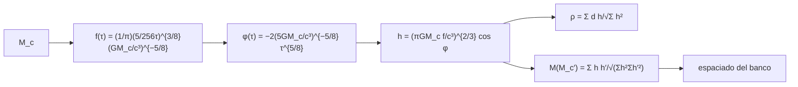

# B28-C21 — Formas de onda gravitacionales y filtro acoplado

<!-- nav:top -->
[🏠 Programa](../../../../README.md) · [📚 Bloque B28](../../../tronco-comun/B28-astronomia-multimensajero.md) · [← Anterior: B28-C20 — Caso de estudio de evento combinado](../B28-C20-caso-de-estudio-de-evento-combinado/CLASE.md) · [Siguiente: B28-C22 — Inferencia bayesiana conjunta de parámetros de fuente multimensajero →](../B28-C22-inferencia-bayesiana-conjunta-de-parametros-de-fuente-multimensajero/CLASE.md)
<!-- /nav -->

## 1. Ubicación, nivel y alcance

Clase 21 del bloque B28 (ampliación). Nivel N3. Las ondas gravitacionales de una binaria ([B28-C05](../B28-C05-ondas-gravitacionales/CLASE.md)) son tan débiles que solo se detectan comparando los datos con **plantillas**. Aquí escribes la **forma de onda newtoniana** de un chirrido, aplicas el **filtro acoplado** en ruido blanco y estudias el **desajuste** al cambiar la masa de chirrido, lo que fija el espaciado de un banco de plantillas. Usas la masa de chirrido de [B27-C13](../../B27/B27-C13-binarias-compactas/CLASE.md), el filtro de [B28-C14](../B28-C14-ruidos-instrumentales/CLASE.md) y la significancia de [B28-C13](../B28-C13-estadistica-de-significancia/CLASE.md). Los datos son sintéticos y el tiempo de coalescencia se supone conocido.

## 2. Por qué esta clase existe

Una plantilla ligeramente errada pierde mucha señal-ruido, porque la fase acumula miles de ciclos. Entender cuánto determina cuántas plantillas hacen falta. La decisión central: **¿qué relación señal-ruido recupera el filtro y con qué precisión hay que conocer la masa de chirrido?**

## 3. Lo que podrás hacer al terminar

1. Escribir la frecuencia `f(τ)` y la fase `φ(τ)` de un chirrido newtoniano.
2. Verificar la frecuencia con la derivada numérica de la fase.
3. Aplicar el filtro acoplado `ρ = Σ d h/√Σ h²`.
4. Verificar por Monte Carlo la media y la desviación del filtro.
5. Calcular el desajuste `M = Σ h h'/√(Σ h² Σ h'²)`.
6. Estimar el espaciado de un banco para `M ≥ 0,97`.

La evidencia es la **ficha de filtro acoplado** del ejercicio 12 (sección 20).

## 4. Con qué llegas y cómo comprobarlo

1. ¿Qué es una fase acumulada?
2. ¿Qué es un producto escalar de series?
3. ¿Qué es el ruido blanco gaussiano?
4. ¿Qué es la masa de chirrido?
5. ¿Qué es un banco de plantillas?

<details>
<summary>Ver respuestas</summary>

1. La integral de la frecuencia angular. 2. `Σ aᵢbᵢ`. 3. Ruido independiente en cada muestra. 4. `M_c = (m₁m₂)^{3/5}/(m₁+m₂)^{1/5}`. 5. Un conjunto de plantillas que cubre los parámetros.
</details>

Con cuatro o cinco aciertos, sigue; si no, repasa B28-C05 y B28-C14.

## 5. Un caso real y un caso sintético

GW150914 se detectó con una relación señal-ruido de `24` (S2, resumen). Esta clase no reproduce su análisis: usa un chirrido sintético con `M_c = 10 M☉`, desde `30 Hz` (`τ = 1,6042 s` antes de la coalescencia), muestreo de `2048 Hz`, ruido blanco de varianza unitaria y una amplitud para `ρ = 10`. Es el **ejemplo conductor**.

## 6. Vocabulario

El **chirrido** es el aumento conjunto de frecuencia y amplitud. La **plantilla** es la forma de onda modelada. El **filtro acoplado** correlaciona los datos con la plantilla. El **desajuste** `M` mide el parecido entre dos plantillas. El **banco** es el conjunto de plantillas. `τ = t_c − t`.

## 7. Modelo mental: buscar una cerradura con muchas llaves

La señal es una cerradura de miles de ciclos; solo una llave encaja bien. Una llave casi igual pierde la mitad del ajuste, así que el banco debe tener llaves muy próximas.



*Descripción textual:* la masa de chirrido da la frecuencia y la fase, de ahí la forma de onda; el filtro acoplado la correlaciona con los datos y el desajuste con plantillas vecinas fija el banco.

Analogía: muchas llaves, una cerradura. Límite: se asume que se conoce el tiempo de coalescencia.

## 8. La explicación, paso a paso

### 8.1 La frecuencia

`f(τ) = (1/π)(5/(256τ))^{3/8}(GM_c/c³)^{−5/8}`. La derivada numérica de la fase coincide con la fórmula a `10⁻³`: `35,817 Hz` (`τ = 1 s`), `56,256 Hz` (`0,3 s`) y `110,149 Hz` (`0,05 s`).

### 8.2 La plantilla

De `30` a `400 Hz`: `3285` muestras, con la norma `1,5723`. La amplitud para `ρ = 10` es `6,3601`.

### 8.3 El filtro

En `200` realizaciones con la señal: media `9,984` y desviación `1,028` (esperadas `10` y `1`). Con solo ruido: media `0,015` y desviación `1,056`.

### 8.4 El desajuste

| `M_c′/M_c` | desajuste `M` | SNR recuperada |
|---|---|---|
| 0,970 | 0,0254 | 0,254 |
| 0,990 | 0,1321 | 1,321 |
| 0,995 | 0,6980 | 6,980 |
| 1,000 | 1,0000 | 10,000 |
| 1,005 | 0,7029 | 7,029 |
| 1,010 | 0,1563 | 1,563 |
| 1,030 | 0,0947 | 0,947 |

### 8.5 El espaciado del banco

Para `M ≥ 0,97` (pérdida del 3 % de la señal-ruido) con el tiempo de coalescencia fijo, la masa de chirrido debe conocerse con `0,15 %`: el banco necesita plantillas muy próximas.

## 9. Magnitudes, símbolos y unidades

| Símbolo | Qué es | Unidad | Valor / nota |
|---|---|---|---|
| `M_c` | masa de chirrido | `M☉` | 10 (ilustrativa) |
| `f_s` | muestreo | Hz | 2048 |
| `f_low`, `f_high` | banda | Hz | 30; 400 |
| `τ` | tiempo hasta la coalescencia | s | 1,6042 (a 30 Hz) |
| `ρ` | relación señal-ruido | — | 10 (objetivo) |
| `M` | desajuste | — | ver 8.4 |

## 10. Convenciones y referencias

Orden newtoniano; circular; de frente; ruido blanco; tiempo de coalescencia fijo; todos los parámetros son **ilustrativos**; semilla `20261109`.

## 11. De dónde sale lo que afirmamos

| ID | Fuente | Localizador | Respalda | Estado |
|---|---|---|---|---|
| S1 | NIST (`G`, `c`) y UAI 2015 B3 (`GM_☉`) | https://physics.nist.gov/cuu/Constants/Table/allascii.txt ; https://arxiv.org/abs/1510.07674 | constantes | Consultadas el 2026-11-09 |
| S2 | LIGO Scientific y Virgo, GW150914, arXiv:1602.03837 | https://arxiv.org/abs/1602.03837 | detección con filtro acoplado de SNR `24` | Solo resumen, consultado el 2026-11-09 |
| S3 | Cálculo propio: chirrido newtoniano y filtro | implementado en `filtro_acoplado.py` | tablas de 8.1–8.5 | Verificado con la derivada de la fase y por Monte Carlo |

Límites: S2 solo resumen; las fórmulas del chirrido y del filtro son estándar y no se consultó su fuente; no hay efectos post-newtonianos ni búsqueda en el tiempo de coalescencia.

## 12. Cómo ver la pérdida

| error en `M_c` | SNR recuperada (de 10) |
|---|---|
| 0,5 % | 7,0 |
| 1 % | 1,4–1,6 |
| 3 % | 0,9–0,3 |

Descripción larga: con un error de pocas décimas de por ciento ya se pierde un tercio de la señal-ruido, y con un 1 % casi toda.

## 13. Ejemplo trabajado: frecuencia a 1 s

**Paso 1 · Datos.** `GM_c/c³ = 4,93 × 10⁻⁵ s`.

**Paso 2 · Fórmula.** `f = (1/π)(5/256)^{3/8}(4,93 × 10⁻⁵)^{−5/8}`.

**Paso 3 · Resultado.** `35,8 Hz`.

**Paso 4 · Sentido.** A 1 s de la coalescencia la señal ya sube de los 30 Hz iniciales.

## 14. Distintas formas de describir el filtro

**Por correlación:** `Σ d h`. **Por SNR:** `ρ`. **Por desajuste:** `M`. **Por banco:** espaciado.

## 15. Práctica guiada

**Ejercicio 1 · con los pasos indicados.** SNR recuperada con `M = 0,7`. *Pasos:* `ρ M`.

<details><summary>Solución comentada</summary>

`7,0`.
</details>

**Ejercicio 2 · con una pista.** Norma de la plantilla.

<details><summary>Solución comentada</summary>

`1,5723`.
</details>

**Ejercicio 3 · casi autónomo.** Amplitud para `ρ = 20`.

<details><summary>Solución comentada</summary>

`20/1,5723 = 12,72`.
</details>

## 16. Práctica autónoma, transferencia e integrador

**Ejercicio 4.** `ρ` esperado con amplitud `3,18`.

<details><summary>Solución comentada</summary>

`3,18 × 1,5723 = 5,0`.
</details>

**Ejercicio 5.** Desviación de la salida del filtro con solo ruido.

<details><summary>Solución comentada</summary>

`1` (`1,056` medido con 200 realizaciones).
</details>

**Ejercicio 6.** Error de la media del filtro con 200 realizaciones.

<details><summary>Solución comentada</summary>

`1,028/√200 = 0,073`.
</details>

**Ejercicio 7.** SNR recuperada con `M_c′/M_c = 0,995`.

<details><summary>Solución comentada</summary>

`6,98`.
</details>

**Ejercicio 8.** Espaciado relativo del banco para `M ≥ 0,97`.

<details><summary>Solución comentada</summary>

`0,15 %`.
</details>

**Ejercicio 9 · transferencia.** Un compañero dice que una plantilla con 1 % de error en la masa recupera casi toda la señal. Responde con 8.4.

<details><summary>Solución comentada</summary>

Recupera solo `1,3`–`1,6` de `10`: el desajuste es `0,13`–`0,16`.
</details>

**Ejercicio 10 · transferencia.** ¿Por qué el desajuste cae tan deprisa?

<details><summary>Solución comentada</summary>

Porque la fase acumula miles de ciclos y un pequeño error de `M_c` desfasa la plantilla (8.5).
</details>

**Ejercicio 11 · transferencia.** ¿Qué prueba la desviación `1` del filtro con solo ruido?

<details><summary>Solución comentada</summary>

Que la normalización de la plantilla es correcta; no la estadística de un detector real.
</details>

**Ejercicio 12 · integrador.** Elabora tu *ficha de filtro acoplado*: la plantilla, la verificación de la frecuencia, el filtro con y sin señal, la tabla de desajuste y el espaciado del banco.

<details><summary>Solución modelo</summary>

Secciones 8.1–8.5.
</details>

## 17. Laboratorio: chirrido y filtro

El script [filtro_acoplado.py](filtro_acoplado.py) construye el chirrido, verifica la frecuencia (**comprueba** `10⁻³`), aplica el filtro (**comprueba** media y desviación) y calcula el desajuste.

**Datos:** `G`, `c`, `GM_☉` de NIST y UAI; todo lo demás **ilustrativo** con semilla fija. **Predice antes de ejecutar:** ¿qué SNR recupera una plantilla con 1 % de error? (poco.) **Ejecución del 2026-11-09 (Python 3.12.9):**

```text
Python 3.12.9 (biblioteca estandar)
Mc = 10 Msol: tau(30 Hz) = 1.6042 s ; muestras = 3285 ; f(tau final) = 551.4 Hz
tau =  1.00 s: f formula =   35.817 Hz ; derivada numerica de la fase =   35.817 Hz
tau =  0.30 s: f formula =   56.256 Hz ; derivada numerica de la fase =   56.256 Hz
tau =  0.05 s: f formula =  110.149 Hz ; derivada numerica de la fase =  110.149 Hz
norma de la plantilla = 1.5723 ; amplitud para rho = 10.0: 6.3601
filtro acoplado con la plantilla exacta, 200 realizaciones: media = 9.984 (esperada 10.0) ; desviacion = 1.028 (esperada 1)
solo ruido: media = 0.015 ; desviacion = 1.056
  Mc/Mc0  desajuste M  SNR recuperada
   0.970       0.0254           0.254
   0.990       0.1321           1.321
   0.995       0.6980           6.980
   1.000       1.0000          10.000
   1.005       0.7029           7.029
   1.010       0.1563           1.563
   1.030       0.0947           0.947
desajuste 0.97 (perdida de SNR del 3 %) para Mc'/Mc = 1.0015 (espaciado relativo ~ 0.15 %) con el tiempo de coalescencia fijo
Pruebas superadas.
```

```bash
python programa/clases/B28/B28-C21-formas-de-onda-gravitacionales-y-filtro-acoplado/filtro_acoplado.py
```

**Límites:** ruido blanco, orden newtoniano, tiempo de coalescencia conocido, sin espines.

## 18. Errores frecuentes y cómo corregirlos

**Normalizar mal la plantilla.** Se corrige con el ejercicio 11.

**Creer que 1 % de error es pequeño.** Se corrige con el ejercicio 9.

**Olvidar la búsqueda en tiempo.** Se corrige con la sección 10.

**Confundir `M_c` con la masa total.** Se corrige con B28-C05.

**Tomar el chirrido sintético por real.** Se corrige con la sección 5.

## 19. Cómo sabrás que vas bien

Tras 8.1: ¿qué comprueba la derivada de la fase? Si dudas, ejercicio 11. Tras 8.4: ¿cómo cae `M`? Ejercicio 10. Tras el laboratorio: ¿qué valida? (la normalización y la fórmula de la frecuencia).

## 20. Qué entregas y cómo se evalúa

El producto es tu **ficha de filtro acoplado** (ejercicio 12).

| Criterio | Inicial | En desarrollo | Logrado | Destacado |
|---|---|---|---|---|
| Conceptos | Los confunde | Parciales | Plantilla, filtro, desajuste | Explica la sensibilidad de la fase |
| Cálculo | Sin unidades | Con errores | Tablas completas | Calcula el banco |
| Numérico | Sin comprobar | Un caso | Fase y Monte Carlo | Interpreta tolerancias |
| Fuentes | Sin fuente | Sin fecha | S1–S3 con fecha | Declara S2 como resumen |
| Límites | No los nombra | Uno | Tres | Discute la búsqueda en tiempo |

**Condiciones críticas (no se compensan con promedio):** rotular todo como ilustrativo; no presentar el banco como el de un detector; citar solo lo consultado.

## 21. Ética, seguridad y límites

Clase educativa: no es una canalización de búsqueda. Accesibilidad: tablas equivalentes a las gráficas, fórmulas en texto, ejercicios sin conexión.

## 22. Para cerrar y seguir

El filtro acoplado recupera `ρ = 10` con desviación unitaria si la plantilla es exacta, pero un error de `0,5 %` en la masa de chirrido ya pierde casi un tercio: el banco necesita un espaciado del `0,15 %`. Queda una última pregunta: ¿cómo se combinan en una sola inferencia las medidas de distintos mensajeros?

**Glosario español–inglés.** filtro acoplado · *matched filter*; plantilla · *template*; chirrido · *chirp*; desajuste · *mismatch*; banco de plantillas · *template bank*; fase acumulada · *accumulated phase*.

**Continuidad.** [B28-C22](../B28-C22-inferencia-bayesiana-conjunta-de-parametros-de-fuente-multimensajero/CLASE.md) estudia la inferencia bayesiana conjunta.

**Referencias:** ver sección 11.

<!-- nav:bottom -->
---

[← Anterior: B28-C20 — Caso de estudio de evento combinado](../B28-C20-caso-de-estudio-de-evento-combinado/CLASE.md) · [📚 Bloque B28](../../../tronco-comun/B28-astronomia-multimensajero.md) · [Siguiente: B28-C22 — Inferencia bayesiana conjunta de parámetros de fuente multimensajero →](../B28-C22-inferencia-bayesiana-conjunta-de-parametros-de-fuente-multimensajero/CLASE.md)
<!-- /nav -->
