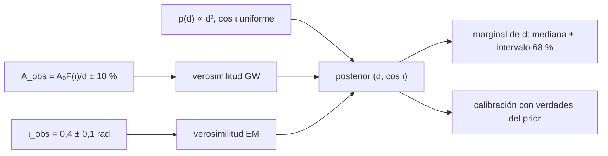

# B28-C22 — Inferencia bayesiana conjunta de parámetros de fuente multimensajero

<!-- nav:top -->
[🏠 Programa](../../../../README.md) · [📚 Bloque B28](../../../tronco-comun/B28-astronomia-multimensajero.md) · [← Anterior: B28-C21 — Formas de onda gravitacionales y filtro acoplado](../B28-C21-formas-de-onda-gravitacionales-y-filtro-acoplado/CLASE.md) · [Siguiente: B29-C01 — Tránsitos planetarios →](../../../tronco-comun/B29-astronomia-temporal-y-exoplanetas.md#b29-c01)
<!-- /nav -->

## 1. Ubicación, nivel y alcance

Clase 22 del bloque B28, la última (ampliación `0.2.0`). Nivel N3. La amplitud de una onda gravitacional depende de la distancia y de la inclinación del plano orbital: ambas son **degeneradas**. Una medida electromagnética de la inclinación rompe esa degeneración y estrecha la distancia, que es la base de las «sirenas estándar». Aquí construyes el **posterior conjunto** de distancia e inclinación sobre una rejilla, comparas la inferencia con y sin la medida electromagnética, compruebas la **convergencia** de la rejilla y la **calibración** por simulación. Usas probabilidad bayesiana ([B12](../../../tronco-comun/B12-probabilidad-estadistica-e-incertidumbre.md)), la amplitud de [B28-C05](../B28-C05-ondas-gravitacionales/CLASE.md) y la coincidencia de [B28-C11](../B28-C11-coincidencias-entre-observatorios/CLASE.md). Todos los números son sintéticos y no se usa ninguna constante de Hubble.

## 2. Por qué esta clase existe

Un solo mensajero entrega una combinación de parámetros; dos mensajeros, si se combinan correctamente, entregan más que la suma. La decisión central: **¿cuánto se estrecha la distancia cuando se añade la inclinación electromagnética y está bien calibrada la inferencia?**

## 3. Lo que podrás hacer al terminar

1. Escribir el factor de inclinación `F(ι)` de la amplitud gravitacional.
2. Definir una verosimilitud gaussiana conjunta y los priors.
3. Calcular el posterior sobre una rejilla `(d, cos ι)`.
4. Obtener la mediana y el intervalo del 68 % de la distancia con y sin medida electromagnética.
5. Verificar la normalización y la convergencia de la rejilla.
6. Comprobar la calibración con verdades extraídas del prior.

La evidencia es la **ficha de inferencia conjunta** del ejercicio 12 (sección 20).

## 4. Con qué llegas y cómo comprobarlo

1. ¿Qué es un prior?
2. ¿Qué es una verosimilitud?
3. ¿Qué es un posterior marginal?
4. ¿Qué es un intervalo creíble?
5. ¿Qué es la calibración?

<details>
<summary>Ver respuestas</summary>

1. La distribución previa del parámetro. 2. La probabilidad de los datos dado el parámetro. 3. La distribución de un parámetro tras integrar los demás. 4. Un intervalo con probabilidad dada. 5. Que el intervalo del 68 % contenga la verdad el 68 % de las veces.
</details>

Con cuatro o cinco aciertos, sigue; si no, repasa B12.

## 5. Un caso real y un caso sintético

GW170817 se observó a `40 (+8, −8) Mpc` con una contrapartida identificada (S2, resumen) y su distancia permitió una medición de la constante de Hubble como sirena estándar (S3, resumen). Esta clase no usa ese resultado: con una verdad sintética de `d = 40 Mpc` e `ι = 0,4 rad`, errores del `10 %` en la amplitud y de `0,1 rad` en la inclinación, calcula cómo cambia la distancia inferida al añadir la medida electromagnética. Es el **ejemplo conductor**.

## 6. Vocabulario

La **degeneración distancia–inclinación** hace que una fuente lejana de frente y una cercana de canto den la misma amplitud. El **posterior** es el producto de verosimilitud y prior normalizado. El **prior de volumen** `p(d) ∝ d²`. La **calibración** exige cobertura nominal. Una **sirena estándar** da la distancia sin escalera de distancias.

## 7. Modelo mental: dos testigos de un mismo suceso

El primer testigo (la onda gravitacional) dice «la combinación `F(ι)/d` es esta»; el segundo (el telescopio) dice «la inclinación es esta». Juntos, fijan ambas.



*Descripción textual:* la amplitud gravitacional y la inclinación electromagnética alimentan sendas verosimilitudes que, con los priors, dan el posterior; su marginal en la distancia se resume y se calibra por simulación.

Analogía: dos testigos. Límite: errores gaussianos conocidos y sin otros parámetros.

## 8. La explicación, paso a paso

### 8.1 El factor de inclinación

`F(ι) = √(((1 + cos²ι)/2)² + cos²ι)/√2`: `F(0) = 1` (de frente) y `F(90°) = 0,3536` (de canto); el cociente es `2,828`, es decir, la distancia inferida puede variar casi tres veces por la inclinación.

### 8.2 Resultados

| inferencia | `d` (Mpc) | ancho relativo del 68 % |
|---|---|---|
| solo ondas gravitacionales | `36,5 (+7,5, −10,5)` | 24,6 % |
| ondas + inclinación electromagnética | `41,4 (+5,4, −4,2)` | 11,6 % |

Las medianas son idénticas con una rejilla de doble resolución.

### 8.3 Calibración

En `300` ensayos con verdades extraídas del prior: el intervalo del 68 % contiene la verdad el `66,7 %` de las veces con solo ondas gravitacionales y el `64,0 %` con la medida electromagnética (tolerancia `0,60`–`0,76`).

### 8.4 Mejora

El ancho mediano pasa de `31,5` a `15,8 Mpc`: una mejora de `2,00` veces.

### 8.5 Lectura

La degeneración domina la incertidumbre de la distancia con una sola señal; la inclinación electromagnética la rompe. La cobertura de `64,0 %` queda a 1,5 errores binomiales (`2,7 %`) del `68 %` nominal, sin evidencia de descalibración.

## 9. Magnitudes, símbolos y unidades

| Símbolo | Qué es | Unidad | Valor / nota |
|---|---|---|---|
| `d` | distancia | Mpc | 10–100 (rango del prior) |
| `ι` | inclinación | rad | 0–π/2 |
| `F(ι)` | factor de inclinación | — | 1 a 0,3536 |
| `σ_A` | error relativo de la amplitud | — | 0,10 (ilustrativo) |
| `σ_ι` | error de la inclinación | rad | 0,1 (ilustrativo) |
| rejilla | puntos | — | 300×300 y 600×600 |

## 10. Convenciones y referencias

`p(d) ∝ d²` en `[10, 100] Mpc`; `cos ι` uniforme en `[0, 1]`; errores gaussianos conocidos; semilla `20261109`; **todos** los números son sintéticos y no se usa la constante de Hubble.

## 11. De dónde sale lo que afirmamos

| ID | Fuente | Localizador | Respalda | Estado |
|---|---|---|---|---|
| S1 | Cálculo propio: posterior sobre rejilla y calibración | implementado en `inferencia.py` | todas las tablas | Verificado por normalización, doble rejilla y simulación |
| S2 | LIGO Scientific, Virgo y colaboraciones, arXiv:1710.05833 | https://arxiv.org/abs/1710.05833 | `40 (+8, −8) Mpc` | Solo resumen, consultado el 2026-11-09 |
| S3 | Abbott et al., arXiv:1710.05835 | https://arxiv.org/abs/1710.05835 | medición de la constante de Hubble como sirena estándar | Solo resumen, consultado el 2026-11-09 |

Límites: S2 y S3 solo resumen; no se usa ninguna cifra de S3; el modelo tiene solo dos parámetros; el factor `F(ι)` es el estándar para una binaria circular y no se consultó su fuente.

## 12. Cómo ver la mejora

| Inferencia | ancho mediano (Mpc) | cobertura del 68 % |
|---|---|---|
| solo GW | 31,5 | 66,7 % |
| GW + EM | 15,8 | 64,0 % |

Descripción larga: la medida electromagnética reduce a la mitad el ancho del intervalo sin perder calibración apreciable.

## 13. Ejemplo trabajado: degeneración

**Paso 1 · Datos.** Una fuente a `40 Mpc` con `ι = 0,4 rad`: `F = 0,9226`.

**Paso 2 · Amplitud.** `A ∝ F/d = 0,02307`.

**Paso 3 · Alternativa de canto.** Con `F = 0,3536` la misma amplitud implica `d = 0,3536/0,02307 = 15,3 Mpc`.

**Paso 4 · Sentido.** La amplitud sola no distingue `40 Mpc` casi de frente de `15,3 Mpc` de canto.

## 14. Distintas formas de describir la inferencia

**Por posterior conjunto:** `(d, cos ι)`. **Por marginal:** `d`. **Por intervalo:** mediana ± 68 %. **Por calibración:** cobertura.

## 15. Práctica guiada

**Ejercicio 1 · con los pasos indicados.** `F(0)`. *Pasos:* `√(1 + 1)/√2`.

<details><summary>Solución comentada</summary>

`1`.
</details>

**Ejercicio 2 · con una pista.** `F(90°)`. *Pista:* `cos = 0`.

<details><summary>Solución comentada</summary>

`√(0,25)/√2 = 0,3536`.
</details>

**Ejercicio 3 · casi autónomo.** Cociente de amplitudes de frente y de canto.

<details><summary>Solución comentada</summary>

`2,828`.
</details>

## 16. Práctica autónoma, transferencia e integrador

**Ejercicio 4.** Mejora del ancho mediano.

<details><summary>Solución comentada</summary>

`31,5/15,8 = 2,00`.
</details>

**Ejercicio 5.** Error binomial de una cobertura del 68 % con 300 ensayos.

<details><summary>Solución comentada</summary>

`√(0,68 × 0,32/300) = 0,027`.
</details>

**Ejercicio 6.** Desviaciones entre `64,0 %` y `68 %`.

<details><summary>Solución comentada</summary>

`4,0/2,7 = 1,5`.
</details>

**Ejercicio 7.** Ancho relativo del intervalo conjunto.

<details><summary>Solución comentada</summary>

`11,6 %`.
</details>

**Ejercicio 8.** Distancia equivalente a `40 Mpc` de frente si la fuente está de canto.

<details><summary>Solución comentada</summary>

`40 × 0,3536 = 14,1 Mpc`.
</details>

**Ejercicio 9 · transferencia.** Un compañero dice que la distancia a `41,4 Mpc` es la medición de la colaboración. Responde con la sección 10.

<details><summary>Solución comentada</summary>

Es un resultado de un modelo sintético con una verdad de `40 Mpc`; no es una medición ni usa los datos de la colaboración.
</details>

**Ejercicio 10 · transferencia.** ¿Por qué se extraen las verdades del prior para la calibración?

<details><summary>Solución comentada</summary>

Porque solo entonces la cobertura del intervalo creíble es exactamente la nominal.
</details>

**Ejercicio 11 · transferencia.** ¿Qué valida duplicar la rejilla?

<details><summary>Solución comentada</summary>

Que la mediana no depende de la resolución a más del 1 %; no que el modelo sea correcto.
</details>

**Ejercicio 12 · integrador.** Elabora tu *ficha de inferencia conjunta*: factor de inclinación, resultados con y sin la medida electromagnética, convergencia y calibración.

<details><summary>Solución modelo</summary>

Secciones 8.1–8.5.
</details>

## 17. Laboratorio: posterior conjunto

El script [inferencia.py](inferencia.py) calcula el posterior (**comprueba** normalización `10⁻¹²` y convergencia `1 %`) y la calibración en 300 ensayos (**comprueba** `0,60`–`0,76`).

**Datos:** sin constantes; todo **sintético** con semilla fija. **Predice antes de ejecutar:** ¿cuánto se estrecha el intervalo? (casi a la mitad.) **Ejecución del 2026-11-09 (Python 3.12.9):**

```text
Python 3.12.9 (biblioteca estandar)
F(0) = 1.0000 (de frente) ; F(90 grados) = 0.3536 (de canto) ; cociente de amplitudes = 2.828
solo ondas gravitacionales: d = 36.5 (+7.5, -10.5) Mpc ; intervalo 68 % de ancho relativo 24.6 % (rejilla doble: 36.5)
ondas gravitacionales + inclinacion electromagnetica: d = 41.4 (+5.4, -4.2) Mpc ; intervalo 68 % de ancho relativo 11.6 % (rejilla doble: 41.4)
calibracion solo GW: el intervalo central del 68 % contiene la verdad el 66.7 % de las veces (300 ensayos) ; ancho mediano = 31.5 Mpc
calibracion GW + EM: el intervalo central del 68 % contiene la verdad el 64.0 % de las veces (300 ensayos) ; ancho mediano = 15.8 Mpc
mejora del ancho mediano con la medida electromagnetica: 2.00 veces
Pruebas superadas.
```

```bash
python programa/clases/B28/B28-C22-inferencia-bayesiana-conjunta-de-parametros-de-fuente-multimensajero/inferencia.py
```

**Límites:** dos parámetros, errores gaussianos conocidos, sin correlaciones, sin la constante de Hubble.

## 18. Errores frecuentes y cómo corregirlos

**Ignorar el prior de volumen.** Se corrige con la sección 10.

**Confundir un resultado sintético con una medición.** Se corrige con el ejercicio 9.

**Sumar errores en vez de combinar verosimilitudes.** Se corrige con la sección 7.

**No verificar la rejilla.** Se corrige con el ejercicio 11.

**Esperar cobertura exacta sin extraer del prior.** Se corrige con el ejercicio 10.

## 19. Cómo sabrás que vas bien

Tras 8.1: ¿cuánto vale `F(90°)`? Si dudas, ejercicio 2. Tras 8.4: ¿cuánto mejora el ancho? Ejercicio 4. Tras el laboratorio: ¿qué valida la calibración? (la coherencia de la inferencia).

## 20. Qué entregas y cómo se evalúa

El producto es tu **ficha de inferencia conjunta** (ejercicio 12).

| Criterio | Inicial | En desarrollo | Logrado | Destacado |
|---|---|---|---|---|
| Conceptos | Los confunde | Parciales | Posterior, degeneración | Explica la sirena estándar |
| Cálculo | Sin unidades | Con errores | Tablas completas | Compara inferencias |
| Numérico | Sin comprobar | Un caso | Rejilla y calibración | Interpreta el error binomial |
| Fuentes | Sin fuente | Sin fecha | S1–S3 con fecha | Declara S2 y S3 como resumen |
| Límites | No los nombra | Uno | Tres | Discute más parámetros |

**Condiciones críticas (no se compensan con promedio):** rotular todo como sintético; no usar la constante de Hubble ni cifras no consultadas; citar solo lo consultado.

## 21. Ética, seguridad y límites

Clase educativa: no es una medición cosmológica. Accesibilidad: tablas equivalentes a las gráficas, fórmulas en texto, ejercicios sin conexión.

## 22. Para cerrar y seguir

La degeneración distancia–inclinación hace que una sola señal gravitacional deje una incertidumbre del `25 %`; la medida electromagnética la reduce al `12 %` sin perder calibración. Con esta clase se cierra el bloque B28; el siguiente es [B29](../../../tronco-comun/B29-astronomia-temporal-y-exoplanetas.md).

**Glosario español–inglés.** inferencia bayesiana · *Bayesian inference*; posterior · *posterior*; degeneración · *degeneracy*; sirena estándar · *standard siren*; intervalo creíble · *credible interval*; calibración · *calibration*.

**Continuidad.** Fin del bloque B28.

**Referencias:** ver sección 11.

<!-- nav:bottom -->
---

[← Anterior: B28-C21 — Formas de onda gravitacionales y filtro acoplado](../B28-C21-formas-de-onda-gravitacionales-y-filtro-acoplado/CLASE.md) · [📚 Bloque B28](../../../tronco-comun/B28-astronomia-multimensajero.md) · [Siguiente: B29-C01 — Tránsitos planetarios →](../../../tronco-comun/B29-astronomia-temporal-y-exoplanetas.md#b29-c01)
<!-- /nav -->
