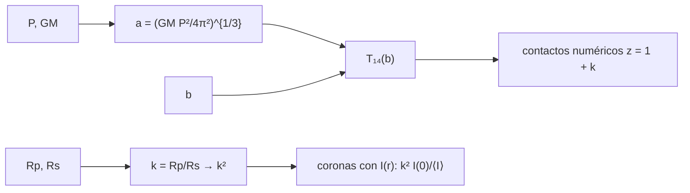

# B29-C01 — Tránsitos planetarios

<!-- nav:top -->
[🏠 Programa](../../../../README.md) · [📚 Bloque B29](../../../tronco-comun/B29-astronomia-temporal-y-exoplanetas.md) · [← Anterior: B28-C22 — Inferencia bayesiana conjunta de parámetros de fuente multimensajero](../../B28/B28-C22-inferencia-bayesiana-conjunta-de-parametros-de-fuente-multimensajero/CLASE.md) · [Siguiente: B29-C02 — Curvas de luz fotométricas →](../B29-C02-curvas-de-luz-fotometricas/CLASE.md)
<!-- /nav -->

## 1. Ubicación, nivel y alcance

Clase 1 del bloque B29. Nivel N3. Cuando un planeta pasa por delante de su estrella, el brillo baja una fracción pequeña y regular: es un **tránsito**. Aquí calculas la **profundidad** `k² = (Rp/Rs)²`, la **duración** `T₁₄` y la forma de la curva de luz, con y sin **oscurecimiento al limbo**, y verificas la duración analítica contra una búsqueda numérica de los contactos y el área de intersección contra una integral. Usas la tercera ley de Kepler ([B02-C14](../../B02/B02-C14-kepler-y-reconstruccion-de-orbitas/CLASE.md)) y las integrales ([B09-C11](../../B09/B09-C11-integrales-definidas/CLASE.md)). Se trata una órbita circular y un planeta opaco.

## 2. Por qué esta clase existe

El tránsito es el método con más planetas descubiertos. Su profundidad da el radio del planeta y su duración informa del semieje y el parámetro de impacto. La decisión central: **¿qué profundidad y qué duración produce un planeta dado y cómo se deforma la curva por el oscurecimiento al limbo?**

## 3. Lo que podrás hacer al terminar

1. Calcular `k = Rp/Rs` y la profundidad `k²`.
2. Calcular `a` con la tercera ley y `T₁₄ = (P/π) asin[(Rs/a)√((1+k)²−b²)/sin i]`.
3. Verificar `T₁₄` buscando numéricamente los contactos.
4. Calcular el área de intersección de dos discos y comprobarla por integración.
5. Calcular la profundidad con oscurecimiento al limbo por coronas.
6. Reconocer el efecto del parámetro de impacto.

La evidencia es la **ficha de un tránsito** del ejercicio 12 (sección 20).

## 4. Con qué llegas y cómo comprobarlo

1. ¿Qué dice la tercera ley de Kepler?
2. ¿Qué es la inclinación orbital?
3. ¿Qué es el parámetro de impacto?
4. ¿Qué es el oscurecimiento al limbo?
5. ¿Qué es la bisección?

<details>
<summary>Ver respuestas</summary>

1. `a³ = GM P²/(4π²)`. 2. El ángulo entre el plano orbital y el plano del cielo. 3. La distancia mínima proyectada entre centros, en radios estelares. 4. La disminución de brillo hacia el borde del disco estelar. 5. Un método para hallar raíces por intervalos.
</details>

Con cuatro o cinco aciertos, sigue; si no, repasa B02-C14.

## 5. Un caso real y casos de referencia

La misión TESS vigila al menos `200 000` enanas de la secuencia principal con `I = 4–13` mediante cuatro cámaras, para detectar descensos temporales de brillo por tránsitos (S2, resumen). Como referencia, con los radios nominales de la UAI (S1), un planeta como Júpiter delante de una estrella como el Sol produce una profundidad de `1,056 %` y uno como la Tierra, de `0,0084 %`. Es el **ejemplo conductor**.

## 6. Vocabulario

La **profundidad** es la caída relativa de flujo. La **duración** `T₁₄` va del primer al último contacto. El **parámetro de impacto** `b = a cos i/Rs`. El **oscurecimiento al limbo** hace al borde más tenue. Los **contactos** son los instantes en que los discos se tocan. El **área de intersección** es la superficie común de los discos.

## 7. Modelo mental: una moneda delante de una linterna

Una moneda que cruza el haz de una linterna proyecta una sombra cuya profundidad depende de su tamaño. Si la linterna es más brillante en el centro, el descenso es mayor cuando la moneda pasa por allí.



*Descripción textual:* los radios dan la profundidad; el periodo y la masa estelar dan el semieje, y con el parámetro de impacto la duración, que se verifica con una búsqueda numérica; el oscurecimiento al limbo modifica la profundidad central.

Analogía: una moneda delante de una linterna. Límite: la órbita es circular y el planeta, opaco.

## 8. La explicación, paso a paso

### 8.1 Profundidad y duración

Con `P` ilustrativos (Tierra `365,25 d`, Júpiter `4332,59 d`) y `GM_☉`:

| planeta | `k` | profundidad | `P` (d) | `a` (au) | `T₁₄` (h) | `T₁₄` numérica (h) |
|---|---|---|---|---|---|---|
| Tierra | 0,00917 | `8,4050 × 10⁻⁵` | 365,25 | 1,0000 | 13,0954 | 13,0954 |
| Júpiter | 0,10276 | `1,0560 × 10⁻²` | 4332,59 | 5,2012 | 32,6353 | 32,6353 |

La búsqueda numérica coincide con la fórmula a `10⁻⁹`.

### 8.2 Efecto del parámetro de impacto

Para Júpiter: `b = 0`: `32,6353 h`; `0,3`: `31,4045`; `0,6`: `27,3820`; `0,9`: `18,8588`. Una incidencia rasante acorta el tránsito.

### 8.3 Área de intersección

Con radios `1` y `0,3`:

| `d` | analítica | numérica |
|---|---|---|
| 0,0 | 0,282743 | 0,282788 |
| 0,5 | 0,282743 | 0,282788 |
| 0,9 | 0,192063 | 0,192096 |
| 1,1 | 0,075469 | 0,075492 |
| 1,3 | 0,000000 | 0,000000 |

La diferencia es menor que `10⁻⁴`, del orden del tamaño de celda.

### 8.4 Oscurecimiento al limbo

Con `u₁ = 0,40`, `u₂ = 0,26` y `k = 0,1`, la profundidad central es `0,012134`, frente a `k² I(0)/⟨I⟩ = 0,012146` y a `k² = 0,010000` sin oscurecimiento: el centro del disco es más brillante que el promedio y el tránsito, más profundo.

### 8.5 Lectura

El radio se infiere de la profundidad, pero hay que corregir por oscurecimiento al limbo y por el parámetro de impacto; la duración, a su vez, depende de `a`, `b` y `k`.

## 9. Magnitudes, símbolos y unidades

| Símbolo | Qué es | Unidad | Valor / nota |
|---|---|---|---|
| `k` | `Rp/Rs` | — | 0,00917; 0,10276 |
| `R_☉`, `R_J`, `R_⊕` | radios nominales | m | `6,957 × 10⁸`; `7,1492 × 10⁷`; `6,3781 × 10⁶` (S1) |
| `a` | semieje | au | 1; 5,2012 |
| `T₁₄` | duración | h | 13,10; 32,64 |
| `b` | parámetro de impacto | — | 0–0,9 (ilustrativo) |
| `u₁`, `u₂` | oscurecimiento al limbo | — | 0,40; 0,26 (ilustrativos) |

## 10. Convenciones y referencias

Órbita circular; radios ecuatoriales nominales de la UAI; `1 au = 1,495 978 707 × 10¹¹ m` (S3); periodos de Júpiter y la Tierra y coeficientes de oscurecimiento **ilustrativos**.

## 11. De dónde sale lo que afirmamos

| ID | Fuente | Localizador | Respalda | Estado |
|---|---|---|---|---|
| S1 | UAI, Resolución B3 de 2015 | https://arxiv.org/abs/1510.07674 | `R_☉`, `R_J`, `R_⊕`, `GM_☉` nominales | Consultada el 2026-11-09 |
| S2 | Ricker et al., TESS, arXiv:1406.0151 | https://arxiv.org/abs/1406.0151 | `≥ 200 000` enanas; `I = 4–13`; cuatro cámaras | Solo resumen, consultado el 2026-11-09 |
| S3 | IERS Technical Note 36, Tabla 1.1 | https://iers-conventions.obspm.fr/ | `au` | Consultada el 2026-11-09 |
| S4 | NIST, *Fundamental Physical Constants* (CODATA 2022) | https://physics.nist.gov/cuu/Constants/Table/allascii.txt | `G` | Consultada el 2026-11-09 |

Límites: S2 solo resumen; la fórmula de `T₁₄` es estándar y se verifica con la búsqueda numérica; no se consultó un texto de tránsitos.

## 12. Cómo ver la señal

| Caso | profundidad | duración |
|---|---|---|
| Tierra ante el Sol | 84 ppm | 13,1 h |
| Júpiter ante el Sol | 1,06 % | 32,6 h |

Descripción larga: el tránsito terrestre es 125 veces más somero que el joviano y tiene un tercio de su duración.

## 13. Ejemplo trabajado: radio desde una profundidad

**Paso 1 · Dato.** Profundidad `1,0 %` con `R_s = R_☉`.

**Paso 2 · Cociente.** `k = √0,01 = 0,1`.

**Paso 3 · Radio.** `R_p = 0,1 × 6,957 × 10⁸ = 6,96 × 10⁷ m`.

**Paso 4 · Sentido.** Unos `0,97 R_J`; con oscurecimiento al limbo, el radio real es algo menor.

## 14. Distintas formas de describir un tránsito

**Por profundidad:** `k²`. **Por duración:** `T₁₄`. **Por forma:** contactos y fondo. **Por parámetro de impacto:** `b`.

## 15. Práctica guiada

**Ejercicio 1 · con los pasos indicados.** Profundidad de la Tierra. *Pasos:* `(R_⊕/R_☉)²`.

<details><summary>Solución comentada</summary>

`(6,3781 × 10⁶/6,957 × 10⁸)² = 8,405 × 10⁻⁵`.
</details>

**Ejercicio 2 · con una pista.** `a` de la Tierra. *Pista:* tercera ley.

<details><summary>Solución comentada</summary>

`1,0000 au`.
</details>

**Ejercicio 3 · casi autónomo.** `T₁₄` de Júpiter para `b = 0,6`.

<details><summary>Solución comentada</summary>

`27,382 h`.
</details>

## 16. Práctica autónoma, transferencia e integrador

**Ejercicio 4.** Cociente de profundidades Júpiter/Tierra.

<details><summary>Solución comentada</summary>

`1,056 × 10⁻²/8,405 × 10⁻⁵ = 125,6`.
</details>

**Ejercicio 5.** Cociente de duraciones Júpiter/Tierra.

<details><summary>Solución comentada</summary>

`32,6353/13,0954 = 2,49`.
</details>

**Ejercicio 6.** Profundidad si `k` se duplica.

<details><summary>Solución comentada</summary>

Se cuadruplica.
</details>

**Ejercicio 7.** Área de intersección con `d = 0,5`, radios `1` y `0,3`.

<details><summary>Solución comentada</summary>

El disco pequeño está dentro del grande: `π × 0,3² = 0,282743`.
</details>

**Ejercicio 8.** Factor de oscurecimiento `I(0)/⟨I⟩`.

<details><summary>Solución comentada</summary>

`1/(1 − 0,4/3 − 0,26/6) = 1,2146`.
</details>

**Ejercicio 9 · transferencia.** Un compañero dice que la profundidad es siempre `(Rp/Rs)²`. Responde con 8.4.

<details><summary>Solución comentada</summary>

Solo sin oscurecimiento al limbo y al centro; con él, la profundidad central es mayor.
</details>

**Ejercicio 10 · transferencia.** ¿Por qué un tránsito rasante dura menos?

<details><summary>Solución comentada</summary>

Porque la cuerda recorrida sobre el disco estelar es más corta (8.2).
</details>

**Ejercicio 11 · transferencia.** ¿Qué valida la búsqueda numérica de contactos?

<details><summary>Solución comentada</summary>

La fórmula de `T₁₄` frente a la geometría; no la órbita real.
</details>

**Ejercicio 12 · integrador.** Elabora tu *ficha de un tránsito*: `k`, profundidad, `a`, `T₁₄` para tres parámetros de impacto y el efecto del oscurecimiento al limbo.

<details><summary>Solución modelo</summary>

Tablas de 8.1–8.4.
</details>

## 17. Laboratorio: profundidad, duración y limbo

El script [transito.py](transito.py) calcula profundidad y duración (**comprueba** `10⁻⁹` frente a los contactos numéricos), el área de intersección (**comprueba** `10⁻⁴`) y la profundidad con oscurecimiento (**comprueba** 2 %).

**Datos:** constantes de la UAI, NIST e IERS; periodos y coeficientes **ilustrativos**. **Predice antes de ejecutar:** ¿qué profundidad tiene la Tierra? (≈`84 ppm`.) **Ejecución del 2026-11-09 (Python 3.12.9):**

```text
Python 3.12.9 (biblioteca estandar)
planeta     k = Rp/Rs  profundidad     P [d]   a [au]   T14 [h]  T14 numerica [h]
Tierra        0.00917   8.4050e-05    365.25   1.0000   13.0954           13.0954
Jupiter       0.10276   1.0560e-02   4332.59   5.2012   32.6353           32.6353
    b   T14 [h]
  0.0   32.6353
  0.3   31.4045
  0.6   27.3820
  0.9   18.8588
d = 0.0: area de interseccion analitica = 0.282743 ; numerica = 0.282788
d = 0.5: area de interseccion analitica = 0.282743 ; numerica = 0.282788
d = 0.9: area de interseccion analitica = 0.192063 ; numerica = 0.192096
d = 1.1: area de interseccion analitica = 0.075469 ; numerica = 0.075492
d = 1.3: area de interseccion analitica = 0.000000 ; numerica = 0.000000
k = 0.1: profundidad con oscurecimiento al limbo = 0.012134 ; k^2 I(0)/<I> = 0.012146 ; sin oscurecimiento k^2 = 0.010000
Pruebas superadas.
```

```bash
python programa/clases/B29/B29-C01-transitos-planetarios/transito.py
```

**Límites:** órbita circular, estrella esférica, planeta opaco, un solo modelo de oscurecimiento.

## 18. Errores frecuentes y cómo corregirlos

**Confundir `k` y `k²`.** Se corrige con el ejercicio 6.

**Ignorar el parámetro de impacto.** Se corrige con el ejercicio 10.

**Ignorar el oscurecimiento al limbo.** Se corrige con el ejercicio 9.

**Mezclar radios ecuatoriales y polares.** Se corrige con la sección 10.

**Tomar los periodos ilustrativos por medidas.** Se corrige con la sección 10.

## 19. Cómo sabrás que vas bien

Tras 8.1: ¿qué duración tiene la Tierra? Si dudas, ejercicio 2. Tras 8.4: ¿cuánto cambia el oscurecimiento? Ejercicio 8. Tras el laboratorio: ¿qué valida? (la fórmula frente a la geometría).

## 20. Qué entregas y cómo se evalúa

El producto es tu **ficha de un tránsito** (ejercicio 12).

| Criterio | Inicial | En desarrollo | Logrado | Destacado |
|---|---|---|---|---|
| Conceptos | Los confunde | Parciales | Profundidad, duración, limbo | Explica el parámetro de impacto |
| Cálculo | Sin unidades | Con errores | Tablas completas | Compara planetas |
| Numérico | Sin comprobar | Un caso | Tres comprobaciones | Interpreta tolerancias |
| Fuentes | Sin fuente | Sin fecha | S1–S4 con fecha | Declara S2 como resumen |
| Límites | No los nombra | Uno | Tres | Discute órbitas excéntricas |

**Condiciones críticas (no se compensan con promedio):** rotular periodos y coeficientes como ilustrativos; no atribuir cifras a un planeta real; citar solo lo consultado.

## 21. Ética, seguridad y límites

Clase educativa: no es una canalización de análisis de tránsitos. Accesibilidad: tablas equivalentes a las gráficas, fórmulas en texto, ejercicios sin conexión.

## 22. Para cerrar y seguir

La profundidad vale `k²` (`84 ppm` para la Tierra, `1,06 %` para Júpiter), la duración depende de `a`, `k` y `b`, y el oscurecimiento al limbo la hace unos `21 %` mayor en el centro. Queda una pregunta: ¿con qué precisión se mide el brillo para ver esas caídas?

**Glosario español–inglés.** tránsito · *transit*; profundidad · *depth*; duración · *duration*; parámetro de impacto · *impact parameter*; oscurecimiento al limbo · *limb darkening*; contacto · *contact*.

**Continuidad.** [B29-C02](../B29-C02-curvas-de-luz-fotometricas/CLASE.md) estudia las curvas de luz fotométricas.

**Referencias:** ver sección 11.

<!-- nav:bottom -->
---

[← Anterior: B28-C22 — Inferencia bayesiana conjunta de parámetros de fuente multimensajero](../../B28/B28-C22-inferencia-bayesiana-conjunta-de-parametros-de-fuente-multimensajero/CLASE.md) · [📚 Bloque B29](../../../tronco-comun/B29-astronomia-temporal-y-exoplanetas.md) · [Siguiente: B29-C02 — Curvas de luz fotométricas →](../B29-C02-curvas-de-luz-fotometricas/CLASE.md)
<!-- /nav -->
