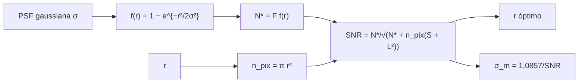

# B29-C02 — Curvas de luz fotométricas

<!-- nav:top -->
[🏠 Programa](../../../../README.md) · [📚 Bloque B29](../../../tronco-comun/B29-astronomia-temporal-y-exoplanetas.md) · [← Anterior: B29-C01 — Tránsitos planetarios](../B29-C01-transitos-planetarios/CLASE.md) · [Siguiente: B29-C03 — Velocidad radial estelar →](../B29-C03-velocidad-radial-estelar/CLASE.md)
<!-- /nav -->

## 1. Ubicación, nivel y alcance

Clase 2 del bloque B29. Nivel N3. Una curva de luz es el brillo de una estrella en función del tiempo; su precisión limita qué tránsitos o variaciones se detectan. Aquí aplicas la **ecuación del CCD** a la **fotometría de apertura** de una estrella con perfil gaussiano, buscas la **apertura óptima** y compruebas por Monte Carlo que el ruido simulado coincide con la predicción. Usas probabilidad ([B12](../../../tronco-comun/B12-probabilidad-estadistica-e-incertidumbre.md)) y optimización ([B09](../../../tronco-comun/B09-calculo-diferencial-e-integral.md)), y los tránsitos de [B29-C01](../B29-C01-transitos-planetarios/CLASE.md). Los números son sintéticos.

## 2. Por qué esta clase existe

Una apertura pequeña pierde estrella; una grande suma cielo y ruido de lectura. La decisión central: **¿qué apertura maximiza la relación señal-ruido y qué error en magnitud implica?**

## 3. Lo que podrás hacer al terminar

1. Calcular la fracción de flujo de una PSF gaussiana dentro de una apertura.
2. Aplicar `SNR = N*/√(N* + n_pix(N_cielo + N_lect²))`.
3. Hallar la apertura óptima por razón áurea.
4. Convertir SNR en error en magnitud `1,0857/SNR`.
5. Verificar por Monte Carlo la desviación de la fotometría.
6. Distinguir regímenes dominados por la estrella y por el cielo.

La evidencia es la **ficha de fotometría y apertura óptima** del ejercicio 12 (sección 20).

## 4. Con qué llegas y cómo comprobarlo

1. ¿Qué es el ruido de Poisson?
2. ¿Qué es el ruido de lectura?
3. ¿Qué es una PSF?
4. ¿Qué es una magnitud?
5. ¿Qué es una razón áurea?

<details>
<summary>Ver respuestas</summary>

1. Fluctuación `√N` de un conteo. 2. Ruido electrónico por pixel al leer el detector. 3. La imagen de una fuente puntual. 4. `m = −2,5 log F`. 5. Un método de búsqueda del extremo de una función unimodal.
</details>

Con cuatro o cinco aciertos, sigue; si no, repasa B12.

## 5. Un caso de contexto y un caso sintético

TESS utiliza cuatro cámaras CCD de campo amplio para monitorear estrellas brillantes (S2, resumen). Esta clase no usa ninguna cifra de su rendimiento: los parámetros son sintéticos, con `50 000 e⁻` de la estrella, `20 e⁻/pix` de cielo, `10 e⁻/pix` de lectura y una PSF de `σ = 1,5 pix`. Es el **ejemplo conductor**.

## 6. Vocabulario

La **fotometría de apertura** suma el flujo dentro de un círculo. El **ruido de disparo** es la fluctuación de Poisson. El **ruido de lectura** es constante por pixel. La **apertura óptima** maximiza la SNR. El **error en magnitud** `σ_m`. El **régimen limitado por la estrella** tiene SNR `≈ √N*`.

## 7. Modelo mental: un balde para recoger lluvia

Un balde pequeño recoge poca lluvia (estrella); uno grande recoge además mucha lluvia de fondo (cielo y lectura). Hay un tamaño óptimo.



*Descripción textual:* la PSF da la fracción de estrella dentro de la apertura; el número de pixeles da el ruido del fondo; ambos fijan la SNR, cuyo máximo da la apertura óptima y el error en magnitud.

Analogía: un balde. Límite: el cielo se supone uniforme y conocido.

## 8. La explicación, paso a paso

### 8.1 SNR frente a la apertura

| `r` (pix) | fracción | `n_pix` | SNR | `σ_m` (mmag) |
|---|---|---|---|---|
| 1,0 | 0,1993 | 3,1 | 97,98 | 11,081 |
| 1,5 | 0,3935 | 7,1 | 137,33 | 7,906 |
| 2,0 | 0,5889 | 12,6 | 167,36 | 6,487 |
| 2,5 | 0,7506 | 19,6 | 187,92 | 5,777 |
| 3,0 | 0,8647 | 28,3 | 200,22 | 5,423 |
| 4,0 | 0,9714 | 50,3 | 207,86 | 5,223 |
| 6,0 | 0,9997 | 113,1 | 198,27 | 5,476 |
| 10,0 | 1,0000 | 314,2 | 168,84 | 6,430 |

### 8.2 El óptimo

La razón áurea da `r = 4,0294 pix = 2,686σ`, con `SNR = 207,865` y `σ_m = 5,223 mmag`.

### 8.3 Según el brillo

Con `5 × 10⁶ e⁻`: apertura `6,00 pix` y `SNR = 2232,66`; con `5 × 10⁴ e⁻`: `4,03 pix` y `207,87`; con `500 e⁻`: `2,49 pix` y `7,18`. Las estrellas débiles piden aperturas pequeñas.

### 8.4 Monte Carlo

Con `20 000` realizaciones en la apertura óptima: flujo medio `48 643,0` (esperado `48 644,6`) y desviación `233,97` (esperada `234,02`).

### 8.5 Lectura

El ruido simulado reproduce la ecuación del CCD con un error de `0,02 %`. Con `SNR = 208`, un tránsito de `84 ppm` no se detectaría en una sola medida: hace falta promediar muchas.

## 9. Magnitudes, símbolos y unidades

| Símbolo | Qué es | Unidad | Valor / nota |
|---|---|---|---|
| `F*` | flujo de la estrella | e⁻ | `5 × 10⁴` (ilustrativo) |
| `S` | cielo | e⁻/pix | 20 (ilustrativo) |
| `L` | ruido de lectura | e⁻/pix | 10 (ilustrativo) |
| `σ` | anchura de la PSF | pix | 1,5 (ilustrativa) |
| `r` | radio de la apertura | pix | 4,03 (óptimo) |
| `σ_m` | error en magnitud | mmag | 5,223 |

## 10. Convenciones y referencias

PSF gaussiana circular; cielo conocido; sin corriente de oscuridad ni ruido de centrado; todos los parámetros son **ilustrativos**; semilla `20261109`.

## 11. De dónde sale lo que afirmamos

| ID | Fuente | Localizador | Respalda | Estado |
|---|---|---|---|---|
| S1 | Cálculo propio: ecuación del CCD y Monte Carlo | implementado en `fotometria.py` | todas las tablas | Verificado por simulación |
| S2 | Ricker et al., TESS, arXiv:1406.0151 | https://arxiv.org/abs/1406.0151 | cuatro cámaras CCD de campo amplio | Solo resumen, consultado el 2026-11-09 |

Límites: S2 solo resumen y sin cifras usadas; la ecuación del CCD es estándar y no se consultó su fuente; los parámetros son sintéticos.

## 12. Cómo ver el compromiso

| Régimen | apertura óptima |
|---|---|
| estrella brillante | grande (6 pix) |
| estrella intermedia | 4,0 pix |
| estrella débil | pequeña (2,5 pix) |

Descripción larga: cuanto más débil la estrella, más pesa el fondo y menor es la apertura óptima.

## 13. Ejemplo trabajado: SNR con r = 3 pix

**Paso 1 · Fracción.** `1 − e^{−9/4,5} = 0,8647`.

**Paso 2 · Flujo.** `N* = 43 233 e⁻`.

**Paso 3 · Pixeles.** `n_pix = 28,3`; fondo `28,3 × (20 + 100) = 3393`.

**Paso 4 · SNR.** `43 233/√(43 233 + 3393) = 200,2`.

## 14. Distintas formas de describir la precisión

**Por SNR:** cociente. **Por error en flujo:** `N*/SNR`. **Por error en magnitud:** `1,0857/SNR`. **Por ppm:** `10⁶/SNR`.

## 15. Práctica guiada

**Ejercicio 1 · con los pasos indicados.** Fracción dentro de `r = 2σ`. *Pasos:* `1 − e^{−2}`.

<details><summary>Solución comentada</summary>

`0,8647`.
</details>

**Ejercicio 2 · con una pista.** `σ_m` para `SNR = 100`.

<details><summary>Solución comentada</summary>

`10,86 mmag`.
</details>

**Ejercicio 3 · casi autónomo.** Error en ppm para `SNR = 208`.

<details><summary>Solución comentada</summary>

`4800 ppm`.
</details>

## 16. Práctica autónoma, transferencia e integrador

**Ejercicio 4.** Número de medidas para detectar `84 ppm` a `5σ` con `SNR = 208` por medida.

<details><summary>Solución comentada</summary>

`σ = 4800 ppm`; hace falta `4800/(84/5) = 286`, es decir `N = 286² = 81 600` medidas.
</details>

**Ejercicio 5.** ¿Cuánto mejora la SNR de 100 a 400 medidas?

<details><summary>Solución comentada</summary>

Un factor `2`.
</details>

**Ejercicio 6.** Diferencia de SNR entre `r = 4` y `r = 10`.

<details><summary>Solución comentada</summary>

`207,86 − 168,84 = 39,0`.
</details>

**Ejercicio 7.** Fracción de estrella perdida con `r = 3`.

<details><summary>Solución comentada</summary>

`13,5 %`.
</details>

**Ejercicio 8.** Error relativo del Monte Carlo.

<details><summary>Solución comentada</summary>

`(234,02 − 233,97)/234,02 = 0,02 %`.
</details>

**Ejercicio 9 · transferencia.** Un compañero dice que la apertura más grande es siempre mejor. Responde con 8.1.

<details><summary>Solución comentada</summary>

La SNR cae de `207,9` a `168,8` al pasar de `4` a `10 pix` por el ruido del fondo.
</details>

**Ejercicio 10 · transferencia.** ¿Por qué la apertura óptima depende del brillo?

<details><summary>Solución comentada</summary>

Porque el peso relativo del fondo y de la estrella cambia con `N*` (8.3).
</details>

**Ejercicio 11 · transferencia.** ¿Qué valida el Monte Carlo?

<details><summary>Solución comentada</summary>

Que la ecuación del CCD describe el ruido simulado; no el ruido de un detector real.
</details>

**Ejercicio 12 · integrador.** Elabora tu *ficha de fotometría y apertura óptima*: tabla de SNR, óptimo, tres brillos y el Monte Carlo.

<details><summary>Solución modelo</summary>

Secciones 8.1–8.4.
</details>

## 17. Laboratorio: ecuación del CCD

El script [fotometria.py](fotometria.py) calcula la SNR, busca la apertura óptima (razón áurea) y simula la fotometría (**comprueba** `3 %`).

**Datos:** sin constantes; todo **ilustrativo** con semilla fija. **Predice antes de ejecutar:** ¿qué apertura es óptima? (unos `4 pix`.) **Ejecución del 2026-11-09 (Python 3.12.9):**

```text
Python 3.12.9 (biblioteca estandar)
 r [pix]  fraccion    n_pix      SNR  sigma_m [mmag]
     1.0    0.1993      3.1    97.98          11.081
     1.5    0.3935      7.1   137.33           7.906
     2.0    0.5889     12.6   167.36           6.487
     2.5    0.7506     19.6   187.92           5.777
     3.0    0.8647     28.3   200.22           5.423
     4.0    0.9714     50.3   207.86           5.223
     6.0    0.9997    113.1   198.27           5.476
    10.0    1.0000    314.2   168.84           6.430
apertura optima = 4.0294 pix = 2.686 sigma ; SNR maximo = 207.865 ; sigma_m = 5.223 mmag
flujo   5000000 e-: apertura optima =  6.00 pix ; SNR =   2232.66
flujo     50000 e-: apertura optima =  4.03 pix ; SNR =    207.87
flujo       500 e-: apertura optima =  2.49 pix ; SNR =      7.18
Monte Carlo (20000): flujo medio = 48643.0 (esperado 48644.6) ; desviacion = 233.97 (esperada 234.02)
Pruebas superadas.
```

```bash
python programa/clases/B29/B29-C02-curvas-de-luz-fotometricas/fotometria.py
```

**Límites:** sin ruido de centrado, ni variación del cielo, ni efectos de píxel.

## 18. Errores frecuentes y cómo corregirlos

**Olvidar el ruido de lectura al cuadrado.** Se corrige con 8.1.

**Confundir `σ_m` y SNR.** Se corrige con el ejercicio 2.

**Usar la misma apertura para todo brillo.** Se corrige con el ejercicio 10.

**Pensar que más medidas mejoran linealmente.** Se corrige con el ejercicio 5.

**Tomar los parámetros por reales.** Se corrige con la sección 10.

## 19. Cómo sabrás que vas bien

Tras 8.2: ¿qué apertura es óptima? Si dudas, tabla de 8.1. Tras 8.5: ¿por qué hacen falta muchas medidas? Ejercicio 4. Tras el laboratorio: ¿qué valida? (la ecuación del CCD).

## 20. Qué entregas y cómo se evalúa

El producto es tu **ficha de fotometría y apertura óptima** (ejercicio 12).

| Criterio | Inicial | En desarrollo | Logrado | Destacado |
|---|---|---|---|---|
| Conceptos | Los confunde | Parciales | SNR, apertura | Explica los regímenes |
| Cálculo | Sin unidades | Con errores | Tablas completas | Calcula medidas necesarias |
| Numérico | Sin comprobar | Un caso | Óptimo y Monte Carlo | Interpreta el error |
| Fuentes | Sin fuente | Sin fecha | S1–S2 con fecha | Declara S2 como resumen |
| Límites | No los nombra | Uno | Tres | Discute ruido correlacionado |

**Condiciones críticas (no se compensan con promedio):** rotular los parámetros como sintéticos; no presentar SNR como la de un instrumento; citar solo lo consultado.

## 21. Ética, seguridad y límites

Clase educativa: no es una canalización de fotometría. Accesibilidad: tablas equivalentes a las gráficas, fórmulas en texto, ejercicios sin conexión.

## 22. Para cerrar y seguir

La apertura óptima (`4,0 pix`, `2,7σ`) da `SNR = 208` (`5,2 mmag`); el simulador reproduce la ecuación del CCD al `0,02 %`. Queda una pregunta: ¿cómo se detecta el planeta por el bamboleo de su estrella?

**Glosario español–inglés.** curva de luz · *light curve*; fotometría de apertura · *aperture photometry*; ecuación del CCD · *CCD equation*; ruido de lectura · *read noise*; apertura óptima · *optimal aperture*; error en magnitud · *magnitude error*.

**Continuidad.** [B29-C03](../B29-C03-velocidad-radial-estelar/CLASE.md) estudia la velocidad radial estelar.

**Referencias:** ver sección 11.

<!-- nav:bottom -->
---

[← Anterior: B29-C01 — Tránsitos planetarios](../B29-C01-transitos-planetarios/CLASE.md) · [📚 Bloque B29](../../../tronco-comun/B29-astronomia-temporal-y-exoplanetas.md) · [Siguiente: B29-C03 — Velocidad radial estelar →](../B29-C03-velocidad-radial-estelar/CLASE.md)
<!-- /nav -->
