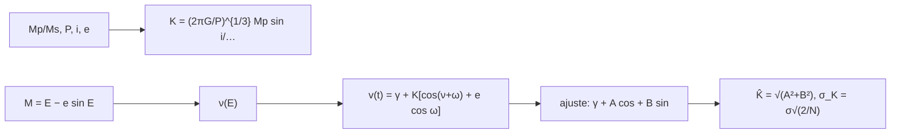

# B29-C03 — Velocidad radial estelar

<!-- nav:top -->
[🏠 Programa](../../../../README.md) · [📚 Bloque B29](../../../tronco-comun/B29-astronomia-temporal-y-exoplanetas.md) · [← Anterior: B29-C02 — Curvas de luz fotométricas](../B29-C02-curvas-de-luz-fotometricas/CLASE.md) · [Siguiente: B29-C04 — Astrometría de exoplanetas →](../B29-C04-astrometria-de-exoplanetas/CLASE.md)
<!-- /nav -->

## 1. Ubicación, nivel y alcance

Clase 3 del bloque B29. Nivel N3. Un planeta no orbita inmóvil a su estrella: ambos giran alrededor del centro de masas y la estrella se mueve con una velocidad pequeña que, vista de lado, se mide por efecto Doppler. Aquí calculas la **semiamplitud** `K`, resuelves la **ecuación de Kepler**, generas una **curva de velocidad radial** y la ajustas con un modelo circular, comprobando la incertidumbre por Monte Carlo y el **sesgo** que produce ignorar la excentricidad. Usas la tercera ley de Kepler ([B02-C14](../../B02/B02-C14-kepler-y-reconstruccion-de-orbitas/CLASE.md)), mínimos cuadrados y el planeta en tránsito de [B29-C01](../B29-C01-transitos-planetarios/CLASE.md). Se trata un solo planeta.

## 2. Por qué esta clase existe

La velocidad radial da la masa mínima del planeta, que el tránsito no da. Combinados, dan la densidad. La decisión central: **¿qué semiamplitud produce un planeta, con qué precisión se recupera y qué pasa si se ignora la excentricidad?**

## 3. Lo que podrás hacer al terminar

1. Calcular `K = (2πG/P)^{1/3} Mp sin i/((Ms+Mp)^{2/3}√(1−e²))`.
2. Resolver la ecuación de Kepler con Newton.
3. Generar `v(t) = γ + K[cos(ν+ω) + e cos ω]`.
4. Ajustar una sinusoide por mínimos cuadrados lineales.
5. Verificar `σ_K ≈ σ√(2/N)` por Monte Carlo.
6. Cuantificar el sesgo de `K` por la excentricidad.

La evidencia es la **ficha de velocidad radial** del ejercicio 12 (sección 20).

## 4. Con qué llegas y cómo comprobarlo

1. ¿Qué es el efecto Doppler?
2. ¿Qué es la anomalía excéntrica?
3. ¿Qué es un ajuste lineal?
4. ¿Qué es la masa mínima `Mp sin i`?
5. ¿Qué es la excentricidad?

<details>
<summary>Ver respuestas</summary>

1. El cambio de frecuencia por movimiento relativo. 2. El ángulo auxiliar `E` de `M = E − e sin E`. 3. Minimizar residuos cuadrados con parámetros lineales. 4. La masa si la órbita se ve de canto. 5. El parámetro de forma de la elipse.
</details>

Con cuatro o cinco aciertos, sigue; si no, repasa B02-C14.

## 5. Un caso de referencia: Júpiter y la Tierra vistos como exoplanetas

Con los parámetros gravitacionales nominales de la UAI (S1) y periodos ilustrativos (`4332,59 d` y `365,25 d`), un Júpiter alrededor del Sol induciría `K = 12,46 m/s` y una Tierra, `K = 0,0895 m/s`. Es el **ejemplo conductor**; no se cita ninguna medición de exoplanetas.

## 6. Vocabulario

La **semiamplitud** `K`. La **anomalía media** `M = 2π(t − t₀)/P`. La **ecuación de Kepler** `M = E − e sin E`. La **masa mínima** `Mp sin i`. El **argumento del periastro** `ω`. El **ajuste circular** usa una sola sinusoide.

## 7. Modelo mental: dos bailarines unidos por una cuerda

Un bailarín pesado (la estrella) y uno ligero (el planeta) giran alrededor del centro de masas: el pesado traza un círculo pequeño; si miramos desde el borde del escenario vemos que se acerca y se aleja con una velocidad `K`.



*Descripción textual:* las masas y el periodo dan `K`; la ecuación de Kepler da la velocidad en cada instante; el ajuste lineal recupera `K` con una incertidumbre `σ√(2/N)`, aunque sesgado si la órbita es excéntrica.

Analogía: dos bailarines. Límite: la inclinación solo entra como `sin i`.

## 8. La explicación, paso a paso

### 8.1 Semiamplitudes

| planeta | `Mp/Ms` | `P` (d) | `K` (m/s) |
|---|---|---|---|
| Júpiter | `9,5459 × 10⁻⁴` | 4332,59 | 12,4591 |
| Tierra | `3,0035 × 10⁻⁶` | 365,25 | 0,0895 |

### 8.2 Ecuación de Kepler

Con Newton, el residuo de `M = E − e sin E` es menor que `10⁻¹²` para `e = 0,1; 0,5; 0,9` y cuatro anomalías medias.

### 8.3 Ajuste con muestreo aleatorio

Con `K = 10 m/s`, `P = 30 d`, `σ = 1 m/s` y `N = 60` medidas en 300 días, `σ_K = 1×√(2/60) = 0,183 m/s`:

| `e` | `K` recuperado | desviación MC | `σ` teórico |
|---|---|---|---|
| 0,0 | 10,001 | 0,181 | 0,183 |
| 0,3 | 9,200 | 0,190 | 0,183 |
| 0,6 | 6,517 | 0,194 | 0,183 |

### 8.4 Lectura

Para órbita circular, el ajuste recupera `K` y la incertidumbre teórica. Con excentricidad, el ajuste de una sola sinusoide **subestima** `K`: el 8 % para `e = 0,3` y el 35 % para `e = 0,6`.

### 8.5 Masa mínima

Una semiamplitud de `10 m/s` con `P = 30 d` alrededor de una estrella de `1 M☉` corresponde a una masa mínima de `0,153 M_J` (valor derivado del cociente con el `K` de Júpiter a ese periodo).

## 9. Magnitudes, símbolos y unidades

| Símbolo | Qué es | Unidad | Valor / nota |
|---|---|---|---|
| `K` | semiamplitud | m/s | 12,46; 0,0895 |
| `GM_☉`, `GM_J`, `GM_⊕` | parámetros nominales | m³ s⁻² | S1 |
| `P` | periodo | d | 4332,59; 365,25 (ilustrativos) |
| `e`, `ω` | excentricidad y periastro | —, rad | 0–0,6; 0,7 (ilustrativos) |
| `σ` | ruido de cada medida | m/s | 1 (ilustrativo) |
| `N` | número de medidas | — | 60 |

## 10. Convenciones y referencias

`sin i = 1` salvo indicación; periodos conocidos al ajustar; ruido blanco; semilla `20261109`; periodos, `e`, `ω`, `σ`, `N` **ilustrativos**.

## 11. De dónde sale lo que afirmamos

| ID | Fuente | Localizador | Respalda | Estado |
|---|---|---|---|---|
| S1 | UAI, Resolución B3 de 2015 | https://arxiv.org/abs/1510.07674 | `GM_☉`, `GM_J`, `GM_⊕` nominales | Consultada el 2026-11-09 |
| S2 | NIST, *Fundamental Physical Constants* (CODATA 2022) | https://physics.nist.gov/cuu/Constants/Table/allascii.txt | `G` | Consultada el 2026-11-09 |
| S3 | Cálculo propio: ecuación de Kepler y ajuste lineal | implementado en `velocidad_radial.py` | tablas 8.1–8.3 | Verificado por Monte Carlo |

Límites: ninguna medición de exoplanetas se cita; la fórmula de `K` es estándar y no se consultó un texto; los periodos de Júpiter y la Tierra son valores redondeados ilustrativos.

## 12. Cómo ver el sesgo

| `e` | sesgo de `K` |
|---|---|
| 0,0 | 0 % |
| 0,3 | −8 % |
| 0,6 | −35 % |

Descripción larga: el ajuste circular pierde las armónicas superiores de la órbita excéntrica y reduce la amplitud recuperada.

## 13. Ejemplo trabajado: K de Júpiter

**Paso 1 · Masas.** `Mp/Ms = GM_J/GM_☉ = 9,5459 × 10⁻⁴`.

**Paso 2 · Periodo.** `P = 4332,59 d = 3,7433 × 10⁸ s`.

**Paso 3 · Fórmula.** `K = (2πG/P)^{1/3} Mp/(Ms+Mp)^{2/3}`.

**Paso 4 · Resultado.** `12,46 m/s`: un cambio de velocidad como el de un corredor.

## 14. Distintas formas de describir la órbita

**Por semiamplitud:** `K`. **Por masa mínima:** `Mp sin i`. **Por elementos:** `P`, `e`, `ω`, `t₀`. **Por la curva:** `v(t)`.

## 15. Práctica guiada

**Ejercicio 1 · con los pasos indicados.** `Mp/Ms` de la Tierra. *Pasos:* `GM_⊕/GM_☉`.

<details><summary>Solución comentada</summary>

`3,0035 × 10⁻⁶`.
</details>

**Ejercicio 2 · con una pista.** `σ_K` con `N = 240`, `σ = 1`.

<details><summary>Solución comentada</summary>

`√(2/240) = 0,0913 m/s`.
</details>

**Ejercicio 3 · casi autónomo.** ¿Detecta `σ = 1 m/s` con 60 medidas una Tierra (`K = 0,09`)?

<details><summary>Solución comentada</summary>

No: `K/σ_K = 0,09/0,18 = 0,5σ`.
</details>

## 16. Práctica autónoma, transferencia e integrador

**Ejercicio 4.** Medidas para detectar `K = 0,09 m/s` a `5σ` con `σ = 1`.

<details><summary>Solución comentada</summary>

`σ_K = 0,018`; `N = 2/0,018² = 6173`.
</details>

**Ejercicio 5.** Cociente de `K` de Júpiter y la Tierra.

<details><summary>Solución comentada</summary>

`12,4591/0,0895 = 139`.
</details>

**Ejercicio 6.** Sesgo relativo del ajuste circular con `e = 0,3`.

<details><summary>Solución comentada</summary>

`9,200/10 − 1 = −8 %`.
</details>

**Ejercicio 7.** Desviaciones del sesgo con `e = 0,3` respecto de `σ_K = 0,183`.

<details><summary>Solución comentada</summary>

`0,8/0,183 = 4,4σ`.
</details>

**Ejercicio 8.** Masa mínima si `K` se triplica a igual `P`.

<details><summary>Solución comentada</summary>

Se triplica: `0,46 M_J`.
</details>

**Ejercicio 9 · transferencia.** Un compañero dice que `K` da la masa del planeta. Responde con la sección 6.

<details><summary>Solución comentada</summary>

Da `Mp sin i`, la masa mínima; la inclinación se resuelve con tránsito o astrometría.
</details>

**Ejercicio 10 · transferencia.** ¿Por qué se subestima `K` con `e` alta si se ajusta una sinusoide?

<details><summary>Solución comentada</summary>

Porque la curva excéntrica tiene armónicas que el modelo circular no incluye (8.4).
</details>

**Ejercicio 11 · transferencia.** ¿Qué valida que la desviación MC coincida con `σ√(2/N)`?

<details><summary>Solución comentada</summary>

La incertidumbre analítica para muestreo uniforme; no la estabilidad real de una estrella.
</details>

**Ejercicio 12 · integrador.** Elabora tu *ficha de velocidad radial*: `K` para dos planetas, verificación de Kepler, ajuste con tres excentricidades y masa mínima.

<details><summary>Solución modelo</summary>

Secciones 8.1–8.5.
</details>

## 17. Laboratorio: velocidad radial

El script [velocidad_radial.py](velocidad_radial.py) calcula `K`, resuelve Kepler (**comprueba** `10⁻¹²`) y simula 1500 ajustes por excentricidad (**comprueba** `8 %` en `σ_K`).

**Datos:** `G`, `GM` de NIST y UAI; periodos y parámetros **ilustrativos**. **Predice antes de ejecutar:** ¿qué `K` recupera el ajuste circular con `e = 0,6`? (bastante menos de 10.) **Ejecución del 2026-11-09 (Python 3.12.9):**

```text
Python 3.12.9 (biblioteca estandar)
planeta          Mp/Ms     P [d]    K [m/s]
Jupiter     9.5459e-04   4332.59    12.4591
Tierra      3.0035e-06    365.25     0.0895
ecuacion de Kepler resuelta con residuo < 1e-12 para e = 0.1, 0.5, 0.9
e = 0.0: K verdadero = 10.0 ; K recuperado (ajuste circular) = 10.001 ; desviacion = 0.181 ; sigma teorico = 0.183
e = 0.3: K verdadero = 10.0 ; K recuperado (ajuste circular) = 9.200 ; desviacion = 0.190 ; sigma teorico = 0.183
e = 0.6: K verdadero = 10.0 ; K recuperado (ajuste circular) = 6.517 ; desviacion = 0.194 ; sigma teorico = 0.183
masa minima (Mp sen i) para K = 10 m/s, P = 30 d, Ms = 1 Msol: 0.153 masas de Jupiter
Pruebas superadas.
```

```bash
python programa/clases/B29/B29-C03-velocidad-radial-estelar/velocidad_radial.py
```

**Límites:** un solo planeta, periodo conocido, sin actividad estelar.

## 18. Errores frecuentes y cómo corregirlos

**Confundir `K` y masa.** Se corrige con el ejercicio 9.

**Ajustar circular con `e` alta.** Se corrige con el ejercicio 10.

**Olvidar `sin i`.** Se corrige con la sección 6.

**Mezclar m/s y km/s.** Se corrige con la sección 9.

**Tomar los periodos ilustrativos por medidas.** Se corrige con la sección 10.

## 19. Cómo sabrás que vas bien

Tras 8.1: ¿qué `K` tiene Júpiter? Si dudas, ejercicio 5. Tras 8.4: ¿cuándo falla el ajuste circular? Ejercicio 10. Tras el laboratorio: ¿qué valida? (la incertidumbre analítica).

## 20. Qué entregas y cómo se evalúa

El producto es tu **ficha de velocidad radial** (ejercicio 12).

| Criterio | Inicial | En desarrollo | Logrado | Destacado |
|---|---|---|---|---|
| Conceptos | Los confunde | Parciales | `K`, Kepler, ajuste | Explica el sesgo de `e` |
| Cálculo | Sin unidades | Con errores | Tablas completas | Calcula medidas necesarias |
| Numérico | Sin comprobar | Un caso | Kepler y Monte Carlo | Interpreta el sesgo |
| Fuentes | Sin fuente | Sin fecha | S1–S3 con fecha | Declara que no hay mediciones reales |
| Límites | No los nombra | Uno | Tres | Discute la actividad estelar |

**Condiciones críticas (no se compensan con promedio):** rotular periodos y ruido como ilustrativos; no atribuir cifras a un exoplaneta real; citar solo lo consultado.

## 21. Ética, seguridad y límites

Clase educativa: no es un ajuste de datos reales. Accesibilidad: tablas equivalentes a las gráficas, fórmulas en texto, ejercicios sin conexión.

## 22. Para cerrar y seguir

La semiamplitud de Júpiter es `12,46 m/s` y la de la Tierra `0,0895 m/s`; el ajuste recupera `K` con error `σ√(2/N)` pero lo subestima si ignora la excentricidad. Queda una pregunta: ¿qué pasa si en lugar de la velocidad se mide el movimiento en el cielo?

**Glosario español–inglés.** velocidad radial · *radial velocity*; semiamplitud · *semi-amplitude*; ecuación de Kepler · *Kepler's equation*; masa mínima · *minimum mass*; anomalía excéntrica · *eccentric anomaly*; periastro · *periastron*.

**Continuidad.** [B29-C04](../B29-C04-astrometria-de-exoplanetas/CLASE.md) estudia la astrometría de exoplanetas.

**Referencias:** ver sección 11.

<!-- nav:bottom -->
---

[← Anterior: B29-C02 — Curvas de luz fotométricas](../B29-C02-curvas-de-luz-fotometricas/CLASE.md) · [📚 Bloque B29](../../../tronco-comun/B29-astronomia-temporal-y-exoplanetas.md) · [Siguiente: B29-C04 — Astrometría de exoplanetas →](../B29-C04-astrometria-de-exoplanetas/CLASE.md)
<!-- /nav -->
