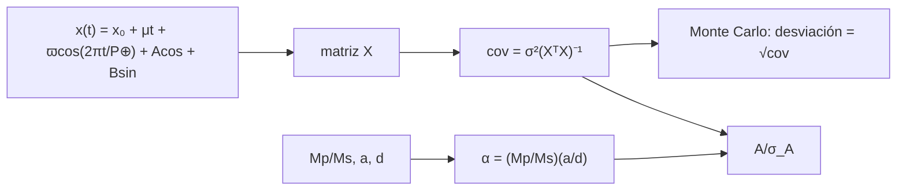

# B29-C04 — Astrometría de exoplanetas

<!-- nav:top -->
[🏠 Programa](../../../../README.md) · [📚 Bloque B29](../../../tronco-comun/B29-astronomia-temporal-y-exoplanetas.md) · [← Anterior: B29-C03 — Velocidad radial estelar](../B29-C03-velocidad-radial-estelar/CLASE.md) · [Siguiente: B29-C05 — Microlentes gravitacionales →](../B29-C05-microlentes-gravitacionales/CLASE.md)
<!-- /nav -->

## 1. Ubicación, nivel y alcance

Clase 4 del bloque B29. Nivel N3. La estrella que orbita alrededor del centro de masas común traza una pequeña elipse en el cielo: la **firma astrométrica**. Aquí calculas su tamaño `α = (Mp/Ms)(a/d)`, lo comparas con la precisión posible y ajustas conjuntamente **posición, movimiento propio, paralaje y órbita** por mínimos cuadrados lineales, verificando por Monte Carlo la covarianza. Usas la tercera ley de Kepler ([B02-C14](../../B02/B02-C14-kepler-y-reconstruccion-de-orbitas/CLASE.md)), el método de velocidad radial de [B29-C03](../B29-C03-velocidad-radial-estelar/CLASE.md) y álgebra lineal ([B10](../../../tronco-comun/B10-algebra-lineal-y-matematicas-geometricas.md)). Se trata una coordenada con ruido blanco.

## 2. Por qué esta clase existe

La astrometría mide la inclinación y la masa verdadera, pero la señal es diminuta. La decisión central: **¿cuál es la firma de un planeta a una distancia dada y con qué incertidumbre se recupera su órbita junto al paralaje y el movimiento propio?**

## 3. Lo que podrás hacer al terminar

1. Calcular `α = (Mp/Ms)(a/d)` en miliarcosegundos.
2. Calcular `a` con la tercera ley.
3. Escribir el modelo lineal `x(t) = x₀ + μt + ϖ cos(2πt/P_⊕) + A cos + B sin`.
4. Obtener la covarianza `σ²(XᵀX)⁻¹`.
5. Verificarla por Monte Carlo con semilla fija.
6. Calcular la significancia de la órbita.

La evidencia es la **ficha de firma astrométrica** del ejercicio 12 (sección 20).

## 4. Con qué llegas y cómo comprobarlo

1. ¿Qué es el paralaje?
2. ¿Qué es el movimiento propio?
3. ¿Qué es un miliarcosegundo?
4. ¿Qué es una matriz de diseño?
5. ¿Qué es una covarianza?

<details>
<summary>Ver respuestas</summary>

1. El desplazamiento aparente por el movimiento de la Tierra. 2. El cambio de posición lineal en el cielo. 3. `10⁻³` segundos de arco. 4. La matriz de las funciones base evaluadas en cada observación. 5. La matriz de incertidumbres y correlaciones de los parámetros.
</details>

Con cuatro o cinco aciertos, sigue; si no, repasa B02-C14 y B10.

## 5. Un caso de referencia: Júpiter y la Tierra vistos a distancia

Con los parámetros nominales de la UAI (S1), `a = 5,2012 au` para un periodo de `4332,59 d` (ilustrativo) y la distancia `d` de `10 pc`, un Júpiter como el del Sol produce una firma de `0,4965 mas`; una Tierra, de `0,30 μas`. Es el **ejemplo conductor**; no se cita ninguna medición.

## 6. Vocabulario

La **firma astrométrica** `α`. El **paralaje** `ϖ`. El **movimiento propio** `μ`. La **matriz de diseño** `X`. La **covarianza** de los parámetros. La **significancia de la órbita** `A/σ_A`.

## 7. Modelo mental: una estrella que baila sobre un fondo fijo

La estrella se desplaza en línea recta (movimiento propio), oscila anualmente por el movimiento de la Tierra (paralaje) y, además, traza una pequeña elipse por el planeta. Cada efecto tiene su periodo, así que se pueden separar.



*Descripción textual:* la firma depende de las masas y de a/d; el modelo lineal define una matriz de diseño cuya covarianza se compara con la dispersión del Monte Carlo; el cociente entre la amplitud y su error da la significancia.

Analogía: tres bailes superpuestos. Límite: los periodos se suponen conocidos.

## 8. La explicación, paso a paso

### 8.1 Firma astrométrica

| planeta | `a` (au) | `d` (pc) | firma (mas) | firma (μas) |
|---|---|---|---|---|
| Júpiter | 5,2012 | 10 | `4,9650 × 10⁻¹` | 496,50 |
| Júpiter | 5,2012 | 100 | `4,9650 × 10⁻²` | 49,65 |
| Tierra | 1,0000 | 10 | `3,0035 × 10⁻⁴` | 0,3003 |
| Tierra | 1,0000 | 100 | `3,0035 × 10⁻⁵` | 0,0300 |

### 8.2 El ajuste

Con `N = 80` observaciones en 1800 días, `σ = 0,05 mas`, `P_⊕ = 365,25 d`, `P_pl = 600 d` y verdad `(x₀, μ, ϖ, A, B) = (1; 8,2 × 10⁻⁴ mas/d; 100; 0,4; −0,3)`:

| parámetro | verdadero | media MC | `σ` MC | `σ` teórico |
|---|---|---|---|---|
| `x₀` (mas) | 1,00000 | 0,99973 | 0,01191 | 0,01188 |
| `μ` (mas/d) | 0,00082 | 0,00082 | 0,00001 | 0,00001 |
| `ϖ` (mas) | 100,00000 | 99,99977 | 0,00857 | 0,00854 |
| `A` (mas) | 0,40000 | 0,40010 | 0,00774 | 0,00781 |
| `B` (mas) | −0,30000 | −0,29979 | 0,00884 | 0,00879 |

### 8.3 Significancia

La amplitud orbital `0,500 mas` frente al error de `A` (`0,0078 mas`) da `64σ`.

### 8.4 Lectura

El Monte Carlo reproduce la covarianza al `1 %`; el paralaje, el movimiento propio y la órbita se separan porque sus funciones base son casi ortogonales.

### 8.5 Escala del problema

Una firma de `0,50 mas` con error de `0,05 mas` por medida es detectable en pocas decenas de observaciones; una Tierra (`0,0003 mas`) requeriría una precisión `10³` veces mejor.

## 9. Magnitudes, símbolos y unidades

| Símbolo | Qué es | Unidad | Valor / nota |
|---|---|---|---|
| `α` | firma astrométrica | mas | ver 8.1 |
| `d` | distancia | pc | 10; 100 |
| `ϖ` | paralaje | mas | 100 (ilustrativo) |
| `μ` | movimiento propio | mas/d | `8,2 × 10⁻⁴` |
| `A`, `B` | componentes orbitales | mas | 0,4; −0,3 |
| `σ` | error por observación | mas | 0,05 (ilustrativo) |

## 10. Convenciones y referencias

Una coordenada; periodos conocidos; `1 pc = 648 000/π au`; todos los parámetros del ajuste son **ilustrativos**; semilla `20261109`.

## 11. De dónde sale lo que afirmamos

| ID | Fuente | Localizador | Respalda | Estado |
|---|---|---|---|---|
| S1 | UAI, Resolución B3 de 2015 | https://arxiv.org/abs/1510.07674 | `GM_☉`, `GM_J`, `GM_⊕` | Consultada el 2026-11-09 |
| S2 | IERS Technical Note 36, Tabla 1.1 | https://iers-conventions.obspm.fr/ | `au` | Consultada el 2026-11-09 |
| S3 | Cálculo propio: ajuste lineal y covarianza | implementado en `astrometria.py` | tabla 8.2 | Verificado por Monte Carlo |

Límites: no se cita ninguna medición astrométrica; el modelo lineal es una simplificación de una órbita real; los errores son sintéticos.

## 12. Cómo ver la detección

| Cantidad | Valor |
|---|---|
| firma de Júpiter a 10 pc | 0,4965 mas |
| error por observación | 0,05 mas |
| error de la amplitud (80 obs.) | 0,0078 mas |
| significancia de 0,5 mas | 64σ |

Descripción larga: con 80 observaciones, el error de la amplitud es unas seis veces menor que el de una observación.

## 13. Ejemplo trabajado: firma de Júpiter a 10 pc

**Paso 1 · Cociente de masas.** `9,5459 × 10⁻⁴`.

**Paso 2 · Cociente de distancias.** `a/d = 5,2012 au/(10 × 206 264,8 au) = 2,522 × 10⁻⁶`.

**Paso 3 · Producto.** `2,407 × 10⁻⁹ rad`.

**Paso 4 · Conversión.** `÷ 4,848 × 10⁻⁹ rad/mas = 0,4965 mas`.

## 14. Distintas formas de describir la señal

**Por tamaño:** `α`. **Por significancia:** `A/σ_A`. **Por covarianza:** `σ²(XᵀX)⁻¹`. **Por masa:** `Mp = α Ms d/a`.

## 15. Práctica guiada

**Ejercicio 1 · con los pasos indicados.** Firma de Júpiter a `100 pc`. *Pasos:* divide por 10.

<details><summary>Solución comentada</summary>

`0,04965 mas`.
</details>

**Ejercicio 2 · con una pista.** Cociente de firmas Júpiter/Tierra a igual distancia.

<details><summary>Solución comentada</summary>

`496,5/0,3003 = 1653`.
</details>

**Ejercicio 3 · casi autónomo.** `σ_A` con `N` cuadruplicado.

<details><summary>Solución comentada</summary>

La mitad: `0,0039 mas`.
</details>

## 16. Práctica autónoma, transferencia e integrador

**Ejercicio 4.** Observaciones para alcanzar `σ_A = 0,001 mas` con `σ = 0,05 mas`.

<details><summary>Solución comentada</summary>

Escalando `σ_A ∝ 1/√N` desde `0,0078` con `N = 80`: `N = 80 × (7,8)² = 4870`.
</details>

**Ejercicio 5.** Masa del planeta si `α = 0,4965 mas`, `a = 5,2012 au`, `d = 10 pc`.

<details><summary>Solución comentada</summary>

`9,5459 × 10⁻⁴ M_☉ ≈ 1 M_J`.
</details>

**Ejercicio 6.** Error de `ϖ` frente al de `A`.

<details><summary>Solución comentada</summary>

`0,00857/0,00774 = 1,1`.
</details>

**Ejercicio 7.** Significancia si el error por observación fuera `0,5 mas`.

<details><summary>Solución comentada</summary>

`σ_A` pasa a `0,078 mas`: `0,5/0,078 = 6,4σ`.
</details>

**Ejercicio 8.** Firma de la Tierra a `10 pc` en μas.

<details><summary>Solución comentada</summary>

`0,3003 μas`.
</details>

**Ejercicio 9 · transferencia.** Un compañero dice que la astrometría no puede dar la masa del planeta. Responde con la sección 2.

<details><summary>Solución comentada</summary>

La firma da `Mp/Ms` si se conocen `a` y `d`: mide la masa verdadera, sin `sin i`.
</details>

**Ejercicio 10 · transferencia.** ¿Por qué se pueden separar paralaje y órbita?

<details><summary>Solución comentada</summary>

Porque tienen periodos distintos y funciones base casi ortogonales (8.4).
</details>

**Ejercicio 11 · transferencia.** ¿Qué valida el Monte Carlo frente a la covarianza?

<details><summary>Solución comentada</summary>

La covarianza de mínimos cuadrados para ruido blanco; no un modelo realista de ruido astrométrico.
</details>

**Ejercicio 12 · integrador.** Elabora tu *ficha de firma astrométrica*: tabla de firmas, ajuste con covarianza y Monte Carlo, significancia.

<details><summary>Solución modelo</summary>

Secciones 8.1–8.5.
</details>

## 17. Laboratorio: ajuste astrométrico

El script [astrometria.py](astrometria.py) calcula las firmas y ajusta cinco parámetros en 3000 realizaciones (**comprueba** `6 %` frente a la covarianza).

**Datos:** `GM` de la UAI; `au` del IERS; todo lo demás **ilustrativo**. **Predice antes de ejecutar:** ¿qué firma da Júpiter a `10 pc`? (≈`0,5 mas`.) **Ejecución del 2026-11-09 (Python 3.12.9):**

```text
Python 3.12.9 (biblioteca estandar)
semieje de Jupiter (tercera ley) = 5.2012 au
planeta     a [au]  d [pc]  firma [mas]  firma [uas]
Jupiter     5.2012    10.0   4.9650e-01     496.4989
Jupiter     5.2012   100.0   4.9650e-02      49.6499
Tierra      1.0000    10.0   3.0035e-04       0.3003
Tierra      1.0000   100.0   3.0035e-05       0.0300
parametro         verdadero    media MC   sigma MC  sigma teorico
x0 [mas]            1.00000     0.99973    0.01191        0.01188
mu [mas/d]          0.00082     0.00082    0.00001        0.00001
paralaje [mas]    100.00000    99.99977    0.00857        0.00854
A [mas]             0.40000     0.40010    0.00774        0.00781
B [mas]            -0.30000    -0.29979    0.00884        0.00879
amplitud orbital verdadera = 0.500 mas ; error de A = 0.0078 mas -> significancia de la orbita ~ 64.0 sigma
Pruebas superadas.
```

```bash
python programa/clases/B29/B29-C04-astrometria-de-exoplanetas/astrometria.py
```

**Límites:** una coordenada, periodos conocidos, ruido blanco.

## 18. Errores frecuentes y cómo corregirlos

**Confundir mas y μas.** Se corrige con la sección 9.

**Olvidar el paralaje.** Se corrige con el ejercicio 10.

**Ignorar la covarianza.** Se corrige con 8.2.

**Pensar que da `sin i`.** Se corrige con el ejercicio 9.

**Tomar los errores por reales.** Se corrige con la sección 10.

## 19. Cómo sabrás que vas bien

Tras 8.1: ¿qué firma tiene Júpiter a `10 pc`? Si dudas, ejercicio 1. Tras 8.2: ¿qué compara la tabla? (Monte Carlo y covarianza). Tras el laboratorio: ¿qué valida? (la covarianza de mínimos cuadrados).

## 20. Qué entregas y cómo se evalúa

El producto es tu **ficha de firma astrométrica** (ejercicio 12).

| Criterio | Inicial | En desarrollo | Logrado | Destacado |
|---|---|---|---|---|
| Conceptos | Los confunde | Parciales | Firma, ajuste, covarianza | Explica la separación de efectos |
| Cálculo | Sin unidades | Con errores | Tablas completas | Calcula observaciones necesarias |
| Numérico | Sin comprobar | Un caso | Monte Carlo | Interpreta la covarianza |
| Fuentes | Sin fuente | Sin fecha | S1–S3 con fecha | Declara que no hay mediciones reales |
| Límites | No los nombra | Uno | Tres | Discute ruido correlacionado |

**Condiciones críticas (no se compensan con promedio):** rotular el ruido y los periodos como ilustrativos; no inferir resultados sobre datos reales; citar solo lo consultado.

## 21. Ética, seguridad y límites

Clase educativa: no es una canalización astrométrica. Accesibilidad: tablas equivalentes a las gráficas, fórmulas en texto, ejercicios sin conexión.

## 22. Para cerrar y seguir

La firma de un Júpiter a `10 pc` es `0,50 mas` y la de una Tierra `0,0003 mas`; un ajuste lineal separa posición, movimiento propio, paralaje y órbita con una covarianza que el Monte Carlo reproduce. Queda una pregunta: ¿cómo se detecta un planeta cuando una estrella pasa por delante de otra y curva su luz?

**Glosario español–inglés.** astrometría · *astrometry*; firma astrométrica · *astrometric signature*; paralaje · *parallax*; movimiento propio · *proper motion*; matriz de diseño · *design matrix*; covarianza · *covariance*.

**Continuidad.** [B29-C05](../B29-C05-microlentes-gravitacionales/CLASE.md) estudia las microlentes gravitacionales.

**Referencias:** ver sección 11.

<!-- nav:bottom -->
---

[← Anterior: B29-C03 — Velocidad radial estelar](../B29-C03-velocidad-radial-estelar/CLASE.md) · [📚 Bloque B29](../../../tronco-comun/B29-astronomia-temporal-y-exoplanetas.md) · [Siguiente: B29-C05 — Microlentes gravitacionales →](../B29-C05-microlentes-gravitacionales/CLASE.md)
<!-- /nav -->
