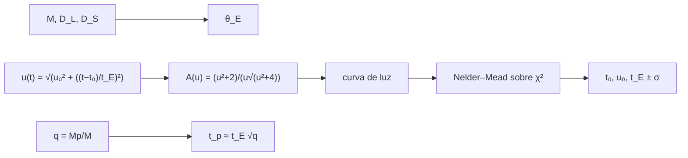

# B29-C05 — Microlentes gravitacionales

<!-- nav:top -->
[🏠 Programa](../../../../README.md) · [📚 Bloque B29](../../../tronco-comun/B29-astronomia-temporal-y-exoplanetas.md) · [← Anterior: B29-C04 — Astrometría de exoplanetas](../B29-C04-astrometria-de-exoplanetas/CLASE.md) · [Siguiente: B29-C06 — Imagen directa de exoplanetas →](../B29-C06-imagen-directa-de-exoplanetas/CLASE.md)
<!-- /nav -->

## 1. Ubicación, nivel y alcance

Clase 5 del bloque B29. Nivel N3. Cuando una estrella pasa casi exactamente por delante de otra más lejana, su gravedad curva la luz y la **magnifica** durante días: una **microlente**. Aquí calculas el **radio de Einstein**, la **magnificación** en función del parámetro de impacto, ajustas la curva de luz de un evento sintético y estimas la **duración de la perturbación de un planeta**. Usas relatividad general ([B26](../../../tronco-comun/B26-relatividad-y-cosmologia.md)), mínimos cuadrados y optimización numérica. La lente y la fuente son puntuales.

## 2. Por qué esta clase existe

La microlente detecta planetas fríos y lejanos que ni el tránsito ni la velocidad radial alcanzan, aunque cada evento no se repite. La decisión central: **¿cuánto vale la escala de un evento, con qué precisión se recuperan sus parámetros y qué duración tendría el efecto de un planeta?**

## 3. Lo que podrás hacer al terminar

1. Calcular `θ_E = √(4GM/c² · (D_S − D_L)/(D_L D_S))`.
2. Calcular `A(u) = (u²+2)/(u√(u²+4))`.
3. Construir `u(t)` y la curva de luz.
4. Ajustar `(t₀, u₀, t_E)` con Nelder–Mead.
5. Medir por Monte Carlo la incertidumbre y las correlaciones.
6. Estimar `t_p ≈ t_E √q`.

La evidencia es la **ficha de una microlente** del ejercicio 12 (sección 20).

## 4. Con qué llegas y cómo comprobarlo

1. ¿Qué es el radio de Einstein?
2. ¿Qué es la magnificación?
3. ¿Qué es un parámetro de impacto?
4. ¿Qué es `χ²`?
5. ¿Qué es el método de Nelder–Mead?

<details>
<summary>Ver respuestas</summary>

1. El radio del anillo de imagen de una alineación perfecta. 2. El cociente entre el flujo observado y el no lentado. 3. La separación mínima en unidades de `θ_E`. 4. La suma de residuos cuadrados ponderados. 5. Un minimizador sin derivadas.
</details>

Con cuatro o cinco aciertos, sigue; si no, repasa B26 y B12.

## 5. Un caso de contexto y un caso sintético

Gaudi describe la microlente como la ocurrencia de una estrella de primer plano que pasa muy cerca de la visual de una de fondo y la magnifica; un planeta cercano a la imagen produce un efecto adicional (S2, resumen). Esta clase no usa datos de eventos: con `M = 0,3 M☉`, `D_L = 4 kpc` y `D_S = 8 kpc` (ilustrativos), `θ_E = 0,5526 mas` y `R_E = 2,211 au`. Es el **ejemplo conductor**.

## 6. Vocabulario

El **radio de Einstein** `θ_E`. El **parámetro de impacto** `u₀`. El **tiempo de Einstein** `t_E`. La **magnificación** `A`. El **evento** es la curva completa. La **razón de masas** `q = Mp/M`.

## 7. Modelo mental: una lupa que pasa

Una lupa (la lente) se mueve delante de un dibujo (la fuente). Cuando pasa justo por encima, el dibujo se agranda; si pasa lejos, casi no cambia.



*Descripción textual:* las masas y las distancias dan el radio de Einstein; la trayectoria da `u(t)` y la magnificación; la curva se ajusta para recuperar los parámetros; la razón de masas da la duración de la perturbación planetaria.

Analogía: una lupa que pasa. Límite: lente y fuente puntuales, sin paralaje.

## 8. La explicación, paso a paso

### 8.1 Magnificación

`A(1) = 3/√5 = 1,341641`; `A(0,3) = 3,4448`; `A(0,1) = 10,0375`. La magnificación crece cuando `u` disminuye.

### 8.2 Escalas

Con `M = 0,3 M☉`, `D_L = 4 kpc`, `D_S = 8 kpc`: `θ_E = 0,5526 mas` y `R_E = 2,211 au`. Con una velocidad relativa de `200 km/s`, `t_E = 19,1 d`; el evento sintético usa `30 d` (equivale a una velocidad menor).

### 8.3 Planetas

La perturbación de un planeta dura `t_p ≈ t_E √q`: `0,949 d` para `q = 10⁻³`, `0,300 d` para `10⁻⁴` y `0,052 d` para `3 × 10⁻⁶` (con `t_E = 30 d`).

### 8.4 El ajuste

Con 175 puntos entre `40` y `179,2 d`, ruido del `2 %` y 200 realizaciones:

| parámetro | verdadero | media | desviación |
|---|---|---|---|
| `t₀` (d) | 100 | 100,0076 | 0,0707 |
| `u₀` | 0,3 | 0,3001 | 0,0017 |
| `t_E` (d) | 30 | 29,9375 | 0,1383 |

La correlación entre `u₀` y `t_E` es `0,375`.

### 8.5 Lectura

El pico de magnificación fija `u₀` y la anchura fija `t_E`; ambos están correlacionados porque una curva más ancha y más alta se parece a una más estrecha y menos alta.

## 9. Magnitudes, símbolos y unidades

| Símbolo | Qué es | Unidad | Valor / nota |
|---|---|---|---|
| `θ_E` | radio de Einstein angular | mas | 0,5526 |
| `R_E` | radio de Einstein en la lente | au | 2,211 |
| `t_E` | tiempo de Einstein | d | 30 (sintético) |
| `u₀` | parámetro de impacto | — | 0,3 |
| `A` | magnificación | — | 3,4448 (máx.) |
| `q` | razón de masas | — | `10⁻³`–`3 × 10⁻⁶` |

## 10. Convenciones y referencias

Lente y fuente puntuales; sin mezcla de luz; `1 pc = 648 000/π au`; masa de la lente, distancias, velocidad y parámetros del evento **ilustrativos**; semilla `20261109`.

## 11. De dónde sale lo que afirmamos

| ID | Fuente | Localizador | Respalda | Estado |
|---|---|---|---|---|
| S1 | NIST (`G`, `c`), UAI 2015 B3 (`GM_☉`) e IERS TN36 (`au`) | https://physics.nist.gov/cuu/Constants/Table/allascii.txt ; https://arxiv.org/abs/1510.07674 | constantes | Consultadas el 2026-11-09 |
| S2 | Gaudi, *Exoplanetary Microlensing*, arXiv:1002.0332 | https://arxiv.org/abs/1002.0332 | definición de microlente y magnificación; efecto de un planeta | Solo resumen, consultado el 2026-11-09 |
| S3 | Cálculo propio: magnificación y ajuste | implementado en `microlente.py` | tablas 8.1–8.4 | Verificado con `A(1) = 3/√5` y Monte Carlo |

Límites: S2 solo resumen; las fórmulas de `θ_E` y `A(u)` son estándar y no se consultó un texto; ningún evento real se ajusta.

## 12. Cómo ver la curva

| `u` | `A` |
|---|---|
| 1,0 | 1,342 |
| 0,3 | 3,445 |
| 0,1 | 10,04 |

Descripción larga: la magnificación sube rápidamente por debajo de `u = 1`.

## 13. Ejemplo trabajado: magnificación al máximo

**Paso 1 · Parámetro.** `u₀ = 0,3`.

**Paso 2 · Fórmula.** `A = (0,09 + 2)/(0,3√(0,09 + 4)) = 2,09/(0,3 × 2,0224)`.

**Paso 3 · Resultado.** `3,445`.

**Paso 4 · Sentido.** La estrella se ve 3,4 veces más brillante en el máximo.

## 14. Distintas formas de describir el evento

**Por parámetros:** `(t₀, u₀, t_E)`. **Por magnificación:** `A_max`. **Por escala:** `θ_E`. **Por planeta:** `q`, `t_p`.

## 15. Práctica guiada

**Ejercicio 1 · con los pasos indicados.** `A(0,5)`. *Pasos:* fórmula.

<details><summary>Solución comentada</summary>

`2,25/(0,5 × 2,0616) = 2,183`.
</details>

**Ejercicio 2 · con una pista.** `t_p` para `q = 10⁻³` y `t_E = 20 d`.

<details><summary>Solución comentada</summary>

`20 × 0,0316 = 0,63 d`.
</details>

**Ejercicio 3 · casi autónomo.** `θ_E` en radianes.

<details><summary>Solución comentada</summary>

`0,5526 × 4,848 × 10⁻⁹ = 2,679 × 10⁻⁹ rad`.
</details>

## 16. Práctica autónoma, transferencia e integrador

**Ejercicio 4.** `u` en `t = t₀ + t_E`.

<details><summary>Solución comentada</summary>

`√(0,09 + 1) = 1,044`.
</details>

**Ejercicio 5.** Error relativo de `t_E`.

<details><summary>Solución comentada</summary>

`0,1383/30 = 0,46 %`.
</details>

**Ejercicio 6.** Error relativo de `u₀`.

<details><summary>Solución comentada</summary>

`0,0017/0,3 = 0,57 %`.
</details>

**Ejercicio 7.** Masa de la lente si `θ_E` fuera el doble con las mismas distancias.

<details><summary>Solución comentada</summary>

`θ_E² ∝ M`: cuatro veces: `1,2 M☉`.
</details>

**Ejercicio 8.** Ratio de duraciones `t_p` entre `q = 10⁻³` y `q = 10⁻⁵`.

<details><summary>Solución comentada</summary>

`√100 = 10`.
</details>

**Ejercicio 9 · transferencia.** Un compañero dice que la microlente permite repetir la observación. Responde con la sección 2.

<details><summary>Solución comentada</summary>

El alineamiento ocurre una vez; hay que monitorizar a muchas estrellas y registrar el evento.
</details>

**Ejercicio 10 · transferencia.** ¿Por qué `u₀` y `t_E` se correlacionan?

<details><summary>Solución comentada</summary>

Porque una curva más alta y ancha se parece a una más baja y estrecha (8.5).
</details>

**Ejercicio 11 · transferencia.** ¿Qué valida `A(1) = 3/√5`?

<details><summary>Solución comentada</summary>

La implementación de la magnificación; no el modelo del evento.
</details>

**Ejercicio 12 · integrador.** Elabora tu *ficha de una microlente*: `θ_E`, `R_E`, `A(u)` en tres valores, ajuste con incertidumbres y planetas con tres `q`.

<details><summary>Solución modelo</summary>

Secciones 8.1–8.5.
</details>

## 17. Laboratorio: ajuste de un evento

El script [microlente.py](microlente.py) calcula `θ_E`, `A(u)` (**comprueba** `10⁻¹²`) y ajusta 200 eventos sintéticos con Nelder–Mead.

**Datos:** constantes de NIST/UAI/IERS; todo lo demás **ilustrativo**. **Predice antes de ejecutar:** ¿qué `θ_E` sale? (≈`0,5 mas`.) **Ejecución del 2026-11-09 (Python 3.12.9):**

```text
Python 3.12.9 (biblioteca estandar)
A(u = 1) = 1.341641 (3/sqrt 5 = 1.341641) ; A(0.3) = 3.4448 ; A(0.1) = 10.0375
M = 0.3 Msol, D_L = 4 kpc, D_S = 8 kpc: theta_E = 0.5526 mas ; R_E en la lente = 2.211 au
con velocidad relativa de 200 km/s: tE = 19.1 d
planeta con q = 0.001: duracion de la perturbacion ~ tE sqrt(q) = 0.949 d (tE = 30 d)
planeta con q = 0.0001: duracion de la perturbacion ~ tE sqrt(q) = 0.300 d (tE = 30 d)
planeta con q = 3e-06: duracion de la perturbacion ~ tE sqrt(q) = 0.052 d (tE = 30 d)
parametro  verdadero     media  desviacion
t0 [d]     100.0000  100.0076      0.0707
u0           0.3000    0.3001      0.0017
tE [d]      30.0000   29.9375      0.1383
correlacion u0-tE en las 200 realizaciones: 0.375
Pruebas superadas.
```

```bash
python programa/clases/B29/B29-C05-microlentes-gravitacionales/microlente.py
```

**Límites:** lente y fuente puntuales, sin mezcla ni paralaje, planeta no modelado.

## 18. Errores frecuentes y cómo corregirlos

**Confundir `u₀` y `t_E`.** Se corrige con la sección 6.

**Olvidar que `θ_E² ∝ M`.** Se corrige con el ejercicio 7.

**Esperar repetición.** Se corrige con el ejercicio 9.

**Tomar `q` como masa.** Se corrige con la sección 6.

**Tomar los parámetros ilustrativos por medidos.** Se corrige con la sección 10.

## 19. Cómo sabrás que vas bien

Tras 8.1: ¿cuánto vale `A(1)`? Si dudas, ejercicio 1. Tras 8.4: ¿qué errores tiene `t_E`? Ejercicio 5. Tras el laboratorio: ¿qué valida? (la magnificación y el ajuste).

## 20. Qué entregas y cómo se evalúa

El producto es tu **ficha de una microlente** (ejercicio 12).

| Criterio | Inicial | En desarrollo | Logrado | Destacado |
|---|---|---|---|---|
| Conceptos | Los confunde | Parciales | `θ_E`, `A`, ajuste | Explica la correlación |
| Cálculo | Sin unidades | Con errores | Tablas completas | Calcula `t_p` |
| Numérico | Sin comprobar | Un caso | Monte Carlo | Interpreta incertidumbres |
| Fuentes | Sin fuente | Sin fecha | S1–S3 con fecha | Declara S2 como resumen |
| Límites | No los nombra | Uno | Tres | Discute paralaje y mezcla |

**Condiciones críticas (no se compensan con promedio):** rotular los parámetros como ilustrativos; no atribuir cifras a un evento real; citar solo lo consultado.

## 21. Ética, seguridad y límites

Clase educativa: no es una canalización de microlentes. Accesibilidad: tablas equivalentes a las gráficas, fórmulas en texto, ejercicios sin conexión.

## 22. Para cerrar y seguir

La microlente tiene escala `θ_E = 0,55 mas` (`2,2 au`) para una lente de `0,3 M☉` a `4 kpc`, su magnificación sube a `3,4` con `u₀ = 0,3` y el ajuste recupera sus parámetros al `0,5 %`. Queda una pregunta: ¿cómo se ve directamente un planeta a la luz de su estrella?

**Glosario español–inglés.** microlente gravitacional · *gravitational microlensing*; radio de Einstein · *Einstein radius*; magnificación · *magnification*; parámetro de impacto · *impact parameter*; tiempo de Einstein · *Einstein time*; razón de masas · *mass ratio*.

**Continuidad.** [B29-C06](../B29-C06-imagen-directa-de-exoplanetas/CLASE.md) estudia la imagen directa de exoplanetas.

**Referencias:** ver sección 11.

<!-- nav:bottom -->
---

[← Anterior: B29-C04 — Astrometría de exoplanetas](../B29-C04-astrometria-de-exoplanetas/CLASE.md) · [📚 Bloque B29](../../../tronco-comun/B29-astronomia-temporal-y-exoplanetas.md) · [Siguiente: B29-C06 — Imagen directa de exoplanetas →](../B29-C06-imagen-directa-de-exoplanetas/CLASE.md)
<!-- /nav -->
