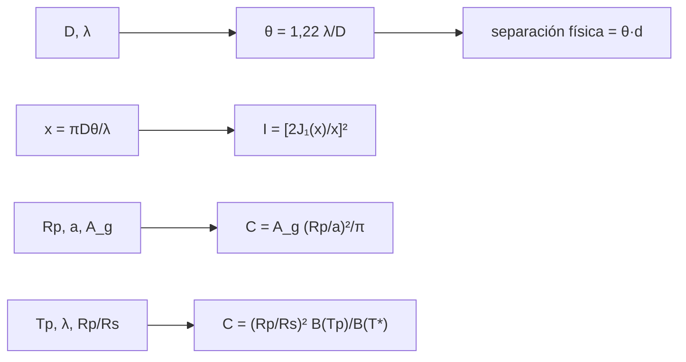

# B29-C06 — Imagen directa de exoplanetas

<!-- nav:top -->
[🏠 Programa](../../../../README.md) · [📚 Bloque B29](../../../tronco-comun/B29-astronomia-temporal-y-exoplanetas.md) · [← Anterior: B29-C05 — Microlentes gravitacionales](../B29-C05-microlentes-gravitacionales/CLASE.md) · [Siguiente: B29-C07 — Métodos de validación planetaria →](../B29-C07-metodos-de-validacion-planetaria/CLASE.md)
<!-- /nav -->

## 1. Ubicación, nivel y alcance

Clase 6 del bloque B29. Nivel N3. Ver un planeta junto a su estrella es difícil por dos razones: la estrella lo deslumbra y la difracción del telescopio extiende su luz. Aquí calculas el **patrón de Airy**, la **ventana angular** de un telescopio, el **contraste en luz reflejada** y el **contraste térmico** de planetas gigantes y terrestres. Usas óptica ondulatoria ([B05](../../../tronco-comun/B05-fisica-fundamental-para-el-espacio.md)), integrales numéricas ([B09-C11](../../B09/B09-C11-integrales-definidas/CLASE.md)) y la ley de Planck ([B28-C02](../../B28/B28-C02-fotones-en-multiples-longitudes-de-onda/CLASE.md)). Se trata un disco estelar sin resolver y albedos constantes.

## 2. Por qué esta clase existe

La imagen directa entrega espectros del planeta y la órbita completa, pero solo es posible con planetas jóvenes, calientes y lejanos de la estrella. La decisión central: **¿qué contraste y qué separación angular hay que alcanzar para ver un planeta dado?**

## 3. Lo que podrás hacer al terminar

1. Calcular la función de Bessel `J₁` por cuadratura y verificarla con su serie.
2. Calcular el patrón de Airy `[2J₁(x)/x]²` y su primer cero.
3. Calcular la ventana `1,22 λ/D` y su equivalente en au.
4. Calcular el contraste reflejado `A_g (Rp/a)²/π`.
5. Calcular el contraste térmico con Planck.
6. Comparar planetas gigantes y terrestres.

La evidencia es la **ficha de contraste y separación** del ejercicio 12 (sección 20).

## 4. Con qué llegas y cómo comprobarlo

1. ¿Qué es la difracción?
2. ¿Qué es el criterio de Rayleigh?
3. ¿Qué es el albedo geométrico?
4. ¿Qué es la ley de Planck?
5. ¿Qué es un coronógrafo?

<details>
<summary>Ver respuestas</summary>

1. La extensión de la luz al pasar por una abertura. 2. Dos fuentes se resuelven si su separación es `1,22 λ/D`. 3. El cociente del brillo en fase llena con el de un disco lambertiano. 4. La radiancia de un cuerpo negro. 5. Un instrumento que bloquea la luz de la estrella.
</details>

Con cuatro o cinco aciertos, sigue; si no, repasa B28-C02.

## 5. Un caso de contexto y un caso de referencia

Bowler resume que la imagen de alto contraste con óptica adaptativa y coronógrafos ha madurado en la última década y estudia las atmósferas de planetas gigantes autoluminosos (S2, resumen). Esta clase no usa sus cifras: con un telescopio de `8 m` a `1,6 μm` y una estrella a `10 pc`, `1,22 λ/D = 0,0503″`, o sea `0,503 au`. Es el **ejemplo conductor**.

## 6. Vocabulario

El **patrón de Airy** es la imagen de una fuente puntual. La **ventana angular** es la separación mínima. El **contraste** es el cociente de flujos planeta/estrella. La **luz reflejada** es la del planeta iluminado. La **emisión térmica** es la propia del planeta. La **fase** es el ángulo estrella–planeta–observador.

## 7. Modelo mental: ver una luciérnaga junto a un faro

El faro (la estrella) ciega, y su luz se extiende por difracción; la luciérnaga (el planeta) es `10⁹` veces más débil. Hay que suprimir el faro y alejarse lo suficiente.



*Descripción textual:* el diámetro y la longitud de onda dan la ventana y el patrón de Airy; la geometría orbital y el albedo dan el contraste reflejado; las temperaturas dan el contraste térmico; la ventana y la distancia dan la separación física mínima.

Analogía: una luciérnaga junto a un faro. Límite: no se modela el ruido de moteado.

## 8. La explicación, paso a paso

### 8.1 Patrón de Airy

`J₁` se calcula como `(1/π)∫cos(τ − x sin τ)dτ`; coincide con su serie a `10⁻⁹`. La primera raíz es `3,83171`, es decir `θ = 1,2197 λ/D`:

| `x` | `I/I₀` |
|---|---|
| 0,000 | 1,00000 |
| 1,000 | 0,774578 |
| 2,000 | 0,332612 |
| 3,000 | 0,051094 |
| 3,832 | ≈ 0 |
| 5,000 | 0,017169 |
| 5,140 | 0,017498 |
| 7,000 | `1,79 × 10⁻⁶` |

### 8.2 La ventana

Con `D = 8 m` y `λ = 1,6 μm`: `1,22 λ/D = 2,44 × 10⁻⁷ rad = 0,0503″`; a `10 pc` equivale a `0,503 au`.

### 8.3 Luz reflejada

| planeta | `a` (au) | albedo | contraste (fase 90°) |
|---|---|---|---|
| Júpiter | 5,2012 | 0,50 | `1,3436 × 10⁻⁹` |
| Tierra | 1,0000 | 0,30 | `1,7358 × 10⁻¹⁰` |

### 8.4 Emisión térmica

| planeta | `T` (K) | `λ` (μm) | contraste |
|---|---|---|---|
| Júpiter | 125 | 1,6 | `2,2643 × 10⁻³³` |
| Júpiter | 125 | 10,0 | `2,9976 × 10⁻⁸` |
| Tierra | 255 | 1,6 | `1,5256 × 10⁻¹⁹` |
| Tierra | 255 | 10,0 | `8,4644 × 10⁻⁸` |

### 8.5 Lectura

Un planeta frío es invisible a 1,6 μm por emisión propia (`10⁻³³`) pero a 10 μm su contraste térmico (`8,5 × 10⁻⁸`) es unas 500 veces mayor que el reflejado para la Tierra y unas 22 veces para Júpiter. Los planetas jóvenes y calientes son más fáciles.

## 9. Magnitudes, símbolos y unidades

| Símbolo | Qué es | Unidad | Valor / nota |
|---|---|---|---|
| `D` | diámetro | m | 8 (ilustrativo) |
| `λ` | longitud de onda | μm | 1,6; 10 |
| `θ_Airy` | primer cero | `λ/D` | 1,2197 |
| `A_g` | albedo geométrico | — | 0,50; 0,30 (ilustrativos) |
| `T_p` | temperatura del planeta | K | 125; 255 (ilustrativos) |
| `T_☉` | temperatura solar nominal | K | 5772 (S1) |

## 10. Convenciones y referencias

Fase de 90° con ley de Lambert (`1/π`); radios ecuatoriales nominales de la UAI; `1 pc = 648 000/π au`; albedos, temperaturas y diámetro **ilustrativos**.

## 11. De dónde sale lo que afirmamos

| ID | Fuente | Localizador | Respalda | Estado |
|---|---|---|---|---|
| S1 | UAI, Resolución B3 de 2015 | https://arxiv.org/abs/1510.07674 | `R_☉`, `R_J`, `R_⊕`, `T_eff` solar | Consultada el 2026-11-09 |
| S2 | Bowler, *Imaging Extrasolar Giant Planets*, arXiv:1605.02731 | https://arxiv.org/abs/1605.02731 | contexto: óptica adaptativa y coronógrafos | Solo resumen, consultado el 2026-11-09 |
| S3 | NIST (`h`, `c`, `k_B`) e IERS TN36 (`au`) | https://physics.nist.gov/cuu/Constants/Table/allascii.txt | constantes | Consultadas el 2026-11-09 |

Límites: S2 solo resumen; los contrastes no incluyen ruido de moteado; las fórmulas se verifican con la serie de `J₁` y su primer cero.

## 12. Cómo ver los contrastes

| Caso | contraste |
|---|---|
| Júpiter, reflejado | `10⁻⁹` |
| Tierra, reflejado | `10⁻¹⁰` |
| Tierra, térmico a 10 μm | `10⁻⁷` |

Descripción larga: la emisión térmica en el infrarrojo medio es mucho más favorable que la luz reflejada para planetas terrestres.

## 13. Ejemplo trabajado: contraste de la Tierra reflejado

**Paso 1 · Radio y distancia.** `Rp/a = 6,3781 × 10⁶/1,496 × 10¹¹ = 4,264 × 10⁻⁵`.

**Paso 2 · Cuadrado.** `1,818 × 10⁻⁹`.

**Paso 3 · Albedo y fase.** `0,3 × 1,818 × 10⁻⁹/π = 1,736 × 10⁻¹⁰`.

**Paso 4 · Sentido.** Un planeta diez mil millones de veces más débil que su estrella.

## 14. Distintas formas de describir la dificultad

**Por contraste:** flujo relativo. **Por separación:** `θ·d`. **Por banda:** reflejada o térmica. **Por supresión necesaria:** inversa del contraste.

## 15. Práctica guiada

**Ejercicio 1 · con los pasos indicados.** `1,22 λ/D` para `D = 30 m`, `λ = 1,6 μm`. *Pasos:* fórmula.

<details><summary>Solución comentada</summary>

`6,5 × 10⁻⁸ rad = 0,0134″`.
</details>

**Ejercicio 2 · con una pista.** Separación física a 10 pc con ese ángulo.

<details><summary>Solución comentada</summary>

`0,134 au`.
</details>

**Ejercicio 3 · casi autónomo.** Cociente del contraste de Júpiter y la Tierra (reflejado).

<details><summary>Solución comentada</summary>

`1,3436 × 10⁻⁹/1,7358 × 10⁻¹⁰ = 7,74`.
</details>

## 16. Práctica autónoma, transferencia e integrador

**Ejercicio 4.** Contraste de un Júpiter a `1 au` con albedo `0,5`.

<details><summary>Solución comentada</summary>

`0,5 × (7,1492 × 10⁷/1,496 × 10¹¹)²/π = 3,6 × 10⁻⁸`.
</details>

**Ejercicio 5.** Cociente térmico 10 μm / 1,6 μm de la Tierra.

<details><summary>Solución comentada</summary>

`8,4644 × 10⁻⁸/1,5256 × 10⁻¹⁹ = 5,5 × 10¹¹`.
</details>

**Ejercicio 6.** Supresión necesaria para ver la Tierra reflejada (contraste inverso).

<details><summary>Solución comentada</summary>

`5,8 × 10⁹`.
</details>

**Ejercicio 7.** `I/I₀` en el primer anillo brillante.

<details><summary>Solución comentada</summary>

`0,0175` (1,75 %).
</details>

**Ejercicio 8.** Ventana en au a 100 pc con 8 m y 1,6 μm.

<details><summary>Solución comentada</summary>

`5,03 au`.
</details>

**Ejercicio 9 · transferencia.** Un compañero dice que un telescopio grande basta para ver planetas terrestres. Responde con 8.3.

<details><summary>Solución comentada</summary>

Además de la resolución hace falta un contraste de `10⁻¹⁰`, que exige coronografía y control de la luz dispersa.
</details>

**Ejercicio 10 · transferencia.** ¿Por qué se prefiere el infrarrojo medio para planetas fríos?

<details><summary>Solución comentada</summary>

Porque su emisión térmica es mucho mayor: el contraste es unas 500 veces mejor que en luz reflejada para la Tierra (8.5).
</details>

**Ejercicio 11 · transferencia.** ¿Qué valida la serie de `J₁`?

<details><summary>Solución comentada</summary>

La cuadratura numérica; no el patrón de un telescopio real con obstrucción.
</details>

**Ejercicio 12 · integrador.** Elabora tu *ficha de contraste y separación*: ventana para tres telescopios, contraste reflejado y térmico de dos planetas y conclusión.

<details><summary>Solución modelo</summary>

Secciones 8.2–8.5.
</details>

## 17. Laboratorio: Airy y contrastes

El script [imagen_directa.py](imagen_directa.py) calcula `J₁` por cuadratura (**comprueba** `10⁻⁹` frente a la serie), su primer cero (**comprueba** `10⁻⁴`) y los contrastes.

**Datos:** constantes de NIST/UAI/IERS; albedos, temperaturas y telescopio **ilustrativos**. **Predice antes de ejecutar:** ¿qué contraste tiene la Tierra reflejada? (`10⁻¹⁰`.) **Ejecución del 2026-11-09 (Python 3.12.9):**

```text
Python 3.12.9 (biblioteca estandar)
primera raiz de J1 = 3.83171 -> primer anillo oscuro en theta = 1.2197 lambda/D (1.22 lambda/D es el criterio de Rayleigh)
     x         I/I0
 0.000  1.00000e+00
 1.000  7.74578e-01
 2.000  3.32612e-01
 3.000  5.10938e-02
 3.832  1.68330e-33
 5.000  1.71693e-02
 5.140  1.74975e-02
 7.000  1.79011e-06
D = 8.0 m, lambda = 1.6 um: 1.22 lambda/D = 2.4400e-07 rad = 0.0503 arcsec -> separacion fisica a 10 pc = 0.503 au
planeta    a [au]  albedo  C reflejado (alfa = 90)
Jupiter    5.2012    0.50               1.3436e-09
Tierra     1.0000    0.30               1.7358e-10
planeta    T [K]  lambda [um]    C termico
Jupiter      125          1.6   2.2643e-33
Jupiter      125         10.0   2.9976e-08
Tierra       255          1.6   1.5256e-19
Tierra       255         10.0   8.4644e-08
Pruebas superadas.
```

```bash
python programa/clases/B29/B29-C06-imagen-directa-de-exoplanetas/imagen_directa.py
```

**Límites:** disco estelar sin resolver, albedo constante, sin moteado ni obstrucción.

## 18. Errores frecuentes y cómo corregirlos

**Confundir resolución y contraste.** Se corrige con el ejercicio 9.

**Olvidar el factor `1/π` de Lambert.** Se corrige con el ejemplo 13.

**Usar la longitud de onda equivocada.** Se corrige con el ejercicio 5.

**Mezclar radios ecuatoriales y polares.** Se corrige con la sección 10.

**Tomar los albedos por medidos.** Se corrige con la sección 10.

## 19. Cómo sabrás que vas bien

Tras 8.2: ¿qué ventana da `8 m` a `1,6 μm`? Si dudas, ejercicio 1. Tras 8.5: ¿por qué 10 μm? Ejercicio 10. Tras el laboratorio: ¿qué valida? (la cuadratura de `J₁`).

## 20. Qué entregas y cómo se evalúa

El producto es tu **ficha de contraste y separación** (ejercicio 12).

| Criterio | Inicial | En desarrollo | Logrado | Destacado |
|---|---|---|---|---|
| Conceptos | Los confunde | Parciales | Airy, ventana, contraste | Explica reflejada frente a térmica |
| Cálculo | Sin unidades | Con errores | Tablas completas | Calcula supresión |
| Numérico | Sin comprobar | Un caso | Serie y cero | Interpreta tolerancias |
| Fuentes | Sin fuente | Sin fecha | S1–S3 con fecha | Declara S2 como resumen |
| Límites | No los nombra | Uno | Tres | Discute el moteado |

**Condiciones críticas (no se compensan con promedio):** rotular albedos y temperaturas como ilustrativos; no presentar contrastes como detectabilidad real; citar solo lo consultado.

## 21. Ética, seguridad y límites

Clase educativa: no es un simulador de coronógrafo. Accesibilidad: tablas equivalentes a las gráficas, fórmulas en texto, ejercicios sin conexión.

## 22. Para cerrar y seguir

El primer cero de Airy está en `1,22 λ/D` (`0,50 au` a 10 pc con 8 m), el contraste reflejado de la Tierra es `10⁻¹⁰` y el térmico a 10 μm, `10⁻⁷`. Queda una pregunta: ¿cómo se decide que una señal candidata es realmente un planeta?

**Glosario español–inglés.** imagen directa · *direct imaging*; patrón de Airy · *Airy pattern*; contraste · *contrast*; luz reflejada · *reflected light*; emisión térmica · *thermal emission*; coronógrafo · *coronagraph*.

**Continuidad.** [B29-C07](../B29-C07-metodos-de-validacion-planetaria/CLASE.md) estudia los métodos de validación planetaria.

**Referencias:** ver sección 11.

<!-- nav:bottom -->
---

[← Anterior: B29-C05 — Microlentes gravitacionales](../B29-C05-microlentes-gravitacionales/CLASE.md) · [📚 Bloque B29](../../../tronco-comun/B29-astronomia-temporal-y-exoplanetas.md) · [Siguiente: B29-C07 — Métodos de validación planetaria →](../B29-C07-metodos-de-validacion-planetaria/CLASE.md)
<!-- /nav -->
