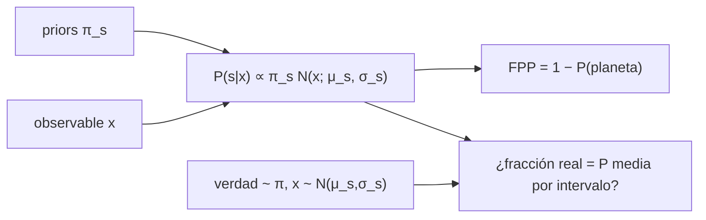

# B29-C07 — Métodos de validación planetaria

<!-- nav:top -->
[🏠 Programa](../../../../README.md) · [📚 Bloque B29](../../../tronco-comun/B29-astronomia-temporal-y-exoplanetas.md) · [← Anterior: B29-C06 — Imagen directa de exoplanetas](../B29-C06-imagen-directa-de-exoplanetas/CLASE.md) · [Siguiente: B29-C08 — Falsos positivos de tránsito →](../B29-C08-falsos-positivos-de-transito/CLASE.md)
<!-- /nav -->

## 1. Ubicación, nivel y alcance

Clase 7 del bloque B29. Nivel N3. Muchos candidatos a planeta no se pueden confirmar por velocidad radial; se **validan** estadísticamente mostrando que la probabilidad de que sean falsos positivos es muy baja. Aquí calculas la **probabilidad posterior** de cada escenario con la regla de Bayes, tomas un observable de forma como evidencia y compruebas por Monte Carlo la **calibración** de las probabilidades. Usas probabilidad ([B12](../../../tronco-comun/B12-probabilidad-estadistica-e-incertidumbre.md)) y los tránsitos de [B29-C01](../B29-C01-transitos-planetarios/CLASE.md). Se trata un observable único con tres escenarios.

## 2. Por qué esta clase existe

Hay muchos más candidatos que posibilidades de seguimiento. Validar bien exige probabilidades honestas: ni optimistas ni conservadoras en exceso. La decisión central: **¿qué probabilidad de ser planeta tiene un candidato dada su evidencia y están calibradas esas probabilidades?**

## 3. Lo que podrás hacer al terminar

1. Definir escenarios, priors y verosimilitudes.
2. Calcular `P(s | x) = π_s N(x; μ_s, σ_s)/Σ π N`.
3. Definir la probabilidad de falso positivo `FPP = 1 − P(planeta)`.
4. Simular candidatos con la verdad extraída del prior.
5. Verificar la calibración por intervalos.
6. Reconocer cuándo una sola evidencia no basta.

La evidencia es la **ficha de validación con su calibración** del ejercicio 12 (sección 20).

## 4. Con qué llegas y cómo comprobarlo

1. ¿Qué es la regla de Bayes?
2. ¿Qué es un prior?
3. ¿Qué es una verosimilitud?
4. ¿Qué es la calibración?
5. ¿Qué es una binaria eclipsante?

<details>
<summary>Ver respuestas</summary>

1. `P(A|B) = P(B|A)P(A)/P(B)`. 2. La probabilidad antes de los datos. 3. La probabilidad de los datos dado el escenario. 4. Que `P` = frecuencia real. 5. Dos estrellas que se eclipsan mutuamente.
</details>

Con cuatro o cinco aciertos, sigue; si no, repasa B12.

## 5. Un caso de contexto y un caso sintético

Morton presenta un procedimiento general para calcular la probabilidad de falso positivo de un candidato a partir de su periodo, profundidad, duración y forma, de los colores de la estrella y del seguimiento; entonces Kepler tenía más de `2300` candidatos y solo `77` planetas confirmados (S2, resumen). Esta clase no reproduce ese método: usa tres escenarios sintéticos (planeta `0,30`, binaria de fondo `0,40`, binaria jerárquica `0,30`) y un observable `x` normal en cada uno. Es el **ejemplo conductor**.

## 6. Vocabulario

La **validación** es la prueba estadística de que es un planeta. La **FPP** es la probabilidad de falso positivo. El **escenario** es una hipótesis. El **prior** es su frecuencia. La **calibración** compara probabilidades y frecuencias. La **binaria de fondo** y la **jerárquica** imitan un tránsito.

## 7. Modelo mental: tres sospechosos y un testigo

Hay tres sospechosos con distinta frecuencia previa. Un testigo (el observable) los describe con distinta probabilidad. La regla de Bayes combina ambas cosas.



*Descripción textual:* los priors y el observable dan la probabilidad posterior de cada escenario; una simulación con verdades extraídas de los priors comprueba que las probabilidades sean frecuencias reales.

Analogía: tres sospechosos. Límite: un solo observable da poca discriminación.

## 8. La explicación, paso a paso

### 8.1 Escenarios

| escenario | prior | `μ` | `σ` |
|---|---|---|---|
| planeta | 0,30 | 0,10 | 0,05 |
| binaria de fondo | 0,40 | 0,40 | 0,20 |
| binaria jerárquica | 0,30 | 0,25 | 0,10 |

(valores ilustrativos).

### 8.2 Probabilidades posteriores

| `x` | `P(planeta)` | `P(BEB)` | `P(HEB)` | FPP |
|---|---|---|---|---|
| 0,02 | 0,7548 | 0,1488 | 0,0964 | 0,2452 |
| 0,10 | 0,7871 | 0,0852 | 0,1278 | 0,2129 |
| 0,15 | 0,5709 | 0,1436 | 0,2855 | 0,4291 |
| 0,20 | 0,1738 | 0,2596 | 0,5666 | 0,8262 |
| 0,30 | 0,0005 | 0,3998 | 0,5997 | 0,9995 |
| 0,50 | 0,0000 | 0,9305 | 0,0695 | 1,0000 |

### 8.3 Calibración

Con `200 000` candidatos simulados:

| intervalo `P(planeta)` | `n` | `P` media | fracción real | dif. |
|---|---|---|---|---|
| [0,00; 0,10) | 106 353 | 0,0067 | 0,0067 | 0,0001 |
| [0,10; 0,30) | 11 847 | 0,1923 | 0,1936 | −0,0013 |
| [0,30; 0,50) | 11 068 | 0,4033 | 0,4037 | −0,0003 |
| [0,50; 0,70) | 19 073 | 0,6147 | 0,6173 | −0,0027 |
| [0,70; 0,90) | 51 659 | 0,7849 | 0,7862 | −0,0014 |

La probabilidad coincide con la frecuencia real a menos de `0,003`.

### 8.4 Ningún candidato se valida

La probabilidad máxima de planeta es `0,79`; no hay candidatos con `P ≥ 0,9`. Con un solo observable débil, el FPP mínimo es `0,21`: no se puede validar.

### 8.5 La población

La fracción de planetas simulada es `0,2993` y la probabilidad media `0,2986`, ambas cerca del prior `0,30`.

## 9. Magnitudes, símbolos y unidades

| Símbolo | Qué es | Unidad | Valor / nota |
|---|---|---|---|
| `π_s` | prior del escenario | — | 0,30; 0,40; 0,30 (ilustrativos) |
| `x` | observable (ingreso/duración) | — | 0–0,5 |
| `P(s|x)` | probabilidad posterior | — | ver 8.2 |
| FPP | probabilidad de falso positivo | — | 0,21–1 |
| `n` | candidatos simulados | — | 200 000 |
| semilla | repetibilidad | — | 20261109 |

## 10. Convenciones y referencias

Un observable; tres escenarios con distribuciones normales; priors y distribuciones **ilustrativos**; sin seguimiento ni colores.

## 11. De dónde sale lo que afirmamos

| ID | Fuente | Localizador | Respalda | Estado |
|---|---|---|---|---|
| S1 | Cálculo propio: regla de Bayes y simulación | implementado en `validacion.py` | tablas 8.2–8.5 | Verificado por calibración |
| S2 | Morton, arXiv:1206.1568 | https://arxiv.org/abs/1206.1568 | `> 2300` candidatos; `77` confirmados; procedimiento general de FPP | Solo resumen, consultado el 2026-11-09 |

Límites: S2 solo resumen; el modelo del laboratorio es un juguete sin relación cuantitativa con ese procedimiento; los priors son ilustrativos.

## 12. Cómo ver la calibración

| Declarado | Real |
|---|---|
| 0,19 | 0,19 |
| 0,40 | 0,40 |
| 0,78 | 0,79 |

Descripción larga: en cada intervalo, las probabilidades declaradas coinciden con las frecuencias reales, que es lo que define una buena calibración.

## 13. Ejemplo trabajado: x = 0,10

**Paso 1 · Verosimilitudes.** `N(0,1; 0,1, 0,05) = 7,98`; `N(0,1; 0,4, 0,2) = 0,647`; `N(0,1; 0,25, 0,1) = 1,295`.

**Paso 2 · Pesos.** `0,3 × 7,98 = 2,394`; `0,4 × 0,647 = 0,259`; `0,3 × 1,295 = 0,389`.

**Paso 3 · Suma.** `3,042`.

**Paso 4 · Planeta.** `2,394/3,042 = 0,787`.

## 14. Distintas formas de describir la validación

**Por probabilidad:** `P(planeta)`. **Por FPP:** `1 − P`. **Por razón de verosimilitudes:** Bayes. **Por calibración:** frecuencias.

## 15. Práctica guiada

**Ejercicio 1 · con los pasos indicados.** FPP si `P(planeta) = 0,787`. *Pasos:* `1 − P`.

<details><summary>Solución comentada</summary>

`0,213`.
</details>

**Ejercicio 2 · con una pista.** Prior de la binaria de fondo.

<details><summary>Solución comentada</summary>

`0,40`.
</details>

**Ejercicio 3 · casi autónomo.** Verosimilitud del planeta en `x = 0,1`.

<details><summary>Solución comentada</summary>

`1/(0,05√(2π)) = 7,98`.
</details>

## 16. Práctica autónoma, transferencia e integrador

**Ejercicio 4.** Máxima `P(planeta)` alcanzable en este modelo.

<details><summary>Solución comentada</summary>

Cerca de `0,79` (en `x ≈ 0,1`).
</details>

**Ejercicio 5.** ¿Cuántos candidatos reales hay en el intervalo `[0,10; 0,30)`?

<details><summary>Solución comentada</summary>

`0,1936 × 11 847 = 2294`.
</details>

**Ejercicio 6.** Diferencia en el intervalo `[0,50; 0,70)`.

<details><summary>Solución comentada</summary>

`0,6147 − 0,6173 = −0,0027`.
</details>

**Ejercicio 7.** FPP en `x = 0,5`.

<details><summary>Solución comentada</summary>

`1,0000`.
</details>

**Ejercicio 8.** Fracción de planetas en la población simulada.

<details><summary>Solución comentada</summary>

`0,2993`.
</details>

**Ejercicio 9 · transferencia.** Un compañero dice que `P = 0,79` valida el candidato. Responde con 8.4.

<details><summary>Solución comentada</summary>

La validación suele exigir FPP muy bajo; con `0,21` queda sin validar.
</details>

**Ejercicio 10 · transferencia.** ¿Qué haría falta para validar?

<details><summary>Solución comentada</summary>

Más evidencia independiente (colores, seguimiento, imágenes) que separe los escenarios.
</details>

**Ejercicio 11 · transferencia.** ¿Qué prueba la calibración?

<details><summary>Solución comentada</summary>

Que las probabilidades son frecuencias reales bajo el modelo supuesto; no que el modelo sea el mundo real.
</details>

**Ejercicio 12 · integrador.** Elabora tu *ficha de validación con su calibración*: escenarios, probabilidades en seis valores de `x`, tabla de calibración y conclusión.

<details><summary>Solución modelo</summary>

Secciones 8.1–8.5.
</details>

## 17. Laboratorio: Bayes y calibración

El script [validacion.py](validacion.py) calcula posteriores y los calibra en `200 000` candidatos simulados (**comprueba** `0,015`).

**Datos:** sin constantes; todo **ilustrativo** con semilla fija. **Predice antes de ejecutar:** ¿alcanzará algún candidato `P ≥ 0,9`? (no.) **Ejecución del 2026-11-09 (Python 3.12.9):**

```text
Python 3.12.9 (biblioteca estandar)
     x  P(planeta)   P(BEB)   P(HEB)     FPP
  0.02      0.7548   0.1488   0.0964  0.2452
  0.10      0.7871   0.0852   0.1278  0.2129
  0.15      0.5709   0.1436   0.2855  0.4291
  0.20      0.1738   0.2596   0.5666  0.8262
  0.30      0.0005   0.3998   0.5997  0.9995
  0.50      0.0000   0.9305   0.0695  1.0000
  intervalo P(planeta)       n   P media  fraccion real    dif.
[0.00, 0.10)            106353    0.0067         0.0067  0.0001
[0.10, 0.30)             11847    0.1923         0.1936 -0.0013
[0.30, 0.50)             11068    0.4033         0.4037 -0.0003
[0.50, 0.70)             19073    0.6147         0.6173 -0.0027
[0.70, 0.90)             51659    0.7849         0.7862 -0.0014
[0.90, 0.99)         0  (pocos candidatos)
[0.99, 1.00)         0  (pocos candidatos)
fraccion de planetas en la poblacion simulada = 0.2993 ; P(planeta) media = 0.2986 ; prior = 0.3000
Pruebas superadas.
```

```bash
python programa/clases/B29/B29-C07-metodos-de-validacion-planetaria/validacion.py
```

**Límites:** un observable, tres escenarios, distribuciones normales.

## 18. Errores frecuentes y cómo corregirlos

**Confundir verosimilitud y posterior.** Se corrige con el ejemplo 13.

**Olvidar el prior.** Se corrige con el ejercicio 2.

**Dar por validado un FPP alto.** Se corrige con el ejercicio 9.

**Creer que calibrado es correcto.** Se corrige con el ejercicio 11.

**Tomar los escenarios por reales.** Se corrige con la sección 10.

## 19. Cómo sabrás que vas bien

Tras 8.2: ¿qué P tiene `x = 0,1`? Si dudas, ejemplo 13. Tras 8.4: ¿por qué no se valida? Ejercicio 9. Tras el laboratorio: ¿qué valida? (la calibración).

## 20. Qué entregas y cómo se evalúa

El producto es tu **ficha de validación con su calibración** (ejercicio 12).

| Criterio | Inicial | En desarrollo | Logrado | Destacado |
|---|---|---|---|---|
| Conceptos | Los confunde | Parciales | Escenarios, posterior, FPP | Explica la calibración |
| Cálculo | Sin unidades | Con errores | Tablas completas | Calcula casos extremos |
| Numérico | Sin comprobar | Un caso | Simulación y calibración | Interpreta diferencias |
| Fuentes | Sin fuente | Sin fecha | S1–S2 con fecha | Declara S2 como resumen |
| Límites | No los nombra | Uno | Tres | Discute más evidencias |

**Condiciones críticas (no se compensan con promedio):** rotular priors como ilustrativos; no presentar el modelo como el de ningún estudio; citar solo lo consultado.

## 21. Ética, seguridad y límites

Clase educativa: no valida ningún candidato real. Accesibilidad: tablas equivalentes a las gráficas, fórmulas en texto, ejercicios sin conexión.

## 22. Para cerrar y seguir

La regla de Bayes da probabilidades calibradas (diferencias menores que `0,003`), pero con un solo observable el FPP mínimo es `0,21`: validar exige más evidencia. Queda una pregunta: ¿qué fenómenos imitan un tránsito y cómo se descartan?

**Glosario español–inglés.** validación planetaria · *planet validation*; probabilidad de falso positivo · *false positive probability*; escenario · *scenario*; binaria de fondo · *background eclipsing binary*; calibración · *calibration*; prior · *prior*.

**Continuidad.** [B29-C08](../B29-C08-falsos-positivos-de-transito/CLASE.md) estudia los falsos positivos de tránsito.

**Referencias:** ver sección 11.

<!-- nav:bottom -->
---

[← Anterior: B29-C06 — Imagen directa de exoplanetas](../B29-C06-imagen-directa-de-exoplanetas/CLASE.md) · [📚 Bloque B29](../../../tronco-comun/B29-astronomia-temporal-y-exoplanetas.md) · [Siguiente: B29-C08 — Falsos positivos de tránsito →](../B29-C08-falsos-positivos-de-transito/CLASE.md)
<!-- /nav -->
