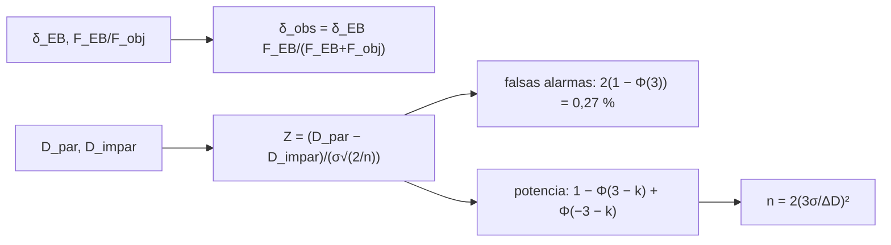

# B29-C08 — Falsos positivos de tránsito

<!-- nav:top -->
[🏠 Programa](../../../../README.md) · [📚 Bloque B29](../../../tronco-comun/B29-astronomia-temporal-y-exoplanetas.md) · [← Anterior: B29-C07 — Métodos de validación planetaria](../B29-C07-metodos-de-validacion-planetaria/CLASE.md) · [Siguiente: B29-C09 — Parámetros orbitales exoplanetarios →](../../../tronco-comun/B29-astronomia-temporal-y-exoplanetas.md#b29-c09)
<!-- /nav -->

## 1. Ubicación, nivel y alcance

Clase 8 del bloque B29. Nivel N3. No todo descenso periódico de brillo es un planeta: una **binaria eclipsante** de fondo o ligada puede imitarlo. Aquí calculas la **dilución** de una binaria por la luz del objetivo, diseñas la **prueba par–impar** (si el periodo verdadero es el doble, los eclipses alternos difieren) y evalúas por Monte Carlo su **tasa de falsas alarmas** y su **potencia**. Usas probabilidad ([B12](../../../tronco-comun/B12-probabilidad-estadistica-e-incertidumbre.md)) y la validación de [B29-C07](../B29-C07-metodos-de-validacion-planetaria/CLASE.md). Los números son sintéticos.

## 2. Por qué esta clase existe

Una pequeña fracción de falsos positivos contamina cualquier muestra de planetas. Conocer qué pruebas los detectan, con qué potencia y con qué falsas alarmas, permite diseñar cribados honestos. La decisión central: **¿cuántos eclipses se necesitan para que la prueba par–impar detecte una diferencia dada con una tasa de falsas alarmas controlada?**

## 3. Lo que podrás hacer al terminar

1. Calcular la profundidad diluida `δ_obs = δ_EB F_EB/(F_EB+F_obj)`.
2. Reconocer el planeta que imita una binaria diluida.
3. Definir el estadístico par–impar `Z = (D_par − D_impar)/(σ√(2/n))`.
4. Verificar por Monte Carlo la tasa de falsas alarmas.
5. Calcular la potencia analítica y verificarla.
6. Estimar el número de eclipses necesarios.

La evidencia es la **ficha de una prueba par–impar** del ejercicio 12 (sección 20).

## 4. Con qué llegas y cómo comprobarlo

1. ¿Qué es una binaria eclipsante?
2. ¿Qué es la dilución?
3. ¿Qué es una prueba de hipótesis?
4. ¿Qué es la potencia?
5. ¿Qué es una tasa de falsas alarmas?

<details>
<summary>Ver respuestas</summary>

1. Dos estrellas que se eclipsan. 2. La reducción de la profundidad por luz de otras fuentes. 3. Una regla para decidir entre hipótesis. 4. La probabilidad de detectar un efecto real. 5. La probabilidad de declarar un efecto sin existir.
</details>

Con cuatro o cinco aciertos, sigue; si no, repasa B12.

## 5. Un caso de contexto y un caso sintético

Fressin y colaboradores simulan los falsos positivos astrofísicos de Kepler (binarias eclipsantes de fondo o ligadas a la estrella) y la fracción que superaría el cribado de candidatos (S2, resumen). Esta clase no reproduce ese cálculo: una binaria 100 veces más débil que el objetivo con eclipses del `20 %` produce una profundidad observada de `1980 ppm`, la de un planeta con `k = 0,0445`. Es el **ejemplo conductor**.

## 6. Vocabulario

La **dilución** reduce la profundidad. El **falso positivo** imita un tránsito. La **prueba par–impar** compara eclipses alternos. La **tasa de falsas alarmas** es la probabilidad de rechazar una hipótesis cierta. La **potencia** es la probabilidad de detectar una diferencia real. El **eclipse secundario** es el de la estrella más fría.

## 7. Modelo mental: un metrónomo que se salta un compás

Si un metrónomo marca cada 2 s pero uno de cada dos golpes suena más fuerte, medir solo cada 4 s hace creer que suena cada 4 s. Comparar golpes pares e impares delata el truco.



*Descripción textual:* una binaria diluida imita un planeta; la diferencia entre eclipses pares e impares, normalizada por su error, da un estadístico cuya tasa de falsas alarmas y potencia se obtienen analíticamente y se verifican por simulación.

Analogía: un metrónomo con compás oculto. Límite: ruido gaussiano independiente por eclipse.

## 8. La explicación, paso a paso

### 8.1 Dilución

Con eclipses del `20 %`:

| `F_EB/F_obj` | `δ_obs` |
|---|---|
| 0,001 | `1,998 × 10⁻⁴` |
| 0,010 | `1,9802 × 10⁻³` |
| 0,050 | `9,5238 × 10⁻³` |
| 0,200 | `3,3333 × 10⁻²` |
| 1,000 | `1,0000 × 10⁻¹` |

### 8.2 Error de la prueba

Con `n = 8` eclipses de cada tipo y `σ = 1000 ppm`, el error de la diferencia es `σ√(2/n) = 500 ppm`.

### 8.3 Falsas alarmas

A `3σ` (dos colas) la tasa esperada es `0,00270` y el Monte Carlo (40 000 ensayos) da `0,00263`, dentro de `0,00026`.

### 8.4 Potencia

| `ΔD/sd` | analítica | Monte Carlo |
|---|---|---|
| 0,5 | 0,0064 | 0,0062 |
| 1,0 | 0,0228 | 0,0232 |
| 2,0 | 0,1587 | 0,1563 |
| 3,0 | 0,5000 | 0,5027 |
| 5,0 | 0,9772 | 0,9777 |

### 8.5 Número de eclipses

Para detectar una diferencia de `500 ppm` (el `10 %` de una profundidad de `5000 ppm`) a `3σ` con potencia `0,5` hacen falta unos `72` eclipses de cada tipo.

## 9. Magnitudes, símbolos y unidades

| Símbolo | Qué es | Unidad | Valor / nota |
|---|---|---|---|
| `δ_EB` | profundidad de la binaria | — | 0,20 (ilustrativa) |
| `δ_obs` | profundidad observada | ppm | 1980 |
| `σ` | ruido por eclipse | ppm | 1000 (ilustrativo) |
| `n` | eclipses de cada tipo | — | 8 |
| `Z` | estadístico par–impar | — | umbral 3 |
| `k` | diferencia en unidades de `sd` | — | 0,5–5 |

## 10. Convenciones y referencias

Ruido gaussiano independiente; umbral de `3σ` a dos colas; semilla `20261109`; profundidades, flujos y ruido **ilustrativos**.

## 11. De dónde sale lo que afirmamos

| ID | Fuente | Localizador | Respalda | Estado |
|---|---|---|---|---|
| S1 | Cálculo propio: dilución, estadístico par–impar y Monte Carlo | implementado en `falsos_positivos.py` | tablas 8.1–8.5 | Verificado por simulación |
| S2 | Fressin et al., arXiv:1301.0842 | https://arxiv.org/abs/1301.0842 | simulación de falsos positivos de Kepler | Solo resumen, consultado el 2026-11-09 |

Límites: S2 solo resumen y sin cifras usadas; el modelo es un juguete con ruido gaussiano; no se estima ninguna tasa de falsos positivos real.

## 12. Cómo ver la potencia

| Diferencia | Detección |
|---|---|
| `1 sd` | 2 % |
| `3 sd` | 50 % |
| `5 sd` | 98 % |

Descripción larga: la potencia crece rápido con la diferencia; con `3 sd` se detecta la mitad de las veces.

## 13. Ejemplo trabajado: la binaria 100 veces más débil

**Paso 1 · Datos.** `δ_EB = 0,2`; `F_EB/F_obj = 0,01`.

**Paso 2 · Dilución.** `0,2 × 0,01/1,01 = 1,980 × 10⁻³`.

**Paso 3 · Tamaño equivalente.** `k = √(1,98 × 10⁻³) = 0,0445`.

**Paso 4 · Sentido.** Se ve como un planeta de `4,45 %` del radio estelar: para una estrella solar, unos `31 000 km`, es decir `4,9` radios terrestres.

## 14. Distintas formas de describir una prueba

**Por estadístico:** `Z`. **Por falsas alarmas:** `α`. **Por potencia:** `1 − β`. **Por eclipses necesarios:** `n`.

## 15. Práctica guiada

**Ejercicio 1 · con los pasos indicados.** `δ_obs` para `F_EB/F_obj = 0,05`. *Pasos:* `0,2 × 0,05/1,05`.

<details><summary>Solución comentada</summary>

`9,5238 × 10⁻³`.
</details>

**Ejercicio 2 · con una pista.** Error de la diferencia con `n = 32`.

<details><summary>Solución comentada</summary>

`1000 × √(2/32) = 250 ppm`.
</details>

**Ejercicio 3 · casi autónomo.** Falsas alarmas a `3σ`.

<details><summary>Solución comentada</summary>

`0,0027`.
</details>

## 16. Práctica autónoma, transferencia e integrador

**Ejercicio 4.** Potencia con `ΔD = 3 sd`.

<details><summary>Solución comentada</summary>

`0,5000`.
</details>

**Ejercicio 5.** Eclipses para detectar `250 ppm` a `3σ` con potencia `0,5`.

<details><summary>Solución comentada</summary>

`n = 2(3 × 1000/250)² = 288`.
</details>

**Ejercicio 6.** Falsas alarmas esperadas en `10 000` candidatos reales.

<details><summary>Solución comentada</summary>

`27`.
</details>

**Ejercicio 7.** Diferencia relativa Monte Carlo/analítica en `ΔD = 5 sd`.

<details><summary>Solución comentada</summary>

`0,9777/0,9772 − 1 = 0,05 %`.
</details>

**Ejercicio 8.** Profundidad observada si `F_EB/F_obj = 1`.

<details><summary>Solución comentada</summary>

`0,10`.
</details>

**Ejercicio 9 · transferencia.** Un compañero dice que si la prueba par–impar no detecta nada, no es una binaria. Responde con 8.4.

<details><summary>Solución comentada</summary>

Con diferencias pequeñas la potencia es baja (2 % para `1 sd`): la ausencia de señal no descarta una binaria.
</details>

**Ejercicio 10 · transferencia.** ¿Por qué se mide también el eclipse secundario?

<details><summary>Solución comentada</summary>

Porque una binaria presenta un segundo eclipse a fase 0,5 que un planeta oscuro no produce.
</details>

**Ejercicio 11 · transferencia.** ¿Qué valida el Monte Carlo?

<details><summary>Solución comentada</summary>

Que el estadístico tiene la tasa de falsas alarmas y la potencia teóricas con ruido gaussiano; no que los datos reales lo sean.
</details>

**Ejercicio 12 · integrador.** Elabora tu *ficha de una prueba par–impar*: tabla de dilución, error, falsas alarmas, potencia y eclipses necesarios.

<details><summary>Solución modelo</summary>

Secciones 8.1–8.5.
</details>

## 17. Laboratorio: dilución y prueba par–impar

El script [falsos_positivos.py](falsos_positivos.py) calcula la dilución y simula la prueba (**comprueba** 4 desviaciones binomiales en las falsas alarmas y `0,01` en la potencia).

**Datos:** sin constantes; todo **ilustrativo** con semilla fija. **Predice antes de ejecutar:** ¿qué potencia tiene `3 sd`? (50 %.) **Ejecución del 2026-11-09 (Python 3.12.9):**

```text
Python 3.12.9 (biblioteca estandar)
 F_EB/F_obj  delta observada
      0.001      1.99800e-04
      0.010      1.98020e-03
      0.050      9.52381e-03
      0.200      3.33333e-02
      1.000      1.00000e-01
binaria 100 veces mas debil con eclipse de 20 %: profundidad observada = 1980 ppm = la de un planeta con k = 0.0445
error de la diferencia par-impar con 8 eclipses de cada tipo y sigma = 1000 ppm: 500.0 ppm
tasa de falsas alarmas a 3.0 sigma: 0.00263 (esperada 0.00270 +/- 0.00026)
 delta D / sd  potencia analitica  potencia MC
          0.5              0.0064       0.0062
          1.0              0.0228       0.0232
          2.0              0.1587       0.1563
          3.0              0.5000       0.5027
          5.0              0.9772       0.9777
para detectar una diferencia de 500 ppm (10 % de 5000 ppm) con potencia 0.5 hacen falta ~72 eclipses de cada tipo
Pruebas superadas.
```

```bash
python programa/clases/B29/B29-C08-falsos-positivos-de-transito/falsos_positivos.py
```

**Límites:** ruido gaussiano, eclipses independientes, sin eclipse secundario ni variabilidad estelar.

## 18. Errores frecuentes y cómo corregirlos

**Olvidar la dilución.** Se corrige con el ejemplo 13.

**Confundir falsas alarmas y potencia.** Se corrige con la sección 6.

**Dar por descartado sin potencia.** Se corrige con el ejercicio 9.

**Usar una cola.** Se corrige con la sección 10.

**Tomar el ruido por real.** Se corrige con la sección 10.

## 19. Cómo sabrás que vas bien

Tras 8.1: ¿cuánto diluye una compañera cien veces más débil? Si dudas, ejemplo 13. Tras 8.4: ¿qué potencia hay a `1 sd`? Ejercicio 9. Tras el laboratorio: ¿qué valida? (el estadístico).

## 20. Qué entregas y cómo se evalúa

El producto es tu **ficha de una prueba par–impar** (ejercicio 12).

| Criterio | Inicial | En desarrollo | Logrado | Destacado |
|---|---|---|---|---|
| Conceptos | Los confunde | Parciales | Dilución, prueba, potencia | Explica los límites |
| Cálculo | Sin unidades | Con errores | Tablas completas | Calcula eclipses necesarios |
| Numérico | Sin comprobar | Un caso | Dos simulaciones | Interpreta errores binomiales |
| Fuentes | Sin fuente | Sin fecha | S1–S2 con fecha | Declara S2 como resumen |
| Límites | No los nombra | Uno | Tres | Discute el eclipse secundario |

**Condiciones críticas (no se compensan con promedio):** rotular el modelo como ilustrativo; no estimar tasas reales de falsos positivos; citar solo lo consultado.

## 21. Ética, seguridad y límites

Clase educativa: no es un cribador de candidatos. Accesibilidad: tablas equivalentes a las gráficas, fórmulas en texto, ejercicios sin conexión.

## 22. Para cerrar y seguir

Una binaria 100 veces más débil con eclipses del 20 % imita un planeta de `4,4 %` de radio estelar; la prueba par–impar tiene `0,27 %` de falsas alarmas a `3σ` y solo un `2 %` de potencia para diferencias de `1 sd`. Queda una pregunta: ¿cómo se determina la órbita completa de un planeta confirmado?

**Glosario español–inglés.** falso positivo · *false positive*; binaria eclipsante · *eclipsing binary*; dilución · *dilution*; prueba par–impar · *odd–even test*; potencia · *power*; eclipse secundario · *secondary eclipse*.

**Continuidad.** [B29-C09](../B29-C09-parametros-orbitales-exoplanetarios/CLASE.md) estudia los parámetros orbitales exoplanetarios.

**Referencias:** ver sección 11.

<!-- nav:bottom -->
---

[← Anterior: B29-C07 — Métodos de validación planetaria](../B29-C07-metodos-de-validacion-planetaria/CLASE.md) · [📚 Bloque B29](../../../tronco-comun/B29-astronomia-temporal-y-exoplanetas.md) · [Siguiente: B29-C09 — Parámetros orbitales exoplanetarios →](../../../tronco-comun/B29-astronomia-temporal-y-exoplanetas.md#b29-c09)
<!-- /nav -->
