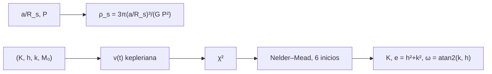

# B29-C09 — Parámetros orbitales exoplanetarios

<!-- nav:top -->
[🏠 Programa](../../../../README.md) · [📚 Bloque B29](../../../tronco-comun/B29-astronomia-temporal-y-exoplanetas.md) · [← Anterior: B29-C08 — Falsos positivos de tránsito](../B29-C08-falsos-positivos-de-transito/CLASE.md) · [Siguiente: B29-C10 — Masas y radios planetarios →](../B29-C10-masas-y-radios-planetarios/CLASE.md)
<!-- /nav -->

## 1. Ubicación, nivel y alcance

Clase 9 del bloque B29. Nivel N3. Un planeta confirmado se describe con sus **elementos orbitales**: periodo, semieje, excentricidad, argumento del periastro y época. Aquí obtienes la **densidad estelar** a partir de `a/R_s` y `P` (la que informa un tránsito) y ajustas una **órbita kepleriana** completa a una curva de velocidad radial con Nelder–Mead desde varios inicios, midiendo por Monte Carlo el sesgo y la dispersión. Usas la ecuación de Kepler ([B29-C03](../B29-C03-velocidad-radial-estelar/CLASE.md)), los tránsitos de [B29-C01](../B29-C01-transitos-planetarios/CLASE.md) y la optimización de [B28-C14](../../B28/B28-C14-ruidos-instrumentales/CLASE.md). Se supone un solo planeta y el periodo conocido.

## 2. Por qué esta clase existe

La excentricidad y el argumento del periastro cambian la forma de la curva y el sesgo de `K` que vimos en C03. Y la densidad de la estrella que sale del tránsito ayuda a validar al anfitrión. La decisión central: **¿qué elementos orbitales se recuperan, con qué incertidumbre y qué densidad estelar implica un tránsito?**

## 3. Lo que podrás hacer al terminar

1. Calcular `ρ_s = 3π(a/R_s)³/(GP²)` y comprobarla con el Sol.
2. Parametrizar `(K, √e cos ω, √e sin ω, M₀)`.
3. Ajustar una órbita kepleriana con varios inicios.
4. Medir el sesgo y la dispersión de `K`, `e` y `ω` por Monte Carlo.
5. Interpretar la degeneración entre `e` y `ω`.
6. Reconocer los supuestos del ajuste.

La evidencia es la **ficha de parámetros orbitales** del ejercicio 12 (sección 20).

## 4. Con qué llegas y cómo comprobarlo

1. ¿Qué es la anomalía media?
2. ¿Qué es el argumento del periastro?
3. ¿Qué es la densidad media de una estrella?
4. ¿Qué es un máximo local de `χ²`?
5. ¿Qué es un inicio múltiple?

<details>
<summary>Ver respuestas</summary>

1. `M = 2π(t − t₀)/P`. 2. El ángulo del periastro desde el nodo. 3. `ρ = 3M/(4πR³)`. 4. Una solución del ajuste que no es la mejor. 5. Repetir la optimización desde varios puntos de partida.
</details>

Con cuatro o cinco aciertos, sigue; si no, repasa B29-C03.

## 5. Un caso de referencia: el Sol visto por la Tierra

Con la tercera ley de Kepler y `GM_☉` nominal de la UAI (S1), la órbita de la Tierra da `a/R_s = 215,029`; la densidad estelar `3π(a/R_s)³/(GP²)` coincide con `3GM/(4πGR_s³) = 1409,78 kg/m³` con cociente `1,000000`. Es el **ejemplo conductor**.

## 6. Vocabulario

Los **elementos orbitales** son `P`, `a`, `e`, `ω`, `M₀`, `i`. La **densidad estelar** se obtiene de `a/R_s` y `P`. La **parametrización** `(√e cos ω, √e sin ω)` evita discontinuidades. El **inicio múltiple** protege de mínimos locales. El **ajuste kepleriano** modela la curva completa.

## 7. Modelo mental: un reloj con muelle excéntrico

Un reloj de muelle excéntrico va más rápido en un lado de la órbita y más lento en el otro: la forma de la curva de velocidad delata `e`, y el lado donde ocurre el máximo delata `ω`.



*Descripción textual:* `a/R_s` y el periodo dan la densidad de la estrella; los cuatro parámetros generan la curva kepleriana, cuyo `χ²` se minimiza desde varios inicios y de ahí se obtienen `K`, `e` y `ω`.

Analogía: un reloj excéntrico. Límite: periodo conocido, un planeta.

## 8. La explicación, paso a paso

### 8.1 Densidad estelar

| `a/R_s` | `P` (d) | `ρ_s` (kg/m³) | `ρ_s/ρ_☉` |
|---|---|---|---|
| 215,0 | 365,25 | 1409,20 | 1,000 |
| 10,0 | 3,00 | 2101,82 | 1,491 |
| 5,0 | 1,00 | 2364,55 | 1,677 |
| 30,0 | 20,00 | 1276,86 | 0,906 |

La Tierra reproduce la densidad solar con cociente `1,000000`.

### 8.2 El ajuste

Con `P = 30 d`, `K = 20 m/s`, `e = 0,4`, `ω = 1,0 rad`, `σ = 1 m/s`, `N = 50` medidas en cuatro periodos y 40 realizaciones:

| parámetro | verdadero | media | desviación |
|---|---|---|---|
| `K` (m/s) | 20,0000 | 19,9979 | 0,2293 |
| `e` | 0,4000 | 0,4002 | 0,0094 |
| `ω` (rad) | 1,0000 | 0,9951 | 0,0242 |

### 8.3 Sin sesgo

A diferencia del ajuste circular de B29-C03 (que perdía el 8 % a `e = 0,3`), el ajuste kepleriano recupera `K`, `e` y `ω` sin sesgo apreciable.

### 8.4 Precisión

`σ_e ≈ 0,009` y `σ_ω ≈ 0,024 rad` con 50 medidas: el periastro está bien determinado cuando `e` es grande; para `e → 0`, `ω` se vuelve indefinido.

### 8.5 Lectura

Combinar el tránsito (que fija `i` y `a/R_s`) con la velocidad radial (que fija `K`, `e` y `ω`) da la órbita completa y la masa verdadera.

## 9. Magnitudes, símbolos y unidades

| Símbolo | Qué es | Unidad | Valor / nota |
|---|---|---|---|
| `a/R_s` | semieje en radios estelares | — | 215,03 (Tierra) |
| `ρ_s` | densidad estelar | kg/m³ | 1409,78 (Sol) |
| `K` | semiamplitud | m/s | 20 (sintético) |
| `e`, `ω` | excentricidad y periastro | —, rad | 0,4; 1,0 (sintéticos) |
| `M₀` | anomalía media inicial | rad | 0,7 (sintética) |
| `P` | periodo | d | 30 (sintético) |

## 10. Convenciones y referencias

Un planeta; periodo conocido; semilla `20261109`; `GM_☉`, `R_☉` de la UAI; parámetros del planeta sintético **ilustrativos**.

## 11. De dónde sale lo que afirmamos

| ID | Fuente | Localizador | Respalda | Estado |
|---|---|---|---|---|
| S1 | UAI, Resolución B3 de 2015 | https://arxiv.org/abs/1510.07674 | `GM_☉`, `R_☉` nominales | Consultada el 2026-11-09 |
| S2 | NIST, *Fundamental Physical Constants* (CODATA 2022) e IERS TN36 | https://physics.nist.gov/cuu/Constants/Table/allascii.txt | `G`, `au` | Consultadas el 2026-11-09 |
| S3 | Cálculo propio: ajuste kepleriano por Nelder–Mead | implementado en `orbitas.py` | tabla 8.2 | Verificado por Monte Carlo |

Límites: ninguna medición de exoplanetas se cita; las fórmulas son estándar; el ajuste supone periodo conocido.

## 12. Cómo ver la densidad

| Caso | densidad estelar |
|---|---|
| Tierra ante el Sol | 1409 kg/m³ |
| `a/R_s = 10`, `P = 3 d` | 2102 kg/m³ |
| `a/R_s = 5`, `P = 1 d` | 2365 kg/m³ |

Descripción larga: la densidad estelar inferida del tránsito se compara con la esperada para el tipo espectral del anfitrión.

## 13. Ejemplo trabajado: la densidad de la estrella

**Paso 1 · Datos.** `a/R_s = 10`, `P = 3 d = 2,592 × 10⁵ s`.

**Paso 2 · Cubo.** `3π × 1000 = 9425`.

**Paso 3 · Denominador.** `G P² = 6,6743 × 10⁻¹¹ × 6,718 × 10¹⁰ = 4,484`.

**Paso 4 · Resultado.** `ρ_s = 9425/4,484 = 2102 kg/m³`.

## 14. Distintas formas de describir la órbita

**Por elementos:** `P, a, e, ω`. **Por la curva:** `v(t)`. **Por la densidad estelar:** `ρ_s`. **Por la masa:** `Mp sin i`.

## 15. Práctica guiada

**Ejercicio 1 · con los pasos indicados.** `ρ_☉` desde `GM_☉` y `R_☉`. *Pasos:* `3GM/(4πGR³)`.

<details><summary>Solución comentada</summary>

`1409,78 kg/m³`.
</details>

**Ejercicio 2 · con una pista.** `e` desde `√e cos ω = 0,4` y `√e sin ω = 0,5`.

<details><summary>Solución comentada</summary>

`e = 0,16 + 0,25 = 0,41`.
</details>

**Ejercicio 3 · casi autónomo.** `ω` en esos valores.

<details><summary>Solución comentada</summary>

`atan2(0,5; 0,4) = 0,896 rad`.
</details>

## 16. Práctica autónoma, transferencia e integrador

**Ejercicio 4.** `ρ_s` si `a/R_s` se duplica a igual `P`.

<details><summary>Solución comentada</summary>

Se multiplica por 8.
</details>

**Ejercicio 5.** `ρ_s` si `P` se duplica a igual `a/R_s`.

<details><summary>Solución comentada</summary>

Se divide por 4.
</details>

**Ejercicio 6.** Error relativo de `K`.

<details><summary>Solución comentada</summary>

`0,2293/20 = 1,1 %`.
</details>

**Ejercicio 7.** Error relativo de `e`.

<details><summary>Solución comentada</summary>

`0,0094/0,4 = 2,4 %`.
</details>

**Ejercicio 8.** Error de `ω` en grados.

<details><summary>Solución comentada</summary>

`0,0242 × 57,3 = 1,4°`.
</details>

**Ejercicio 9 · transferencia.** Un compañero dice que `ω` se determina bien siempre. Responde con 8.4.

<details><summary>Solución comentada</summary>

Si `e → 0`, `ω` es indefinido: la curva casi no depende de él.
</details>

**Ejercicio 10 · transferencia.** ¿Por qué se usan varios inicios?

<details><summary>Solución comentada</summary>

Porque el `χ²` tiene mínimos locales; con varios inicios se elige el mejor.
</details>

**Ejercicio 11 · transferencia.** ¿Qué valida el Monte Carlo?

<details><summary>Solución comentada</summary>

Que el ajuste recupera los parámetros con la dispersión esperada; no la estabilidad de una estrella real.
</details>

**Ejercicio 12 · integrador.** Elabora tu *ficha de parámetros orbitales*: densidad estelar en cuatro casos y ajuste con media y dispersión de `K`, `e` y `ω`.

<details><summary>Solución modelo</summary>

Tablas de 8.1–8.2.
</details>

## 17. Laboratorio: densidad estelar y órbita kepleriana

El script [orbitas.py](orbitas.py) calcula la densidad estelar (**comprueba** `10⁻³` frente al Sol) y ajusta 40 curvas con Nelder–Mead.

**Datos:** `G`, `GM_☉`, `R_☉`, `au`; todo lo demás **ilustrativo**. **Predice antes de ejecutar:** ¿qué `e` recupera? (≈`0,40`.) **Ejecución del 2026-11-09 (Python 3.12.9):**

```text
Python 3.12.9 (biblioteca estandar)
a de la Tierra (tercera ley) = 0.999987 au ; a/Rs = 215.029
densidad solar: 3 GM/(4 pi G Rs^3) = 1409.78 kg/m3 ; desde a/Rs y P = 1409.78 kg/m3 ; cociente = 1.000000
   a/Rs    P [d]  rho_* [kg/m3]  rho_*/rho_sol
  215.0   365.25        1409.20          1.000
   10.0     3.00        2101.82          1.491
    5.0     1.00        2364.55          1.677
   30.0    20.00        1276.86          0.906
parametro     verdadero     media  desviacion
K [m/s]         20.0000   19.9979      0.2293
e                0.4000    0.4002      0.0094
omega [rad]      1.0000    0.9951      0.0242
Pruebas superadas.
```

```bash
python programa/clases/B29/B29-C09-parametros-orbitales-exoplanetarios/orbitas.py
```

**Límites:** un planeta, periodo conocido, sin actividad estelar.

## 18. Errores frecuentes y cómo corregirlos

**Ajustar `e` y `ω` directamente.** Se corrige con la sección 6.

**Un solo inicio.** Se corrige con el ejercicio 10.

**Interpretar `ω` con `e` pequeña.** Se corrige con el ejercicio 9.

**Confundir `a/R_s` y `a`.** Se corrige con la sección 9.

**Tomar los parámetros por medidos.** Se corrige con la sección 10.

## 19. Cómo sabrás que vas bien

Tras 8.1: ¿qué densidad tiene el Sol? Si dudas, ejercicio 1. Tras 8.3: ¿hay sesgo? No. Tras el laboratorio: ¿qué valida? (la recuperación de la órbita).

## 20. Qué entregas y cómo se evalúa

El producto es tu **ficha de parámetros orbitales** (ejercicio 12).

| Criterio | Inicial | En desarrollo | Logrado | Destacado |
|---|---|---|---|---|
| Conceptos | Los confunde | Parciales | Elementos y densidad | Explica `ω` con `e` pequeña |
| Cálculo | Sin unidades | Con errores | Tablas completas | Compara estrellas |
| Numérico | Sin comprobar | Un caso | Sol y Monte Carlo | Interpreta incertidumbres |
| Fuentes | Sin fuente | Sin fecha | S1–S3 con fecha | Declara que no hay mediciones reales |
| Límites | No los nombra | Uno | Tres | Discute varios planetas |

**Condiciones críticas (no se compensan con promedio):** rotular los parámetros como ilustrativos; no atribuir cifras a un exoplaneta real; citar solo lo consultado.

## 21. Ética, seguridad y límites

Clase educativa: no es una canalización de ajuste orbital. Accesibilidad: tablas equivalentes a las gráficas, fórmulas en texto, ejercicios sin conexión.

## 22. Para cerrar y seguir

La densidad del Sol se recupera de `a/R_s` y `P` con cociente `1,000000`, y un ajuste kepleriano con inicios múltiples recupera `e` y `ω` sin sesgo (`σ_e = 0,009`, `σ_ω = 1,4°`). Queda una pregunta: ¿qué masas y radios, y por tanto densidades, resultan?

**Glosario español–inglés.** elementos orbitales · *orbital elements*; densidad estelar · *stellar density*; ajuste kepleriano · *Keplerian fit*; excentricidad · *eccentricity*; argumento del periastro · *argument of periastron*; inicio múltiple · *multi-start*.

**Continuidad.** [B29-C10](../B29-C10-masas-y-radios-planetarios/CLASE.md) estudia las masas y radios planetarios.

**Referencias:** ver sección 11.

<!-- nav:bottom -->
---

[← Anterior: B29-C08 — Falsos positivos de tránsito](../B29-C08-falsos-positivos-de-transito/CLASE.md) · [📚 Bloque B29](../../../tronco-comun/B29-astronomia-temporal-y-exoplanetas.md) · [Siguiente: B29-C10 — Masas y radios planetarios →](../B29-C10-masas-y-radios-planetarios/CLASE.md)
<!-- /nav -->
