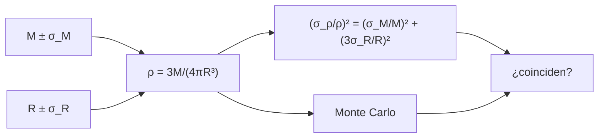

# B29-C10 — Masas y radios planetarios

<!-- nav:top -->
[🏠 Programa](../../../../README.md) · [📚 Bloque B29](../../../tronco-comun/B29-astronomia-temporal-y-exoplanetas.md) · [← Anterior: B29-C09 — Parámetros orbitales exoplanetarios](../B29-C09-parametros-orbitales-exoplanetarios/CLASE.md) · [Siguiente: B29-C11 — Atmósferas exoplanetarias →](../B29-C11-atmosferas-exoplanetarias/CLASE.md)
<!-- /nav -->

## 1. Ubicación, nivel y alcance

Clase 10 del bloque B29. Nivel N3. La velocidad radial da la masa (mínima) y el tránsito el radio; juntos dan la **densidad**, que distingue mundos rocosos, helados o gaseosos. Aquí calculas **densidad, gravedad superficial y velocidad de escape**, comparas planetas del sistema solar y casos sintéticos, y propagas las **incertidumbres** de masa y radio comparando la fórmula lineal con un Monte Carlo. Usas los parámetros nominales de la UAI, los métodos de [B29-C01](../B29-C01-transitos-planetarios/CLASE.md) y [B29-C03](../B29-C03-velocidad-radial-estelar/CLASE.md) y la estadística de [B12](../../../tronco-comun/B12-probabilidad-estadistica-e-incertidumbre.md). Se supone un planeta esférico.

## 2. Por qué esta clase existe

Una densidad con 28 % de incertidumbre no distingue una roca de un mundo con agua. Saber de qué medida depende el error orienta la inversión de observación. La decisión central: **¿qué precisión en masa y radio hace falta para decidir la composición y cómo se propaga el error?**

## 3. Lo que podrás hacer al terminar

1. Calcular `ρ = 3M/(4πR³)`, `g = GM/R²` y `v_esc = √(2GM/R)`.
2. Propagar errores: `(σ_ρ/ρ)² = (σ_M/M)² + (3σ_R/R)²`.
3. Verificar la propagación lineal por Monte Carlo.
4. Reconocer cuándo falla la propagación lineal.
5. Identificar el término dominante.
6. Estimar la precisión necesaria.

La evidencia es la **ficha de masa, radio y densidad** del ejercicio 12 (sección 20).

## 4. Con qué llegas y cómo comprobarlo

1. ¿Qué es la densidad media?
2. ¿Qué es la gravedad superficial?
3. ¿Qué es la velocidad de escape?
4. ¿Qué es una propagación de errores?
5. ¿Qué es un Monte Carlo?

<details>
<summary>Ver respuestas</summary>

1. Masa entre volumen. 2. `g = GM/R²`. 3. `√(2GM/R)`. 4. Cómo los errores de las entradas se transmiten a la salida. 5. Una simulación aleatoria.
</details>

Con cuatro o cinco aciertos, sigue; si no, repasa B12.

## 5. Un caso de contexto y casos de referencia

Weiss y Marcy estudian 65 exoplanetas menores que `4 R_⊕` con periodos menores de `100 d` y encuentran una densidad máxima de `7,6 g/cc` a `1,4 R_⊕` (S2, resumen). Chen y Kipping presentan un modelo probabilístico de masa y radio con 316 objetos (S3, resumen). Con los valores nominales de la UAI (S1), la Tierra tiene `5,495 g/cc` y Júpiter (radio ecuatorial) `1,240 g/cc`. Es el **ejemplo conductor**.

## 6. Vocabulario

La **densidad media** `ρ`. La **gravedad superficial** `g`. La **velocidad de escape**. La **propagación lineal** usa derivadas parciales. El **término dominante** es el que más contribuye al error. La **no linealidad** sesga la media de `ρ`.

## 7. Modelo mental: pesar y medir un balón

Pesar un balón (masa) y medir su diámetro (radio) da su densidad, pero el diámetro entra al cubo: un error del 3 % en el radio vale como un 9 % en la densidad.



*Descripción textual:* la masa y el radio con sus errores dan la densidad; la propagación lineal y el Monte Carlo se comparan y coinciden solo si los errores son pequeños.

Analogía: pesar y medir un balón. Límite: errores independientes y gaussianos.

## 8. La explicación, paso a paso

### 8.1 Propiedades

| objeto | `M` (`M_⊕`) | `R` (`R_⊕`) | `ρ` (g/cc) | `g` (m/s²) | `v_esc` (km/s) |
|---|---|---|---|---|---|
| Tierra | 1,000 | 1,000 | 5,495 | 9,798 | 11,180 |
| Júpiter | 317,828 | 11,209 | 1,240 | 24,787 | 59,532 |
| sintético 1,4 `R_⊕` | 4,000 | 1,400 | 8,010 | 19,997 | 18,897 |
| sintético 4 `R_⊕` | 15,000 | 4,000 | 1,288 | 9,186 | 21,650 |

`M_⊕ = 5,9722 × 10²⁴ kg` y `M_J = 1,8981 × 10²⁷ kg` (de `GM/G`).

### 8.2 Propagación con errores grandes

Con `M = 5 ± 1 M_⊕` y `R = 1,5 ± 0,1 R_⊕`: `ρ = 8,141 g/cc`; propagación lineal `σ_ρ = 2,303 g/cc` (28,3 %); Monte Carlo (200 000): media `8,367`, `σ = 2,440 g/cc` (29,2 %). La media sube `2,8 %` por la no linealidad.

### 8.3 Con errores pequeños

Con `5 %` en masa y `2 %` en radio: lineal `0,6358 g/cc`; Monte Carlo `0,6386 g/cc`; cociente `1,0044`.

### 8.4 Qué domina

En el caso grande, la masa aporta `20,0 %` y el radio (×3) `20,0 %`: contribuyen por igual. Con un radio al `3 %`: error de masa `20 %` → `21,9 %`; `10 %` → `13,5 %`; `5 %` → `10,3 %`.

### 8.5 Lectura

Con errores del 20 % en masa y radio, la densidad solo se conoce al 28 %: no permite decidir entre composiciones cuyas densidades difieren en unos pocos g/cc. Reducir el error del radio ayuda tanto como el de la masa porque entra al cubo.

## 9. Magnitudes, símbolos y unidades

| Símbolo | Qué es | Unidad | Valor / nota |
|---|---|---|---|
| `M_⊕`, `M_J` | masas | kg | `5,9722 × 10²⁴`; `1,8981 × 10²⁷` |
| `R_⊕`, `R_J` | radios ecuatoriales nominales | m | `6,3781 × 10⁶`; `7,1492 × 10⁷` (S1) |
| `ρ` | densidad | g/cc | ver tabla |
| `g` | gravedad superficial | m/s² | ver tabla |
| `v_esc` | velocidad de escape | km/s | ver tabla |
| `σ_M`, `σ_R` | errores | `M_⊕`, `R_⊕` | 1; 0,1 (ilustrativos) |

## 10. Convenciones y referencias

Radios ecuatoriales nominales (la densidad media de Júpiter, `1,33 g/cc`, usa un radio medio y es mayor); errores gaussianos independientes; semilla `20261109`; los casos sintéticos son **ilustrativos**.

## 11. De dónde sale lo que afirmamos

| ID | Fuente | Localizador | Respalda | Estado |
|---|---|---|---|---|
| S1 | UAI, Resolución B3 de 2015 | https://arxiv.org/abs/1510.07674 | `GM_⊕`, `GM_J`, `R_⊕`, `R_J` nominales | Consultada el 2026-11-09 |
| S2 | Weiss y Marcy, arXiv:1312.0936 | https://arxiv.org/abs/1312.0936 | 65 exoplanetas `< 4 R_⊕`; densidad máxima `7,6 g/cc` a `1,4 R_⊕` | Solo resumen, consultado el 2026-11-09 |
| S3 | Chen y Kipping, arXiv:1603.08614 | https://arxiv.org/abs/1603.08614 | modelo probabilístico con 316 objetos | Solo resumen, consultado el 2026-11-09 |
| S4 | NIST, *Fundamental Physical Constants* (CODATA 2022) | https://physics.nist.gov/cuu/Constants/Table/allascii.txt | `G` | Consultada el 2026-11-09 |

Límites: S2 y S3 solo resumen; la densidad del caso sintético de `1,4 R_⊕` (`8,0 g/cc`) es ilustrativa y supera la cifra publicada de `7,6 g/cc`; las fórmulas son estándar.

## 12. Cómo ver el error

| Caso | `σ_ρ/ρ` |
|---|---|
| lineal, errores grandes | 28,3 % |
| Monte Carlo, errores grandes | 29,2 % |
| lineal, errores pequeños | 7,8 % |
| Monte Carlo, errores pequeños | 7,8 % |

Descripción larga: con errores grandes el Monte Carlo supera ligeramente a la propagación lineal por la no linealidad de `R⁻³`.

## 13. Ejemplo trabajado: densidad de la Tierra

**Paso 1 · Masa.** `5,9722 × 10²⁴ kg`.

**Paso 2 · Volumen.** `4π(6,3781 × 10⁶)³/3 = 1,0868 × 10²¹ m³`.

**Paso 3 · Cociente.** `5495 kg/m³`.

**Paso 4 · Sentido.** `5,495 g/cc`, compatible con una composición mayoritariamente rocosa y metálica.

## 14. Distintas formas de describir un planeta

**Por densidad:** composición. **Por gravedad:** retención de atmósfera. **Por velocidad de escape:** pérdida de gas. **Por error relativo:** calidad de la medida.

## 15. Práctica guiada

**Ejercicio 1 · con los pasos indicados.** `g` de la Tierra. *Pasos:* `GM/R²`.

<details><summary>Solución comentada</summary>

`3,986004 × 10¹⁴/(6,3781 × 10⁶)² = 9,798 m/s²`.
</details>

**Ejercicio 2 · con una pista.** `v_esc` de la Tierra.

<details><summary>Solución comentada</summary>

`√(2 × 9,798 × 6,3781 × 10⁶) = 11,18 km/s`.
</details>

**Ejercicio 3 · casi autónomo.** Cociente de densidades sintético 1,4 / Tierra.

<details><summary>Solución comentada</summary>

`8,010/5,495 = 1,46`.
</details>

## 16. Práctica autónoma, transferencia e integrador

**Ejercicio 4.** Error de `ρ` con masa al `10 %` y radio al `3 %`.

<details><summary>Solución comentada</summary>

`√(0,1² + 0,09²) = 13,5 %`.
</details>

**Ejercicio 5.** Error de radio necesario para igualar un error de masa del `10 %`.

<details><summary>Solución comentada</summary>

`3σ_R/R = 0,1`: `σ_R/R = 3,3 %`.
</details>

**Ejercicio 6.** Densidad del planeta sintético de `4 R_⊕`.

<details><summary>Solución comentada</summary>

`1,288 g/cc`.
</details>

**Ejercicio 7.** Sesgo de la media Monte Carlo respecto del valor central.

<details><summary>Solución comentada</summary>

`8,367/8,141 − 1 = 2,8 %`.
</details>

**Ejercicio 8.** Velocidad de escape de Júpiter respecto de la Tierra.

<details><summary>Solución comentada</summary>

`59,532/11,180 = 5,32`.
</details>

**Ejercicio 9 · transferencia.** Un compañero dice que la densidad de Júpiter es `1,24 g/cc`. Responde con la sección 10.

<details><summary>Solución comentada</summary>

Es con el radio ecuatorial nominal; con un radio medio es `1,33 g/cc`.
</details>

**Ejercicio 10 · transferencia.** ¿Por qué el radio pesa tres veces en el error?

<details><summary>Solución comentada</summary>

Porque `ρ ∝ R⁻³` (7).
</details>

**Ejercicio 11 · transferencia.** ¿Qué valida el Monte Carlo?

<details><summary>Solución comentada</summary>

La propagación lineal con errores pequeños y su límite con errores grandes; no la composición del planeta.
</details>

**Ejercicio 12 · integrador.** Elabora tu *ficha de masa, radio y densidad*: tabla de propiedades, propagación con errores grandes y pequeños y conclusión.

<details><summary>Solución modelo</summary>

Secciones 8.1–8.5.
</details>

## 17. Laboratorio: densidad e incertidumbre

El script [masa_radio.py](masa_radio.py) calcula densidad, gravedad y velocidad de escape y compara propagación lineal y Monte Carlo (**comprueba** 10 % y 2 %).

**Datos:** `GM` y radios nominales de la UAI; `G` de NIST; casos sintéticos **ilustrativos**. **Predice antes de ejecutar:** ¿cuánto vale el error de `ρ` con 20 % y 7 %? (≈28 %.) **Ejecución del 2026-11-09 (Python 3.12.9):**

```text
Python 3.12.9 (biblioteca estandar)
M_E = 5.9722e+24 kg ; M_J = 1.8981e+27 kg ; M_J/M_E = 317.828
objeto                   M [M_E]  R [R_E]  rho [g/cc]  g [m/s2]  v_esc [km/s]
Tierra                     1.000    1.000       5.495     9.798        11.180
Jupiter                  317.828   11.209       1.240    24.787        59.532
sintetico 1.4 R_E          4.000    1.400       8.010    19.997        18.897
sintetico 4 R_E           15.000    4.000       1.288     9.186        21.650
planeta sintetico: M = 5 +/- 1 M_E, R = 1.5 +/- 0.1 R_E -> rho central = 8.141 g/cc
propagacion lineal: sigma_rho = 2.303 g/cc (28.3 %) ; Monte Carlo: media = 8.367, sigma = 2.440 g/cc (29.2 %)
errores pequenos (5 % en masa, 2 % en radio): lineal = 0.6358 g/cc ; Monte Carlo = 0.6386 g/cc ; cociente = 1.0044
contribuciones al error relativo de rho: masa 20.0 % ; radio (x3) 20.0 %
media Monte Carlo / valor central = 1.0278
con error de masa 20 % y de radio 3 %: sigma_rho/rho = 21.9 %
con error de masa 10 % y de radio 3 %: sigma_rho/rho = 13.5 %
con error de masa 5 % y de radio 3 %: sigma_rho/rho = 10.3 %
Pruebas superadas.
```

```bash
python programa/clases/B29/B29-C10-masas-y-radios-planetarios/masa_radio.py
```

**Límites:** planeta esférico, errores independientes y gaussianos.

## 18. Errores frecuentes y cómo corregirlos

**Usar `σ_R/R` sin multiplicar por 3.** Se corrige con el ejercicio 10.

**Mezclar radio ecuatorial y medio.** Se corrige con el ejercicio 9.

**Aplicar la propagación lineal con errores grandes.** Se corrige con 8.2.

**Confundir `g/cc` y `kg/m³`.** Se corrige con la sección 9.

**Tomar los casos sintéticos por reales.** Se corrige con la sección 10.

## 19. Cómo sabrás que vas bien

Tras 8.1: ¿qué densidad tiene la Tierra? Si dudas, ejemplo 13. Tras 8.2: ¿cuándo falla la propagación lineal? Ejercicio 11. Tras el laboratorio: ¿qué valida? (la propagación).

## 20. Qué entregas y cómo se evalúa

El producto es tu **ficha de masa, radio y densidad** (ejercicio 12).

| Criterio | Inicial | En desarrollo | Logrado | Destacado |
|---|---|---|---|---|
| Conceptos | Los confunde | Parciales | `ρ`, `g`, `v_esc`, errores | Explica el término dominante |
| Cálculo | Sin unidades | Con errores | Tablas completas | Calcula la precisión necesaria |
| Numérico | Sin comprobar | Un caso | Lineal y Monte Carlo | Interpreta el sesgo |
| Fuentes | Sin fuente | Sin fecha | S1–S4 con fecha | Declara S2 y S3 como resumen |
| Límites | No los nombra | Uno | Tres | Discute composición |

**Condiciones críticas (no se compensan con promedio):** rotular los casos sintéticos; no atribuir densidades a planetas reales; citar solo lo consultado.

## 21. Ética, seguridad y límites

Clase educativa: no clasifica planetas por composición. Accesibilidad: tablas equivalentes a las gráficas, fórmulas en texto, ejercicios sin conexión.

## 22. Para cerrar y seguir

La Tierra tiene `5,495 g/cc` y `g = 9,80 m/s²`; con masa al 20 % y radio al 7 % la densidad solo se conoce al 28 %, y el radio pesa tres veces. Queda una pregunta: ¿qué se puede aprender de la atmósfera de un planeta con esta masa y radio?

**Glosario español–inglés.** densidad media · *mean density*; gravedad superficial · *surface gravity*; velocidad de escape · *escape velocity*; propagación de errores · *error propagation*; término dominante · *dominant term*; no linealidad · *nonlinearity*.

**Continuidad.** [B29-C11](../B29-C11-atmosferas-exoplanetarias/CLASE.md) estudia las atmósferas exoplanetarias.

**Referencias:** ver sección 11.

<!-- nav:bottom -->
---

[← Anterior: B29-C09 — Parámetros orbitales exoplanetarios](../B29-C09-parametros-orbitales-exoplanetarios/CLASE.md) · [📚 Bloque B29](../../../tronco-comun/B29-astronomia-temporal-y-exoplanetas.md) · [Siguiente: B29-C11 — Atmósferas exoplanetarias →](../B29-C11-atmosferas-exoplanetarias/CLASE.md)
<!-- /nav -->
