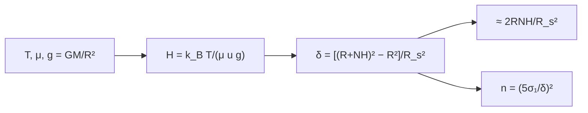

# B29-C11 — Atmósferas exoplanetarias

<!-- nav:top -->
[🏠 Programa](../../../../README.md) · [📚 Bloque B29](../../../tronco-comun/B29-astronomia-temporal-y-exoplanetas.md) · [← Anterior: B29-C10 — Masas y radios planetarios](../B29-C10-masas-y-radios-planetarios/CLASE.md) · [Siguiente: B29-C12 — Espectroscopía de transmisión →](../B29-C12-espectroscopia-de-transmision/CLASE.md)
<!-- /nav -->

## 1. Ubicación, nivel y alcance

Clase 11 del bloque B29. Nivel N3. Durante un tránsito, la luz estelar atraviesa la atmósfera del planeta y la hace parecer un poco mayor: el anillo atmosférico aporta una señal de unas decenas a cientos de partes por millón. Aquí calculas la **altura de escala** `H = k_BT/(μ u g)`, la **señal de transmisión** de un anillo de `N` alturas de escala (exacta y aproximada) y el **número de tránsitos** necesario para detectarla. Usas gravedad y termodinámica ([B05](../../../tronco-comun/B05-fisica-fundamental-para-el-espacio.md)), las masas y radios de [B29-C10](../B29-C10-masas-y-radios-planetarios/CLASE.md) y el tránsito de [B29-C01](../B29-C01-transitos-planetarios/CLASE.md). Se trata una atmósfera isoterma.

## 2. Por qué esta clase existe

Los planetas inflados y calientes tienen señales de cientos de ppm; las Tierras alrededor de estrellas como el Sol, de ~1 ppm, que no se alcanzan. La decisión central: **¿qué señal produce una atmósfera dada y cuántos tránsitos hacen falta para verla?**

## 3. Lo que podrás hacer al terminar

1. Calcular `g = GM/R²` y `H = k_BT/(μ u g)`.
2. Calcular la señal exacta `[(R + NH)² − R²]/R_s²` y la aproximada `2RNH/R_s²`.
3. Calcular el número de tránsitos `n = (5σ₁/δ)²`.
4. Comparar casos: Júpiter caliente, sub-Neptuno, mundo de agua y Tierra.
5. Verificar la proporcionalidad `H ∝ T/μ`.
6. Reconocer el papel del radio estelar.

La evidencia es la **ficha de una atmósfera** del ejercicio 12 (sección 20).

## 4. Con qué llegas y cómo comprobarlo

1. ¿Qué es la altura de escala?
2. ¿Qué es la masa molecular media?
3. ¿Qué es la gravedad superficial?
4. ¿Qué es una atmósfera isoterma?
5. ¿Qué es el ruido por tránsito?

<details>
<summary>Ver respuestas</summary>

1. La distancia en que la presión cae un factor `e`. 2. La masa media de las moléculas en unidades de masa atómica. 3. `g = GM/R²`. 4. Con temperatura constante. 5. La incertidumbre de la profundidad de un solo tránsito.
</details>

Con cuatro o cinco aciertos, sigue; si no, repasa B29-C10.

## 5. Un caso de contexto y casos de referencia

Seager y Deming resumen que las atmósferas de exoplanetas ya se observan y que los Júpiteres calientes son los más accesibles (S2, resumen). Esta clase no usa cifras de esa revisión: con `T = 1500 K`, `μ = 2,3` y `1,4 R_J`, un Júpiter caliente tiene `H = 428,78 km` y una señal de `896 ppm` para cinco alturas de escala; una Tierra ante el Sol, `H = 7,46 km` y `0,99 ppm`. Es el **ejemplo conductor**.

## 6. Vocabulario

La **altura de escala** `H`. La **masa molecular media** `μ`. La **señal de transmisión** `δ` es el exceso de profundidad. El **anillo atmosférico** tiene espesor `NH`. La **detección a 5σ** exige `δ ≥ 5σ/√n`. Un **Júpiter caliente** es un gigante muy cercano a su estrella.

## 7. Modelo mental: el halo de una moneda

Una moneda con un halo borroso tapa un poco más que la moneda sola. El ancho del halo es el espesor de la atmósfera efectiva, de unas cuantas alturas de escala.



*Descripción textual:* la temperatura, la composición y la gravedad dan la altura de escala; N alturas definen el anillo cuya área, dividida por la del disco estelar, da la señal; el ruido por tránsito fija el número de tránsitos.

Analogía: el halo de una moneda. Límite: nubes y brumas reducen el anillo efectivo.

## 8. La explicación, paso a paso

### 8.1 Casos

Con `N = 5` y `σ₁ = 30 ppm`:

| caso | `g` (m/s²) | `H` (km) | señal exacta (ppm) | aprox. (ppm) | `n` (5σ) |
|---|---|---|---|---|---|
| Júpiter caliente (H₂/He) | 12,65 | 428,78 | 896,203 | 886,706 | 0,028 |
| sub-Neptuno de H₂ | 12,54 | 144,12 | 48,551 | 47,479 | 9,545 |
| mundo de agua | 19,14 | 9,65 | 2,040 | 2,036 | 5404 |
| Tierra (N₂/O₂), Sol | 9,80 | 7,46 | 0,986 | 0,983 | `2,314 × 10⁴` |
| Tierra, enano M de 0,3 `R_☉` | 9,80 | 7,46 | 10,957 | 10,925 | 187,4 |

Un `n < 1` significa que un solo tránsito basta.

### 8.2 Dependencia con T y μ

Para el Júpiter caliente: `H = 285,86 km` a 1000 K, `428,78` a 1500 K, `571,71` a 2000 K (con `μ = 2,3`); `54,79` con `μ = 18` y `22,41` con `μ = 44` (a 1500 K).

### 8.3 Proporcionalidades

`H` es proporcional a `T` e inversamente proporcional a `μ` (comprobado a `10⁻¹²`).

### 8.4 La estrella importa

La señal escala como `1/R_s²`: la misma Tierra ante un enano M de `0,3 R_☉` da `10,96 ppm`, once veces más que ante el Sol.

### 8.5 Lectura

Una atmósfera ligera y caliente alrededor de un gigante es fácil de medir; una atmósfera densa y pesada de un mundo pequeño ante una estrella grande requiere decenas de miles de tránsitos. La aproximación `2RNH/R_s²` es buena a `1 %` para el Júpiter caliente y a `0,3 %` para la Tierra.

## 9. Magnitudes, símbolos y unidades

| Símbolo | Qué es | Unidad | Valor / nota |
|---|---|---|---|
| `H` | altura de escala | km | ver tabla |
| `μ` | masa molecular media | u | 2,3; 18; 29 (ilustrativas) |
| `T` | temperatura | K | 255–1500 (ilustrativas) |
| `N` | alturas de escala | — | 5 (ilustrativo) |
| `δ` | señal de transmisión | ppm | ver tabla |
| `σ₁` | ruido por tránsito | ppm | 30 (ilustrativo) |

## 10. Convenciones y referencias

`k_B` y `u` de NIST; `GM` y radios nominales de la UAI; atmósfera isoterma; los casos sintéticos son **ilustrativos**.

## 11. De dónde sale lo que afirmamos

| ID | Fuente | Localizador | Respalda | Estado |
|---|---|---|---|---|
| S1 | NIST (`G`, `k_B`, `u`) y UAI 2015 B3 (`GM`, `R`) | https://physics.nist.gov/cuu/Constants/Table/allascii.txt ; https://arxiv.org/abs/1510.07674 | constantes | Consultadas el 2026-11-09 |
| S2 | Seager y Deming, arXiv:1005.4037 | https://arxiv.org/abs/1005.4037 | las atmósferas de exoplanetas se observan; los Júpiteres calientes son los más accesibles | Solo resumen, consultado el 2026-11-09 |
| S3 | Cálculo propio: altura de escala y anillo atmosférico | implementado en `atmosfera.py` | tablas de 8.1–8.2 | Verificado por proporcionalidades y comparación exacta/aproximada |

Límites: S2 solo resumen y sin cifras usadas; no se cita ninguna señal medida; las nubes se ignoran.

## 12. Cómo ver la detectabilidad

| Caso | tránsitos |
|---|---|
| Júpiter caliente | 1 |
| sub-Neptuno | 10 |
| Tierra ante enano M | 190 |
| Tierra ante el Sol | 23 000 |

Descripción larga: la detectabilidad cae con el tamaño del planeta y con el radio de la estrella.

## 13. Ejemplo trabajado: H de la Tierra

**Paso 1 · Gravedad.** `9,80 m/s²`.

**Paso 2 · Numerador.** `k_B T = 1,3806 × 10⁻²³ × 255 = 3,52 × 10⁻²¹ J`.

**Paso 3 · Denominador.** `μ u g = 29 × 1,6605 × 10⁻²⁷ × 9,80 = 4,72 × 10⁻²⁵`.

**Paso 4 · Cociente.** `H = 7,46 km`.

## 14. Distintas formas de describir la atmósfera

**Por altura de escala:** `H`. **Por señal:** `δ`. **Por tránsitos:** `n`. **Por composición:** `μ`.

## 15. Práctica guiada

**Ejercicio 1 · con los pasos indicados.** `H` si `T` se duplica. *Pasos:* proporcional.

<details><summary>Solución comentada</summary>

Se duplica.
</details>

**Ejercicio 2 · con una pista.** `H` si `μ` pasa de 2,3 a 4,6.

<details><summary>Solución comentada</summary>

Se reduce a la mitad.
</details>

**Ejercicio 3 · casi autónomo.** Cociente de señales Tierra ante enano M / ante el Sol.

<details><summary>Solución comentada</summary>

`10,957/0,986 = 11,1 = (1/0,3)²`.
</details>

## 16. Práctica autónoma, transferencia e integrador

**Ejercicio 4.** Tránsitos para detectar a `5σ` una señal de `5 ppm` con `σ₁ = 30 ppm`.

<details><summary>Solución comentada</summary>

`(150/5)² = 900`.
</details>

**Ejercicio 5.** Señal con `N = 3` para el sub-Neptuno.

<details><summary>Solución comentada</summary>

`48,551 × 3/5 = 29,1 ppm`.
</details>

**Ejercicio 6.** Cociente de `H` entre `μ = 2,3` y `μ = 44` a la misma `T`.

<details><summary>Solución comentada</summary>

`428,78/22,41 = 19,1 = 44/2,3`.
</details>

**Ejercicio 7.** Error de la aproximación para el sub-Neptuno.

<details><summary>Solución comentada</summary>

`47,479/48,551 − 1 = −2,2 %`.
</details>

**Ejercicio 8.** Señal del Júpiter caliente si `T = 1000 K`.

<details><summary>Solución comentada</summary>

Proporcional a `H`: `896 × 285,86/428,78 = 597 ppm`.
</details>

**Ejercicio 9 · transferencia.** Un compañero dice que una atmósfera de CO₂ da más señal que una de H₂. Responde con 8.2.

<details><summary>Solución comentada</summary>

Al revés: `H ∝ 1/μ`; el CO₂ (`μ = 44`) tiene una altura de escala 19 veces menor.
</details>

**Ejercicio 10 · transferencia.** ¿Por qué las nubes complican la medida?

<details><summary>Solución comentada</summary>

Porque reducen el anillo efectivo a menos de `N` alturas de escala.
</details>

**Ejercicio 11 · transferencia.** ¿Qué valida la proporcionalidad de `H`?

<details><summary>Solución comentada</summary>

La implementación de la altura de escala; no la composición real.
</details>

**Ejercicio 12 · integrador.** Elabora tu *ficha de una atmósfera*: `g`, `H`, señal y tránsitos para tres planetas, y el efecto de `T` y `μ`.

<details><summary>Solución modelo</summary>

Tablas de 8.1–8.2.
</details>

## 17. Laboratorio: altura de escala y señal

El script [atmosfera.py](atmosfera.py) calcula `H`, la señal exacta y la aproximada (**comprueba** 5 % y 0,5 %) y las proporcionalidades (**comprueba** `10⁻¹²`).

**Datos:** constantes de NIST/UAI; casos **ilustrativos**. **Predice antes de ejecutar:** ¿cuántos ppm da la Tierra ante el Sol? (≈`1 ppm`.) **Ejecución del 2026-11-09 (Python 3.12.9):**

```text
Python 3.12.9 (biblioteca estandar)
caso                            g [m/s2]    H [km]  senal exacta [ppm]  aprox [ppm]  n transitos (5 sigma)
Jupiter caliente (H2/He)           12.65    428.78             896.203      886.706                0.02801
sub-Neptuno de H2                  12.54    144.12              48.551       47.479                  9.545
mundo de agua                      19.14      9.65               2.040        2.036                   5404
Tierra (N2/O2), Sol                 9.80      7.46               0.986        0.983              2.314e+04
Tierra, enano M de 0.3 R_sol        9.80      7.46              10.957       10.925                  187.4
  T [K]     mu  H [km] (Jupiter caliente)
   1000    2.3                     285.86
   1500    2.3                     428.78
   2000    2.3                     571.71
   1500   18.0                      54.79
   1500   44.0                      22.41
H es proporcional a T e inversamente proporcional a mu (comprobado a 1e-12)
Pruebas superadas.
```

```bash
python programa/clases/B29/B29-C11-atmosferas-exoplanetarias/atmosfera.py
```

**Límites:** atmósfera isoterma, sin nubes, anillo opaco de `N` alturas de escala.

## 18. Errores frecuentes y cómo corregirlos

**Confundir `μ` alto con señal alta.** Se corrige con el ejercicio 9.

**Olvidar `R_s²`.** Se corrige con el ejercicio 3.

**Ignorar las nubes.** Se corrige con el ejercicio 10.

**Mezclar km y m.** Se corrige con la sección 9.

**Tomar los casos por planetas reales.** Se corrige con la sección 10.

## 19. Cómo sabrás que vas bien

Tras 8.1: ¿qué señal tiene la Tierra? Si dudas, ejemplo 13. Tras 8.3: ¿cómo escala `H`? Ejercicios 1–2. Tras el laboratorio: ¿qué valida? (la altura de escala).

## 20. Qué entregas y cómo se evalúa

El producto es tu **ficha de una atmósfera** (ejercicio 12).

| Criterio | Inicial | En desarrollo | Logrado | Destacado |
|---|---|---|---|---|
| Conceptos | Los confunde | Parciales | `H`, señal, tránsitos | Explica el papel de la estrella |
| Cálculo | Sin unidades | Con errores | Tablas completas | Compara casos |
| Numérico | Sin comprobar | Un caso | Exacto y aproximado | Interpreta tolerancias |
| Fuentes | Sin fuente | Sin fecha | S1–S3 con fecha | Declara S2 como resumen |
| Límites | No los nombra | Uno | Tres | Discute nubes |

**Condiciones críticas (no se compensan con promedio):** rotular los casos como ilustrativos; no atribuir señales a planetas reales; citar solo lo consultado.

## 21. Ética, seguridad y límites

Clase educativa: no sustituye una recuperación atmosférica. Accesibilidad: tablas equivalentes a las gráficas, fórmulas en texto, ejercicios sin conexión.

## 22. Para cerrar y seguir

La altura de escala crece con `T` y decrece con `μ` y `g`; un Júpiter caliente da `~900 ppm` y una Tierra ante el Sol, `~1 ppm`, once veces menos que ante un enano M de `0,3 R_☉`. Queda una pregunta: ¿cómo se identifica qué moléculas hay en esa atmósfera?

**Glosario español–inglés.** atmósfera exoplanetaria · *exoplanet atmosphere*; altura de escala · *scale height*; masa molecular media · *mean molecular weight*; señal de transmisión · *transmission signal*; Júpiter caliente · *hot Jupiter*; anillo atmosférico · *atmospheric annulus*.

**Continuidad.** [B29-C12](../B29-C12-espectroscopia-de-transmision/CLASE.md) estudia la espectroscopía de transmisión.

**Referencias:** ver sección 11.

<!-- nav:bottom -->
---

[← Anterior: B29-C10 — Masas y radios planetarios](../B29-C10-masas-y-radios-planetarios/CLASE.md) · [📚 Bloque B29](../../../tronco-comun/B29-astronomia-temporal-y-exoplanetas.md) · [Siguiente: B29-C12 — Espectroscopía de transmisión →](../B29-C12-espectroscopia-de-transmision/CLASE.md)
<!-- /nav -->
