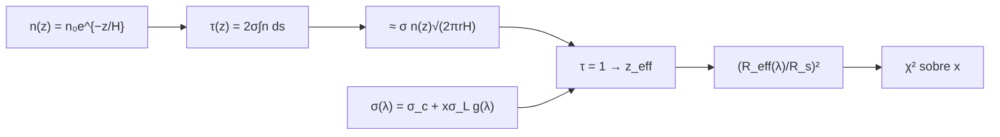

# B29-C12 — Espectroscopía de transmisión

<!-- nav:top -->
[🏠 Programa](../../../../README.md) · [📚 Bloque B29](../../../tronco-comun/B29-astronomia-temporal-y-exoplanetas.md) · [← Anterior: B29-C11 — Atmósferas exoplanetarias](../B29-C11-atmosferas-exoplanetarias/CLASE.md) · [Siguiente: B29-C13 — Zonas de habitabilidad →](../B29-C13-zonas-de-habitabilidad/CLASE.md)
<!-- /nav -->

## 1. Ubicación, nivel y alcance

Clase 12 del bloque B29. Nivel N3. A cada longitud de onda, la atmósfera de un planeta es opaca a una altitud distinta: donde hay una línea de absorción, el planeta parece mayor. Aquí calculas la **profundidad óptica a lo largo de una cuerda** (por cuadratura y con una aproximación), el **radio efectivo** donde `τ = 1`, el **espectro** de transmisión de un modelo con una línea y la **recuperación de la abundancia** por `χ²` con Monte Carlo. Usas la altura de escala de [B29-C11](../B29-C11-atmosferas-exoplanetarias/CLASE.md), la ley de Beer–Lambert y la estadística de [B12](../../../tronco-comun/B12-probabilidad-estadistica-e-incertidumbre.md). Se trata una atmósfera isoterma sin nubes.

## 2. Por qué esta clase existe

La amplitud de una línea mide la abundancia: una línea más fuerte se eleva más sobre el continuo. La decisión central: **¿qué incremento de radio produce una línea y con qué precisión se recupera la abundancia de la molécula?**

## 3. Lo que podrás hacer al terminar

1. Calcular `τ(z) = 2σ∫n(√(r²+s²) − R₀) ds` por cuadratura.
2. Compararla con `σ n(z)√(2πrH)`.
3. Hallar el radio efectivo (`τ = 1`) y compararlo con `R₀ + H ln(σ n₀√(2πR₀H))`.
4. Construir un espectro con una línea gaussiana.
5. Recuperar `log₁₀ x` por `χ²` en una rejilla.
6. Reconocer los supuestos (sin nubes, isotermia).

La evidencia es la **ficha de un espectro de transmisión** del ejercicio 12 (sección 20).

## 4. Con qué llegas y cómo comprobarlo

1. ¿Qué es la ley de Beer–Lambert?
2. ¿Qué es una sección eficaz?
3. ¿Qué es una cuerda?
4. ¿Qué es una rejilla de `χ²`?
5. ¿Qué es la profundidad óptica?

<details>
<summary>Ver respuestas</summary>

1. `I = I₀e^{−τ}`. 2. El área efectiva de absorción por molécula. 3. La trayectoria rectilínea de un rayo. 4. Evaluar `χ²` en una malla de parámetros. 5. `τ = ∫σ n ds`.
</details>

Con cuatro o cinco aciertos, sigue; si no, repasa B29-C11.

## 5. Un caso de contexto y un caso sintético

Seager y Deming resumen la detección de características espectrales moleculares en atmósferas de exoplanetas (S2, resumen). Esta clase no usa cifras de esa revisión: modela un planeta de `1,4 R_J` con `H = 430 km`, densidad en la base `10²⁵ m⁻³` y secciones eficaces ilustrativas (`10⁻²⁸ m²` de continuo, `10⁻²⁶ m²` en la línea). Es el **ejemplo conductor**.

## 6. Vocabulario

La **profundidad óptica** `τ`. El **radio efectivo** es donde `τ = 1`. La **sección eficaz** `σ(λ)`. El **continuo** es la opacidad de fondo. La **línea** es el pico de opacidad de una molécula. La **abundancia** `x` escala la línea.

## 7. Modelo mental: niebla que cambia de color

A cada color la niebla es opaca a una altura distinta; mirando desde el borde del planeta, las líneas de absorción son los colores donde la niebla es más alta.



*Descripción textual:* la densidad exponencial da la profundidad óptica por cuadratura, aproximada por una expresión cerrada; el radio efectivo depende de la sección eficaz, que varía con la longitud de onda; el espectro resultante se ajusta por `χ²` para obtener la abundancia.

Analogía: niebla que cambia de altura según el color. Límite: sin nubes.

## 8. La explicación, paso a paso

### 8.1 La profundidad óptica

La cuadratura y la aproximación `σ n(z)√(2πrH)` coinciden al `0,16 %`:

| `z` (en `H`) | `τ` numérica | `τ` aprox. | cociente |
|---|---|---|---|
| −2 | `1,21181 × 10⁵` | `1,20985 × 10⁵` | 1,00162 |
| 0 | `1,64708 × 10⁴` | `1,64444 × 10⁴` | 1,00161 |
| 2 | `2,23861 × 10³` | `2,23504 × 10³` | 1,00159 |
| 4 | `3,04246 × 10²` | `3,03766 × 10²` | 1,00158 |

### 8.2 Radio efectivo

Para el continuo: `z = 4183,13 km` (`9,728 H`) frente a `4174,33 km` (`9,708 H`) analítico: diferencia de `0,02 H`.

### 8.3 La línea

En el centro de la línea con `x = 1`, el radio efectivo sube `4,625 H`, frente a `H ln[(σ_c + σ_L)/σ_c] = 4,615 H`.

| `x` | profundidad en el centro (ppm) | aumento sobre el continuo (ppm) |
|---|---|---|
| `10⁻⁴` | 22 466,0 | 1,8 |
| `10⁻³` | 22 481,9 | 17,7 |
| `10⁻²` | 22 593,1 | 128,9 |
| `10⁻¹` | 22 911,6 | 447,4 |
| 1 | 23 329,2 | 865,0 |

### 8.4 Recuperación

Con 40 canales, una línea gaussiana (centro 20, ancho 3), ruido de `20 ppm` por canal y `x = 0,01`, en 300 realizaciones: `log₁₀ x = −2,0000 ± 0,0408` (media y desviación).

### 8.5 Lectura

El aumento crece de forma logarítmica con la abundancia (cada factor 10 añade unas `2,3 H`), por lo que una incertidumbre pequeña en el espectro da una incertidumbre moderada en `log₁₀ x`; el continuo, en cambio, debe conocerse bien.

## 9. Magnitudes, símbolos y unidades

| Símbolo | Qué es | Unidad | Valor / nota |
|---|---|---|---|
| `R₀` | radio de referencia | m | `1,4 R_J = 1,0009 × 10⁸` |
| `H` | altura de escala | km | 430 (ilustrativa) |
| `n₀` | densidad en la base | m⁻³ | `10²⁵` (ilustrativa) |
| `σ_c`, `σ_L` | secciones eficaces | m² | `10⁻²⁸`; `10⁻²⁶` (ilustrativas) |
| `x` | abundancia | — | 0,01 (verdadera) |
| `σ` | ruido por canal | ppm | 20 (ilustrativo) |

## 10. Convenciones y referencias

Atmósfera isoterma y exponencial; sin nubes; línea gaussiana; semilla `20261109`; todos los parámetros son **ilustrativos**.

## 11. De dónde sale lo que afirmamos

| ID | Fuente | Localizador | Respalda | Estado |
|---|---|---|---|---|
| S1 | UAI, Resolución B3 de 2015 | https://arxiv.org/abs/1510.07674 | `R_J`, `R_☉` nominales | Consultada el 2026-11-09 |
| S2 | Seager y Deming, arXiv:1005.4037 | https://arxiv.org/abs/1005.4037 | detección de características moleculares | Solo resumen, consultado el 2026-11-09 |
| S3 | Cálculo propio: cuadratura de `τ` y `χ²` | implementado en `transmision.py` | todas las tablas | Verificado contra la aproximación analítica y por Monte Carlo |

Límites: S2 solo resumen; no se cita ningún espectro real; la línea y las secciones eficaces son sintéticas.

## 12. Cómo ver la línea

| `x` | aumento (ppm) |
|---|---|
| 0,001 | 18 |
| 0,01 | 129 |
| 0,1 | 447 |
| 1 | 865 |

Descripción larga: el aumento de la señal crece despacio con la abundancia, aproximadamente con su logaritmo.

## 13. Ejemplo trabajado: elevación de la línea

**Paso 1 · Cociente.** `(σ_c + σ_L)/σ_c = 101`.

**Paso 2 · Logaritmo.** `ln 101 = 4,615`.

**Paso 3 · Altura.** `Δz = 4,615 H = 1,98 × 10³ km`.

**Paso 4 · Señal.** `2R₀Δz/R_s² = 2 × 1,0 × 10⁸ × 1,98 × 10⁶/4,84 × 10¹⁷ = 819 ppm`.

## 14. Distintas formas de describir el espectro

**Por radio efectivo:** `R_eff(λ)`. **Por profundidad:** `(R_eff/R_s)²`. **Por abundancia:** `log x`. **Por altura:** `Δz/H`.

## 15. Práctica guiada

**Ejercicio 1 · con los pasos indicados.** `Δz` de la línea para `x = 0,01`. *Pasos:* `H ln(1 + x σ_L/σ_c)`.

<details><summary>Solución comentada</summary>

`H ln 2 = 0,693 H = 298 km`.
</details>

**Ejercicio 2 · con una pista.** Señal asociada.

<details><summary>Solución comentada</summary>

`2 × 1,0 × 10⁸ × 2,98 × 10⁵/4,84 × 10¹⁷ = 123 ppm`, cercana al `128,9 ppm` del laboratorio.
</details>

**Ejercicio 3 · casi autónomo.** Cociente `τ` numérica/aprox. en `z = 0`.

<details><summary>Solución comentada</summary>

`1,00161`.
</details>

## 16. Práctica autónoma, transferencia e integrador

**Ejercicio 4.** Cuántas `H` sube la línea al pasar de `x = 0,01` a `x = 1`.

<details><summary>Solución comentada</summary>

`4,615 − 0,693 = 3,92 H`.
</details>

**Ejercicio 5.** Error de `log₁₀ x` relativo al valor.

<details><summary>Solución comentada</summary>

`0,0408` dex: `9,8 %` en `x`.
</details>

**Ejercicio 6.** Diferencia entre el radio efectivo numérico y el analítico.

<details><summary>Solución comentada</summary>

`4183,13 − 4174,33 = 8,8 km = 0,02 H`.
</details>

**Ejercicio 7.** Cociente entre el aumento con `x = 1` y con `x = 0,1`.

<details><summary>Solución comentada</summary>

`865,0/447,4 = 1,93`.
</details>

**Ejercicio 8.** Aumento de la señal por canal si el ruido bajara a `10 ppm`.

<details><summary>Solución comentada</summary>

La detección de `x = 10⁻³` (18 ppm) pasa de `0,9σ` a `1,8σ` por canal.
</details>

**Ejercicio 9 · transferencia.** Un compañero dice que si se duplica la abundancia se duplica la señal. Responde con 8.5.

<details><summary>Solución comentada</summary>

No: el aumento es logarítmico en la abundancia.
</details>

**Ejercicio 10 · transferencia.** ¿Qué efecto tendría una capa de nubes opacas a `z = 2H`?

<details><summary>Solución comentada</summary>

Truncaría el espectro: por debajo de `2H` no se vería la atmósfera y las líneas serían más débiles.
</details>

**Ejercicio 11 · transferencia.** ¿Qué valida la comparación de `τ`?

<details><summary>Solución comentada</summary>

La aproximación analítica frente a la cuadratura; no el modelo del planeta.
</details>

**Ejercicio 12 · integrador.** Elabora tu *ficha de un espectro de transmisión*: `τ`, radio efectivo, aumento de la línea para cinco abundancias y recuperación por `χ²`.

<details><summary>Solución modelo</summary>

Secciones 8.1–8.4.
</details>

## 17. Laboratorio: línea y abundancia

El script [transmision.py](transmision.py) integra `τ` (**comprueba** 2 %), halla el radio efectivo (**comprueba** `0,05 H`) y recupera la abundancia en 300 realizaciones.

**Datos:** radios de la UAI; todo lo demás **ilustrativo**. **Predice antes de ejecutar:** ¿qué `log₁₀ x` se recupera? (`−2`.) **Ejecución del 2026-11-09 (Python 3.12.9):**

```text
Python 3.12.9 (biblioteca estandar)
 z [H]  tau numerica   tau aprox  cociente
  -2.0   1.21181e+05 1.20985e+05   1.00162
   0.0   1.64708e+04 1.64444e+04   1.00161
   2.0   2.23861e+03 2.23504e+03   1.00159
   4.0   3.04246e+02 3.03766e+02   1.00158
radio efectivo del continuo: z = 4183.13 km (9.728 H) ; analitico = 4174.33 km (9.708 H)
con x = 1 en el centro de la linea: z = 6171.69 km ; aumento de 4.625 H = H ln[(sigma_c + sigma_L)/sigma_c] = 4.615 H
      x  profundidad en el centro [ppm]   aumento sobre el continuo [ppm]
  1e-04                         22466.0                               1.8
  1e-03                         22481.9                              17.7
  1e-02                         22593.1                             128.9
  1e-01                         22911.6                             447.4
  1e+00                         23329.2                             865.0
recuperacion de log10 x (verdadero -2.000) en 300 realizaciones con 20 ppm por canal: media = -2.0000 ; desviacion = 0.0408
Pruebas superadas.
```

```bash
python programa/clases/B29/B29-C12-espectroscopia-de-transmision/transmision.py
```

**Límites:** atmósfera isoterma, sin nubes, una sola línea, sección eficaz conocida.

## 18. Errores frecuentes y cómo corregirlos

**Confundir profundidad óptica y radio efectivo.** Se corrige con la sección 6.

**Esperar señal lineal en la abundancia.** Se corrige con el ejercicio 9.

**Ignorar las nubes.** Se corrige con el ejercicio 10.

**Mezclar m y km.** Se corrige con la sección 9.

**Tomar las secciones eficaces por reales.** Se corrige con la sección 10.

## 19. Cómo sabrás que vas bien

Tras 8.1: ¿coinciden numérica y aproximada? Si dudas, ejercicio 3. Tras 8.3: ¿cuánto sube la línea? Ejercicio 1. Tras el laboratorio: ¿qué valida? (la recuperación de la abundancia).

## 20. Qué entregas y cómo se evalúa

El producto es tu **ficha de un espectro de transmisión** (ejercicio 12).

| Criterio | Inicial | En desarrollo | Logrado | Destacado |
|---|---|---|---|---|
| Conceptos | Los confunde | Parciales | `τ`, radio efectivo, línea | Explica la dependencia logarítmica |
| Cálculo | Sin unidades | Con errores | Tablas completas | Compara abundancias |
| Numérico | Sin comprobar | Un caso | Cuadratura y recuperación | Interpreta errores |
| Fuentes | Sin fuente | Sin fecha | S1–S3 con fecha | Declara que no hay espectros reales |
| Límites | No los nombra | Uno | Tres | Discute nubes y degeneraciones |

**Condiciones críticas (no se compensan con promedio):** rotular el modelo como sintético; no atribuir abundancias a un planeta real; citar solo lo consultado.

## 21. Ética, seguridad y límites

Clase educativa: no es una recuperación atmosférica. Accesibilidad: tablas equivalentes a las gráficas, fórmulas en texto, ejercicios sin conexión.

## 22. Para cerrar y seguir

La profundidad óptica por cuerda coincide con `σ n√(2πrH)` al `0,16 %`, la línea eleva el radio `H ln(1 + xσ_L/σ_c)` y la abundancia se recupera con `0,04` dex de error. Queda una pregunta: ¿qué planetas pueden tener agua líquida en la superficie?

**Glosario español–inglés.** espectroscopía de transmisión · *transmission spectroscopy*; profundidad óptica · *optical depth*; radio efectivo · *effective radius*; sección eficaz · *cross section*; continuo · *continuum*; abundancia · *abundance*.

**Continuidad.** [B29-C13](../B29-C13-zonas-de-habitabilidad/CLASE.md) estudia las zonas de habitabilidad.

**Referencias:** ver sección 11.

<!-- nav:bottom -->
---

[← Anterior: B29-C11 — Atmósferas exoplanetarias](../B29-C11-atmosferas-exoplanetarias/CLASE.md) · [📚 Bloque B29](../../../tronco-comun/B29-astronomia-temporal-y-exoplanetas.md) · [Siguiente: B29-C13 — Zonas de habitabilidad →](../B29-C13-zonas-de-habitabilidad/CLASE.md)
<!-- /nav -->
