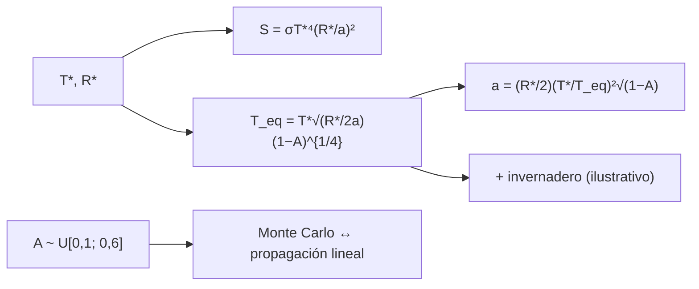

# B29-C13 — Zonas de habitabilidad

<!-- nav:top -->
[🏠 Programa](../../../../README.md) · [📚 Bloque B29](../../../tronco-comun/B29-astronomia-temporal-y-exoplanetas.md) · [← Anterior: B29-C12 — Espectroscopía de transmisión](../B29-C12-espectroscopia-de-transmision/CLASE.md) · [Siguiente: B29-C14 — Estrellas variables periódicas →](../B29-C14-estrellas-variables-periodicas/CLASE.md)
<!-- /nav -->

## 1. Ubicación, nivel y alcance

Clase 13 del bloque B29. Nivel N3. La **zona habitable** es la región alrededor de una estrella donde un planeta podría tener agua líquida en su superficie. Aquí calculas el **flujo estelar** recibido, la **temperatura de equilibrio** de un planeta sin atmósfera, las **distancias** para una temperatura dada en distintos tipos de estrella y la **propagación de la incertidumbre del albedo**. No se calculan los límites de la zona habitable con climas 1-D; solo la temperatura de equilibrio. Usas la ley de Stefan–Boltzmann ([B28-C02](../../B28/B28-C02-fotones-en-multiples-longitudes-de-onda/CLASE.md)), la profundidad de [B29-C11](../B29-C11-atmosferas-exoplanetarias/CLASE.md) y la estadística de [B12](../../../tronco-comun/B12-probabilidad-estadistica-e-incertidumbre.md). Se trata un planeta de albedo uniforme.

## 2. Por qué esta clase existe

La temperatura de equilibrio es la primera estimación de si un mundo es cálido o helado, pero no es la temperatura de la superficie: depende del albedo y del efecto invernadero. La decisión central: **¿a qué distancias una estrella da una temperatura de equilibrio dada y cuánto cambia con el albedo?**

## 3. Lo que podrás hacer al terminar

1. Calcular el flujo `S = σT⁴(R/a)²` y compararlo con el nominal.
2. Calcular `T_eq = T_* √(R_*/2a) (1−A)^{1/4}`.
3. Calcular la distancia para una `T_eq` dada.
4. Comparar el Sol, una enana K y una enana M.
5. Propagar la incertidumbre del albedo por Monte Carlo.
6. Distinguir `T_eq` de la temperatura superficial.

La evidencia es la **ficha de habitabilidad** del ejercicio 12 (sección 20).

## 4. Con qué llegas y cómo comprobarlo

1. ¿Qué es la ley de Stefan–Boltzmann?
2. ¿Qué es el albedo?
3. ¿Qué es el equilibrio radiativo?
4. ¿Qué es el efecto invernadero?
5. ¿Qué es una constante solar?

<details>
<summary>Ver respuestas</summary>

1. `F = σT⁴`. 2. La fracción de luz reflejada. 3. Energía absorbida igual a energía emitida. 4. El calentamiento adicional por gases que atrapan la radiación infrarroja. 5. El flujo solar a 1 au.
</details>

Con cuatro o cinco aciertos, sigue; si no, repasa B28-C02.

## 5. Un caso de contexto y un caso de referencia

Kopparapu y colaboradores revisan las zonas habitables de estrellas de la secuencia principal con modelos climáticos 1-D que mejoran los de Kasting y colaboradores de 1993 (S2, resumen); esta clase no usa sus límites. Con los valores nominales de la UAI (S1), el flujo a 1 au es `1361,16 W/m²`, y un planeta con albedo `0,3` tiene `T_eq = 254,59 K`; con un efecto invernadero ilustrativo de `+33 K`, `287,59 K`. Es el **ejemplo conductor**.

## 6. Vocabulario

La **zona habitable** es la región con agua líquida posible. La **temperatura de equilibrio** `T_eq`. El **albedo** `A`. El **flujo** `S`. El **efecto invernadero** eleva la temperatura superficial sobre `T_eq`. La **distancia equivalente** es la que da cierta `T_eq`.

## 7. Modelo mental: una sartén y un fuego

El planeta es una sartén que recibe calor de un fuego (la estrella) y lo reemite. Cuanto más cerca del fuego o menos reflectante, más caliente. La atmósfera actúa como una tapa que retiene calor.



*Descripción textual:* la estrella fija el flujo y la temperatura de equilibrio; la fórmula se invierte para hallar la distancia; la incertidumbre del albedo se propaga por simulación y por la derivada; la atmósfera añade un desplazamiento ilustrativo.

Analogía: una sartén junto al fuego. Límite: no hay modelo climático.

## 8. La explicación, paso a paso

### 8.1 Flujo solar

`σT⁴(R/a)² = 1361,16 W/m²` y `L/(4πa²) = 1361,17 W/m²`, frente al valor nominal `1361` (diferencia `0,01 %`).

### 8.2 Temperatura de equilibrio

| `a` (au) | `T_eq` (K) | `S` (`S_☉`) |
|---|---|---|
| 0,30 | 464,81 | 11,112 |
| 0,50 | 360,04 | 4,000 |
| 0,72 | 300,03 | 1,929 |
| 1,00 | 254,59 | 1,000 |
| 1,50 | 207,87 | 0,444 |
| 5,20 | 111,64 | 0,037 |

### 8.3 Distancias

Con `A = 0,3`:

| estrella | `T_*` (K) | `R_*` (`R_☉`) | `a` (`T_eq = 273`) | `a` (`T_eq = 373`) | `a` (`S = S_☉`) |
|---|---|---|---|---|---|
| Sol | 5772 | 1,00 | 0,8696 au | 0,4659 au | 1,0001 au |
| enana K | 4500 | 0,70 | 0,3700 au | 0,1982 au | 0,4255 au |
| enana M | 3300 | 0,30 | 0,0853 au | 0,0457 au | 0,0981 au |

### 8.4 Albedo incierto

Con albedo uniforme en `[0,1; 0,6]`: `T_eq` media `248,70 K`, desviación Monte Carlo `14,209 K` frente a `13,874 K` lineal (cociente `1,0242`).

### 8.5 Lectura

Una `T_eq` entre `273` y `373 K` no define la zona habitable porque ignora el invernadero y el ciclo del carbono: en el Sol da `0,47–0,87 au`, bastante más cerca de lo que dan los modelos climáticos. Una estrella más fría tiene la distancia equivalente mucho más corta, a la que la rotación sincrónica y las erupciones pueden ser importantes.

## 9. Magnitudes, símbolos y unidades

| Símbolo | Qué es | Unidad | Valor / nota |
|---|---|---|---|
| `σ` | constante de Stefan–Boltzmann | W m⁻² K⁻⁴ | `5,670374419 × 10⁻⁸` (S3) |
| `S_☉`, `L_☉`, `T_eff,☉`, `R_☉` | valores nominales | — | 1361; `3,828 × 10²⁶`; 5772; `6,957 × 10⁸` (S1) |
| `A` | albedo | — | 0,3; U[0,1; 0,6] (ilustrativos) |
| `T_eq` | temperatura de equilibrio | K | ver tablas |
| `a` | semieje | au | ver tablas |
| invernadero | desplazamiento | K | +33 (ilustrativo) |

## 10. Convenciones y referencias

Redistribución global (`f = 1`); sin atmósfera salvo el desplazamiento; las enanas K y M son **ilustrativas**; semilla `20261109`.

## 11. De dónde sale lo que afirmamos

| ID | Fuente | Localizador | Respalda | Estado |
|---|---|---|---|---|
| S1 | UAI, Resolución B3 de 2015 | https://arxiv.org/abs/1510.07674 | `S_☉`, `L_☉`, `T_eff`, `R_☉` nominales | Consultada el 2026-11-09 |
| S2 | Kopparapu et al., arXiv:1301.6674 | https://arxiv.org/abs/1301.6674 | contexto: nuevas estimaciones de zonas habitables con modelos 1-D | Solo resumen, consultado el 2026-11-09 |
| S3 | NIST (`σ`) e IERS TN36 (`au`) | https://physics.nist.gov/cuu/Constants/Table/allascii.txt | constantes | Consultadas el 2026-11-09 |

Límites: S2 solo resumen y sus límites no se usan; la temperatura de equilibrio no es la superficial; las estrellas K y M son ilustrativas.

## 12. Cómo ver la escala

| Cantidad | Valor |
|---|---|
| `T_eq` a 1 au | 254,6 K |
| con invernadero ilustrativo | 287,6 K |
| rango `T_eq` 273–373 K en el Sol | 0,47–0,87 au |

Descripción larga: sin atmósfera la Tierra estaría helada; el desplazamiento por invernadero la acerca a una temperatura habitable.

## 13. Ejemplo trabajado: T_eq a 1 au

**Paso 1 · Cociente.** `R_☉/(2a) = 6,957 × 10⁸/(2 × 1,496 × 10¹¹) = 2,325 × 10⁻³`.

**Paso 2 · Raíz.** `√(2,325 × 10⁻³) = 0,04822`.

**Paso 3 · Albedo.** `(0,7)^{1/4} = 0,9147`.

**Paso 4 · Resultado.** `T_eq = 5772 × 0,04822 × 0,9147 = 254,6 K`.

## 14. Distintas formas de describir la habitabilidad

**Por flujo:** `S/S_☉`. **Por temperatura:** `T_eq`. **Por distancia:** `a`. **Por el invernadero:** `ΔT`.

## 15. Práctica guiada

**Ejercicio 1 · con los pasos indicados.** Flujo a `0,5 au`. *Pasos:* `S ∝ 1/a²`.

<details><summary>Solución comentada</summary>

`4 S_☉`.
</details>

**Ejercicio 2 · con una pista.** `T_eq` a `0,5 au`.

<details><summary>Solución comentada</summary>

`254,59 × √2 = 360,04 K`.
</details>

**Ejercicio 3 · casi autónomo.** `T_eq` si el albedo es 0.

<details><summary>Solución comentada</summary>

`278,3 K`.
</details>

## 16. Práctica autónoma, transferencia e integrador

**Ejercicio 4.** Distancia donde `T_eq = 200 K` (Sol, `A = 0,3`).

<details><summary>Solución comentada</summary>

`a = 1 au × (254,59/200)² = 1,62 au`.
</details>

**Ejercicio 5.** Flujo a `1,62 au`.

<details><summary>Solución comentada</summary>

`0,38 S_☉`.
</details>

**Ejercicio 6.** Sensibilidad `dT/dA` a `A = 0,35`.

<details><summary>Solución comentada</summary>

`T/(4(1 − A)) = 248,7/(4 × 0,65) = 95,7 K` por unidad de albedo (`0,96 K` por 0,01).
</details>

**Ejercicio 7.** Cociente de las distancias del Sol y de la enana M con `T_eq = 273`.

<details><summary>Solución comentada</summary>

`0,8696/0,0853 = 10,2`.
</details>

**Ejercicio 8.** Error del Monte Carlo respecto de la linealización.

<details><summary>Solución comentada</summary>

`+2,4 %`.
</details>

**Ejercicio 9 · transferencia.** Un compañero dice que `T_eq = 255 K` implica un planeta helado. Responde con la sección 12.

<details><summary>Solución comentada</summary>

Sin atmósfera sí; con el efecto invernadero la superficie puede estar `33 K` más caliente (ilustrativo).
</details>

**Ejercicio 10 · transferencia.** ¿Por qué una zona más cercana es peor para un planeta alrededor de una enana M?

<details><summary>Solución comentada</summary>

Por la rotación sincrónica y la actividad (erupciones), que no se modelan aquí.
</details>

**Ejercicio 11 · transferencia.** ¿Qué valida el flujo de 8.1?

<details><summary>Solución comentada</summary>

La coherencia entre `σ`, `T_eff`, `R_☉` y `S_☉` de la UAI; no el clima.
</details>

**Ejercicio 12 · integrador.** Elabora tu *ficha de habitabilidad*: flujo, `T_eq` en seis distancias, distancias para tres estrellas y el efecto del albedo.

<details><summary>Solución modelo</summary>

Tablas de 8.2–8.4.
</details>

## 17. Laboratorio: flujo y temperatura de equilibrio

El script [habitabilidad.py](habitabilidad.py) calcula el flujo (**comprueba** `0,3 %`), `T_eq`, las distancias y la propagación del albedo (**comprueba** 3 %).

**Datos:** constantes de NIST/UAI/IERS; estrellas K y M, albedo e invernadero **ilustrativos**. **Predice antes de ejecutar:** ¿qué `T_eq` tiene la Tierra sin atmósfera? (≈`255 K`.) **Ejecución del 2026-11-09 (Python 3.12.9):**

```text
Python 3.12.9 (biblioteca estandar)
flujo solar a 1 au: sigma T^4 (R/a)^2 = 1361.16 W/m2 ; L/(4 pi a^2) = 1361.17 ; valor nominal de la UAI = 1361.0
T_eq de un planeta a 1 au del Sol con albedo 0.3 = 254.59 K ; con efecto invernadero ilustrativo de +33 K: 287.59 K
 a [au]  T_eq (A = 0.3) [K]  S [S_sol]
   0.30              464.81     11.112
   0.50              360.04      4.000
   0.72              300.03      1.929
   1.00              254.59      1.000
   1.50              207.87      0.444
   5.20              111.64      0.037
estrella    T* [K]  R* [R_sol]  a(T_eq = 273) [au]  a(T_eq = 373) [au]  a(S = S_sol) [au]
Sol           5772        1.00              0.8696              0.4659             1.0001
enana K       4500        0.70              0.3700              0.1982             0.4255
enana M       3300        0.30              0.0853              0.0457             0.0981
albedo uniforme en [0.1, 0.6]: T_eq media = 248.70 K ; desviacion Monte Carlo = 14.209 K ; lineal = 13.874 K ; cociente = 1.0242
Pruebas superadas.
```

```bash
python programa/clases/B29/B29-C13-zonas-de-habitabilidad/habitabilidad.py
```

**Límites:** sin modelo climático, sin ciclo del carbono, sin rotación sincrónica.

## 18. Errores frecuentes y cómo corregirlos

**Confundir `T_eq` y temperatura superficial.** Se corrige con el ejercicio 9.

**Olvidar el albedo.** Se corrige con el ejercicio 3.

**Aplicar la zona del Sol a otras estrellas.** Se corrige con 8.3.

**Mezclar flujo y temperatura.** Se corrige con el ejemplo 13.

**Tomar las estrellas ilustrativas por reales.** Se corrige con la sección 10.

## 19. Cómo sabrás que vas bien

Tras 8.1: ¿qué flujo tiene 1 au? Si dudas, ejercicio 1. Tras 8.3: ¿cómo cambia con la estrella? Ejercicio 7. Tras el laboratorio: ¿qué valida? (el flujo y la propagación).

## 20. Qué entregas y cómo se evalúa

El producto es tu **ficha de habitabilidad** (ejercicio 12).

| Criterio | Inicial | En desarrollo | Logrado | Destacado |
|---|---|---|---|---|
| Conceptos | Los confunde | Parciales | Flujo, `T_eq`, distancias | Explica los límites de `T_eq` |
| Cálculo | Sin unidades | Con errores | Tablas completas | Propaga el albedo |
| Numérico | Sin comprobar | Un caso | Flujo y Monte Carlo | Interpreta el cociente |
| Fuentes | Sin fuente | Sin fecha | S1–S3 con fecha | Declara que no se usan límites climáticos |
| Límites | No los nombra | Uno | Tres | Discute estrellas frías |

**Condiciones críticas (no se compensan con promedio):** rotular estrellas K y M y el invernadero como ilustrativos; no presentar `T_eq` como zona habitable; citar solo lo consultado.

## 21. Ética, seguridad y límites

Clase educativa: no clasifica planetas como habitables. Accesibilidad: tablas equivalentes a las gráficas, fórmulas en texto, ejercicios sin conexión.

## 22. Para cerrar y seguir

La Tierra sin atmósfera tendría `254,6 K`; el rango `273–373 K` en el Sol corresponde a `0,47–0,87 au`; y una incertidumbre de albedo de `0,14` produce `14 K` de incertidumbre. Queda una pregunta: ¿cómo se estudian las estrellas que cambian de brillo con el tiempo?

**Glosario español–inglés.** zona habitable · *habitable zone*; temperatura de equilibrio · *equilibrium temperature*; albedo · *albedo*; flujo estelar · *stellar flux*; efecto invernadero · *greenhouse effect*; distancia equivalente · *equivalent distance*.

**Continuidad.** [B29-C14](../B29-C14-estrellas-variables-periodicas/CLASE.md) estudia las estrellas variables periódicas.

**Referencias:** ver sección 11.

<!-- nav:bottom -->
---

[← Anterior: B29-C12 — Espectroscopía de transmisión](../B29-C12-espectroscopia-de-transmision/CLASE.md) · [📚 Bloque B29](../../../tronco-comun/B29-astronomia-temporal-y-exoplanetas.md) · [Siguiente: B29-C14 — Estrellas variables periódicas →](../B29-C14-estrellas-variables-periodicas/CLASE.md)
<!-- /nav -->
