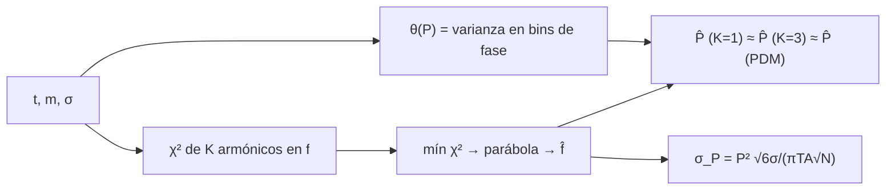

# B29-C14 — Estrellas variables periódicas

<!-- nav:top -->
[🏠 Programa](../../../../README.md) · [📚 Bloque B29](../../../tronco-comun/B29-astronomia-temporal-y-exoplanetas.md) · [← Anterior: B29-C13 — Zonas de habitabilidad](../B29-C13-zonas-de-habitabilidad/CLASE.md) · [Siguiente: B29-C15 — Eventos eruptivos estelares →](../B29-C15-eventos-eruptivos-estelares/CLASE.md)
<!-- /nav -->

## 1. Ubicación, nivel y alcance

Clase 14 del bloque B29. Nivel N3. Muchas estrellas cambian de brillo de forma periódica: pulsan, rotan con manchas o forman sistemas eclipsantes. Aquí buscas el **periodo** de una estrella variable sintética con un ajuste de **armónicos** en una rejilla de frecuencias, lo contrastas con la **dispersión de fase** (PDM), y comparas la incertidumbre de una sinusoide pura con la fórmula estándar. Usas mínimos cuadrados lineales ([B10](../../../tronco-comun/B10-algebra-lineal-y-matematicas-geometricas.md)), la fotometría de [B29-C02](../B29-C02-curvas-de-luz-fotometricas/CLASE.md) y estadística de [B12](../../../tronco-comun/B12-probabilidad-estadistica-e-incertidumbre.md). Todos los datos son sintéticos.

## 2. Por qué esta clase existe

El periodo es la propiedad básica de una variable periódica; de él y de la forma de la curva se deducen la masa, la edad o la distancia en muchos casos. La decisión central: **¿qué periodo y qué incertidumbre da la serie y qué métodos coinciden?**

## 3. Lo que podrás hacer al terminar

1. Construir una curva de luz con tres armónicos.
2. Ajustar `K` armónicos para cada frecuencia de prueba.
3. Afinar el pico del `χ²` con una parábola.
4. Calcular la dispersión de fase (PDM).
5. Comparar la incertidumbre MC con `σ_f = √6σ/(πTA√N)`.
6. Distinguir una buena fase de una errónea.

La evidencia es la **ficha de una variable periódica** del ejercicio 12 (sección 20).

## 4. Con qué llegas y cómo comprobarlo

1. ¿Qué es un armónico?
2. ¿Qué es una curva de fase?
3. ¿Qué es un ajuste lineal?
4. ¿Qué es un periodo?
5. ¿Qué es una rejilla de frecuencias?

<details>
<summary>Ver respuestas</summary>

1. Un múltiplo entero de la frecuencia fundamental. 2. El brillo frente a `(t/P) mod 1`. 3. Un modelo lineal en sus coeficientes. 4. El tiempo de un ciclo completo. 5. Un conjunto de frecuencias de prueba.
</details>

Con cuatro o cinco aciertos, sigue; si no, repasa B10 y B12.

## 5. Un caso de contexto y un caso sintético

VanderPlas describe el periodograma de Lomb–Scargle como el algoritmo habitual para señales periódicas en series con muestreo desigual (S2, resumen). Esta clase no usa estrellas reales: simula `120` medidas en `100 d` de una variable de periodo `5,3 d`, amplitud `0,30 mag` y tres armónicos, con ruido `0,03 mag`. Es el **ejemplo conductor**.

## 6. Vocabulario

El **armónico** `k`. La **curva de fase** pliega la serie al periodo. La **dispersión de fase** (PDM) mide cuánto varía el brillo dentro de cada bin de fase. La **rejilla de frecuencias** cubre el rango de búsqueda. La **amplitud** de la fundamental. La **incertidumbre del periodo** `σ_P = P²σ_f`.

## 7. Modelo mental: enrollar una cinta alrededor de un cilindro

Se enrolla la serie temporal alrededor de un cilindro de circunferencia `P`: si `P` es el verdadero, los puntos se alinean en una curva limpia; si no, se mezclan.



*Descripción textual:* se ajusta una curva armónica para cada frecuencia y se toma el mínimo de `χ²`; la dispersión de fase da un estimador independiente; ambos coinciden y la incertidumbre de una sinusoide sigue una fórmula estándar.

Analogía: una cinta enrollada. Límite: se supone un periodo constante.

## 8. La explicación, paso a paso

### 8.1 Periodos recuperados

Con el periodo verdadero `5,3 d`: ajuste de un armónico `5,29808 d`; tres armónicos `5,29909 d`; PDM `5,29538 d`. Los tres coinciden con el verdadero a `10⁻³`.

### 8.2 La curva de fase

La dispersión de fase en el periodo verdadero es `θ = 0,0503` y en un periodo erróneo (1,37 veces) `0,8831`: valores bajos indican fase limpia.

### 8.3 Incertidumbre

Para una sinusoide pura de amplitud `0,316 mag` (la fundamental de los armónicos dados) en 60 realizaciones: periodo `5,29991 ± 0,00196 d`, frente a la `σ_P` teórica `0,00190 d` (diferencia del `3 %`).

### 8.4 Lectura

El tercer armónico no cambia apreciablemente el periodo, pero mejora la forma de la curva; la incertidumbre depende de `A√N T`: más medidas o un baseline mayor reducen `σ_P`.

### 8.5 Cuidado con los alias

Con huecos regulares (día/noche) aparecen alias del periodo verdadero; se estudian en B29-C19.

## 9. Magnitudes, símbolos y unidades

| Símbolo | Qué es | Unidad | Valor / nota |
|---|---|---|---|
| `P` | periodo | d | 5,3 (sintético) |
| `A` | amplitud | mag | 0,316 (fundamental) |
| `σ` | ruido | mag | 0,03 |
| `N`, `T` | medidas y baseline | —, d | 120; 100 |
| `θ` | dispersión de fase | — | 0,0503 (buen periodo) |
| `σ_P` | incertidumbre del periodo | d | 0,0019 |

## 10. Convenciones y referencias

Ruido blanco; periodo constante; semilla `20261109`; periodo, amplitudes, ruido y calendario **ilustrativos**.

## 11. De dónde sale lo que afirmamos

| ID | Fuente | Localizador | Respalda | Estado |
|---|---|---|---|---|
| S1 | Cálculo propio: ajuste de armónicos, PDM y Monte Carlo | implementado en `periodicas.py` | todas las tablas | Verificado por tres métodos |
| S2 | VanderPlas, arXiv:1703.09824 | https://arxiv.org/abs/1703.09824 | Lomb–Scargle como algoritmo para series desigualmente muestreadas | Solo resumen, consultado el 2026-11-09 |

Límites: S2 solo resumen; la fórmula de `σ_f` es estándar y no se consultó su fuente; ninguna estrella real se analiza.

## 12. Cómo ver la fase

| Periodo de prueba | `θ` |
|---|---|
| 5,3 d (verdadero) | 0,0503 |
| 7,26 d (×1,37) | 0,8831 |

Descripción larga: la dispersión de fase es mínima en el periodo correcto y grande en periodos erróneos.

## 13. Ejemplo trabajado: incertidumbre del periodo

**Paso 1 · Datos.** `σ = 0,03`, `T = 100`, `A = 0,316`, `N = 120`.

**Paso 2 · Frecuencia.** `σ_f = √6 × 0,03/(π × 100 × 0,316 × 10,95) = 6,76 × 10⁻⁵ d⁻¹`.

**Paso 3 · Periodo.** `σ_P = 5,3² × 6,76 × 10⁻⁵ = 1,90 × 10⁻³ d`.

**Paso 4 · Sentido.** El periodo se conoce al `0,04 %`.

## 14. Distintas formas de describir la variable

**Por periodo:** `P`. **Por amplitud:** `A`. **Por forma:** coeficientes de armónicos. **Por fase:** `θ`.

## 15. Práctica guiada

**Ejercicio 1 · con los pasos indicados.** Frecuencia de la señal. *Pasos:* `1/P`.

<details><summary>Solución comentada</summary>

`0,1887 d⁻¹`.
</details>

**Ejercicio 2 · con una pista.** `σ_P` con `N` cuadruplicado.

<details><summary>Solución comentada</summary>

La mitad: `0,00095 d`.
</details>

**Ejercicio 3 · casi autónomo.** `σ_P` con `T` doble.

<details><summary>Solución comentada</summary>

La mitad: `0,00095 d`.
</details>

## 16. Práctica autónoma, transferencia e integrador

**Ejercicio 4.** Error del periodo de PDM frente al verdadero.

<details><summary>Solución comentada</summary>

`(5,3 − 5,29538)/5,3 = 0,09 %`.
</details>

**Ejercicio 5.** Error del ajuste de 3 armónicos en unidades de `σ_P`.

<details><summary>Solución comentada</summary>

`0,00091/0,0019 = 0,5σ`.
</details>

**Ejercicio 6.** Desviación MC frente a la teórica.

<details><summary>Solución comentada</summary>

`0,00196/0,00190 = 1,03`.
</details>

**Ejercicio 7.** Amplitud pico a pico de la fundamental.

<details><summary>Solución comentada</summary>

`2 × 0,316 = 0,63 mag`.
</details>

**Ejercicio 8.** Ciclos observados en 100 d.

<details><summary>Solución comentada</summary>

`100/5,3 = 18,9`.
</details>

**Ejercicio 9 · transferencia.** Un compañero dice que PDM y el ajuste armónico deben dar exactamente el mismo periodo. Responde con 8.1.

<details><summary>Solución comentada</summary>

Son estimadores distintos con su propia incertidumbre: difieren en `~10⁻³`.
</details>

**Ejercicio 10 · transferencia.** ¿Por qué usar tres armónicos?

<details><summary>Solución comentada</summary>

Para capturar la forma no sinusoidal; el periodo cambia poco, pero el modelo se ajusta mejor.
</details>

**Ejercicio 11 · transferencia.** ¿Qué valida el Monte Carlo?

<details><summary>Solución comentada</summary>

Que la fórmula de `σ_P` describe la dispersión de la búsqueda; no que una estrella real sea estrictamente periódica.
</details>

**Ejercicio 12 · integrador.** Elabora tu *ficha de una variable periódica*: periodos por tres métodos, `θ` en dos periodos y la incertidumbre.

<details><summary>Solución modelo</summary>

Secciones 8.1–8.3.
</details>

## 17. Laboratorio: periodo y fase

El script [periodicas.py](periodicas.py) ajusta armónicos en una rejilla de frecuencias, calcula PDM (**comprueba** `10⁻³`) y simula 60 sinusoides (**comprueba** 30 % en `σ_P`).

**Datos:** sin constantes; todo **sintético** con semilla fija. **Predice antes de ejecutar:** ¿qué periodo recupera? (≈`5,30 d`.) **Ejecución del 2026-11-09 (Python 3.12.9):**

```text
Python 3.12.9 (biblioteca estandar)
periodo verdadero = 5.3 d ; ajuste de 1 armonico: 5.29808 d ; de 3 armonicos: 5.29909 d ; PDM: 5.29538 d
theta PDM en el periodo verdadero = 0.0503 ; en un periodo erroneo (1.37 x) = 0.8831
sinusoide pura (amplitud 0.316 mag): periodo MC = 5.29991 +/- 0.00196 d ; teorico sigma_P = 0.00190 d
Pruebas superadas.
```

```bash
python programa/clases/B29/B29-C14-estrellas-variables-periodicas/periodicas.py
```

**Límites:** ruido blanco, periodo constante, sin tendencias ni cambios de amplitud.

## 18. Errores frecuentes y cómo corregirlos

**Confundir periodo y frecuencia.** Se corrige con el ejercicio 1.

**Esperar coincidencia exacta de métodos.** Se corrige con el ejercicio 9.

**Ignorar los alias.** Se corrige con 8.5.

**Olvidar el baseline.** Se corrige con el ejercicio 3.

**Tomar la estrella sintética por real.** Se corrige con la sección 10.

## 19. Cómo sabrás que vas bien

Tras 8.1: ¿coinciden los tres métodos? Si dudas, ejercicio 9. Tras 8.3: ¿cuánto vale `σ_P`? Ejercicio 2. Tras el laboratorio: ¿qué valida? (la recuperación del periodo).

## 20. Qué entregas y cómo se evalúa

El producto es tu **ficha de una variable periódica** (ejercicio 12).

| Criterio | Inicial | En desarrollo | Logrado | Destacado |
|---|---|---|---|---|
| Conceptos | Los confunde | Parciales | Periodo, fase, armónicos | Explica el papel del baseline |
| Cálculo | Sin unidades | Con errores | Tablas completas | Calcula `σ_P` |
| Numérico | Sin comprobar | Un caso | Tres métodos | Interpreta diferencias |
| Fuentes | Sin fuente | Sin fecha | S1–S2 con fecha | Declara que no hay estrellas reales |
| Límites | No los nombra | Uno | Tres | Discute alias |

**Condiciones críticas (no se compensan con promedio):** rotular todo como sintético; no atribuir periodos a estrellas reales; citar solo lo consultado.

## 21. Ética, seguridad y límites

Clase educativa: no es una canalización de clasificación de variables. Accesibilidad: tablas equivalentes a las gráficas, fórmulas en texto, ejercicios sin conexión.

## 22. Para cerrar y seguir

Tres métodos recuperan el periodo `5,3 d` a `10⁻³` y la incertidumbre de una sinusoide (`0,0019 d`) coincide con la teórica. Queda una pregunta: ¿qué pasa con las estrellas que de pronto se iluminan?

**Glosario español–inglés.** variable periódica · *periodic variable*; curva de fase · *phase curve*; dispersión de fase · *phase dispersion minimization*; armónico · *harmonic*; periodograma · *periodogram*; baseline · *time baseline*.

**Continuidad.** [B29-C15](../B29-C15-eventos-eruptivos-estelares/CLASE.md) estudia los eventos eruptivos estelares.

**Referencias:** ver sección 11.

<!-- nav:bottom -->
---

[← Anterior: B29-C13 — Zonas de habitabilidad](../B29-C13-zonas-de-habitabilidad/CLASE.md) · [📚 Bloque B29](../../../tronco-comun/B29-astronomia-temporal-y-exoplanetas.md) · [Siguiente: B29-C15 — Eventos eruptivos estelares →](../B29-C15-eventos-eruptivos-estelares/CLASE.md)
<!-- /nav -->
