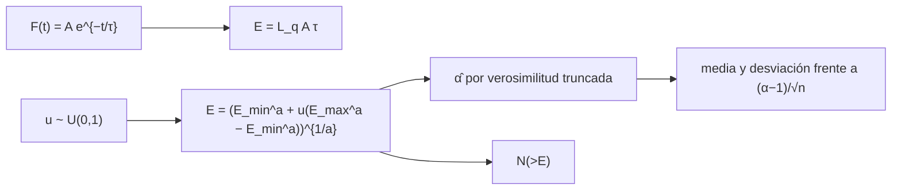

# B29-C15 — Eventos eruptivos estelares

<!-- nav:top -->
[🏠 Programa](../../../../README.md) · [📚 Bloque B29](../../../tronco-comun/B29-astronomia-temporal-y-exoplanetas.md) · [← Anterior: B29-C14 — Estrellas variables periódicas](../B29-C14-estrellas-variables-periodicas/CLASE.md) · [Siguiente: B29-C16 — Supernovas y curvas de luz →](../B29-C16-supernovas-y-curvas-de-luz/CLASE.md)
<!-- /nav -->

## 1. Ubicación, nivel y alcance

Clase 15 del bloque B29. Nivel N3. Las enanas M fabrican **llamaradas**: subidas bruscas de brillo seguidas de una caída exponencial. Aquí modelas una llamarada de **subida rápida y caída exponencial**, calculas su **energía**, simulas una población con una **ley de potencias truncada** y estimas el índice con **máxima verosimilitud**, comprobando el sesgo y la dispersión por Monte Carlo. Usas integrales ([B09-C11](../../B09/B09-C11-integrales-definidas/CLASE.md)), la ley de potencias de [B28-C04](../../B28/B28-C04-rayos-cosmicos-de-alta-energia/CLASE.md) y la estadística de [B12](../../../tronco-comun/B12-probabilidad-estadistica-e-incertidumbre.md). Se suponen energías independientes.

## 2. Por qué esta clase existe

La distribución de energías de las llamaradas determina cuánta energía total reciben los planetas cercanos. Estimar su índice con poco sesgo exige usar el estimador correcto. La decisión central: **¿cuánta energía tiene una llamarada y cómo se estima la ley que siguen las energías de la población?**

## 3. Lo que podrás hacer al terminar

1. Calcular `E = L_q A τ` de una llamarada exponencial.
2. Verificar la integral numéricamente.
3. Muestrear energías de una ley de potencias truncada por transformada inversa.
4. Estimar el índice `α` por máxima verosimilitud truncada.
5. Comparar el error con `(α−1)/√n`.
6. Calcular el recuento acumulado y la fracción de energía en la cola.

La evidencia es la **ficha de llamaradas estelares** del ejercicio 12 (sección 20).

## 4. Con qué llegas y cómo comprobarlo

1. ¿Qué es una ley de potencias?
2. ¿Qué es la máxima verosimilitud?
3. ¿Qué es la transformada inversa?
4. ¿Qué es una distribución truncada?
5. ¿Qué es una luminosidad quiescente?

<details>
<summary>Ver respuestas</summary>

1. `dN/dE ∝ E^{−α}`. 2. Elegir el parámetro que maximiza la probabilidad de los datos. 3. Generar una variable a partir de una uniforme invirtiendo su distribución acumulada. 4. Restringida a un intervalo. 5. La luminosidad de la estrella sin llamarada.
</details>

Con cuatro o cinco aciertos, sigue; si no, repasa B12.

## 5. Un caso de contexto y un caso sintético

Davenport reúne más de `6100` llamaradas de la enana M GJ 1243, con energías de `10²⁹` a `10³³ erg`, en 11 meses de datos de Kepler con cadencia de 1 minuto (S2, resumen). Esta clase usa esas cifras solo para fijar la escala de la simulación: `n = 6100` energías entre `10²⁹` y `10³³ erg` con un índice ilustrativo de `1,8` y una luminosidad quiescente de `10³⁰ erg/s`. Es el **ejemplo conductor**.

## 6. Vocabulario

La **llamarada** es un aumento brusco de brillo. La **subida rápida y caída exponencial** es su plantilla mínima. La **energía** `E = L_q ∫ F dt`. El **índice** `α` de `dN/dE ∝ E^{−α}`. La **máxima verosimilitud** estima `α`. El **recuento acumulado** `N(>E)`.

## 7. Modelo mental: un petardo y un registro de ruidos

Cada petardo (llamarada) tiene una energía; en un registro largo hay muchos pequeños y pocos grandes. El índice dice cuán rápido disminuyen.



*Descripción textual:* la llamarada tiene energía `L_q A τ`; las energías de una población se generan por transformada inversa de una ley de potencias truncada; el índice se estima por verosimilitud y su dispersión se compara con la teórica.

Analogía: un registro de petardos. Límite: no se modela la detectabilidad de las pequeñas.

## 8. La explicación, paso a paso

### 8.1 Energía de una llamarada

Con `A = 0,1` y `τ = 10 min = 600 s` y `L_q = 10³⁰ erg/s`: `E = 6,000 × 10³¹ erg`. La integral numérica hasta `10τ` da `60,0023` frente a `Aτ = 60,0000`.

### 8.2 Estimación del índice

En 200 muestras de `6100` llamaradas con `α = 1,8`: media `1,7997`, desviación `0,0108`, frente a `(α−1)/√n = 0,0102`.

### 8.3 Recuento acumulado

| `E` (erg) | `N(>E)` simulado | `N(>E)` analítico |
|---|---|---|
| `10²⁹` | 6100 | 6100,0 |
| `10³⁰` | 998 | 963,5 |
| `10³¹` | 165 | 149,5 |
| `10³²` | 20 | 20,4 |

### 8.4 La cola

La energía total de las `6100` llamaradas es `1,443 × 10³⁴ erg`; el `1 %` más energético concentra el `62,4 %`.

### 8.5 Lectura

Con índice menor que 2 la energía total está dominada por las llamaradas grandes, aunque son pocas. Por eso la energía acumulada depende mucho del extremo superior de la distribución.

## 9. Magnitudes, símbolos y unidades

| Símbolo | Qué es | Unidad | Valor / nota |
|---|---|---|---|
| `E` | energía de una llamarada | erg | `10²⁹`–`10³³` |
| `A`, `τ` | amplitud relativa y constante de caída | —, s | 0,1; 600 (ilustrativos) |
| `L_q` | luminosidad quiescente | erg/s | `10³⁰` (ilustrativa) |
| `α` | índice | — | 1,8 (ilustrativo) |
| `n` | número de llamaradas | — | 6100 |
| semilla | repetibilidad | — | 20261109 |

## 10. Convenciones y referencias

Subida instantánea; energías independientes; semilla `20261109`; el índice, `L_q`, `A` y `τ` son **ilustrativos**; los límites de energía y `n` son de S2.

## 11. De dónde sale lo que afirmamos

| ID | Fuente | Localizador | Respalda | Estado |
|---|---|---|---|---|
| S1 | Cálculo propio: transformada inversa y verosimilitud truncada | implementado en `llamaradas.py` | todas las tablas | Verificado por Monte Carlo |
| S2 | Davenport, arXiv:1411.3723 | https://arxiv.org/abs/1411.3723 | `> 6100` llamaradas; `10²⁹`–`10³³ erg`; 11 meses; cadencia de 1 min; GJ 1243 | Solo resumen, consultado el 2026-11-09 |

Límites: S2 solo resumen y su índice real no se usa; el modelo de llamarada es mínimo; no se modela la completitud.

## 12. Cómo ver el recuento

| `E` | `N(>E)` |
|---|---|
| `10²⁹` erg | 6100 |
| `10³¹` erg | 150 |
| `10³²` erg | 20 |

Descripción larga: cada década de energía reduce el recuento en un factor `10^{0,8} = 6,3`.

## 13. Ejemplo trabajado: energía de una llamarada

**Paso 1 · Datos.** `L_q = 10³⁰ erg/s`, `A = 0,1`, `τ = 600 s`.

**Paso 2 · Producto.** `L_q A = 10²⁹ erg/s`.

**Paso 3 · Energía.** `10²⁹ × 600 = 6 × 10³¹ erg`.

**Paso 4 · Sentido.** Dentro del rango de energías del caso de contexto.

## 14. Distintas formas de describir las llamaradas

**Por energía:** `E`. **Por duración:** `τ`. **Por frecuencia:** `N(>E)`. **Por índice:** `α`.

## 15. Práctica guiada

**Ejercicio 1 · con los pasos indicados.** `E` con `A = 0,5`. *Pasos:* proporcional.

<details><summary>Solución comentada</summary>

`3 × 10³² erg`.
</details>

**Ejercicio 2 · con una pista.** Error teórico de `α` con `n = 100`.

<details><summary>Solución comentada</summary>

`0,8/10 = 0,08`.
</details>

**Ejercicio 3 · casi autónomo.** Recuento sobre `10³²` con `α = 1,8`.

<details><summary>Solución comentada</summary>

`20,4`.
</details>

## 16. Práctica autónoma, transferencia e integrador

**Ejercicio 4.** Factor entre los recuentos acumulados de dos décadas.

<details><summary>Solución comentada</summary>

`10^{0,8} = 6,3`.
</details>

**Ejercicio 5.** Cociente simulado/analítico en `10³⁰`.

<details><summary>Solución comentada</summary>

`998/963,5 = 1,036`.
</details>

**Ejercicio 6.** Sesgo de `α` en unidades del error de la media.

<details><summary>Solución comentada</summary>

`(1,7997 − 1,8)/(0,0108/√200) = −0,4`.
</details>

**Ejercicio 7.** Fracción de la energía en el 1 % mayor.

<details><summary>Solución comentada</summary>

`62,4 %`.
</details>

**Ejercicio 8.** Energía media por llamarada.

<details><summary>Solución comentada</summary>

`1,443 × 10³⁴/6100 = 2,37 × 10³⁰ erg`.
</details>

**Ejercicio 9 · transferencia.** Un compañero dice que la mayor parte de la energía viene de las llamaradas pequeñas. Responde con 8.4.

<details><summary>Solución comentada</summary>

Con `α < 2` domina la cola grande: el 1 % mayor aporta el 62 %.
</details>

**Ejercicio 10 · transferencia.** ¿Por qué se usa verosimilitud truncada?

<details><summary>Solución comentada</summary>

Porque la ley solo vale entre `E_min` y `E_max`; ignorar el techo sesga el índice.
</details>

**Ejercicio 11 · transferencia.** ¿Qué valida el Monte Carlo?

<details><summary>Solución comentada</summary>

Que el estimador es insesgado y tiene la dispersión esperada; no que la población real sea una ley de potencias.
</details>

**Ejercicio 12 · integrador.** Elabora tu *ficha de llamaradas estelares*: energía de una llamarada, estimación del índice, recuentos y fracción en la cola.

<details><summary>Solución modelo</summary>

Secciones 8.1–8.4.
</details>

## 17. Laboratorio: energías de llamaradas

El script [llamaradas.py](llamaradas.py) integra la llamarada (**comprueba** `10⁻³`), simula 200 poblaciones de 6100 llamaradas y estima `α` (**comprueba** 15 % en la dispersión).

**Datos:** sin constantes; cifras de escala de S2; el resto **ilustrativo**. **Predice antes de ejecutar:** ¿qué `α` se recupera? (≈`1,80`.) **Ejecución del 2026-11-09 (Python 3.12.9):**

```text
Python 3.12.9 (biblioteca estandar)
llamarada de ejemplo: amplitud 0.1, tau = 10 min -> energia = L_q A tau = 6.000e+31 erg
integral numerica de A exp(-t/tau) dt hasta 10 tau = 60.0023 (A tau = 60.0000)
alpha verdadero = 1.8 ; 200 muestras de 6100 llamaradas: media = 1.7997 ; desviacion = 0.0108 ; teorica (alpha - 1)/sqrt(n) = 0.0102
 E_min [erg]   N(>E) simulado   N(>E) analitico
       1e+29             6100            6100.0
       1e+30              998             963.5
       1e+31              165             149.5
       1e+32               20              20.4
energia total de las 6100 llamaradas = 1.443e+34 erg ; fraccion de la energia en el 1 % mas energetico = 0.624
Pruebas superadas.
```

```bash
python programa/clases/B29/B29-C15-eventos-eruptivos-estelares/llamaradas.py
```

**Límites:** sin completitud, sin subida finita, energías independientes.

## 18. Errores frecuentes y cómo corregirlos

**Usar el estimador sin truncamiento.** Se corrige con el ejercicio 10.

**Pensar que el recuento es lineal en `E`.** Se corrige con el ejercicio 4.

**Olvidar la cola.** Se corrige con el ejercicio 9.

**Mezclar erg y J.** Se corrige con la sección 9.

**Tomar el índice ilustrativo por medido.** Se corrige con la sección 10.

## 19. Cómo sabrás que vas bien

Tras 8.1: ¿cuánta energía tiene la llamarada? Si dudas, ejemplo 13. Tras 8.2: ¿qué error tiene `α`? Ejercicio 2. Tras el laboratorio: ¿qué valida? (el estimador).

## 20. Qué entregas y cómo se evalúa

El producto es tu **ficha de llamaradas estelares** (ejercicio 12).

| Criterio | Inicial | En desarrollo | Logrado | Destacado |
|---|---|---|---|---|
| Conceptos | Los confunde | Parciales | Energía, índice, recuento | Explica la cola |
| Cálculo | Sin unidades | Con errores | Tablas completas | Calcula fracciones |
| Numérico | Sin comprobar | Un caso | Monte Carlo | Interpreta el error |
| Fuentes | Sin fuente | Sin fecha | S1–S2 con fecha | Declara que el índice es ilustrativo |
| Límites | No los nombra | Uno | Tres | Discute completitud |

**Condiciones críticas (no se compensan con promedio):** rotular el índice y los parámetros como ilustrativos; no atribuir resultados a GJ 1243; citar solo lo consultado.

## 21. Ética, seguridad y límites

Clase educativa: no es un análisis de llamaradas reales. Accesibilidad: tablas equivalentes a las gráficas, fórmulas en texto, ejercicios sin conexión.

## 22. Para cerrar y seguir

Una llamarada de `10²⁹ erg/s` y 10 minutos libera `6 × 10³¹ erg`; el estimador de máxima verosimilitud truncada recupera `α = 1,8` con `0,011` de dispersión, y el 1 % mayor concentra el 62 % de la energía. Queda una pregunta: ¿cómo se analiza la curva de luz de una explosión estelar?

**Glosario español–inglés.** llamarada estelar · *stellar flare*; ley de potencias truncada · *truncated power law*; máxima verosimilitud · *maximum likelihood*; recuento acumulado · *cumulative count*; transformada inversa · *inverse transform sampling*; luminosidad quiescente · *quiescent luminosity*.

**Continuidad.** [B29-C16](../B29-C16-supernovas-y-curvas-de-luz/CLASE.md) estudia las supernovas y sus curvas de luz.

**Referencias:** ver sección 11.

<!-- nav:bottom -->
---

[← Anterior: B29-C14 — Estrellas variables periódicas](../B29-C14-estrellas-variables-periodicas/CLASE.md) · [📚 Bloque B29](../../../tronco-comun/B29-astronomia-temporal-y-exoplanetas.md) · [Siguiente: B29-C16 — Supernovas y curvas de luz →](../B29-C16-supernovas-y-curvas-de-luz/CLASE.md)
<!-- /nav -->
