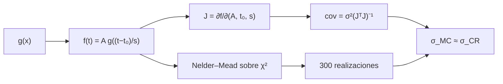

# B29-C16 — Supernovas y curvas de luz

<!-- nav:top -->
[🏠 Programa](../../../../README.md) · [📚 Bloque B29](../../../tronco-comun/B29-astronomia-temporal-y-exoplanetas.md) · [← Anterior: B29-C15 — Eventos eruptivos estelares](../B29-C15-eventos-eruptivos-estelares/CLASE.md) · [Siguiente: B29-C17 — Fenómenos transitorios rápidos →](../B29-C17-fenomenos-transitorios-rapidos/CLASE.md)
<!-- /nav -->

## 1. Ubicación, nivel y alcance

Clase 16 del bloque B29. Nivel N3. Una supernova es una explosión estelar cuya curva de luz sube en días y baja en semanas. Aquí ajustas una **plantilla asimétrica** con tres parámetros (amplitud, instante del máximo y **estiramiento**) a una curva sintética y comparas la dispersión de los parámetros recuperados con el **límite de Cramér–Rao** obtenido con un jacobiano numérico. Usas la cadena radiactiva de [B27-C14](../../B27/B27-C14-supernovas-termonucleares/CLASE.md), los ajustes de [B29-C09](../B29-C09-parametros-orbitales-exoplanetarios/CLASE.md) y la estadística de [B12](../../../tronco-comun/B12-probabilidad-estadistica-e-incertidumbre.md). Se supone ruido gaussiano y una plantilla conocida.

## 2. Por qué esta clase existe

El estiramiento de la curva de luz es una de las magnitudes con que se estandarizan las supernovas de tipo Ia para medir distancias. Saber con qué precisión se recupera guía la planificación de observaciones. La decisión central: **¿con qué precisión se recuperan amplitud, máximo y estiramiento con un calendario dado y qué dice el límite de Cramér–Rao?**

## 3. Lo que podrás hacer al terminar

1. Escribir la plantilla `g(x) = e^{x/8}` (subida) y `e^{−x/25}` (caída).
2. Ajustar `(A, t₀, s)` con Nelder–Mead.
3. Calcular el jacobiano numérico y la covarianza de Cramér–Rao `σ²(JᵀJ)⁻¹`.
4. Comparar con la dispersión del Monte Carlo.
5. Relacionar el estiramiento con el tiempo de caída a la mitad.
6. Reconocer los supuestos del modelo.

La evidencia es la **ficha de una curva de luz de supernova** del ejercicio 12 (sección 20).

## 4. Con qué llegas y cómo comprobarlo

1. ¿Qué es el máximo de brillo?
2. ¿Qué es una plantilla?
3. ¿Qué es el jacobiano?
4. ¿Qué es el límite de Cramér–Rao?
5. ¿Qué es un estiramiento temporal?

<details>
<summary>Ver respuestas</summary>

1. El instante de mayor flujo. 2. Una curva modelo cuya forma se escala. 3. La matriz de derivadas del modelo respecto de los parámetros. 4. La cota inferior de la varianza de un estimador insesgado. 5. Un factor que ensancha o estrecha la curva.
</details>

Con cuatro o cinco aciertos, sigue; si no, repasa B27-C14.

## 5. Un caso de contexto y un caso sintético

Maoz et al. revisan las supernovas de tipo Ia y sus progenitores (S2, resumen). Esta clase no usa ninguna curva real: simula `30` épocas entre `−5` y `82 d` con un máximo en `t₀ = 20 d`, estiramiento `1,10` y ruido del `3 %` del máximo. Es el **ejemplo conductor**.

## 6. Vocabulario

La **plantilla** `g(x)` da la forma. El **estiramiento** `s` ensancha o estrecha. El **instante del máximo** `t₀`. La **amplitud** `A`. El **jacobiano** reúne las derivadas parciales. La **cota de Cramér–Rao** es el límite de precisión.

## 7. Modelo mental: una goma elástica sobre un dibujo

La plantilla es un dibujo sobre una goma elástica: se desplaza (`t₀`), se amplía en altura (`A`) y se estira en el tiempo (`s`) hasta encajar con los datos.



*Descripción textual:* la plantilla y los tres parámetros definen el modelo; el jacobiano da la covarianza mínima; el ajuste simulado reproduce esa covarianza.

Analogía: una goma elástica con un dibujo. Límite: se supone una plantilla única.

## 8. La explicación, paso a paso

### 8.1 Cramér–Rao frente a Monte Carlo

En 300 realizaciones:

| parámetro | verdadero | media | `σ` MC | Cramér–Rao | cociente |
|---|---|---|---|---|---|
| `A` | 1,0000 | 0,9990 | 0,0165 | 0,0181 | 0,913 |
| `t₀` (d) | 20,0000 | 19,9867 | 0,1728 | 0,1846 | 0,936 |
| `s` | 1,1000 | 1,1006 | 0,0278 | 0,0301 | 0,925 |

El cociente (`0,91`–`0,94`) está dentro del `15 %` exigido; el estimador no supera el límite de forma sistemática (la diferencia viene de los términos de segundo orden y del número finito de realizaciones).

### 8.2 Tiempo de caída a la mitad

`t_{1/2} = s × 25 × ln 2`: `13,86 d` (`s = 0,80`), `17,33` (`1,00`), `19,06` (`1,10`) y `22,53 d` (`1,30`).

### 8.3 Precisión relativa

`σ_s/s = 0,0278/1,10 = 2,5 %`; `σ_{t₀} = 0,17 d`; `σ_A/A = 1,7 %`.

### 8.4 Lectura

Con 30 épocas de un `3 %` de ruido el máximo se conoce a menos de `0,2 d` y el estiramiento al `2,5 %`. Más épocas cerca del máximo mejoran `t₀`; épocas en la cola mejoran `s`.

### 8.5 Extensión

Con dos bandas o más, se recuperan además colores y la corrección de extinción, que no se tratan aquí.

## 9. Magnitudes, símbolos y unidades

| Símbolo | Qué es | Unidad | Valor / nota |
|---|---|---|---|
| `A` | amplitud | relativa | 1,0 |
| `t₀` | instante del máximo | d | 20 |
| `s` | estiramiento | — | 1,10 |
| `σ` | ruido | relativa | 0,03 |
| `N` | épocas | — | 30 |
| constantes de la plantilla | subida y caída | d | 8; 25 (ilustrativas) |

## 10. Convenciones y referencias

Plantilla asimétrica con máximo en `x = 0`; ruido gaussiano constante; semilla `20261109`; plantilla, parámetros y calendario **ilustrativos**.

## 11. De dónde sale lo que afirmamos

| ID | Fuente | Localizador | Respalda | Estado |
|---|---|---|---|---|
| S1 | Cálculo propio: ajuste de plantilla y Cramér–Rao | implementado en `supernovas.py` | tablas 8.1–8.2 | Verificado por Monte Carlo |
| S2 | Maoz et al., arXiv:1312.0628 | https://arxiv.org/abs/1312.0628 | contexto: supernovas de tipo Ia y progenitores | Solo resumen, consultado el 2026-11-09 |

Límites: S2 solo resumen y sin cifras usadas; la plantilla no es la de ninguna supernova real; las cifras son sintéticas.

## 12. Cómo ver el efecto del estiramiento

| `s` | `t_{1/2}` (d) |
|---|---|
| 0,80 | 13,86 |
| 1,00 | 17,33 |
| 1,10 | 19,06 |
| 1,30 | 22,53 |

Descripción larga: el tiempo de caída a la mitad crece en proporción al estiramiento.

## 13. Ejemplo trabajado: tiempo de caída a la mitad

**Paso 1 · Condición.** `e^{−x/25} = 1/2`.

**Paso 2 · Despeje.** `x = 25 ln 2 = 17,33 d`.

**Paso 3 · Estiramiento.** `t = s x = 1,1 × 17,33 = 19,06 d`.

**Paso 4 · Sentido.** El flujo cae a la mitad del máximo 19 días después.

## 14. Distintas formas de describir la curva

**Por parámetros:** `(A, t₀, s)`. **Por tiempos característicos:** subida y caída. **Por precisión:** Cramér–Rao. **Por forma:** plantilla.

## 15. Práctica guiada

**Ejercicio 1 · con los pasos indicados.** `g(−8)`. *Pasos:* `e^{−1}`.

<details><summary>Solución comentada</summary>

`0,3679`.
</details>

**Ejercicio 2 · con una pista.** `g(25)`.

<details><summary>Solución comentada</summary>

`e^{−1} = 0,3679`.
</details>

**Ejercicio 3 · casi autónomo.** `t_{1/2}` con `s = 1,2`.

<details><summary>Solución comentada</summary>

`20,8 d`.
</details>

## 16. Práctica autónoma, transferencia e integrador

**Ejercicio 4.** Error relativo de `s`.

<details><summary>Solución comentada</summary>

`2,5 %`.
</details>

**Ejercicio 5.** Cociente MC/CR para `t₀`.

<details><summary>Solución comentada</summary>

`0,936`.
</details>

**Ejercicio 6.** Sesgo de `t₀` en unidades del error de la media (`0,1728/√300 = 0,0100`).

<details><summary>Solución comentada</summary>

`(19,9867 − 20)/0,0100 = −1,3`.
</details>

**Ejercicio 7.** `σ_s` si el ruido pasa a `6 %`.

<details><summary>Solución comentada</summary>

Se duplica: `0,056`.
</details>

**Ejercicio 8.** `σ_{t₀}` si las épocas se duplican.

<details><summary>Solución comentada</summary>

Se divide por `√2`: `0,12 d`.
</details>

**Ejercicio 9 · transferencia.** Un compañero dice que el ajuste debe superar el límite de Cramér–Rao. Responde con 8.1.

<details><summary>Solución comentada</summary>

El límite es una cota: un estimador insesgado no puede tener menor varianza.
</details>

**Ejercicio 10 · transferencia.** ¿Por qué `s` y `t₀` se correlacionan?

<details><summary>Solución comentada</summary>

Porque desplazar y estirar la curva producen cambios parecidos en las épocas cercanas al máximo.
</details>

**Ejercicio 11 · transferencia.** ¿Qué valida el Monte Carlo?

<details><summary>Solución comentada</summary>

La covarianza de Cramér–Rao con un estimador real; no la plantilla.
</details>

**Ejercicio 12 · integrador.** Elabora tu *ficha de una curva de luz de supernova*: parámetros, Monte Carlo, Cramér–Rao y tiempos de caída.

<details><summary>Solución modelo</summary>

Secciones 8.1–8.4.
</details>

## 17. Laboratorio: plantilla y Cramér–Rao

El script [supernovas.py](supernovas.py) ajusta 300 curvas sintéticas y calcula Cramér–Rao con un jacobiano numérico (**comprueba** 15 %).

**Datos:** sin constantes; todo **sintético** con semilla fija. **Predice antes de ejecutar:** ¿qué cociente MC/CR sale? (cercano a 1.) **Ejecución del 2026-11-09 (Python 3.12.9):**

```text
Python 3.12.9 (biblioteca estandar)
parametro  verdadero     media  sigma MC  Cramer-Rao  cociente
A            1.0000    0.9990    0.0165      0.0181     0.913
t0 [d]      20.0000   19.9867    0.1728      0.1846     0.936
s            1.1000    1.1006    0.0278      0.0301     0.925
estiramiento s = 0.80: tiempo para caer a la mitad tras el maximo = 13.86 d
estiramiento s = 1.00: tiempo para caer a la mitad tras el maximo = 17.33 d
estiramiento s = 1.10: tiempo para caer a la mitad tras el maximo = 19.06 d
estiramiento s = 1.30: tiempo para caer a la mitad tras el maximo = 22.53 d
Pruebas superadas.
```

```bash
python programa/clases/B29/B29-C16-supernovas-y-curvas-de-luz/supernovas.py
```

**Límites:** plantilla única, ruido gaussiano de varianza constante, sin extinción.

## 18. Errores frecuentes y cómo corregirlos

**Confundir estiramiento y amplitud.** Se corrige con la sección 6.

**Esperar que el ajuste supere a Cramér–Rao.** Se corrige con el ejercicio 9.

**Ignorar la correlación entre parámetros.** Se corrige con el ejercicio 10.

**Mezclar el tiempo y el estiramiento.** Se corrige con el ejemplo 13.

**Tomar la plantilla por real.** Se corrige con la sección 10.

## 19. Cómo sabrás que vas bien

Tras 8.1: ¿cuánto vale el cociente MC/CR? Si dudas, ejercicio 5. Tras 8.2: ¿cómo cambia `t_{1/2}` con `s`? Ejemplo 13. Tras el laboratorio: ¿qué valida? (el estimador).

## 20. Qué entregas y cómo se evalúa

El producto es tu **ficha de una curva de luz de supernova** (ejercicio 12).

| Criterio | Inicial | En desarrollo | Logrado | Destacado |
|---|---|---|---|---|
| Conceptos | Los confunde | Parciales | Plantilla, estiramiento, CR | Explica las correlaciones |
| Cálculo | Sin unidades | Con errores | Tablas completas | Calcula tiempos |
| Numérico | Sin comprobar | Un caso | Monte Carlo y CR | Interpreta cociente |
| Fuentes | Sin fuente | Sin fecha | S1–S2 con fecha | Declara que la plantilla no es real |
| Límites | No los nombra | Uno | Tres | Discute extinción y colores |

**Condiciones críticas (no se compensan con promedio):** rotular la plantilla como ilustrativa; no atribuir parámetros a una supernova real; citar solo lo consultado.

## 21. Ética, seguridad y límites

Clase educativa: no es un ajustador de supernovas. Accesibilidad: tablas equivalentes a las gráficas, fórmulas en texto, ejercicios sin conexión.

## 22. Para cerrar y seguir

Con 30 épocas y un `3 %` de ruido el máximo se recupera a `0,17 d`, el estiramiento al `2,5 %` y la dispersión del ajuste está al `92 %` de la cota de Cramér–Rao. Queda una pregunta: ¿cómo se estudian los fenómenos que duran milisegundos?

**Glosario español–inglés.** curva de luz · *light curve*; estiramiento · *stretch*; plantilla · *template*; límite de Cramér–Rao · *Cramér–Rao bound*; jacobiano · *Jacobian*; instante del máximo · *time of maximum*.

**Continuidad.** [B29-C17](../B29-C17-fenomenos-transitorios-rapidos/CLASE.md) estudia los fenómenos transitorios rápidos.

**Referencias:** ver sección 11.

<!-- nav:bottom -->
---

[← Anterior: B29-C15 — Eventos eruptivos estelares](../B29-C15-eventos-eruptivos-estelares/CLASE.md) · [📚 Bloque B29](../../../tronco-comun/B29-astronomia-temporal-y-exoplanetas.md) · [Siguiente: B29-C17 — Fenómenos transitorios rápidos →](../B29-C17-fenomenos-transitorios-rapidos/CLASE.md)
<!-- /nav -->
