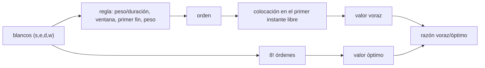

# B29-C18 — Redes de seguimiento temporal

<!-- nav:top -->
[🏠 Programa](../../../../README.md) · [📚 Bloque B29](../../../tronco-comun/B29-astronomia-temporal-y-exoplanetas.md) · [← Anterior: B29-C17 — Fenómenos transitorios rápidos](../B29-C17-fenomenos-transitorios-rapidos/CLASE.md) · [Siguiente: B29-C19 — Análisis de series temporales irregularmente muestreadas →](../B29-C19-analisis-de-series-temporales-irregularmente-muestreadas/CLASE.md)
<!-- /nav -->

## 1. Ubicación, nivel y alcance

Clase 18 del bloque B29. Nivel N3. Una red de telescopios observa muchos blancos con ventanas de visibilidad, duraciones y prioridades distintas: hay que **planificar**. Aquí aplicas **reglas voraces** a un problema de planificación de una noche, las comparas con el **óptimo exhaustivo** y calculas la **completitud** al añadir telescopios. Usas combinatoria, la visibilidad de [B28-C16](../../B28/B28-C16-redes-internacionales-de-alertas/CLASE.md) y el seguimiento de [B28-C15](../../B28/B28-C15-busqueda-de-contrapartidas-opticas/CLASE.md). Los blancos son sintéticos.

## 2. Por qué esta clase existe

La regla de planificación determina cuánto valor científico se recoge. Una regla ingenua puede perder la mitad del valor; añadir telescopios no siempre compensa. La decisión central: **¿qué regla voraz se acerca más al óptimo y cuántos telescopios hacen falta para observar casi todo?**

## 3. Lo que podrás hacer al terminar

1. Modelar blancos con ventana, duración y peso.
2. Implementar una colocación en el primer instante libre.
3. Implementar cuatro reglas voraces.
4. Calcular el óptimo exhaustivo (8! órdenes).
5. Comparar razones voraz/óptimo en 150 instancias.
6. Calcular la completitud con 1 a 8 telescopios.

La evidencia es la **ficha de planificación de seguimiento** del ejercicio 12 (sección 20).

## 4. Con qué llegas y cómo comprobarlo

1. ¿Qué es un algoritmo voraz?
2. ¿Qué es una ventana de visibilidad?
3. ¿Qué es una permutación?
4. ¿Qué es la completitud?
5. ¿Qué es una razón de aproximación?

<details>
<summary>Ver respuestas</summary>

1. Elegir en cada paso la mejor opción local. 2. El intervalo en que un blanco es observable. 3. Un orden de los elementos. 4. La fracción del valor total observado. 5. El cociente entre el valor del algoritmo y el óptimo.
</details>

Con cuatro o cinco aciertos, sigue; si no, repasa B28-C15.

## 5. Un caso de contexto y un caso sintético

La red de Las Cumbres Observatory proyecta incluir dos telescopios de 2 m, hasta 17 de 1 m y hasta 23 de 40 cm para observaciones en el dominio del tiempo (S2, resumen). Esta clase no modela esa red: usa instancias de 8 blancos con ventanas aleatorias en una noche de 10 h, duraciones de 0,5–2,5 h y pesos de 1–10. Es el **ejemplo conductor**.

## 6. Vocabulario

El **blanco** tiene ventana `[s, e]`, duración `d` y peso `w`. La **colocación** asigna el primer instante libre dentro de la ventana. La **regla voraz** ordena los blancos. El **óptimo** es el mejor orden. La **completitud ponderada** es el valor observado entre el total. La **razón** voraz/óptimo mide la calidad.

## 7. Modelo mental: llenar una maleta con prisa

Hay objetos de distinto valor y tamaño y una maleta de tamaño fijo. Se puede meter primero lo más valioso, lo más pequeño o lo que menos tiempo queda disponible; cada criterio da un resultado distinto.



*Descripción textual:* una regla ordena los blancos; la colocación los asigna en el primer hueco; el valor resultante se compara con el óptimo exhaustivo para medir la calidad de la regla.

Analogía: llenar una maleta. Límite: no hay tiempos de apuntado.

## 8. La explicación, paso a paso

### 8.1 Un ejemplo

Ocho blancos (inicio, fin, duración, peso) con un telescopio: valor voraz `19,22` (blancos 1 y 3), óptimo `26,44` (blancos 1, 2, 4 y 3), razón `0,727`.

### 8.2 Calidad de las reglas

En 150 instancias de 8 blancos con un telescopio:

| regla voraz | razón media | razón mínima | instancias óptimas |
|---|---|---|---|
| peso/duración | 0,596 | 0,172 | 3 |
| ventana más estrecha | 0,408 | 0,061 | 0 |
| primer fin | 0,836 | 0,456 | 20 |
| peso | 0,581 | 0,187 | 5 |

La regla del primer fin es claramente la mejor; ninguna alcanza siempre el óptimo.

### 8.3 Añadir telescopios

Completitud ponderada media: 1 telescopio `0,449`, 2: `0,716`, 3: `0,861`, 5: `0,988`, 8: `1,000`. Con la regla peso/duración, la completitud media pasa de `0,459` (1 telescopio) a `0,878` (3).

### 8.4 Lectura

Con ventanas apretadas, la prioridad por peso o por densidad no basta: el criterio del primer fin respeta la urgencia temporal. Con cinco telescopios se observa prácticamente todo.

### 8.5 Límites

No se modelan los tiempos de apuntado, los cambios de filtro ni la visibilidad desde varios lugares; esos efectos reducen la completitud real.

## 9. Magnitudes, símbolos y unidades

| Símbolo | Qué es | Unidad | Valor / nota |
|---|---|---|---|
| `s`, `e` | ventana del blanco | h | 0–10 |
| `d` | duración | h | 0,5–2,5 |
| `w` | peso | — | 1–10 |
| `N` | blancos por instancia | — | 8 |
| razón | voraz/óptimo | — | 0,41–0,84 |
| telescopios | `n_t` | — | 1–8 |

## 10. Convenciones y referencias

Noche de 10 h; un blanco por telescopio a la vez; semilla `20261109`; los blancos y los pesos son **sintéticos**.

## 11. De dónde sale lo que afirmamos

| ID | Fuente | Localizador | Respalda | Estado |
|---|---|---|---|---|
| S1 | Cálculo propio: colocación, reglas voraces y búsqueda exhaustiva | implementado en `seguimiento.py` | tablas 8.1–8.3 | Verificado: el valor voraz nunca supera al óptimo |
| S2 | Brown et al., arXiv:1305.2437 | https://arxiv.org/abs/1305.2437 | `2` telescopios de 2 m, hasta `17` de 1 m, hasta `23` de 40 cm | Solo resumen, consultado el 2026-11-09 |

Límites: S2 solo resumen y sin cifras operativas; las instancias son sintéticas; el óptimo es el de la política de colocación, no el global.

## 12. Cómo ver la calidad

| regla | razón media |
|---|---|
| primer fin | 0,836 |
| peso/duración | 0,596 |
| peso | 0,581 |
| ventana más estrecha | 0,408 |

Descripción larga: la regla del primer fin supera a las demás por una amplia diferencia.

## 13. Ejemplo trabajado: una colocación

**Paso 1 · Blanco.** Ventana `[1,28; 6,21]`, `d = 2,24`.

**Paso 2 · Primer instante libre.** Si el telescopio está libre: `1,28 h`.

**Paso 3 · Fin.** `1,28 + 2,24 = 3,52 h ≤ 6,21 h`: cabe.

**Paso 4 · Siguiente.** El telescopio queda libre a las `3,52 h`.

## 14. Distintas formas de describir la planificación

**Por regla:** orden. **Por valor:** suma de pesos. **Por razón:** voraz/óptimo. **Por completitud:** fracción.

## 15. Práctica guiada

**Ejercicio 1 · con los pasos indicados.** Razón del ejemplo 8.1. *Pasos:* `19,22/26,44`.

<details><summary>Solución comentada</summary>

`0,727`.
</details>

**Ejercicio 2 · con una pista.** Número de órdenes para 8 blancos.

<details><summary>Solución comentada</summary>

`8! = 40 320`.
</details>

**Ejercicio 3 · casi autónomo.** Valor perdido en el ejemplo.

<details><summary>Solución comentada</summary>

`26,44 − 19,22 = 7,22`.
</details>

## 16. Práctica autónoma, transferencia e integrador

**Ejercicio 4.** Ganancia de completitud de 1 a 2 telescopios.

<details><summary>Solución comentada</summary>

`0,716 − 0,449 = 0,267`.
</details>

**Ejercicio 5.** Ganancia de 5 a 8 telescopios.

<details><summary>Solución comentada</summary>

`1,000 − 0,988 = 0,012`.
</details>

**Ejercicio 6.** Veces mejor del primer fin que la ventana más estrecha.

<details><summary>Solución comentada</summary>

`0,836/0,408 = 2,05`.
</details>

**Ejercicio 7.** Fracción de instancias óptimas con el primer fin.

<details><summary>Solución comentada</summary>

`20/150 = 13 %`.
</details>

**Ejercicio 8.** Razón mínima del primer fin.

<details><summary>Solución comentada</summary>

`0,456`.
</details>

**Ejercicio 9 · transferencia.** Un compañero dice que el voraz por peso es óptimo. Responde con 8.2.

<details><summary>Solución comentada</summary>

Solo es óptimo en 5 de 150 instancias y su razón media es `0,581`.
</details>

**Ejercicio 10 · transferencia.** ¿Por qué el primer fin funciona mejor?

<details><summary>Solución comentada</summary>

Porque prioriza lo que caduca antes y libera hueco para los demás.
</details>

**Ejercicio 11 · transferencia.** ¿Qué valida la comparación con el óptimo?

<details><summary>Solución comentada</summary>

Que ninguna regla supera al óptimo de la política de colocación; no que el óptimo sea global.
</details>

**Ejercicio 12 · integrador.** Elabora tu *ficha de planificación de seguimiento*: ejemplo, calidad de cuatro reglas y completitud con 1–8 telescopios.

<details><summary>Solución modelo</summary>

Tablas de 8.1–8.3.
</details>

## 17. Laboratorio: planificación

El script [seguimiento.py](seguimiento.py) compara cuatro reglas con el óptimo exhaustivo y calcula la completitud (**comprueba** que el voraz nunca supera al óptimo).

**Datos:** sin constantes; todo **sintético** con semilla fija. **Predice antes de ejecutar:** ¿qué regla gana? (la del primer fin.) **Ejecución del 2026-11-09 (Python 3.12.9):**

```text
Python 3.12.9 (biblioteca estandar)
blanco  inicio [h]  fin [h]  duracion [h]   peso
     0        1.29     4.81          1.48   4.82
     1        1.28     6.21          2.24   9.94
     2        1.44     5.30          0.93   2.45
     3        4.56     8.00          2.18   9.27
     4        2.59     5.84          1.30   4.77
     5        4.90     8.32          2.44   7.28
     6        1.11     4.14          2.19   3.85
     7        4.43     8.12          2.03   5.97
un telescopio: valor voraz = 19.22 (blancos [1, 3]) ; optimo = 26.44 (blancos [1, 2, 4, 3]) ; razon = 0.727
regla voraz             razon media  razon minima  instancias optimas
peso/duracion                 0.596         0.172                   3
ventana mas estrecha          0.408         0.061                   0
primer fin                    0.836         0.456                  20
peso                          0.581         0.187                   5
completitud ponderada media con 1 telescopio = 0.459 ; con 3 telescopios = 0.878
telescopios  completitud media
          1              0.449
          2              0.716
          3              0.861
          5              0.988
          8              1.000
Pruebas superadas.
```

```bash
python programa/clases/B29/B29-C18-redes-de-seguimiento-temporal/seguimiento.py
```

**Límites:** sin tiempos de apuntado ni filtros, un solo lugar, ventanas simples.

## 18. Errores frecuentes y cómo corregirlos

**Suponer que lo voraz es óptimo.** Se corrige con el ejercicio 9.

**Ignorar las ventanas.** Se corrige con el ejercicio 10.

**Añadir telescopios sin límite.** Se corrige con el ejercicio 5.

**Confundir óptimo global y de la política.** Se corrige con el ejercicio 11.

**Tomar los blancos por reales.** Se corrige con la sección 10.

## 19. Cómo sabrás que vas bien

Tras 8.2: ¿qué regla gana? Si dudas, ejercicio 6. Tras 8.3: ¿cuándo se satura? Ejercicio 5. Tras el laboratorio: ¿qué valida? (el óptimo exhaustivo).

## 20. Qué entregas y cómo se evalúa

El producto es tu **ficha de planificación de seguimiento** (ejercicio 12).

| Criterio | Inicial | En desarrollo | Logrado | Destacado |
|---|---|---|---|---|
| Conceptos | Los confunde | Parciales | Reglas, óptimo, completitud | Explica por qué gana una regla |
| Cálculo | Sin unidades | Con errores | Tablas completas | Compara razones |
| Numérico | Sin comprobar | Un caso | 150 instancias | Interpreta mínimos |
| Fuentes | Sin fuente | Sin fecha | S1–S2 con fecha | Declara S2 como resumen |
| Límites | No los nombra | Uno | Tres | Discute tiempos de apuntado |

**Condiciones críticas (no se compensan con promedio):** rotular los blancos como sintéticos; no presentar la red como la de LCO; citar solo lo consultado.

## 21. Ética, seguridad y límites

Clase educativa: no es un planificador operativo. Accesibilidad: tablas equivalentes a las gráficas, fórmulas en texto, ejercicios sin conexión.

## 22. Para cerrar y seguir

La regla del primer fin alcanza el `84 %` del óptimo frente al `41 %`–`60 %` de otras, y con cinco telescopios se observa el `99 %` del valor. Queda una pregunta: ¿cómo se analizan las series de estos seguimientos cuando los datos están irregularmente espaciados?

**Glosario español–inglés.** red de seguimiento · *follow-up network*; planificación · *scheduling*; regla voraz · *greedy rule*; ventana de visibilidad · *visibility window*; completitud · *completeness*; óptimo · *optimum*.

**Continuidad.** [B29-C19](../B29-C19-analisis-de-series-temporales-irregularmente-muestreadas/CLASE.md) estudia el análisis de series temporales irregularmente muestreadas.

**Referencias:** ver sección 11.

<!-- nav:bottom -->
---

[← Anterior: B29-C17 — Fenómenos transitorios rápidos](../B29-C17-fenomenos-transitorios-rapidos/CLASE.md) · [📚 Bloque B29](../../../tronco-comun/B29-astronomia-temporal-y-exoplanetas.md) · [Siguiente: B29-C19 — Análisis de series temporales irregularmente muestreadas →](../B29-C19-analisis-de-series-temporales-irregularmente-muestreadas/CLASE.md)
<!-- /nav -->
