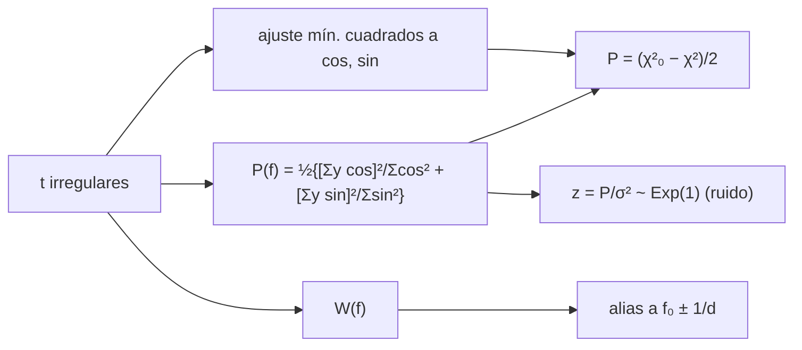

# B29-C19 — Análisis de series temporales irregularmente muestreadas

<!-- nav:top -->
[🏠 Programa](../../../../README.md) · [📚 Bloque B29](../../../tronco-comun/B29-astronomia-temporal-y-exoplanetas.md) · [← Anterior: B29-C18 — Redes de seguimiento temporal](../B29-C18-redes-de-seguimiento-temporal/CLASE.md) · [Siguiente: B29-C20 — Proyecto de detección exoplanetaria →](../B29-C20-proyecto-de-deteccion-exoplanetaria/CLASE.md)
<!-- /nav -->

## 1. Ubicación, nivel y alcance

Clase 19 del bloque B29. Nivel N3. Las series astronómicas casi nunca tienen muestreo regular: hay noches sin datos, estaciones, huecos. Aquí calculas el **periodograma de Lomb–Scargle**, compruebas que equivale a un **ajuste por mínimos cuadrados** de una sinusoide, estudias la **función ventana** que genera **alias** y verificas que la potencia normalizada del ruido sigue una **distribución exponencial**. Usas mínimos cuadrados ([B29-C14](../B29-C14-estrellas-variables-periodicas/CLASE.md)), la distribución exponencial y la significancia de [B28-C13](../../B28/B28-C13-estadistica-de-significancia/CLASE.md). Los datos son sintéticos.

## 2. Por qué esta clase existe

Un periodograma sin cuidado señala alias en lugar del periodo verdadero, y una potencia alta puede ser una fluctuación del ruido. La decisión central: **¿qué picos son del periodo verdadero, cuáles son alias y qué potencia es significativa?**

## 3. Lo que podrás hacer al terminar

1. Calcular la potencia de Lomb–Scargle con el desfase `τ`.
2. Verificarla con el ajuste de `a cos ωt + b sin ωt`.
3. Calcular la función ventana `W(f)`.
4. Identificar alias en `f₀ ± 1 d⁻¹`.
5. Comprobar por Monte Carlo la distribución del ruido.
6. Distinguir significancia local de global.

La evidencia es la **ficha de un periodograma irregular** del ejercicio 12 (sección 20).

## 4. Con qué llegas y cómo comprobarlo

1. ¿Qué es la transformada de Fourier discreta?
2. ¿Qué es una función ventana?
3. ¿Qué es un alias?
4. ¿Qué es una distribución exponencial?
5. ¿Qué es la significancia local?

<details>
<summary>Ver respuestas</summary>

1. La descomposición en frecuencias de una serie. 2. La respuesta del muestreo a una frecuencia. 3. Un pico espurio causado por el muestreo. 4. La de `e^{−z}`. 5. La probabilidad en una sola frecuencia.
</details>

Con cuatro o cinco aciertos, sigue; si no, repasa B29-C14.

## 5. Un caso de contexto y un caso sintético

VanderPlas presenta el periodograma de Lomb–Scargle como algoritmo para señales periódicas en series irregulares (S2, resumen). Esta clase no usa datos reales: simula `81` medidas en `40 d` (noches con datos con probabilidad `0,7` y 3 medidas por noche) de una señal de frecuencia `0,37 d⁻¹` y amplitud `1` con ruido unitario. Es el **ejemplo conductor**.

## 6. Vocabulario

El **periodograma** `P(f)`. El **desfase** `τ` hace ortogonales los términos coseno y seno. La **función ventana** `W(f) = |Σe^{−2πift}|/N`. El **alias** es el pico espurio a `f₀ ± 1/Δ`. La **potencia normalizada** `z = P/σ²`. La **significancia** compara `z` con `e^{−z}`.

## 7. Modelo mental: ver una rueda con una luz estroboscópica

Con una luz que parpadea una vez al día, una rueda que gira a 1,37 vueltas por día parece girar a 0,37: los alias son lo que el muestreo no distingue.



*Descripción textual:* con los tiempos se calcula la potencia de Lomb–Scargle, que coincide con el ajuste de mínimos cuadrados; la función ventana explica los alias; bajo el ruido la potencia normalizada es exponencial.

Analogía: una luz estroboscópica. Límite: se suponen ruido blanco y varianza conocida.

## 8. La explicación, paso a paso

### 8.1 Equivalencia con mínimos cuadrados

La fórmula clásica y el ajuste de una sinusoide por ecuaciones normales coinciden a menos de `10⁻⁹` relativo en `f = 0,05; 0,37; 0,63; 1,37; 2,9 d⁻¹`.

### 8.2 Picos

| pico | `f` (d⁻¹) | `P(f)` |
|---|---|---|
| 1 | 0,366 | 27,462 |
| 2 | 1,368 | 24,795 |
| 3 | 0,636 | 17,911 |
| 4 | 2,368 | 13,216 |

El pico principal está en `0,366` (verdadero `0,37`) y los alias en `1,368` (`f₀ + 1`) y `0,636` (`1 − f₀`) tienen potencias del 90 % y 65 % de la del principal.

### 8.3 Función ventana

| `f` (d⁻¹) | `W(f)` |
|---|---|
| 0,0 | 1,000 |
| 0,5 | 0,187 |
| 1,0 | 0,865 |
| 1,5 | 0,196 |
| 2,0 | 0,525 |

`W(1) = 0,865`: el muestreo nocturno hace que `f` y `f ± 1` sean casi indistinguibles.

### 8.4 Ruido

En 4000 series de ruido puro en `f = 0,37`: media de `z` `0,9687 ± 0,0158` (esperada `1`) y fracción con `z > 3` `0,0503`, frente a `e⁻³ = 0,0498 ± 0,0034`.

### 8.5 Lectura

Un pico de `z = 27` es altísimo (`e^{−27} ≈ 10⁻¹²` local), pero hay que contar el número de frecuencias independientes para el significado global. Ante dos picos casi iguales, el muestreo no permite decidir cuál es el verdadero sin más datos.

## 9. Magnitudes, símbolos y unidades

| Símbolo | Qué es | Unidad | Valor / nota |
|---|---|---|---|
| `f₀` | frecuencia verdadera | d⁻¹ | 0,37 (ilustrativa) |
| `P(f)` | potencia de Lomb–Scargle | — | 27,46 (pico) |
| `z` | potencia normalizada | — | `P/σ²` |
| `W(f)` | función ventana | — | 0,865 (en 1 d⁻¹) |
| `N` | medidas | — | 81 |
| `σ` | ruido | — | 1 (conocido) |

## 10. Convenciones y referencias

Series sin media; ruido blanco de varianza conocida; semilla `20261109`; el calendario, la frecuencia y la amplitud son **ilustrativos**.

## 11. De dónde sale lo que afirmamos

| ID | Fuente | Localizador | Respalda | Estado |
|---|---|---|---|---|
| S1 | Cálculo propio: Lomb–Scargle, mínimos cuadrados y Monte Carlo | implementado en `lomb_scargle.py` | todas las tablas | Verificado por equivalencia y simulación |
| S2 | VanderPlas, arXiv:1703.09824 | https://arxiv.org/abs/1703.09824 | Lomb–Scargle para series con muestreo desigual | Solo resumen, consultado el 2026-11-09 |

Límites: S2 solo resumen; la distribución exponencial se contrasta por simulación y no se consultó su fuente original; los datos son sintéticos.

## 12. Cómo ver los alias

| Frecuencia | Origen | `P` |
|---|---|---|
| 0,366 | verdadero | 27,5 |
| 1,368 | alias `f₀ + 1` | 24,8 |
| 0,636 | alias `1 − f₀` | 17,9 |
| 2,368 | alias `f₀ + 2` | 13,2 |

Descripción larga: el muestreo nocturno produce copias del pico principal a distancias de `1 d⁻¹`.

## 13. Ejemplo trabajado: alias esperado

**Paso 1 · Muestreo.** Una medida por noche: periodo de muestreo `1 d`.

**Paso 2 · Frecuencia de muestreo.** `f_s = 1 d⁻¹`.

**Paso 3 · Alias.** `f₀ ± f_s = 1,37` y `0,63`.

**Paso 4 · Sentido.** Los picos observados (`1,368` y `0,636`) coinciden.

## 14. Distintas formas de describir el periodograma

**Por potencia:** `P(f)`. **Por ventana:** `W(f)`. **Por significancia:** `e^{−z}`. **Por ajuste:** `Δχ²/2`.

## 15. Práctica guiada

**Ejercicio 1 · con los pasos indicados.** Frecuencia del alias `f₀ + 1`. *Pasos:* suma.

<details><summary>Solución comentada</summary>

`1,37 d⁻¹`.
</details>

**Ejercicio 2 · con una pista.** Probabilidad local de `z > 3`.

<details><summary>Solución comentada</summary>

`e⁻³ = 0,0498`.
</details>

**Ejercicio 3 · casi autónomo.** Cociente de potencias alias/principal.

<details><summary>Solución comentada</summary>

`24,795/27,462 = 0,903`.
</details>

## 16. Práctica autónoma, transferencia e integrador

**Ejercicio 4.** `z` con `P = 27,5` y `σ = 1`.

<details><summary>Solución comentada</summary>

`27,5`.
</details>

**Ejercicio 5.** Probabilidad local de `z > 27,5`.

<details><summary>Solución comentada</summary>

`e^{−27,5} = 1,1 × 10⁻¹²`.
</details>

**Ejercicio 6.** Frecuencias independientes en `0–1,5 d⁻¹` y `T = 40 d`.

<details><summary>Solución comentada</summary>

`~T Δf = 60`.
</details>

**Ejercicio 7.** FAP global aproximada para `z = 10`.

<details><summary>Solución comentada</summary>

`1 − (1 − e^{−10})^{60} = 2,7 × 10⁻³`.
</details>

**Ejercicio 8.** Desviaciones entre `0,9687` y `1`.

<details><summary>Solución comentada</summary>

`0,0313/0,0158 = 2,0`.
</details>

**Ejercicio 9 · transferencia.** Un compañero dice que el segundo pico es otra señal. Responde con 8.2 y 8.3.

<details><summary>Solución comentada</summary>

Está a `f₀ + 1`, es decir, el alias nocturno; hay que observar con otro muestreo para distinguirlo.
</details>

**Ejercicio 10 · transferencia.** ¿Por qué el desfase `τ`?

<details><summary>Solución comentada</summary>

Para que las funciones coseno y seno sean ortogonales sobre los tiempos y el periodograma equivalga a un ajuste.
</details>

**Ejercicio 11 · transferencia.** ¿Qué valida la media de `z`?

<details><summary>Solución comentada</summary>

La normalización del periodograma bajo el ruido; no la señal.
</details>

**Ejercicio 12 · integrador.** Elabora tu *ficha de un periodograma irregular*: equivalencia con mínimos cuadrados, picos y alias, ventana y distribución del ruido.

<details><summary>Solución modelo</summary>

Secciones 8.1–8.4.
</details>

## 17. Laboratorio: Lomb–Scargle

El script [lomb_scargle.py](lomb_scargle.py) calcula la potencia (**comprueba** `10⁻⁹` frente a mínimos cuadrados), los picos y la ventana, y la distribución del ruido (**comprueba** 3 errores en la media y 4 en la fracción).

**Datos:** sin constantes; todo **sintético** con semilla fija. **Predice antes de ejecutar:** ¿dónde estarán los alias? (a ±1 d⁻¹ del pico.) **Ejecución del 2026-11-09 (Python 3.12.9):**

```text
Python 3.12.9 (biblioteca estandar)
81 medidas en 40 dias (noches con datos con probabilidad 0.7, 3 medidas por noche)
Lomb-Scargle clasico = minimos cuadrados de una sinusoide (diferencia relativa < 1e-9) en cinco frecuencias
 pico   f [1/d]      P(f)  P/sigma^2
    1     0.366    27.462     27.462
    2     1.368    24.795     24.795
    3     0.636    17.911     17.911
    4     2.368    13.216     13.216
frecuencia verdadera = 0.37 ; pico principal en 0.366 ; alias esperados en 1.37 y 0.63
 f [1/d]  ventana W(f)
     0.0         1.000
     0.5         0.187
     1.0         0.865
     1.5         0.196
     2.0         0.525
ruido puro, f = 0.37: media de z = 0.9687 +/- 0.0158 (esperada 1) ; fraccion con z > 3 = 0.0503 (esperada exp(-3) = 0.0498 +/- 0.0034)
Pruebas superadas.
```

```bash
python programa/clases/B29/B29-C19-analisis-de-series-temporales-irregularmente-muestreadas/lomb_scargle.py
```

**Límites:** ruido blanco, sin media flotante, sin ponderación por errores individuales.

## 18. Errores frecuentes y cómo corregirlos

**Tomar un alias por una señal.** Se corrige con el ejercicio 9.

**Olvidar la ventana.** Se corrige con 8.3.

**Confundir significancia local y global.** Se corrige con el ejercicio 7.

**No normalizar por la varianza.** Se corrige con el ejercicio 4.

**Tomar la serie por real.** Se corrige con la sección 10.

## 19. Cómo sabrás que vas bien

Tras 8.1: ¿qué equivale la potencia? Si dudas, ejercicio 10. Tras 8.2: ¿dónde están los alias? Ejercicio 1. Tras el laboratorio: ¿qué valida? (la normalización).

## 20. Qué entregas y cómo se evalúa

El producto es tu **ficha de un periodograma irregular** (ejercicio 12).

| Criterio | Inicial | En desarrollo | Logrado | Destacado |
|---|---|---|---|---|
| Conceptos | Los confunde | Parciales | Potencia, ventana, alias | Explica la significancia global |
| Cálculo | Sin unidades | Con errores | Tablas completas | Calcula FAP |
| Numérico | Sin comprobar | Un caso | Equivalencia y ruido | Interpreta el desvío del 2σ |
| Fuentes | Sin fuente | Sin fecha | S1–S2 con fecha | Declara S2 como resumen |
| Límites | No los nombra | Uno | Tres | Discute ruido rojo |

**Condiciones críticas (no se compensan con promedio):** rotular los datos como sintéticos; no tomar alias por señales; citar solo lo consultado.

## 21. Ética, seguridad y límites

Clase educativa: no es una canalización de detección de periodicidad. Accesibilidad: tablas equivalentes a las gráficas, fórmulas en texto, ejercicios sin conexión.

## 22. Para cerrar y seguir

La potencia de Lomb–Scargle coincide con un ajuste sinusoidal a `10⁻⁹`, el muestreo nocturno crea alias a `±1 d⁻¹` con el 90 % de la potencia, y bajo el ruido `z` es exponencial. Queda una pregunta: ¿cómo se combina todo en un proyecto de detección?

**Glosario español–inglés.** serie irregular · *unevenly sampled series*; periodograma de Lomb–Scargle · *Lomb–Scargle periodogram*; función ventana · *window function*; alias · *alias*; potencia normalizada · *normalized power*; probabilidad de falsa alarma · *false alarm probability*.

**Continuidad.** [B29-C20](../B29-C20-proyecto-de-deteccion-exoplanetaria/CLASE.md) cierra el bloque con un proyecto de detección exoplanetaria.

**Referencias:** ver sección 11.

<!-- nav:bottom -->
---

[← Anterior: B29-C18 — Redes de seguimiento temporal](../B29-C18-redes-de-seguimiento-temporal/CLASE.md) · [📚 Bloque B29](../../../tronco-comun/B29-astronomia-temporal-y-exoplanetas.md) · [Siguiente: B29-C20 — Proyecto de detección exoplanetaria →](../B29-C20-proyecto-de-deteccion-exoplanetaria/CLASE.md)
<!-- /nav -->
