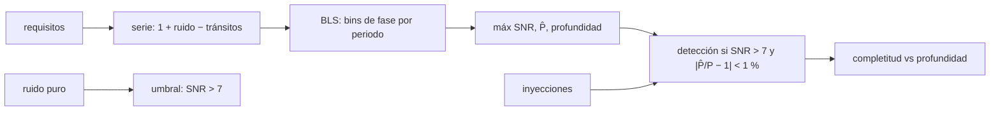

# B29-C20 — Proyecto de detección exoplanetaria

<!-- nav:top -->
[🏠 Programa](../../../../README.md) · [📚 Bloque B29](../../../tronco-comun/B29-astronomia-temporal-y-exoplanetas.md) · [← Anterior: B29-C19 — Análisis de series temporales irregularmente muestreadas](../B29-C19-analisis-de-series-temporales-irregularmente-muestreadas/CLASE.md) · [Siguiente: B30-C01 — Estructura interna del Sol →](../../B30/B30-C01-estructura-interna-del-sol/CLASE.md)
<!-- /nav -->

## 1. Ubicación, nivel y alcance

Clase 20 y última del bloque B29. Nivel N3. Un proyecto de detección es un problema de ingeniería con **requisitos**, **componentes** y **criterios de comprobación**. Aquí montas una cadena mínima: una serie fotométrica sintética, una **búsqueda de tránsitos por ajuste de cajas**, y una **campaña de inyección y recuperación** para medir la **completitud** en función de la profundidad. Usas los tránsitos de [B29-C01](../B29-C01-transitos-planetarios/CLASE.md), la fotometría de [B29-C02](../B29-C02-curvas-de-luz-fotometricas/CLASE.md), los falsos positivos de [B29-C08](../B29-C08-falsos-positivos-de-transito/CLASE.md) y la significancia de [B28-C13](../../B28/B28-C13-estadistica-de-significancia/CLASE.md). Todo es sintético.

## 2. Por qué esta clase existe

Una detección sin completitud no se puede contar: ¿cuántos planetas se perdieron? La inyección y recuperación responde. La decisión central: **¿a partir de qué profundidad la búsqueda recupera el planeta y qué requisitos de ruido y cadencia lo garantizan?**

## 3. Lo que podrás hacer al terminar

1. Escribir los requisitos de una búsqueda (cadencia, duración, ruido, periodos).
2. Generar una serie con un tren de tránsitos en caja.
3. Implementar una búsqueda de cajas con bins de fase.
4. Establecer la distribución del máximo de SNR en ruido puro.
5. Medir la completitud por inyección y recuperación.
6. Redactar un informe con criterios de comprobación.

La evidencia es el **informe de detección con completitud** del ejercicio 12 (sección 20).

## 4. Con qué llegas y cómo comprobarlo

1. ¿Qué es un tránsito en caja?
2. ¿Qué es una relación señal-ruido?
3. ¿Qué es un periodo de prueba?
4. ¿Qué es la completitud?
5. ¿Qué es una inyección?

<details>
<summary>Ver respuestas</summary>

1. Una caída rectangular de flujo. 2. El cociente entre la profundidad y su incertidumbre. 3. Un periodo de la rejilla de búsqueda. 4. La fracción de señales inyectadas que se recuperan. 5. Insertar una señal conocida en los datos.
</details>

Con cuatro o cinco aciertos, sigue; si no, repasa B29-C01.

## 5. Un caso de contexto y un caso sintético

Kovács, Zucker y Mazeh estudian las características estadísticas de un algoritmo de ajuste de cajas para buscar tránsitos periódicos y muestran que el parámetro crucial es la relación señal-ruido efectiva (S2, resumen). Esta clase no reproduce ese análisis: genera `720` muestras (cadencia de 2 h, 60 d, ruido `400 ppm`) y busca periodos entre `2` y `20 d` con una rejilla de `1153` valores. Es el **ejemplo conductor**.

## 6. Vocabulario

El **ajuste de cajas** (BLS) busca una caída rectangular periódica. La **rejilla de periodos** es geométrica. La **relación señal-ruido** `SNR = profundidad/(σ√(1/n_dentro + 1/n_fuera))`. La **inyección–recuperación** mide la completitud. El **umbral** (`SNR > 7`) decide una detección. El **alias de periodo** es un múltiplo o submúltiplo del verdadero.

## 7. Modelo mental: buscar una moneda en un campo sembrado

Se camina por el campo con una cuadrícula de pasos de longitud variable; una moneda enterrada (el tránsito) se encuentra solo si el paso la alcanza y el campo no tiene demasiado ruido. Se entierran monedas conocidas para medir cuántas se encuentran.



*Descripción textual:* los requisitos fijan la serie; el BLS busca el periodo con mayor relación señal-ruido; el ruido puro fija el umbral; las inyecciones con profundidades conocidas dan la completitud.

Analogía: monedas enterradas. Límite: ruido blanco, un solo planeta.

## 8. La explicación, paso a paso

### 8.1 Requisitos

Cadencia `2 h`, duración `60 d`, ruido `400 ppm`, tránsito de `3 h`, periodos `2–20 d`, umbral `SNR > 7`, recuperación del periodo al `1 %`.

### 8.2 Un caso ilustrativo

Con `P = 7,3 d` y profundidad `1500 ppm`: periodo hallado `7,2853 d`, profundidad `976 ppm`, `SNR = 8,4`. La profundidad hallada es menor que la inyectada (`65 %`) porque los bins de 3 h incluyen muestras fuera del tránsito.

### 8.3 El ruido puro

El máximo de SNR en 12 series de ruido puro va de `3,84` a `4,56` (media `4,24`), por debajo del umbral `7`.

### 8.4 Completitud

Con 10 inyecciones por profundidad y periodos aleatorios entre `2,5` y `15 d`:

| profundidad (ppm) | inyecciones | recuperadas | completitud |
|---|---|---|---|
| 500 | 10 | 0 | 0,00 |
| 1000 | 10 | 5 | 0,50 |
| 1500 | 10 | 9 | 0,90 |
| 3000 | 10 | 9 | 0,90 |

### 8.5 Lectura

La búsqueda recupera casi todos los planetas con `≥ 1500 ppm` (SNR ≈ 10 o más) y la mitad con `1000 ppm`. La fracción de `0,90` en `3000 ppm` refleja la dispersión estadística de 10 inyecciones y algún periodo mal recuperado; hacen falta muchas más inyecciones para curvas suaves.

## 9. Magnitudes, símbolos y unidades

| Símbolo | Qué es | Unidad | Valor / nota |
|---|---|---|---|
| `cad` | cadencia | h | 2 |
| `T` | duración | d | 60 |
| `σ` | ruido por muestra | ppm | 400 |
| `D` | duración del tránsito | h | 3 |
| `d` | profundidad | ppm | 500–3000 |
| `SNR` | relación señal-ruido | — | umbral 7 |

## 10. Convenciones y referencias

Ruido blanco; tránsito en caja; búsqueda en periodos geométricos (`ratio = 1,002`); semilla `20261109`; todos los parámetros son **ilustrativos**.

## 11. De dónde sale lo que afirmamos

| ID | Fuente | Localizador | Respalda | Estado |
|---|---|---|---|---|
| S1 | Cálculo propio: BLS con bins de fase e inyección–recuperación | implementado en `proyecto.py` | todas las tablas | Verificado con un caso ilustrativo y el ruido puro |
| S2 | Kovács, Zucker y Mazeh, arXiv:astro-ph/0206099 | https://arxiv.org/abs/astro-ph/0206099 | el parámetro crucial es la relación señal-ruido efectiva | Solo resumen, consultado el 2026-11-09 |

Límites: S2 solo resumen; esta implementación es una versión simplificada del ajuste de cajas; la completitud se estima con pocas inyecciones.

## 12. Cómo ver la completitud

| profundidad | completitud |
|---|---|
| 500 ppm | 0 % |
| 1000 ppm | 50 % |
| 1500 ppm | 90 % |
| 3000 ppm | 90 % |

Descripción larga: la completitud sube de 0 a casi 1 en una pequeña ventana de profundidades alrededor de `1000 ppm`, y se satura por debajo de 1 por la estadística de pocas inyecciones.

## 13. Ejemplo trabajado: SNR esperada

**Paso 1 · Muestras en tránsito.** `8 tránsitos × 1,5 muestras = 12` (aprox.).

**Paso 2 · Error de la profundidad.** `400/√12 = 115 ppm`.

**Paso 3 · SNR.** `1000/115 = 8,7`.

**Paso 4 · Sentido.** Por encima del umbral `7`: una profundidad de `1000 ppm` es detectable en promedio.

## 14. Distintas formas de describir el proyecto

**Por requisitos:** cadencia, ruido, rejilla. **Por detección:** SNR y periodo. **Por completitud:** fracción. **Por informe:** criterios y resultados.

## 15. Práctica guiada

**Ejercicio 1 · con los pasos indicados.** Muestras en `60 d` con cadencia de `2 h`. *Pasos:* `60 × 12`.

<details><summary>Solución comentada</summary>

`720`.
</details>

**Ejercicio 2 · con una pista.** Número de tránsitos para `P = 7,3 d`.

<details><summary>Solución comentada</summary>

`60/7,3 = 8,2`.
</details>

**Ejercicio 3 · casi autónomo.** SNR esperada para `500 ppm`.

<details><summary>Solución comentada</summary>

`4,3`, por debajo del umbral.
</details>

## 16. Práctica autónoma, transferencia e integrador

**Ejercicio 4.** SNR esperada para `3000 ppm`.

<details><summary>Solución comentada</summary>

`26`.
</details>

**Ejercicio 5.** Profundidad mínima para `SNR = 7`.

<details><summary>Solución comentada</summary>

`7 × 115 = 805 ppm`.
</details>

**Ejercicio 6.** Cociente profundidad hallada/inyectada del caso ilustrativo.

<details><summary>Solución comentada</summary>

`976/1500 = 0,65`.
</details>

**Ejercicio 7.** Margen entre el umbral y el máximo del ruido puro.

<details><summary>Solución comentada</summary>

`7 − 4,56 = 2,4`.
</details>

**Ejercicio 8.** Error estadístico de una completitud de `0,9` con `10` inyecciones.

<details><summary>Solución comentada</summary>

`√(0,9 × 0,1/10) = 0,095`.
</details>

**Ejercicio 9 · transferencia.** Un compañero dice que `0,90` en `3000 ppm` demuestra que se pierde el 10 % de los planetas grandes. Responde con 8.5.

<details><summary>Solución comentada</summary>

Con 10 inyecciones el error es `±0,095`; hay que repetir con más inyecciones para decidirlo.
</details>

**Ejercicio 10 · transferencia.** ¿Por qué se exige recuperar el periodo al `1 %`?

<details><summary>Solución comentada</summary>

Para evitar contar como recuperada una detección con un alias del periodo.
</details>

**Ejercicio 11 · transferencia.** ¿Qué valida el ruido puro?

<details><summary>Solución comentada</summary>

Que el umbral de `SNR = 7` deja margen frente al máximo del ruido; no que el ruido real sea blanco.
</details>

**Ejercicio 12 · integrador.** Elabora tu *informe de detección con completitud*: requisitos, caso ilustrativo, ruido puro y tabla de completitud con una conclusión.

<details><summary>Solución modelo</summary>

Secciones 8.1–8.5.
</details>

## 17. Laboratorio: BLS e inyección–recuperación

El script [proyecto.py](proyecto.py) implementa el ajuste de cajas, el caso ilustrativo (**comprueba** `1 %` en el periodo) y la completitud (**comprueba** no decrecimiento con tolerancia estadística).

**Datos:** sin constantes; todo **sintético** con semilla fija. **Predice antes de ejecutar:** ¿qué completitud tiene `500 ppm`? (cero.) **Ejecución del 2026-11-09 (Python 3.12.9):**

```text
Python 3.12.9 (biblioteca estandar)
720 muestras (cadencia 2 h, 60 d), 1153 periodos de prueba entre 2 y 20 d, ruido 400 ppm
caso ilustrativo: P = 7.3 d, profundidad 1500 ppm -> periodo hallado = 7.2853 d ; profundidad = 976 ppm ; SNR = 8.4
ruido puro: SNR maximo sobre la rejilla (12 series) = 3.84 - 4.56 (media 4.24); umbral de recuperacion = 7
 profundidad [ppm]  inyecciones  recuperadas  completitud
               500           10            0         0.00
              1000           10            5         0.50
              1500           10            9         0.90
              3000           10            9         0.90
Pruebas superadas.
```

```bash
python programa/clases/B29/B29-C20-proyecto-de-deteccion-exoplanetaria/proyecto.py
```

**Límites:** ruido blanco, caja única, pocas inyecciones, sin ruido rojo ni variabilidad estelar.

## 18. Errores frecuentes y cómo corregirlos

**No medir el ruido puro.** Se corrige con el ejercicio 11.

**Contar alias como detecciones.** Se corrige con el ejercicio 10.

**Concluir con pocas inyecciones.** Se corrige con el ejercicio 9.

**Olvidar los requisitos.** Se corrige con la sección 8.1.

**Tomar la completitud por real.** Se corrige con la sección 10.

## 19. Cómo sabrás que vas bien

Tras 8.2: ¿qué periodo se halla? Si dudas, ejemplo 13. Tras 8.4: ¿cuándo se recupera el 50 %? A `1000 ppm`. Tras el laboratorio: ¿qué valida? (el ruido puro y las inyecciones).

## 20. Qué entregas y cómo se evalúa

El producto es tu **informe de detección con completitud** (ejercicio 12).

| Criterio | Inicial | En desarrollo | Logrado | Destacado |
|---|---|---|---|---|
| Conceptos | Los confunde | Parciales | Requisitos, BLS, completitud | Explica el umbral y los alias |
| Cálculo | Sin unidades | Con errores | Tablas completas | Calcula SNR esperada |
| Numérico | Sin comprobar | Un caso | Ruido e inyecciones | Interpreta la estadística |
| Fuentes | Sin fuente | Sin fecha | S1–S2 con fecha | Declara que todo es sintético |
| Límites | No los nombra | Uno | Tres | Discute ruido rojo |

**Condiciones críticas (no se compensan con promedio):** rotular todo como sintético; no declarar completitudes con pocas inyecciones sin su error; citar solo lo consultado.

## 21. Ética, seguridad y límites

Clase educativa: no es una canalización de descubrimiento de planetas. Accesibilidad: tablas equivalentes a las gráficas, fórmulas en texto, ejercicios sin conexión.

## 22. Para cerrar y seguir

Una búsqueda de cajas recupera `P = 7,29 d` con `SNR = 8,4`, el ruido puro no supera `4,6` y la completitud sube de 0 a 0,5 a 0,9 entre 500 y 1500 ppm. Con esta clase se cierra el bloque B29; el siguiente es [B30](../../../tronco-comun/B30-heliofisica-y-fisica-de-plasmas.md).

**Glosario español–inglés.** ajuste de cajas · *box-fitting search (BLS)*; inyección–recuperación · *injection–recovery*; completitud · *completeness*; relación señal-ruido · *signal-to-noise ratio*; umbral · *threshold*; alias de periodo · *period alias*.

**Continuidad.** Fin del bloque B29.

**Referencias:** ver sección 11.

<!-- nav:bottom -->
---

[← Anterior: B29-C19 — Análisis de series temporales irregularmente muestreadas](../B29-C19-analisis-de-series-temporales-irregularmente-muestreadas/CLASE.md) · [📚 Bloque B29](../../../tronco-comun/B29-astronomia-temporal-y-exoplanetas.md) · [Siguiente: B30-C01 — Estructura interna del Sol →](../../B30/B30-C01-estructura-interna-del-sol/CLASE.md)
<!-- /nav -->
